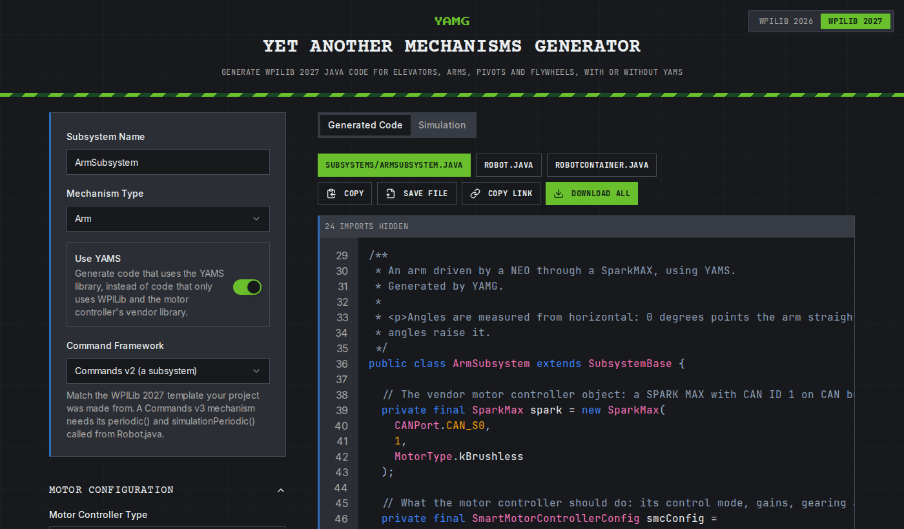

# Welcome

Welcome to the Yet Another Mechanism System (YAMS) documentation.

<figure><figcaption></figcaption></figure>

YAMS fuses simulation and real control as closely as possible to real life. You can debug and program your robot without the actual robot. You can also program your robot before it is built.

YAMS targets WPILib 2027 (`2027_alpha7`) and the SystemCore. Upgrading a 2026 project? See [Upgrading from 2026 to 2027](upgrading-from-2026-to-2027.md).

### Installation

YAMS ships as two vendordeps, one per WPILib command framework. Install **only one** of them; they conflict with each other.

| Command framework | Vendordep | Online URL |
| --- | --- | --- |
| Commands v2 (`org.wpilib.command2`, Java and C++) | Yet Another Mechanism System (Commands v2) | `https://cdn.yassrobotics.com/yams_commands2.json` |
| Commands v3 (`org.wpilib.command3`, Java only) | Yet Another Mechanism System (Commands v3) | `https://cdn.yassrobotics.com/yams_commands3.json` |

If you are not sure which one you need, use Commands v2. The [tutorials](tutorials/project-setup.md) have a tab for Java with Commands v2, Java with Commands v3, and C++.



1. In VS Code, open the command palette with <kbd>Ctrl+Shift+P</kbd> (<kbd>Cmd+Shift+P</kbd> on macOS).
2. Run **WPILib: Manage Vendor Libraries**, then **Install new libraries (online)**.
3. Paste the vendordep URL for your command framework from the table above and press Enter.



1. Install WPILib 2027 (`2027_alpha7`) first, which creates the `2027_alpha7` WPILib home folder.
2. Download `<version>-YAMS-Offline.zip` from the [YAMS GitHub releases](https://github.com/Yet-Another-Software-Suite/YAMS/releases).
3. Extract it into the WPILib home folder, so its `maven` and `vendordeps` folders merge with the existing ones:
   * **Windows:** `C:\Users\Public\wpilib\2027_alpha7`
   * **macOS and Linux:** `~/wpilib/2027_alpha7`
4. In VS Code, run **WPILib: Manage Vendor Libraries**, then **Install new libraries (offline)**, and pick **Yet Another Mechanism System (Commands v2)** or **Yet Another Mechanism System (Commands v3)**.



YAMS maven artifacts are served from `https://cdn.yassrobotics.com/`.

### Get started with YAMG

The quickest way to get started is [YAMG](https://yamg.yassrobotics.com/), the Yet Another Mechanisms Generator. Fill in a form about your mechanism and it writes the code for you, ready to copy into your project.

<figure><figcaption>
YAMG generating an arm with YAMS.
</figcaption></figure>

1. Pick your WPILib version with the toggle at the top right: 2027, or 2026 for a 2026 project.
2. Turn on **Use YAMS**. Without it, YAMG writes code that uses only WPILib and the motor controller's vendor library.
3. Name your subsystem and pick the mechanism type: an elevator, an arm, a pivot or a flywheel.
4. Pick the command framework that matches the vendordep you installed: Commands v2 or Commands v3.
5. Fill in your motor controller, motor, gearing, limits and gains.
6. Copy each generated file into your project, or press **Download All**. Along with the mechanism, YAMG writes `Robot.java` and, for Commands v2, `RobotContainer.java` with controller bindings, or, for Commands v3, a teleop op mode.

**Copy Link** puts the whole form into a link, so you can share the mechanism with your team or come back to it later.

The tutorials below build the same mechanisms step by step and explain each part.

### Jump right in

<table data-view="cards"><thead><tr><th></th><th></th><th></th><th data-hidden data-card-target data-type="content-ref"></th><th data-hidden data-card-cover data-type="files"></th><th data-hidden></th></tr></thead><tbody><tr><td><h4><i class="fa-bolt">:bolt:</i></h4></td><td><strong>Create an Arm</strong></td><td>Create your first Arm.</td><td><a href="tutorials/arm.md">arm.md</a></td><td></td><td></td></tr><tr><td><h4><i class="fa-leaf">:leaf:</i></h4></td><td><strong>Create an Elevator</strong></td><td>Create your first elevator.</td><td><a href="tutorials/elevator.md">elevator.md</a></td><td></td><td></td></tr><tr><td><i class="fa-crosshairs">:crosshairs:</i></td><td><strong>Create a shooter</strong></td><td>Create your first shooter.</td><td><a href="tutorials/shooter-flywheels.md">shooter-flywheels.md</a></td><td></td><td></td></tr></tbody></table>
