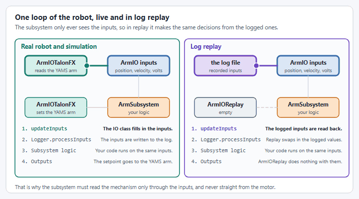
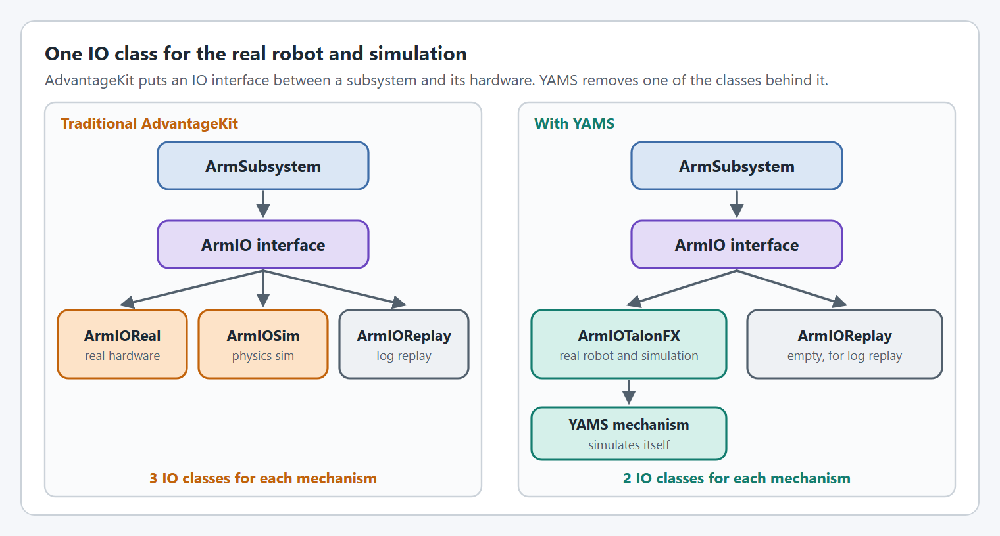

# AdvantageKit Integration

YAMS integrates seamlessly with [AdvantageKit](https://docs.advantagekit.org/), Team 6328's logging and replay framework. This guide shows how to use YAMS mechanisms with AdvantageKit's IO layer pattern for deterministic log replay.

## What is AdvantageKit?

[AdvantageKit](https://docs.advantagekit.org/getting-started/what-is-advantagekit) is a logging framework that records **all inputs** to your robot code, enabling deterministic replay in simulation. Unlike traditional logging that captures specific values, AdvantageKit captures everything flowing into your code, allowing you to:

* Replay matches exactly as they happened
* Add new logged fields after the fact
* Test code changes against real match data
* Debug issues that only occurred on the real robot

<figure><figcaption>
The subsystem only sees the inputs, so replaying the logged inputs replays its decisions.
</figcaption></figure>


AdvantageKit is optional. YAMS works perfectly without it using its built-in telemetry system. Consider AdvantageKit if you want deterministic log replay capabilities.


## Architecture overview

AdvantageKit uses an [IO interface pattern](https://docs.advantagekit.org/data-flow/recording-inputs/io-interfaces) to separate hardware interaction from business logic. Traditionally, this requires separate IO implementations for real hardware and simulation:

<figure><figcaption>
Traditional AdvantageKit needs three IO classes for each mechanism. With YAMS it is two.
</figcaption></figure>

## YAMS simplification: one IO class for real and sim

**With YAMS, you don't need separate Real and Sim IO implementations.** Every `SmartMotorController` wrapper (TalonFXWrapper, SparkWrapper, etc.) and every Mechanism class (Arm, Elevator, FlyWheel, SwerveModule, SwerveDrive, etc.) includes **passive simulation** that runs automatically when `Robot.isSimulation()` returns true.

The YAMS mechanism under the IO class picks real hardware or its own simulation by itself, based on `Robot.isSimulation()`.

This means:

* **One IO class** handles both real robot and simulation
* **No duplicate code** - configuration is written once
* **No SimWrapper needed** - real hardware wrappers simulate themselves
* **Physics are automatic** - based on your DCMotor, gearing, and mass/MOI configuration


**Key Insight**: When you create a `TalonFXWrapper`, `TalonFXSWrapper`, `SparkWrapper`, or any YAMS Mechanism, the simulation physics run automatically in sim mode. You write your IO class once using real hardware objects, and YAMS handles the rest.


## Tutorial

The tutorial builds an arm with the IO layer pattern, one step per page, and shows the elevator and shooter IO classes alongside it. Start with Step 0:

| Page                                                                                            | What it covers                                                                |
| ----------------------------------------------------------------------------------------------- | ----------------------------------------------------------------------------- |
| [Step 0: Install AdvantageKit and set up Robot](advantagekit/setup.md) | The vendor library, `build.gradle`, and `Robot` as a `LoggedRobot`. |
| [Step 1: Define the IO interface](advantagekit/io-interface.md) | The inputs each mechanism logs. |
| [Step 2: Implement the IO class](advantagekit/io-implementation.md)                             | One IO class per mechanism that works on the real robot and in simulation.    |
| [Steps 3 and 4: The subsystem and RobotContainer](advantagekit/subsystem-and-robotcontainer.md) | The subsystem that uses the IO class, and wiring it up.                       |
| [Log replay](advantagekit/log-replay.md)                                                        | Replaying a log, and the pattern in summary.                                  |
| [Swerve drive with AdvantageKit](advantagekit/swerve-drive.md)                                  | The same pattern for a YAMS swerve drive.                                     |
| [Without an IO layer](advantagekit/direct-subsystem.md)                                         | A simpler pattern that logs straight from the subsystem.                      |

## Benefits of YAMS + AdvantageKit

| Feature                     | Benefit                                                   |
| --------------------------- | --------------------------------------------------------- |
| **No Duplicate IO Classes** | Single IO class works for real robot AND simulation       |
| **Deterministic Replay**    | Debug issues from real matches using log replay           |
| **Automatic Physics**       | YAMS uses DCMotor, gearing, and mass/MOI for accurate sim |
| **Less Boilerplate**        | 2 IO classes instead of 3 per mechanism                   |
| **Consistent Behavior**     | Same code paths execute in real and sim modes             |
| **Flexible Hardware**       | Swap vendors by changing one IO class                     |

## Further reading

* [AdvantageKit Documentation](https://docs.advantagekit.org/)
* [What is AdvantageKit?](https://docs.advantagekit.org/getting-started/what-is-advantagekit)
* [IO Interfaces](https://docs.advantagekit.org/data-flow/recording-inputs/io-interfaces)
* [Template Projects](https://docs.advantagekit.org/getting-started/template-projects)
* [YAMS AdvantageKit Example (Commands v2)](https://github.com/Yet-Another-Software-Suite/YAMS/tree/master/examples/commands2/advantage_kit)
* [YAMS AdvantageKit Example (Commands v3)](https://github.com/Yet-Another-Software-Suite/YAMS/tree/master/examples/commands3/advantage_kit)
