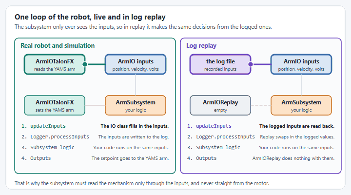

# Log replay

In [log replay](https://docs.advantagekit.org/getting-started/what-is-advantagekit), AdvantageKit reads the inputs from a log file instead of from the hardware, and runs your code on them again. This is the **one case** where you need a separate IO implementation: an empty one that does nothing.

<figure><figcaption><p>In replay the inputs come from the log, and the empty IO class drops the outputs.</p></figcaption></figure>



### Add the replay IO class

Create `ArmIOReplay.java` in the same `akit` folder as `ArmIO.java`. Every `ArmIO` method has an empty default, so the class is empty:



```java
package first.robot.subsystems.akit;

/**
 * Empty IO implementation for log replay.
 * AdvantageKit fills the inputs from the log, so there is no hardware to talk to.
 */
public class ArmIOReplay implements ArmIO {
  // Every method uses the empty default from ArmIO
}
```



```java
package first.robot.mechanisms.akit;

/**
 * Empty IO implementation for log replay.
 * AdvantageKit fills the inputs from the log, so there is no hardware to talk to.
 */
public class ArmIOReplay implements ArmIO {
  // Every method uses the empty default from ArmIO
}
```



**Check:** the project builds.



### Use it in replay mode

Only replay mode needs a different IO class. `Robot.currentMode` comes from [Make Robot a logged robot](setup.md#make-robot-a-logged-robot).



In `RobotContainer.java`, replace the line that creates the arm:

```java
  // Replay mode: the empty IO class, AdvantageKit fills the inputs from the log.
  // Real AND sim: the same IO class works for both.
  private final ArmSubsystem arm = new ArmSubsystem(
      Robot.currentMode == Robot.Mode.REPLAY ? subsystem -> new ArmIOReplay() : ArmIOTalonFX::new);
```

and add `import first.robot.subsystems.akit.ArmIOReplay;` to its imports.



In the `Robot` constructor, replace the line that creates the arm:

```java
    // Replay mode: the empty IO class, AdvantageKit fills the inputs from the log.
    // Real AND sim: the same IO class works for both.
    arm = new ArmMechanism(
        currentMode == Mode.REPLAY ? mechanism -> new ArmIOReplay() : ArmIOTalonFX::new);
```

and add `import first.robot.mechanisms.akit.ArmIOReplay;` to its imports.



**Check:** the project builds, and the simulation runs as before: `simMode` is still `Mode.SIM`.



### Get a log to replay

On the robot, `Robot` already writes a log file every time the code runs. Download it with AdvantageScope's **File > Download Logs**.

No robot yet? Record a log in simulation. Add a `WPILOGWriter` to the `SIM` case in `Robot`:

```java
      case SIM:
        // In simulation: publish to NetworkTables, and write a log file to the project's logs folder.
        Logger.addDataReceiver(new NT4Publisher());
        Logger.addDataReceiver(new WPILOGWriter());
        break;
```

Run the simulation, move the arm as in [Step 4](subsystem-and-robotcontainer.md#step-4-wire-it-up), then stop the simulation.

**Check:** a file named like `akit_26-11-10_11-05-49.wpilog` is in the `logs` folder of your project.



### Replay it

1. Open the log in AdvantageScope (**File > Open Log(s)**). `LogFileUtil.findReplayLog()` replays the log open in AdvantageScope.
2. In `Robot`, set `simMode` to `Mode.REPLAY`.
3. Run the simulation. It runs as fast as it can, and stops at the end of the log.

AdvantageKit writes the replayed values to a new log next to the one you replayed, with `_sim` at the end of its name, and opens it in AdvantageScope.

**Check:** open both logs. `Arm/PositionRotations` is the same in both.

When you are done, set `simMode` back to `Mode.SIM`.



## If it did not work

* **The simulation stops and asks `Enter path to file`:** no log was open in AdvantageScope. Open one there and run again, or set the `AKIT_LOG_PATH` environment variable to the log's full path.
* **The arm's values in the `_sim` log are all 0:** `RobotContainer` (or `Robot`, in Commands v3) still creates `ArmIOTalonFX` in replay, or the subsystem does not call `Logger.processInputs("Arm", inputs)`.
* **The `_sim` log differs from the original:** something the subsystem uses is not in its inputs. During replay only the `@AutoLog` inputs come from the log: anything read straight from a motor, a sensor or YAMS's own telemetry is live simulation instead. Add it to `ArmIOInputs`.


**Summary**: With YAMS + AdvantageKit, you only need **2 IO classes** per mechanism:

1. **One real IO class** (e.g., `ArmIOTalonFX`): works for both real robot and simulation
2. **One empty replay IO class** (e.g., `ArmIOReplay`): for log replay only

Compare this to traditional AdvantageKit which requires **3 IO classes** (Real, Sim, Replay).


## Pattern summary

The steps in this tutorial follow one pattern for using YAMS with AdvantageKit:

1. **The IO class builds the YAMS mechanism** (`Arm`, `Elevator`, `FlyWheel`, etc.), which simulates itself.
2. **It reads the inputs from the mechanism's `SmartMotorController`** (`mechanism.getMotor()`).
3. **It sends setpoints through the `SmartMotorController`**, such as `motor.setPosition(angle)` or `motor.setVelocity(velocity)`.
4. **The subsystem only uses the IO interface and the logged inputs**, so replay makes the same decisions as the robot did.

See the YAMS AdvantageKit examples for complete robot projects that log YAMS mechanisms with AdvantageKit: [Commands v2](https://github.com/Yet-Another-Software-Suite/YAMS/tree/master/examples/commands2/advantage_kit) and [Commands v3](https://github.com/Yet-Another-Software-Suite/YAMS/tree/master/examples/commands3/advantage_kit). They log from the subsystem without an IO layer, as in [Without an IO layer](direct-subsystem.md).
