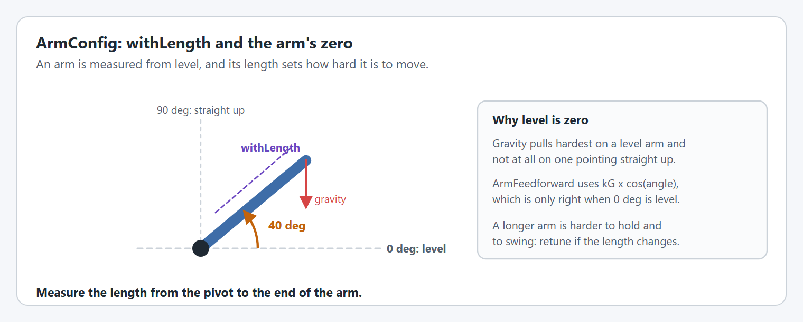
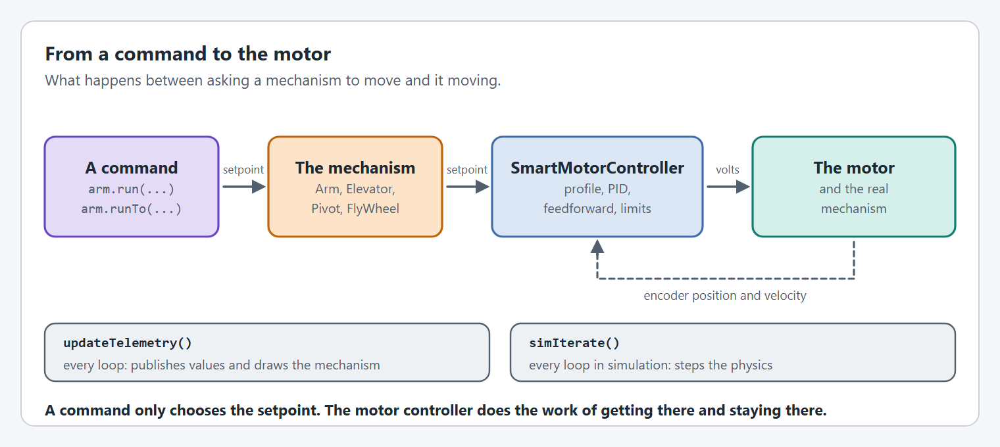
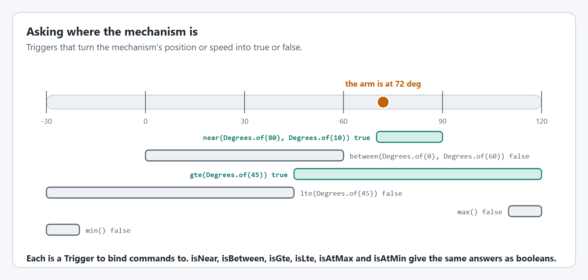
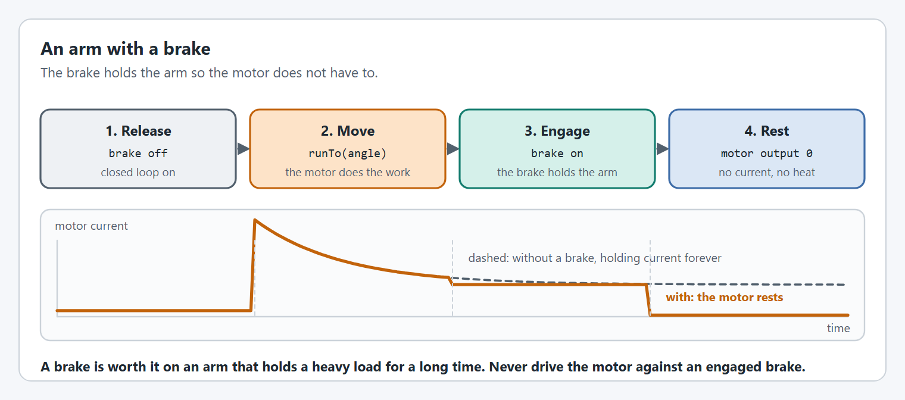

# Arms

An `Arm` is a mechanism that swings about a pivot and has to hold itself up against gravity: an intake arm, a shooter hood that tilts, a climber hook.

## How an arm works

<figure><figcaption><p>An arm is measured from level.</p></figcaption></figure>

Following WPILib, an arm is at 0° when it is parallel to the ground and 90° when it points straight up. Gravity pulls hardest on a level arm and not at all on a vertical one, and [`ArmFeedforward`](editor/config/feedforward.md#withfeedforward) uses that angle to work out how much voltage holds the arm still. So the arm's encoder has to read 0 when the arm is level.

If your mechanism does not need gravity accounted for, because it turns about a vertical axis or is balanced, use a [Pivot](turrets-wrists.md) instead.

<figure><figcaption><p>The same chain runs every mechanism.</p></figcaption></figure>

A YAMS `Arm` is a thin layer over one [`SmartMotorController`](editor/). The `Arm` knows what the mechanism is, turns your commands into setpoints, and runs its simulation. The motor controller does the closed loop control. Keep one mechanism per subsystem, so live tuning and command requirements stay simple.

## Creating an arm

The code is the same for Commands v2 and Commands v3 except for the package you import from and the class that owns the mechanism.



```java
import yams.commands2.config.SmartMotorControllerConfig;
import yams.commands2.mechanisms.Arm;

public class ArmSubsystem extends SubsystemBase
{
  private final SmartMotorControllerConfig motorConfig = new SmartMotorControllerConfig(this)
      .withControlMode(ControlMode.CLOSED_LOOP)
      .withGearing(new MechanismGearing(GearBox.fromReductionStages(3, 4)))
      .withClosedLoopController(4, 0, 0)
      .withFeedforward(new ArmFeedforward(0, 0.3, 1.2))
      .withTrapezoidalProfile(DegreesPerSecond.of(180), DegreesPerSecondPerSecond.of(90))
      .withSoftLimits(Degrees.of(-30), Degrees.of(100))
      .withStartingPosition(Degrees.of(0))
      .withMomentOfInertia(Feet.of(3), Pounds.of(4))
      .withStatorCurrentLimit(Amps.of(40))
      .withZeroPower(MotorMode.BRAKE)
      .withTelemetry("ArmMotor", TelemetryVerbosity.HIGH);
  private final SmartMotorController motor = new SparkWrapper(spark, DCMotor.getNEO(1), motorConfig);
  private final ArmConfig config = new ArmConfig()
      .withLength(Feet.of(3))
      .withHardLimits(Degrees.of(-100), Degrees.of(200))
      .withTelemetry("Arm", TelemetryVerbosity.HIGH);
  private final Arm arm = new Arm(config, motor);

  @Override
  public void periodic()
  {
    arm.updateTelemetry(); // every loop
  }

  @Override
  public void simulationPeriodic()
  {
    arm.simIterate(); // every loop, in simulation
  }
}
```

`this` is the `Subsystem`. The scheduler calls `periodic()` and `simulationPeriodic()` for you.



```java
import yams.commands3.config.SmartMotorControllerConfig;
import yams.commands3.mechanisms.Arm;

public class ArmMechanism implements Mechanism
{
  private final SmartMotorControllerConfig motorConfig = new SmartMotorControllerConfig(this)
      .withControlMode(ControlMode.CLOSED_LOOP)
      .withGearing(new MechanismGearing(GearBox.fromReductionStages(3, 4)))
      .withClosedLoopController(4, 0, 0)
      .withFeedforward(new ArmFeedforward(0, 0.3, 1.2))
      .withTrapezoidalProfile(DegreesPerSecond.of(180), DegreesPerSecondPerSecond.of(90))
      .withSoftLimits(Degrees.of(-30), Degrees.of(100))
      .withStartingPosition(Degrees.of(0))
      .withMomentOfInertia(Feet.of(3), Pounds.of(4))
      .withStatorCurrentLimit(Amps.of(40))
      .withZeroPower(MotorMode.BRAKE)
      .withTelemetry("ArmMotor", TelemetryVerbosity.HIGH);
  private final SmartMotorController motor = new SparkWrapper(spark, DCMotor.getNEO(1), motorConfig);
  private final ArmConfig config = new ArmConfig()
      .withLength(Feet.of(3))
      .withHardLimits(Degrees.of(-100), Degrees.of(200))
      .withTelemetry("Arm", TelemetryVerbosity.HIGH);
  private final Arm arm = new Arm(config, motor);

  public void periodic()
  {
    arm.updateTelemetry(); // every loop
  }

  public void simulationPeriodic()
  {
    arm.simIterate(); // every loop, in simulation
  }
}
```

`this` is the Commands v3 `Mechanism`. A `Mechanism` has no periodic hook, so call `periodic()` and `simulationPeriodic()` yourself from `Robot.robotPeriodic()`.



The options in `motorConfig` are explained in [SmartMotorControllerConfig](editor/config/), and the options in `config` in [ArmConfig](mechanism-configs/arm-config.md).

## Commands

Every command below exists with the same name in Commands v2 and Commands v3.

<figure><figcaption><p>When each kind of command ends.</p></figcaption></figure>

| Command                         | What it does                                       | Ends                                  |
| ------------------------------- | -------------------------------------------------- | ------------------------------------- |
| `setAngle(Angle)`, `run(Angle)` | Go to the angle and hold it. The two are the same. | Never, until interrupted.             |
| `runTo(Angle, Angle tolerance)` | Go to the angle.                                   | When the arm is within the tolerance. |
| `set(double)`                   | Output a duty cycle, with the closed loop off.     | Never, until interrupted.             |
| `setVoltage(Voltage)`           | Output a voltage, with the closed loop off.        | Never, until interrupted.             |

`setAngle`, `run` and `runTo` also take a `Supplier<Angle>`, and `set` and `setVoltage` a supplier too, for a setpoint that changes while the command runs.



```java
// In the subsystem
public Command hold(Angle angle)
{
  return arm.setAngle(angle); // never ends: a good default command
}

public Command moveTo(Angle angle)
{
  return arm.runTo(angle, Degrees.of(2)); // ends when it gets there
}

// In RobotContainer
arm.setDefaultCommand(arm.hold(Degrees.of(0)));
Command score = arm.moveTo(Degrees.of(80)).andThen(intake.eject());
```



```java
// In the mechanism
public Command hold(Angle angle)
{
  return run(coroutine -> coroutine.await(arm.setAngle(angle)))
      .withPriority(Command.LOWEST_PRIORITY) // so any other command can take over
      .named("Arm Hold");
}

public Command moveTo(Angle angle)
{
  return arm.runTo(angle, Degrees.of(2)); // ends when it gets there
}

// In Robot
arm.setDefaultCommand(arm.hold(Degrees.of(0)));
Command score = Command.noRequirements(coroutine -> {
  coroutine.await(arm.moveTo(Degrees.of(80)));
  coroutine.await(intake.eject());
}).named("Score");
```



When a command ends the motor keeps its last request, so a mechanism that reached its goal stays there until another command, usually the default one, gives it something else. [run() vs runTo() Commands](run-vs-runto.md) covers the pitfalls, including a default command undoing a `runTo()`.

## Setpoint functions

The commands above are built on plain functions that set the setpoint and return at once. Use them when you write your own command, or when something other than a command decides the setpoint, such as an AdvantageKit IO layer.

| Function                                   | What it does                                                                                                                                         |
| ------------------------------------------ | ---------------------------------------------------------------------------------------------------------------------------------------------------- |
| `setMechanismPositionSetpoint(Angle)`      | Go to this angle with closed loop control.                                                                                                           |
| `setMeasurementPositionSetpoint(Distance)` | Go to this distance. Needs a [circumference](editor/config/gearing-and-units.md#withmechanismcircumference).                                         |
| `setVoltageSetpoint(Voltage)`              | Output this voltage. Stops the closed loop.                                                                                                          |
| `setDutyCycleSetpoint(double)`             | Output this duty cycle, from -1 to 1. Stops the closed loop.                                                                                         |
| `getMechanismSetpoint()`                   | The current position setpoint as an angle, if there is one.                                                                                          |
| `getMeasurementSetpoint()`                 | The same setpoint as a distance. Empty if there is no setpoint or no [circumference](editor/config/gearing-and-units.md#withmechanismcircumference). |

```java
arm.setMechanismPositionSetpoint(Degrees.of(45));
```

These do not require the subsystem or mechanism, so nothing stops two callers fighting over the setpoint. Prefer the commands unless you need these. [Setpoint Methods vs Command Helpers](setpoint-methods.md) compares the two in detail.

## Asking where it is

<figure><figcaption><p>The same questions as Triggers or as booleans.</p></figcaption></figure>

| As a `Trigger`             | As a boolean                   | True when                                                                |
| -------------------------- | ------------------------------ | ------------------------------------------------------------------------ |
| `near(angle, within)`      | `isNear(angle, within)`        | The arm is within `within` of `angle`.                                   |
| `between(start, end)`      | `isBetween(start, end)`        | The arm is between the two angles.                                       |
| `gte(angle)`, `lte(angle)` | `isGte(angle)`, `isLte(angle)` | The arm is at or above, or at or below, the angle.                       |
| `max()`, `min()`           | `isAtMax()`, `isAtMin()`       | The arm is at its soft limit, or its hard limit if no soft limit is set. |

`getAngle()` returns the arm's current angle.

```java
arm.near(Degrees.of(80), Degrees.of(2)).onTrue(intake.eject());
if (arm.isNear(Degrees.of(0), Degrees.of(2))) { /* stowed */ }
```

## Absolute encoders

An arm that does not know where it is when the robot turns on has to be started in the same place every time. An absolute encoder removes that.


YAMS reads an absolute encoder through the motor controller, so it must be one that motor controller supports: see [Encoders](editor/config/encoders.md#withexternalencoder). For any other encoder, read it yourself and call `SmartMotorController.setEncoderPosition` once at startup.


[How do I use absolute encoders on my Arm?](../how-to/how-do-i-use-absolute-encoders-on-my-arm.md) has a complete example for each vendor, including the [zero offset](editor/config/encoders.md#withexternalencoderzerooffset) that makes the encoder read 0 when the arm is level.

## Arms with a brake

Some arms have a brake module that holds the arm so the motor can stop working. That saves battery and keeps the motor cool on an arm that holds a heavy load for a long time.

<figure><figcaption><p>The brake holds the arm once the motor stops driving it.</p></figcaption></figure>


This is not `MotorMode.BRAKE`. [Brake mode](editor/config/motor-basics.md#withzeropower) is electrical: it resists movement but cannot hold an arm up. A brake module is mechanical, and can.


Most brake modules are **automatic**: they bite on their own when the motor stops driving and let go when it drives again, with nothing for your code to command. Some are **manual**, released by a solenoid or a servo that your code controls. Check which yours is, because it changes what you can do. YAMS has no brake class of its own for either kind.

### What to aim for

These are suggestions, not rules. With an automatic brake you do not control when it bites, so you cannot always follow them. Get as close as your brake allows.

* **Let the brake do the holding.** Once the arm has arrived, stop driving the motor so the brake takes the load. An arm that keeps holding its setpoint against the brake gains nothing from having one.
* **Avoid driving against the brake.** A motor pushing on an engaged brake heats up and wears the brake. With an automatic brake some of this is unavoidable at the start of each move, while the brake lets go.
* **Avoid a default command that holds an angle.** It keeps the motor driving, which is the opposite of resting. A default command that rests the motor is ideal.
* **Allow for the brake's timing.** A brake takes a moment to bite and to let go. Expect a small lurch or sag at each end of a move, and allow for it where you can.

### Resting the motor

Resting means an output of zero with the closed loop controller stopped. If the closed loop kept running it would go on driving the arm to its setpoint, against the brake.

The `set(0)` helper command does all of it. It stops the closed loop controller, holds the output at zero, and starts the closed loop again when another command takes over. So you can ignore the closed loop entirely: make `set(0)` the arm's default command, and the arm rests whenever nothing else is moving it.

### With an automatic brake

There is nothing to command on the brake. Move with `runTo`, which ends when the arm arrives, and the default command rests the motor so the brake bites:



```java
// In the subsystem
public Command rest()
{
  return arm.set(0); // output 0, closed loop stopped; it restarts when another command takes over
}

public Command moveTo(Angle angle)
{
  return arm.runTo(angle, Degrees.of(2)); // driving releases the brake
}

// In RobotContainer
arm.setDefaultCommand(arm.rest());
```



```java
// In the mechanism
public Command rest()
{
  return run(coroutine -> coroutine.await(arm.set(0))) // output 0, closed loop stopped
      .withPriority(Command.LOWEST_PRIORITY)           // so any other command can take over
      .named("Arm Rest");
}

public Command moveTo(Angle angle)
{
  return arm.runTo(angle, Degrees.of(2)); // driving releases the brake
}

// In Robot
arm.setDefaultCommand(arm.rest());
```



### With a manual brake

If your code controls the brake, release it before the move and engage it after. The default command still rests the motor:



```java
// brake is your own actuator: a Solenoid, a Servo, or anything with an on and off
public Command moveTo(Angle angle)
{
  return runOnce(() -> brake.set(false))         // release
      .andThen(arm.runTo(angle, Degrees.of(2)))  // move
      .finallyDo(() -> brake.set(true));         // engage, even if interrupted
}

// In RobotContainer
arm.setDefaultCommand(arm.rest());               // then the motor rests
```



```java
// brake is your own actuator: a Solenoid, a Servo, or anything with an on and off
public Command moveTo(Angle angle)
{
  return run(coroutine -> {
    brake.set(false);                                  // release
    coroutine.await(arm.runTo(angle, Degrees.of(2)));  // move
    brake.set(true);                                   // engage
  }).whenCanceled(() -> brake.set(true)).named("Arm Move And Brake");
}

// In Robot
arm.setDefaultCommand(arm.rest());                     // then the motor rests
```




If you rest the motor yourself with `arm.setDutyCycleSetpoint(0)` instead of the `set(0)` command, nothing starts the closed loop controller again for you. Call `arm.getMotorController().startClosedLoopController()` before the next move.


Soft limits still apply while the arm moves, with either kind of brake. The brake does not replace them.

## Configuring and tuning an arm, step by step

Do the configuration steps first, in simulation, then the tuning steps on the real mechanism with [live tuning](live-tuning/). Tuning something that is configured wrong wastes the time.


Like all tuning, this can be dangerous. Keep clear of the mechanism, start with low current limits and small moves, and practice in simulation first.


### Configure it



#### Set the gearing

Give the reduction from the motor to the arm's pivot with [`withGearing`](editor/config/gearing-and-units.md#withgearing). Check it by moving the arm a known angle by hand and reading `mechanism/position`.



#### Make up positive

Apply a small positive voltage with `setVoltage`. If the arm goes down, flip [`withMotorInverted`](editor/config/motor-basics.md#withmotorinverted). If the angle counts down while it goes up, an [encoder is backwards](editor/config/encoders.md#withencoderinverted).



#### Make level read zero

Hold the arm level. With an absolute encoder, set its [zero offset](editor/config/encoders.md#withexternalencoderzerooffset) so it reads 0 there. Without one, set a [starting position](editor/config/encoders.md#withstartingposition) for where the arm rests when the robot turns on.



#### Set the limits

Put [`withHardLimits`](mechanism-configs/shared-options.md#withhardlimits) where the stops are and [`withSoftLimits`](editor/config/limits-and-protection.md#withsoftlimits) a few degrees inside them.



#### Protect the motor

Set a low [stator current limit](editor/config/limits-and-protection.md#current-limits) to start with, and `MotorMode.BRAKE`.



#### Describe it to the simulator

Set [`withLength`](mechanism-configs/arm-config.md#withlength) and [`withMomentOfInertia`](editor/config/simulation.md#withmomentofinertia), run it in simulation, and check the arm moves the way you expect before enabling the real one.



### Tune it



#### Find kG with the arm level

Set kP, kI, kD and the other feedforward gains to 0. Hold the arm level and raise `closedloop/feedforward/kG` until the arm stays where you leave it. Level is where gravity pulls hardest, so a kG found there is right at every angle.



#### Find kS

Raise `closedloop/feedforward/kS` until the arm is just about to move, then back off a little.



#### Raise kP, then add kD

Raise kP until the arm reaches the setpoint quickly, and stop when it starts to shake. Add a little kD if it overshoots. Without a profile a new setpoint is a sudden jump, so tune with small moves, a few degrees or centimeters at a time.



#### Add the motion profile last

Once the arm holds and reaches small setpoints cleanly, set a maximum velocity and acceleration the arm can really reach, and raise them a step at a time. If the arm cannot keep up, the profile is too fast, not the gains too low.



#### Find kV with the profile

kV only acts while the setpoint is moving, so it is tuned with the profile. Run a long move and watch the setpoint velocity against `mechanism/velocity` in the middle of it. Raise kV until they match.



#### Check it everywhere

Test near both limits, straight up, level, and holding a game piece. If the loaded arm needs different gains, put them in a second [slot](editor/config/closed-loop-control.md#slots). [How do I control a mechanism that carries a game piece?](../how-to/how-do-i-control-a-mechanism-that-carries-a-game-piece.md) explains how much the gains change, and how to switch them.



[Tuning order](live-tuning/#tuning-order) has the same steps with the NetworkTables keys to watch.

### Tuning an arm with a brake

Tune the arm itself with the steps above first. If your brake can be held off, hold it off while you do. If it is automatic and cannot be, tune with it in place and expect the gains to carry a little of its drag.

Then look at how the arm and the brake work together. These are things to check and try, not steps that every brake allows:

* **Watch the start of a move.** A lurch or a spike in `current/stator` at the start is the motor pushing on a brake that has not let go yet. A slower start to the [profile](editor/config/motion-profiles.md#withtrapezoidalprofile) gives an automatic brake time to release. With a manual brake, release it a moment earlier.
* **Watch the end of a move.** If `mechanism/position` sags as the brake bites, the motor let go before the brake held. With a manual brake, engage it before resting the motor. With an automatic one, a sag of a known size can be allowed for in the setpoint.
* **Check the rest.** With the arm braked, `current/stator` should be close to zero. If it is not, something is still commanding the motor: look for a default command that holds a setpoint.
* **Widen the tolerance if it hunts.** A brake holds wherever it bites. If `runTo` takes a long time to finish, the last fraction of a degree is not worth the wait.
* **Keep an eye on `motor/temperature`** over a few minutes of use. If the motor still runs hot, it is working against the brake somewhere.

## ArmConfig options

Every `ArmConfig` option is on the [ArmConfig](mechanism-configs/arm-config.md) page under this one, with a graphic and an example for each. Options shared by every mechanism are in [Shared options](mechanism-configs/shared-options.md).

An `Arm` needs its length, hard limits and a starting position before it can be created in simulation: see [what simulation needs](mechanism-configs/#what-simulation-needs).

## Code reference






