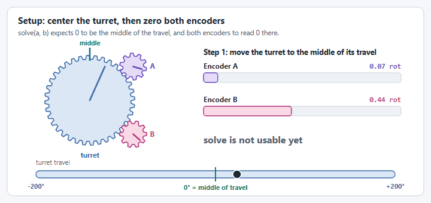
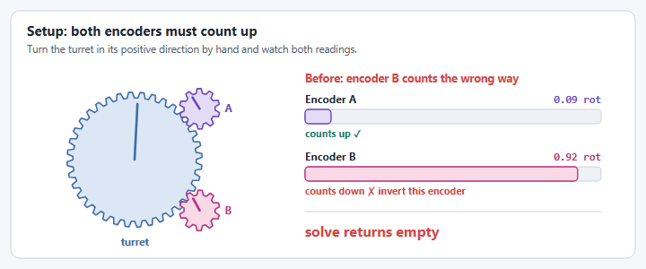
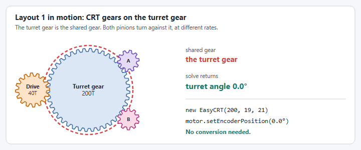
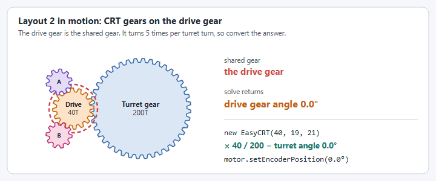
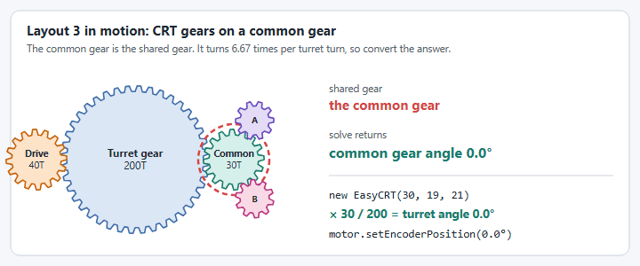
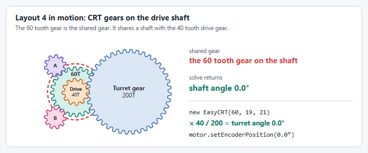
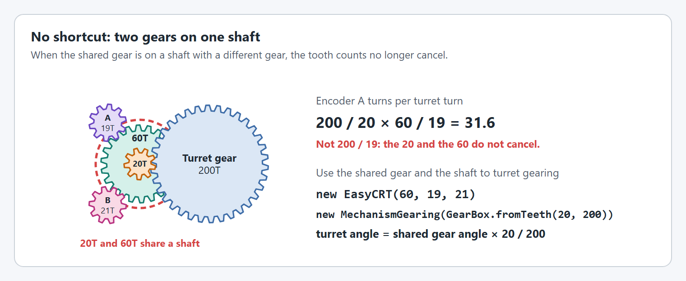
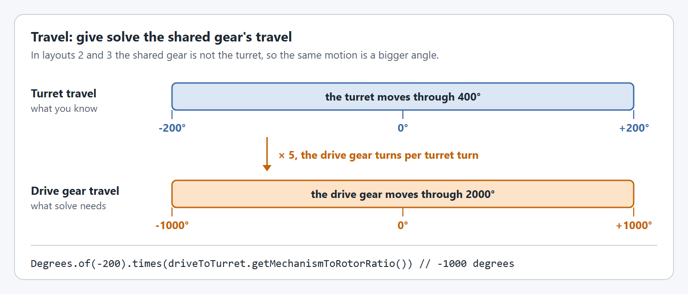
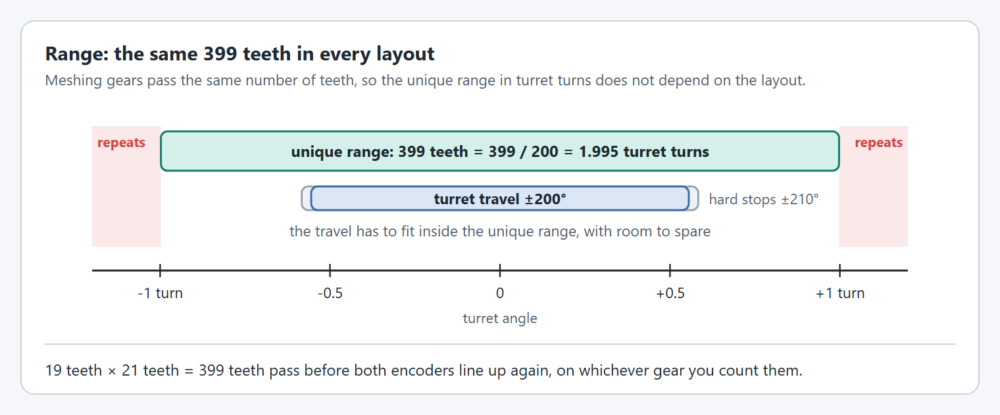

# EasyCRT


`EasyCRT` was made entirely by Team 6911!


`EasyCRT` finds the absolute angle of a mechanism that turns more than once, usually a turret, from two absolute encoders. Each encoder sits on a pinion with a different tooth count, and both pinions mesh with the same gear. Neither encoder knows the angle on its own, but the pair of readings is unique over a much longer travel than either one.

This page explains how it works, then how to set it up step by step, then how to fix it when it misbehaves.

## How it works

<figure><figcaption><p>Each encoder wraps many times, at different rates. Only one turret angle fits both readings.</p></figcaption></figure>

1. Encoder A's reading fits several angles of the gear both pinions mesh with (the **shared gear**), one for each number of whole turns the pinion could have made. `EasyCRT` lists every one inside the travel.
2. For each candidate it predicts what encoder B should read.
3. The candidate whose prediction is closest to encoder B's real reading wins.

This is not a textbook Chinese Remainder Theorem solve. It is the same idea done as a search, which keeps working with backlash and sensor noise.

The readings only repeat after the shared gear has turned a long way. That distance is the **unique range**. Past it, two positions give the same pair of readings, so the travel of your mechanism has to fit inside it.

Team 4967 wrote a white paper describing how the Chinese Remainder Theorem works for gears:



### What to know before you choose it

* Solve for the absolute angle **once** at startup, then seed the motor controller with the result. Do not use `EasyCRT` as closed loop feedback.
* CRT is sensitive to any delay between the two encoder reads, so it is unreliable while the mechanism moves. Read both encoders while the mechanism is still.
* Backlash between the two encoders, and loose pinions or magnets, cause failures. `solve` returns an empty result instead of a guess when the two readings do not agree, so your code has to handle an empty result.
* `EasyCRT` has no offset or inversion settings. Both encoders must read zero with the mechanism at zero, and both must count up when the mechanism moves in its positive direction.

### Alternatives

CRT is not the only way to find the absolute angle of your turret. Choose whatever is easiest for you:

* A zero sensor (limit switch, magnetic limit switch) and rotating to hit it
* A 10-turn pot on a reduction
* An absolute encoder with a 1:1 reduction
  * Optionally add a slightly less than 1:1 pinion on a second absolute encoder and find how many turns there are algebraically.

## Set it up


Coming from the 2026 `EasyCRTConfig` API? See [Upgrading from 2026 to 2027](../upgrading-from-2026-to-2027.md#easycrt) for the before and after.


The whole API:

| Java | C++ | What it does |
| ---- | --- | ------------ |
| `new EasyCRT(shared, a, b)` | `EasyCRT{shared, a, b}` | Tooth counts of the shared gear and the two encoder pinions. |
| `solve(a, b)` | `Solve(a, b)` | Angle of the shared gear, for travel centered on zero. |
| `solve(a, b, min, max)` | `Solve(a, b, min, max)` | The same, for travel that is not centered on zero. |
| `getUniqueRange()` | `GetUniqueRange()` | How far the shared gear can turn before the readings repeat. |

`solve` returns an empty `Optional` (`std::nullopt` in C++) when the two readings do not agree on one angle. Everything else (choosing gears, zeroing, inversion, gear trains, checking your margin) is something you do yourself, with the steps below.

### Step 1: Choose tooth counts

The readings repeat together every `lcm(a, b)` teeth of the shared gear, so:

```
unique range (rotations of the shared gear) = lcm(a, b) / shared
```

Pick pinions with no common factor (coprime), so the lcm is their product. Sharing a factor throws range away: 20 and 30 teeth only cover 60 teeth of the shared gear, not 600.

| Pinion A | Pinion B | Teeth covered | Range on a 100 tooth gear | Range on a 200 tooth gear |
| -------- | -------- | ------------- | ------------------------- | ------------------------- |
| 13 | 15 | 195 | 1.95 turns | 0.975 turns |
| 17 | 19 | 323 | 3.23 turns | 1.615 turns |
| 19 | 21 | 399 | 3.99 turns | 1.995 turns |
| 20 | 21 | 420 | 4.20 turns | 2.10 turns |
| 25 | 27 | 675 | 6.75 turns | 3.375 turns |
| 30 | 31 | 930 | 9.30 turns | 4.65 turns |

The range has to be at least your full travel, including how far the mechanism can coast past its soft limits. `getUniqueRange()` returns it, and `solve(a, b, min, max)` throws an `IllegalArgumentException` if the travel you pass is longer.

To check a pair before you build it:



```java
Angle range = new EasyCRT(200, 19, 21).getUniqueRange(); // 1.995 rotations
```



```cpp
wpi::units::turn_t range = yams::units::EasyCRT{200, 19, 21}.GetUniqueRange(); // 1.995 rotations
```



**Check:** the range is longer than your travel, with room on both sides.

### Step 2: Zero the encoders and check their direction

<figure><figcaption><p>Center the turret, zero both encoders there, then check both directions.</p></figcaption></figure>

<figure><figcaption><p>Both encoders have to count up when the turret turns in its positive direction.</p></figcaption></figure>

`EasyCRT` takes the two readings as they are, so the encoders have to be set up first:

* **Zero both encoders with the mechanism at zero.** Use the vendor tool to set each encoder's offset. If an encoder cannot store an offset, subtract it yourself: `crt.solve(encoderA.get().minus(offsetA), encoderB.get().minus(offsetB))`.
* **Both encoders must count up when the mechanism moves in its positive direction.** A pinion turns the opposite way to the gear it meshes with, so the direction depends on the layout (see Step 3). Set the direction on the encoder, or negate the reading before passing it in.
* **Read while the mechanism is still.** The two readings are taken one after the other, so any motion between them looks like disagreement.


Set each offset and inversion in one place only: on the encoder, or in your code before calling `solve`. Doing it in both places gives shifted or mirrored angles.


**Check:** turn the mechanism by hand in its positive direction. Both readings go up.

### Step 3: Solve once at startup and seed the motor

There are four common places to put the two encoder pinions on a turret. In every one, the gear both pinions mesh with is the shared gear.

<figure><figcaption><p>The four places to put the CRT pinions. Not to scale.</p></figcaption></figure>

Two gearings are involved, and they are not the same thing:

* **The motor's gearing** (`motorToTurret`) goes in the `SmartMotorControllerConfig` with `withGearing(...)`. It is the whole reduction from the motor to the turret.
* **The shared gear's gearing** is only needed in layout 4, to turn the solved angle into the turret angle.

`setEncoderPosition(...)` always takes the turret angle, and applies the motor's gearing itself. The tooth counts below are examples.

#### Layouts 1, 2 and 3: use the turret's tooth count

<figure><figcaption><p>A gear that only meshes passes teeth through one for one.</p></figcaption></figure>

When every gear between the pinions and the turret simply meshes with the next one, the gears in between cancel out: each pinion turns `200 / 19` or `200 / 21` times per turret turn, whichever gear it touches. So in these three layouts you give `EasyCRT` the **turret** gear's tooth count, and `solve` returns the turret angle with no conversion:

| Layout | Where the pinions mesh | Encoder direction |
| --- | --- | --- |
| 1 | On the turret gear | Pinions turn opposite to the turret, so both encoders usually need inverting |
| 2 | On the motor's drive gear, which drives the turret gear | Two meshes away, so the pinions turn the same way as the turret |
| 3 | On a common gear that meshes with the turret gear | Two meshes away, the same way as the turret |

<figure><figcaption><p>Layout 1: the pinions mesh with the turret gear.</p></figcaption></figure>



```java
// Motor: 10:1 gearbox, then the 40 tooth drive gear on the 200 tooth turret gear (5:1).
MechanismGearing motorToTurret = new MechanismGearing(GearBox.fromReductionStages(10, 200.0 / 40));

SmartMotorControllerConfig motorConfig = new SmartMotorControllerConfig(this)
    .withGearing(motorToTurret)
    .withControlMode(ControlMode.CLOSED_LOOP)
    .withClosedLoopController(20, 0, 0);
SmartMotorController motor = new SparkWrapper(sparkMax, DCMotor.getNEO(1), motorConfig);

// Layouts 1, 2 and 3: the 200 tooth turret gear, pinion A, pinion B.
EasyCRT crt = new EasyCRT(200, 19, 21);

// Once, at startup, with the turret still. The result is the turret angle,
// and setEncoderPosition applies motorToTurret itself.
crt.solve(encoderA.get(), encoderB.get()).ifPresent(motor::setEncoderPosition);
```



```cpp
// Motor: 10:1 gearbox, then the 40 tooth drive gear on the 200 tooth turret gear (5:1).
yams::gearing::MechanismGearing motorToTurret{
    yams::gearing::GearBox::FromReductionStages({10.0, 200.0 / 40.0})};
motorConfig.WithMotorGearing(motorToTurret);
// ... finish motorConfig and build the SmartMotorController `motor` with it.

// Layouts 1, 2 and 3: the 200 tooth turret gear, pinion A, pinion B.
yams::units::EasyCRT crt{200, 19, 21};

// Once, at startup, with the turret still. The result is the turret angle,
// and SetEncoderPosition applies motorToTurret itself.
if (auto turretAngle = crt.Solve(encoderA, encoderB)) {
  motor.SetEncoderPosition(*turretAngle);
}
```



<details>

<summary>Layouts 2 and 3 in motion</summary>

<figure><figcaption><p>Layout 2: the pinions mesh with the drive gear.</p></figcaption></figure>

<figure><figcaption><p>Layout 3: the pinions mesh with a common gear.</p></figcaption></figure>

You can also give `EasyCRT` the drive gear's or common gear's own tooth count and scale the result by that stage's `MechanismGearing`, as in layout 4. The answer and the unique range in turret turns are the same.

</details>

#### Layout 4: CRT gears on the drive shaft

<figure><figcaption><p>Layout 4: the 60 tooth gear on the drive shaft is the shared gear.</p></figcaption></figure>

<figure><figcaption><p>Two different gears on one shaft change the ratio.</p></figcaption></figure>

Both pinions mesh with a second gear fixed to the same shaft as the motor's drive gear. Two different gears on one shaft do not cancel, so the shortcut does not work. Give `EasyCRT` the 60 tooth gear, which makes `solve` return the shaft angle, and multiply by the shaft to turret `MechanismGearing`. The same applies whenever the shared gear sits behind a gearbox stage. The pinions turn the same way as the turret.



```java
// Motor: 10:1 gearbox, then the 40 tooth drive gear on the 200 tooth turret gear (5:1).
MechanismGearing motorToTurret = new MechanismGearing(GearBox.fromReductionStages(10, 200.0 / 40));

SmartMotorControllerConfig motorConfig = new SmartMotorControllerConfig(this)
    .withGearing(motorToTurret)
    .withControlMode(ControlMode.CLOSED_LOOP)
    .withClosedLoopController(20, 0, 0);
SmartMotorController motor = new SparkWrapper(sparkMax, DCMotor.getNEO(1), motorConfig);

// The pinions mesh with a 60 tooth gear on the drive gear's shaft.
// That shaft turns 5 times per turret turn (40 tooth drive gear on the 200 tooth turret gear).
MechanismGearing shaftToTurret = new MechanismGearing(GearBox.fromTeeth(40, 200));
EasyCRT crt = new EasyCRT(60, 19, 21); // gear on the shaft, pinion A, pinion B

crt.solve(encoderA.get(), encoderB.get()).ifPresent(shaftAngle -> {
  // Scale the shaft angle down to the turret, then seed the motor with the turret angle.
  Angle turretAngle = shaftAngle.times(shaftToTurret.getRotorToMechanismRatio());
  motor.setEncoderPosition(turretAngle);
});
```



```cpp
// Motor: 10:1 gearbox, then the 40 tooth drive gear on the 200 tooth turret gear (5:1).
yams::gearing::MechanismGearing motorToTurret{
    yams::gearing::GearBox::FromReductionStages({10.0, 200.0 / 40.0})};
motorConfig.WithMotorGearing(motorToTurret);
// ... finish motorConfig and build the SmartMotorController `motor` with it.

// The pinions mesh with a 60 tooth gear on the drive gear's shaft.
// That shaft turns 5 times per turret turn (40 tooth drive gear on the 200 tooth turret gear).
yams::gearing::MechanismGearing shaftToTurret{yams::gearing::GearBox::FromTeeth({40, 200})};
yams::units::EasyCRT crt{60, 19, 21};  // gear on the shaft, pinion A, pinion B

if (auto shaftAngle = crt.Solve(encoderA, encoderB)) {
  // Scale the shaft angle down to the turret, then seed the motor with the turret angle.
  wpi::units::turn_t turretAngle = *shaftAngle * shaftToTurret.GetRotorToMechanismRatio();
  motor.SetEncoderPosition(turretAngle);
}
```



Layout 4 also has a shorter unique range. 399 teeth of the 60 tooth gear is `399 / 60 = 6.65` turns of the shaft, which is `6.65 / 5 = 1.33` turns of the turret, against 1.995 in layouts 1 to 3. A bigger gear on the shaft uses the range up faster. The unique range in turret turns is `getUniqueRange()` multiplied by `shaftToTurret.getRotorToMechanismRatio()`.

#### Travel that is not centered on zero

`solve(a, b)` assumes the mechanism's zero is in the middle of its travel, and returns an angle within half the unique range either side of zero. For a turret that goes from 0 to 540 degrees, give the travel:



```java
Optional<Angle> angle = crt.solve(encoderA.get(), encoderB.get(), Degrees.of(0), Degrees.of(540));
```



```cpp
std::optional<wpi::units::turn_t> angle =
    crt.Solve(encoderA, encoderB, wpi::units::turn_t{0.0}, wpi::units::turn_t{1.5});
```



Give the real travel, not the whole unique range. A tighter range leaves fewer candidates, and it keeps a reading taken slightly past an end stop from wrapping to the other end.

<figure><figcaption><p>The same motion, as turret angles and as shared gear angles.</p></figcaption></figure>

The travel is in shared gear angles. In layouts 1 to 3 with the turret's tooth count, that is the turret angle. In layout 4, convert the turret's travel to shaft angles first:

```java
// Layout 4: turret travel of -200 to 200 degrees, expressed as shaft angles.
double shaftTurnsPerTurretTurn = shaftToTurret.getMechanismToRotorRatio(); // 5
crt.solve(encoderA.get(), encoderB.get(),
    Degrees.of(-200).times(shaftTurnsPerTurretTurn), Degrees.of(200).times(shaftTurnsPerTurretTurn));
```

<figure><figcaption><p>The travel has to fit inside the unique range.</p></figcaption></figure>


Pass `setEncoderPosition(...)` the mechanism angle, not the rotor angle: it applies the `MechanismGearing` from the config, so multiplying first would apply the gearing twice. The rotor angle it ends up setting is `turretAngle.times(motorToTurret.getMechanismToRotorRatio())`.



Decide what happens when the result is empty. Raising an alert and refusing to move the mechanism is safer than assuming it is at zero.


The `BroncBotz_2026` examples have a complete `Turret` class: [Commands v2](https://github.com/Yet-Another-Software-Suite/YAMS/blob/master/examples/commands2/BroncBotz_2026/java/first/robot/subsystems/Turret.java) and [Commands v3](https://github.com/Yet-Another-Software-Suite/YAMS/blob/master/examples/commands3/BroncBotz_2026/java/first/robot/mechanisms/Turret.java).

**Check:** after a power cycle, the turret's `mechanism/position` matches its real angle at several positions across the travel.

### Step 4: Check your margin

`EasyCRT` has no tolerance setting. It works the tolerance out from the gears:

* Neighboring candidates predict encoder B readings `gcd(a, b) / b` of a rotation apart. For 19 and 21 teeth that is 1/21 of a rotation, about 17 degrees of encoder B.
* A match is accepted when encoder B is within a quarter of that gap of its prediction, about 4.3 degrees here. Anything further off returns empty instead of a guess.

So the backlash and noise between the two encoders, measured at encoder B, has to stay under a quarter of the gap. To measure what you actually have, log the error yourself while moving the mechanism slowly by hand through its travel:

```java
// The tooth counts given to EasyCRT.
static final int SHARED_GEAR_TEETH = 200;
static final int PINION_B_TEETH = 21;

// Encoder B turns SHARED_GEAR_TEETH / PINION_B_TEETH times per turn of the shared gear.
Angle predictedB = solvedAngle.times((double) SHARED_GEAR_TEETH / PINION_B_TEETH);
// The gap between predicted and real encoder B, wrapped to -0.5 to 0.5 rotations.
double errorRotations = MathUtil.inputModulus(
    predictedB.minus(encoderB.get()).in(Rotations), -0.5, 0.5);
// Must stay well under a quarter of 1 / PINION_B_TEETH (here 1/84 of a rotation).
```

If the error gets near the limit:

* Preload the mechanism to one side of its backlash before reading.
* Use a larger pinion B, or pinions with a bigger tooth difference, which widens the gap.
* Check that both encoder magnets and pinions are secure.

The accuracy of the result comes from encoder A alone: an error on encoder A shows up divided by `shared / a`.

## Troubleshooting


**Empty near the ends of travel? Your range affects your reading** (found by Team 2181).

If `solve` comes back empty near the ends of travel, your turret is probably sitting just outside the range you gave. Use a range with room on both sides.

For example, instead of `solve(a, b, Rotations.of(0), Rotations.of(2))` use `solve(a, b, Rotations.of(-0.1), Rotations.of(2.1))`, as long as the range is still shorter than `getUniqueRange()`. `solve(a, b)` already does this for travel centered on zero: it allows half of the unique range either side of zero.

If your turret is outside the unique range, your CRT reading will be very **VERY** off.


Two failures are worth seeing in motion.

<figure><figcaption><p>Past the unique range the answer comes from the other end.</p></figcaption></figure>

<figure><figcaption><p>A match must be within a quarter of the gap between candidates. Half way gives no answer, and further gives a wrong one.</p></figcaption></figure>

| Symptom | Likely cause |
| ------- | ------------ |
| Always empty | An encoder is not zeroed at the mechanism's zero, or one encoder counts the wrong way. |
| Empty in some positions only | Backlash or a loose pinion is using up the margin. See [Step 4: Check your margin](#step-4-check-your-margin). |
| Empty at the ends of travel | The mechanism is past the travel you gave, or the travel is the whole unique range. See the warning above. |
| Angle is off by a fixed amount | Encoder A's zero is off. The result follows encoder A. |
| Angle is off by a whole number of pinion turns | The readings were taken while moving, or encoder B's zero is off. |
| Angle is mirrored | Both encoders count the wrong way. |
| `solve(a, b, min, max)` throws an `IllegalArgumentException` | The travel is longer than the unique range. Choose different pinions. |

### Checklist

* [ ] Pinion tooth counts share no factor, and the unique range covers the full travel with room to spare.
* [ ] Both encoders read zero with the mechanism at zero.
* [ ] Both encoders count up when the mechanism moves in its positive direction.
* [ ] The solved angle matches the real angle at several positions across the travel.
* [ ] The error on encoder B stays well under a quarter of the gap between candidates.
* [ ] The robot gives the right angle after a power cycle in several positions.
* [ ] The code handles an empty result.
