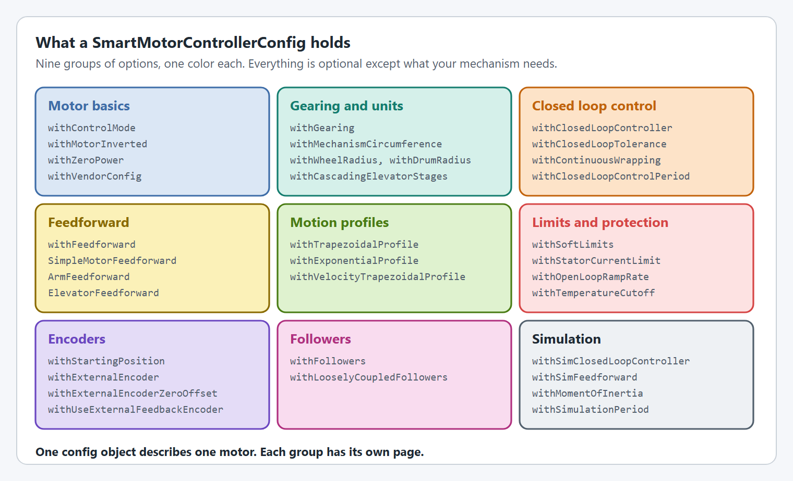
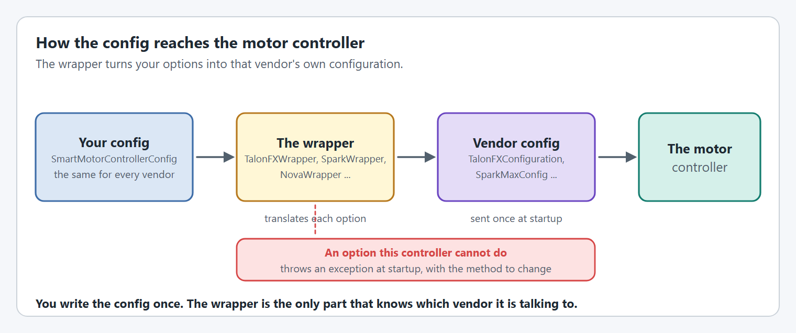

# SmartMotorControllerConfig

A `SmartMotorControllerConfig` describes one motor: how it is geared, how it is controlled, what it must not do and what it reports. You write it once, in the same way for every vendor, and hand it to a wrapper such as `TalonFXWrapper`, `SparkWrapper` or `NovaWrapper`.

<figure><figcaption><p>The option groups. Each has its own page.</p></figcaption></figure>

## Where to find each option

| Page | What it covers |
| --- | --- |
| [Motor basics](motor-basics.md) | Control mode, inversion, brake or coast, starting from a clean config, vendor configs, telemetry. |
| [Gearing and units](gearing-and-units.md) | Gear ratios, circumference, wheels and drums, cascading elevator stages. |
| [Closed loop control](closed-loop-control.md) | PID gains, slots, tolerance, continuous wrapping, output limits, where the loop runs. |
| [Feedforward](feedforward.md) | Simple, arm and elevator feedforwards and what each gain does. |
| [Motion profiles](motion-profiles.md) | Trapezoidal, velocity and exponential profiles. |
| [Limits and protection](limits-and-protection.md) | Soft limits, current limits, ramp rates, voltage compensation, temperature cutoff. |
| [Encoders](encoders.md) | Starting position, encoder inversion, external encoders and their zero offset. |
| [Followers](followers.md) | Followers on one shaft, and loosely coupled followers. |
| [Simulation](simulation.md) | Simulation-only gains, starting position, moment of inertia and step size. |

## How the config is used

<figure><figcaption><p>The same config works for every supported motor controller.</p></figcaption></figure>

```java
SmartMotorControllerConfig config = new SmartMotorControllerConfig(this)
    .withControlMode(ControlMode.CLOSED_LOOP)
    .withGearing(new MechanismGearing(GearBox.fromReductionStages(3, 4)))
    .withClosedLoopController(4, 0, 0)
    .withFeedforward(new ArmFeedforward(0, 0.3, 1.2))
    .withTrapezoidalProfile(DegreesPerSecond.of(180), DegreesPerSecondPerSecond.of(360))
    .withSoftLimits(Degrees.of(-20), Degrees.of(100))
    .withStatorCurrentLimit(Amps.of(40))
    .withZeroPower(MotorMode.BRAKE)
    .withTelemetry("ArmMotor", TelemetryVerbosity.HIGH);

SmartMotorController motor = new SparkWrapper(spark, DCMotor.getNEO(1), config);
```

Three things are worth knowing before reading the option pages:

* **Every `with...()` method returns the config**, so options chain. A few options depend on an earlier one and say so on their page, for example `withClosedLoopTolerance` needs a PID controller first.
* **Options are checked when the wrapper is created.** An option that motor controller cannot do throws a `SmartMotorControllerConfigurationException` that names the method to change, so problems show up at startup and not mid-match.
* **A mechanism adds to the config for you.** `Arm`, `Elevator`, `Pivot` and `FlyWheel` configs forward options such as `withSoftLimits` to the motor's config, so set those on the mechanism where one exists.

## Not every option works on every motor controller


Motor controllers differ. Some options only exist on one of them, and some only work in certain situations, for example only when the closed loop runs on the SystemCore. An option a controller cannot do normally throws an exception at startup, but check the table for each option you rely on.


Every option on the following pages has a table showing where it works. These are the ones that are **not** supported everywhere:

| Option | TalonFX | TalonFXS | SPARK MAX / Flex | Thrifty Nova |
| --- | --- | --- | --- | --- |
| [`withEncoderInverted`](encoders.md#withencoderinverted) | ❌ | ✅ | ❌ | ❌ |
| [`withVendorControlRequest`](motor-basics.md#withvendorcontrolrequest) | ✅ | ✅ | ❌ | ❌ |
| [`withSupplyCurrentLimit`](limits-and-protection.md#current-limits) | ✅ | ✅ | ❌ | ✅ |
| [`withVoltageCompensation`](limits-and-protection.md#withvoltagecompensation) | ❌ | ❌ | ✅ | ✅ |
| [`withClosedLoopTolerance`](closed-loop-control.md#withclosedlooptolerance) | ❌ | ❌ | ⚠️ not with LQR | ⚠️ not with LQR |
| [Closed loop `SLOT_3`](closed-loop-control.md#slots) | ❌ | ❌ | ✅ | ✅ |
| [`withClosedLoopControllerMaximumVoltage`](closed-loop-control.md#withclosedloopcontrollermaximumvoltage) | ✅ | ✅ | ⚠️ exponential profile or LQR only | ✅ |
| [`withClosedLoopControlPeriod`](closed-loop-control.md#withclosedloopcontrolperiod) | ❌ | ❌ | ⚠️ exponential profile or LQR only | ⚠️ closed loop mode only |
| [`withTemperatureCutoff`](limits-and-protection.md#withtemperaturecutoff) | ⚠️ LQR only | ⚠️ LQR only | ⚠️ exponential profile or LQR only | ⚠️ closed loop mode only |
| [`withFeedbackSynchronizationThreshold`](encoders.md#withfeedbacksynchronizationthreshold) | ❌ | ❌ | ⚠️ exponential profile or LQR only | ⚠️ closed loop mode only |
| [Separate open and closed loop ramp rates](limits-and-protection.md#ramp-rates) | ✅ | ✅ | ✅ | ❌ one shared ramp rate |
| [`withExternalEncoderZeroOffset`](encoders.md#withexternalencoderzerooffset), [discontinuity point](encoders.md#withexternalencoderdiscontinuitypoint) | ✅ | ✅ | ⚠️ absolute encoders only | ⚠️ absolute and CAN encoders only |
| [`withSoftLimits`](limits-and-protection.md#withsoftlimits) | ✅ | ✅ | ⚠️ closed loop mode only | ✅ |

Three more work everywhere but only with that vendor's own parts: [`withVendorConfig`](motor-basics.md#withvendorconfig), [`withExternalEncoder`](encoders.md#withexternalencoder) and [`withFollowers`](followers.md#withfollowers).

Many of the ⚠️ entries depend on where the closed loop runs, which is explained in [where the loop runs](closed-loop-control.md#where-the-loop-runs). The [motor controller feature matrix](../feature-matrix.md) has every option, including the ones that work everywhere, in one place.

## Changing a config later

Most options can be changed while the robot runs through [live tuning](../../live-tuning/README.md), which is the quickest way to find gains and limits. Once you have them, put the numbers back in the config so they survive a restart.


## Code Reference

* [`SmartMotorControllerConfig`](https://yet-another-software-suite.github.io/YAMS/javadocs/yams/motorcontrollers/SmartMotorControllerConfig.html)
