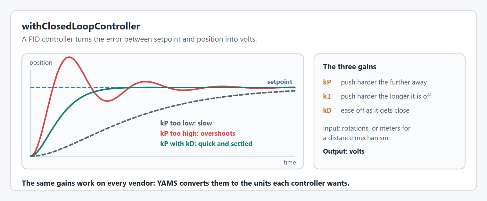
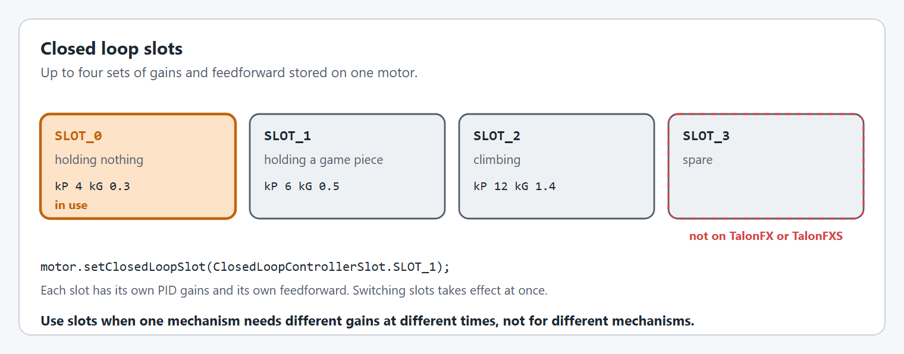
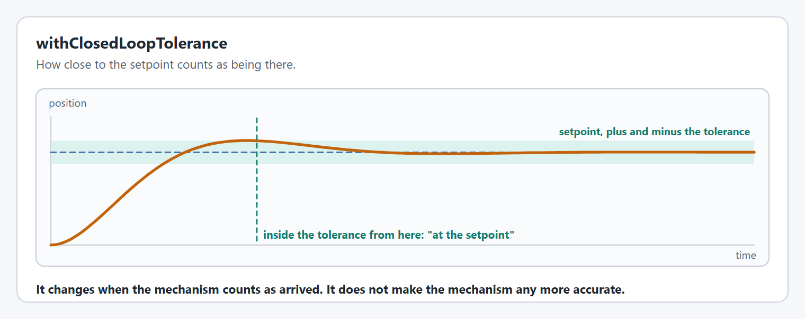
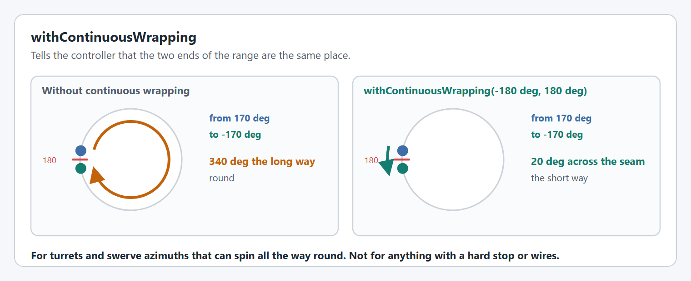
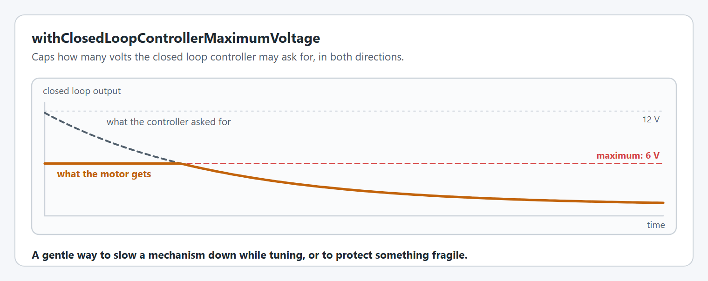
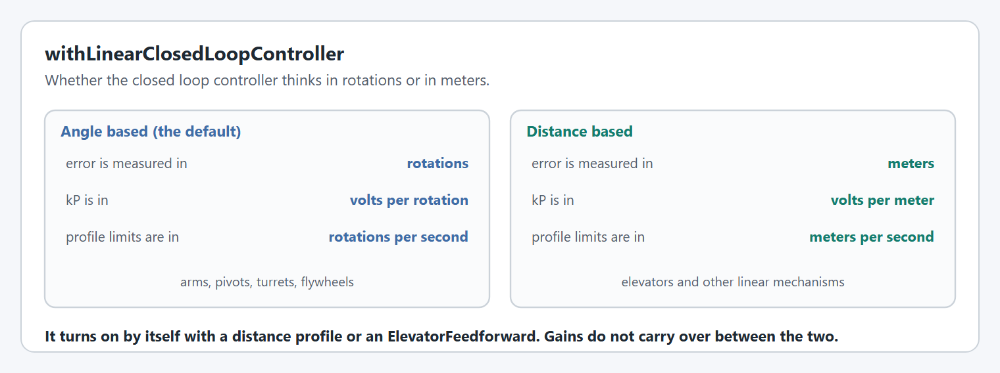

# Closed loop control

Closed loop control is what takes a mechanism to a setpoint and holds it there. These options need [`withControlMode(ControlMode.CLOSED_LOOP)`](motor-basics.md#withcontrolmode), which is the default.


Not every option on this page is supported on every motor controller. Each option has a table showing where it works, and an option a controller cannot do throws a `SmartMotorControllerConfigurationException` or an `IllegalArgumentException` at startup. Each option says which. The [config overview](README.md#not-every-option-works-on-every-motor-controller) lists them all together.


For how to find good values, see [live tuning](../../live-tuning/README.md).

## `withClosedLoopController`

Sets the PID gains.

<figure><figcaption><p>What the gains do to a move.</p></figcaption></figure>

```java
.withClosedLoopController(4, 0, 0.2)                 // kP, kI, kD
.withClosedLoopController(new PIDController(4, 0, 0.2))
```

The gains work in rotations and volts, or meters and volts for a [distance based controller](#withlinearclosedloopcontroller). YAMS converts them to whatever the motor controller uses, so the same numbers behave the same on every vendor.

Passing an `LQRController` instead replaces the PID with an LQR: see [LQR controllers](../lqr-controllers.md).

**Supported on every motor controller.** Every controller accepts PID gains. An [LQR controller](../lqr-controllers.md) always runs on the SystemCore, on every controller.

| TalonFX | TalonFXS | SPARK MAX / Flex | Thrifty Nova |
| --- | --- | --- | --- |
| ✅ | ✅ | ✅ | ✅ PID runs on the SystemCore |

### Slots

Each call can name a slot, so one motor can hold several sets of gains and switch between them.

<figure><figcaption><p>Four slots, each with its own gains and feedforward.</p></figcaption></figure>

```java
.withClosedLoopController(4, 0, 0, ClosedLoopControllerSlot.SLOT_0)
.withClosedLoopController(6, 0, 0, ClosedLoopControllerSlot.SLOT_1)
// later, while running
motor.setClosedLoopSlot(ClosedLoopControllerSlot.SLOT_1);
```

**Not supported everywhere.** Selecting `SLOT_3` on a TalonFX or TalonFXS throws an `IllegalArgumentException`, and a feedforward configured for `SLOT_3` on a TalonFX throws a `SmartMotorControllerConfigurationException`.

| TalonFX | TalonFXS | SPARK MAX / Flex | Thrifty Nova |
| --- | --- | --- | --- |
| ⚠️ `SLOT_0` to `SLOT_2` | ⚠️ `SLOT_0` to `SLOT_2` | ✅ | ✅ |

## `withClosedLoopTolerance`

How close to the setpoint counts as being there.

<figure><figcaption><p>The tolerance is a band around the setpoint.</p></figcaption></figure>

```java
.withClosedLoopController(4, 0, 0)
.withClosedLoopTolerance(Degrees.of(1))
```

Call it after `withClosedLoopController`: it is set on the PID controllers that exist at that moment, and throws a `SmartMotorControllerConfigurationException` if there are none.

**Not supported everywhere.** It throws a `SmartMotorControllerConfigurationException` on a TalonFX or TalonFXS.

| TalonFX | TalonFXS | SPARK MAX / Flex | Thrifty Nova |
| --- | --- | --- | --- |
| ❌ | ❌ | ⚠️ not with an [LQR controller](../lqr-controllers.md) | ⚠️ not with an [LQR controller](../lqr-controllers.md) |

## `withContinuousWrapping`

Tells the controller that the two ends of the range are the same place, so it takes the short way round.

<figure><figcaption><p>From 170° to -170°, without and with continuous wrapping.</p></figcaption></figure>

```java
.withClosedLoopController(50, 0, 0.5)
.withContinuousWrapping(Degrees.of(-180), Degrees.of(180))
```

It needs a closed loop controller first, and cannot be combined with [soft limits](limits-and-protection.md#withsoftlimits) or a distance based controller, because a mechanism with ends cannot wrap.

**Supported on:** every supported motor controller.

## `withClosedLoopControllerMaximumVoltage`

Caps the voltage the closed loop controller may ask for.

<figure><figcaption><p>A 6 V maximum on a move that asked for more.</p></figcaption></figure>

```java
.withClosedLoopControllerMaximumVoltage(Volts.of(6))
```

**Not supported everywhere.** On a TalonFX or TalonFXS it is applied as the peak forward and reverse voltage. On a SPARK it throws a `SmartMotorControllerConfigurationException` unless the loop runs on the SystemCore.

| TalonFX | TalonFXS | SPARK MAX / Flex | Thrifty Nova |
| --- | --- | --- | --- |
| ✅ | ✅ | ⚠️ only with an exponential profile or an [LQR controller](../lqr-controllers.md) | ✅ |

## Where the loop runs

Some combinations run on the motor controller, at 1 kHz, and some on the SystemCore, every 20 ms by default. It matters for a few options, and YAMS raises an alert when the loop is on the SystemCore.

<figure><figcaption><p>Where the closed loop runs, and how often.</p></figcaption></figure>

### PID gains do not carry over between the two

PID gains tuned with the loop on the motor controller will never be the same as gains tuned with the loop on the SystemCore, even on the same mechanism. The reason is the closed loop control period:

* **On the motor controller** the loop runs at 1 kHz, once every millisecond, right next to the motor and its encoder. That is 20 runs for every one run of the SystemCore loop at its default period. This period is fixed by the motor controller and cannot be changed.
* **On the SystemCore** the loop runs once every control period, 20 ms by default, and each measurement and each output also has to cross the CAN bus.

A slower loop reacts later to every error, so it cannot use gains as high as a fast one before it starts to oscillate. `kD` and `kI` are affected the most, because they depend directly on the time between two runs of the loop.

What this means in practice:

* **Tune again whenever the loop moves.** On a SPARK that happens when you switch between a trapezoidal profile, which runs on the controller, and an exponential profile or an [LQR controller](../lqr-controllers.md), which run on the SystemCore. Moving a mechanism to a different brand of motor controller can move the loop too.
* **Tune again after changing [`withClosedLoopControlPeriod`](#withclosedloopcontrolperiod).** A different period is a different loop.
* **Do not copy gains from another team or another robot** without checking where their loop ran and how fast.

### `withClosedLoopControlPeriod`

Changes how often the SystemCore loop runs. The default is 20 ms. It does not change a loop that runs on the motor controller: that period is fixed at 1 ms (1 kHz).

```java
.withClosedLoopControlPeriod(Milliseconds.of(10))
```

**Not supported everywhere.** Where it is not supported it throws an `IllegalArgumentException` on a TalonFX, TalonFXS or Thrifty Nova, and a `SmartMotorControllerConfigurationException` on a SPARK.

| TalonFX | TalonFXS | SPARK MAX / Flex | Thrifty Nova |
| --- | --- | --- | --- |
| ❌ | ❌ | ⚠️ only with an exponential profile or an [LQR controller](../lqr-controllers.md) | ⚠️ only in closed loop mode |

## `withLinearClosedLoopController`

Chooses whether the controller works in rotations or in meters.

<figure><figcaption><p>The units the gains and limits are in.</p></figcaption></figure>

It turns on by itself when you give a distance profile, a distance exponential profile or an `ElevatorFeedforward`, and it only takes effect when a [circumference](gearing-and-units.md#withmechanismcircumference) is set. [How to disable linear closed loop control?](../../../how-to/how-to-disable-linear-closed-loop-control.md) explains when to turn it off.

**Supported on:** every supported motor controller.


## Code Reference

* [`SmartMotorControllerConfig`](https://yet-another-software-suite.github.io/YAMS/javadocs/yams/motorcontrollers/SmartMotorControllerConfig.html)
