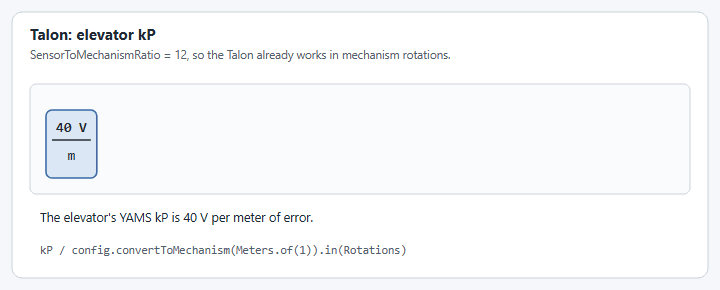

# Closed loop control

Closed loop control is what takes a mechanism to a setpoint and holds it there. These options need [`withControlMode(ControlMode.CLOSED_LOOP)`](motor-basics.md#withcontrolmode), which is the default.


Not every option on this page is supported on every motor controller. Each option has a table showing where it works, and an option a controller cannot do throws a `SmartMotorControllerConfigurationException` or an `IllegalArgumentException` at startup. Each option says which. The [config overview](./#not-every-option-works-on-every-motor-controller) lists them all together.


For how to find good values, see [live tuning](../../live-tuning/).

## `withClosedLoopController`

Sets the PID gains.

<figure><figcaption><p>What the gains do to a move.</p></figcaption></figure>

```java
.withClosedLoopController(4, 0, 0.2)                 // kP, kI, kD
.withClosedLoopController(new PIDController(4, 0, 0.2))
```

Write gains in volts per mechanism rotation, or volts per meter for a [distance based controller](closed-loop-control.md#withlinearclosedloopcontroller). YAMS converts them for each motor controller, so the same numbers behave the same on every vendor: see [Under the hood](closed-loop-control.md#under-the-hood) if you want the details.

Passing an `LQRController` instead replaces the PID with an LQR: see [LQR controllers](../lqr-controllers.md).

**Supported on every motor controller.** Every controller accepts PID gains. An [LQR controller](../lqr-controllers.md) always runs on the SystemCore, on every controller.

| TalonFX | TalonFXS | SPARK MAX / Flex | Thrifty Nova                 |
| ------- | -------- | ---------------- | ---------------------------- |
| ✅       | ✅        | ✅                | ✅ PID runs on the SystemCore |

### Starting values

These are only places to start, so the first move is gentle and you can see which way to go. Every mechanism ends up somewhere else. Tune the [feedforward](feedforward.md#withfeedforward) first, with these PID gains at 0.

| Mechanism            | Start `kP` at | Which means                                        | Start `kI`, `kD` at |
| -------------------- | ------------- | -------------------------------------------------- | ------------------- |
| Arm, pivot, turret   | `10`          | 10 V per rotation of error, about 0.3 V at 10° off | `0`, `0`            |
| Elevator             | `10`          | 10 V per meter of error, 1 V at 10 cm off          | `0`, `0`            |
| Flywheel, roller     | `0.1`         | 0.1 V per rotation per second of error, 1 V at 600 RPM off | `0`, `0`    |

Graph the position (or velocity) against the setpoint and make small moves:

* **It stops short, or creeps up slowly:** `kP` is too low. Double it and try again.
* **It overshoots and rings:** `kP` is too high. Go back about a third, then add `kD`, starting around a tenth of `kP`, until the overshoot goes.
* **It stops a little short every time, even with a good `kP`:** check `kG` and `kS` in the [feedforward](feedforward.md) before reaching for `kI`.

The Arm tutorial starts its light, simulated arm at a `kP` of 50; either is a fine place to start because you double or cut it from there. [Step 5 of the Arm tutorial](../../../tutorials/arm/tune.md) walks through this, and [Tuning order](../../live-tuning/README.md#tuning-order) has the order for each mechanism.

### Slots

Each call can name a slot, so one motor can hold several sets of gains and switch between them.

<figure><figcaption><p>Four slots, each with its own gains and feedforward.</p></figcaption></figure>

```java
.withClosedLoopController(4, 0, 0, ClosedLoopControllerSlot.SLOT_0)
.withClosedLoopController(6, 0, 0, ClosedLoopControllerSlot.SLOT_1)
// later, while running
motor.setClosedLoopSlot(ClosedLoopControllerSlot.SLOT_1);
```

**Not supported everywhere.** Selecting `SLOT_3` on a TalonFX or TalonFXS throws an `IllegalArgumentException`, and a feedforward configured for `SLOT_3` on a TalonFX throws a `SmartMotorControllerConfigurationException`.

| TalonFX                 | TalonFXS                | SPARK MAX / Flex | Thrifty Nova |
| ----------------------- | ----------------------- | ---------------- | ------------ |
| ⚠️ `SLOT_0` to `SLOT_2` | ⚠️ `SLOT_0` to `SLOT_2` | ✅                | ✅            |

## `withClosedLoopTolerance`

How close to the setpoint counts as being there.

<figure><figcaption><p>The tolerance is a band around the setpoint.</p></figcaption></figure>

```java
.withClosedLoopController(4, 0, 0)
.withClosedLoopTolerance(Degrees.of(1))
```

Call it after `withClosedLoopController`: it is set on the PID controllers that exist at that moment, and throws a `SmartMotorControllerConfigurationException` if there are none.

**Not supported everywhere.** It throws a `SmartMotorControllerConfigurationException` on a TalonFX or TalonFXS.

| TalonFX | TalonFXS | SPARK MAX / Flex                                       | Thrifty Nova                                           |
| ------- | -------- | ------------------------------------------------------ | ------------------------------------------------------ |
| ❌       | ❌        | ⚠️ not with an [LQR controller](../lqr-controllers.md) | ⚠️ not with an [LQR controller](../lqr-controllers.md) |

## `withContinuousWrapping`

Tells the controller that the two ends of the range are the same place, so it takes the short way round.

<figure><figcaption><p>From 170° to -170°, without and with continuous wrapping.</p></figcaption></figure>

```java
.withClosedLoopController(50, 0, 0.5)
.withContinuousWrapping(Degrees.of(-180), Degrees.of(180))
```

It needs a closed loop controller first, and cannot be combined with [soft limits](limits-and-protection.md#withsoftlimits) or a distance based controller, because a mechanism with ends cannot wrap.

**Supported on:** every supported motor controller.

## `withClosedLoopControllerMaximumVoltage`

Caps the voltage the closed loop controller may ask for.

<figure><figcaption><p>A 6 V maximum on a move that asked for more.</p></figcaption></figure>

```java
.withClosedLoopControllerMaximumVoltage(Volts.of(6))
```

**Not supported everywhere.** On a TalonFX or TalonFXS it is applied as the peak forward and reverse voltage. On a SPARK it throws a `SmartMotorControllerConfigurationException` unless the loop runs on the SystemCore.

| TalonFX | TalonFXS | SPARK MAX / Flex                                                                  | Thrifty Nova |
| ------- | -------- | --------------------------------------------------------------------------------- | ------------ |
| ✅       | ✅        | ⚠️ only with an exponential profile or an [LQR controller](../lqr-controllers.md) | ✅            |

## Where the loop runs

Some combinations run on the motor controller, at 1 kHz, and some on the SystemCore, every 20 ms by default. It matters for a few options, and YAMS raises an alert when the loop is on the SystemCore.

<figure><figcaption><p>Where the closed loop runs, and how often.</p></figcaption></figure>

### PID gains do not carry over between the two

PID gains tuned with the loop on the motor controller will never be the same as gains tuned with the loop on the SystemCore, even on the same mechanism. The reason is the closed loop control period:

* **On the motor controller** the loop runs at 1 kHz, once every millisecond, right next to the motor and its encoder. That is 20 runs for every one run of the SystemCore loop at its default period. This period is fixed by the motor controller and cannot be changed.
* **On the SystemCore** the loop runs once every control period, 20 ms by default, and each measurement and each output also has to cross the CAN bus.

A slower loop reacts later to every error, so it cannot use gains as high as a fast one before it starts to oscillate. `kD` and `kI` are affected the most, because they depend directly on the time between two runs of the loop.

What this means in practice:

* **Tune again whenever the loop moves.** On a SPARK that happens when you switch between a trapezoidal profile, which runs on the controller, and an exponential profile or an [LQR controller](../lqr-controllers.md), which run on the SystemCore. Moving a mechanism to a different brand of motor controller can move the loop too.
* **Tune again after changing** [**`withClosedLoopControlPeriod`**](closed-loop-control.md#withclosedloopcontrolperiod)**.** A different period is a different loop.
* **Do not copy gains from another team or another robot** without checking where their loop ran and how fast.

### `withClosedLoopControlPeriod`

Changes how often the SystemCore loop runs. The default is 20 ms. It does not change a loop that runs on the motor controller: that period is fixed at 1 ms (1 kHz).

```java
.withClosedLoopControlPeriod(Milliseconds.of(10))
```

**Not supported everywhere.** Where it is not supported it throws an `IllegalArgumentException` on a TalonFX, TalonFXS or Thrifty Nova, and a `SmartMotorControllerConfigurationException` on a SPARK.

| TalonFX | TalonFXS | SPARK MAX / Flex                                                                  | Thrifty Nova                |
| ------- | -------- | --------------------------------------------------------------------------------- | --------------------------- |
| ❌       | ❌        | ⚠️ only with an exponential profile or an [LQR controller](../lqr-controllers.md) | ⚠️ only in closed loop mode |

## `withLinearClosedLoopController`

Chooses whether the controller works in rotations or in meters.

<figure><figcaption><p>The units the gains and limits are in.</p></figcaption></figure>

```java
.withLinearClosedLoopController(true)  // gains and limits in meters
.withLinearClosedLoopController(false) // gains and limits in rotations
```

It turns on by itself when you give a distance profile, a distance exponential profile or an `ElevatorFeedforward`, and it only takes effect when a [circumference](gearing-and-units.md#withmechanismcircumference) is set. [How do I turn off linear closed loop control?](../../../how-to/how-to-disable-linear-closed-loop-control.md) explains when to turn it off.

**Supported on:** every supported motor controller.

## Under the hood

You do not need this section to use YAMS. It explains what YAMS does with your gains, for when you compare them with a vendor's documentation or another team's numbers.

### How your gains reach the motor controller

You write every gain once, in mechanism units: volts per mechanism rotation, or per meter for a [distance based controller](closed-loop-control.md#withlinearclosedloopcontroller). Every [feedforward](feedforward.md) uses the same units, including an `ArmFeedforward`. Each motor controller wants its gains in its own units, so YAMS converts them when it applies the config, and again every time you change a gain while [live tuning](../../live-tuning/).

<figure><figcaption><p>Where your gains go.</p></figcaption></figure>

#### Dimensional analysis

The conversion is dimensional analysis. A gain is a number with units, like 4 V per mechanism rotation. To change its units, multiply it by fractions that are each worth exactly 1, such as 1 mechanism rotation over 12 motor rotations on a 12:1 gearbox. A unit that appears on both the top and the bottom cancels. Once only the units the motor controller wants are left, the number in front is its gain.



A SPARK's closed loop works on its own encoder, not on the mechanism. Its PID output is a duty cycle from -1 to 1, not volts. So every PID gain loses the gear ratio and the 12 V, and a velocity gain also changes from rotations per second to RPM.

<figure><figcaption><p>Converting a 12:1 mechanism's gains for a SPARK, one unit at a time.</p></figcaption></figure>

| Gain                 | YAMS units                                      | SPARK units                     | YAMS does               |
| -------------------- | ----------------------------------------------- | ------------------------------- | ----------------------- |
| `kP`, position       | V per mechanism rotation (or meter)             | duty cycle per encoder rotation | ÷ (12 V × ratio)        |
| `kP`, velocity       | V per mechanism rotation (or meter) per second  | duty cycle per encoder RPM      | ÷ (12 V × ratio × 60)   |
| `kI`                 | `kP`'s units per second                         | `kP`'s units per 1 ms loop      | × 0.001 s, then as `kP` |
| `kD`                 | `kP`'s units × seconds                          | `kP`'s units × 1 ms loops       | ÷ 0.001 s, then as `kP` |
| `kS`, `kG`           | V                                               | V                               | nothing                 |
| `kV`                 | V per mechanism rotation (or meter) per second  | V per encoder RPM               | ÷ (ratio × 60)          |
| `kA`                 | V per mechanism rotation (or meter) per second² | V per encoder RPM per second    | ÷ (ratio × 60)          |
| Profile velocity     | mechanism rotations (or meters) per second      | encoder RPM                     | × ratio × 60            |
| Profile acceleration | mechanism rotations (or meters) per second²     | encoder RPM per second          | × ratio × 60            |

* **The ratio** is the gearing between the mechanism and the encoder the SPARK uses: your [gearing](gearing-and-units.md), or the [external encoder's gearing](encoders.md#withexternalencodergearing) when the SPARK uses an external encoder for feedback.
* **The 12 V** is your [voltage compensation](limits-and-protection.md#withvoltagecompensation) if you set one, and 12 V if you do not. The SPARK's PID output is a fraction of full output, from -1 to 1, in every closed loop control type YAMS sends: position, velocity and both MAXMotion types. With voltage compensation, full output is the compensation voltage, so the gains are exact. Without it, full output is the battery's voltage, so at 11 V the PID pushes about 8% less than you tuned for.
* **The feedforward is in volts**, not a fraction of full output. The SPARK's `kS`, `kV`, `kA`, `kG` and `kCos` are in volts, and YAMS sends its own feedforward with each setpoint in volts (`ArbFFUnits.kVoltage`), so the feedforward does not change with the battery's voltage.
* **An elevator, or any distance based controller,** has every gain per meter, as on a Talon: `kP`, `kI`, `kD`, `kV` and `kA`, and the profile's limits. `kS` and `kG` are volts either way. YAMS first divides a gain per meter by the mechanism rotations per meter (multiplies, for a profile limit), then converts the result as in the table. An `ElevatorFeedforward` or [`withLinearClosedLoopController`](closed-loop-control.md#withlinearclosedloopcontroller) makes the controller distance based.
* **Position and velocity need different gains.** A SPARK measures position error in rotations and velocity error in RPM, so YAMS writes the position or velocity version of your gains whenever the type of setpoint changes. You still tune only one set.
* **An arm's `kG`** goes to the SPARK's `kCos`, with a `kCosRatio` of 1 over the ratio so the SPARK can turn its encoder's rotations into the arm's angle.
* **In simulation**, REVLib's SPARK applies `kI` and `kD` per second instead of per loop, so YAMS skips the 0.001 s step there.



YAMS sets the Talon's `SensorToMechanismRatio` to your gear ratio, so the Talon already measures in mechanism rotations and works in volts. An angle based gain goes to the Talon unchanged. Only a [distance based controller](closed-loop-control.md#withlinearclosedloopcontroller) is converted, from meters to mechanism rotations.

<figure><figcaption><p>Converting an elevator's gains for a Talon, one unit at a time.</p></figcaption></figure>

| Gain                                | YAMS units                                                 | Talon units                             | YAMS does                                                                                       |
| ----------------------------------- | ---------------------------------------------------------- | --------------------------------------- | ----------------------------------------------------------------------------------------------- |
| `kP`, `kI`, `kD`                    | V per mechanism rotation (or meter)                        | V per mechanism rotation                | ÷ mechanism rotations per meter when distance based                                             |
| `kS`, `kG`                          | V                                                          | V                                       | nothing, and sets `GravityType` to `Arm_Cosine` for an arm or `Elevator_Static` for an elevator |
| `kV`, `kA`                          | V per mechanism rotation (or meter) per second (²)         | V per mechanism rotation per second (²) | ÷ mechanism rotations per meter when distance based                                             |
| Motion Magic velocity, acceleration | mechanism rotations (or meters) per second (²)             | mechanism rotations per second (²)      | × mechanism rotations per meter when distance based                                             |
| Motion Magic Expo `kV`, `kA`        | from the [exponential profile](../exponential-profiles.md) | V per mechanism rotation per second (²) | ÷ mechanism rotations per meter when distance based                                             |

With an [external encoder](encoders.md#withexternalencoder), the `SensorToMechanismRatio` is the encoder's gearing and the `RotorToSensorRatio` is the rest of the gearing, so the gains are still per mechanism rotation.



The Nova's closed loop [runs on the SystemCore](closed-loop-control.md#where-the-loop-runs) in YAMS units, so nothing is converted. Your gains are used exactly as you wrote them, and the Nova only receives the voltage the loop asks for.



The units are the same on every controller, but [where the loop runs](closed-loop-control.md#where-the-loop-runs) still matters. A loop on the motor controller runs every millisecond, so gains tuned there are not the best gains for a loop on the SystemCore.

## Code reference

* [`SmartMotorControllerConfig`](https://yet-another-software-suite.github.io/YAMS/javadocs/yams/motorcontrollers/SmartMotorControllerConfig.html)
