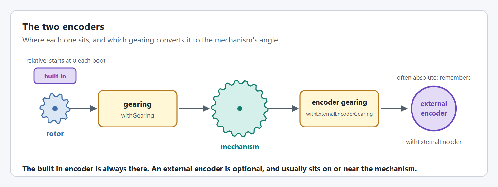
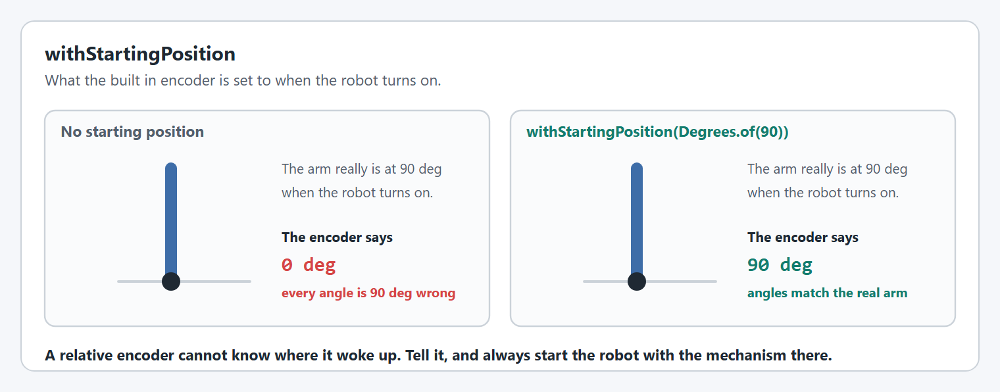
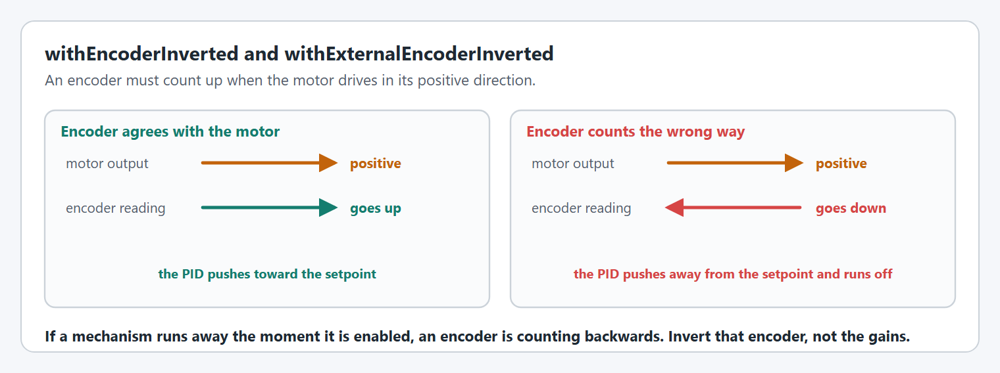
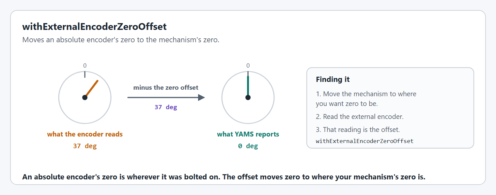
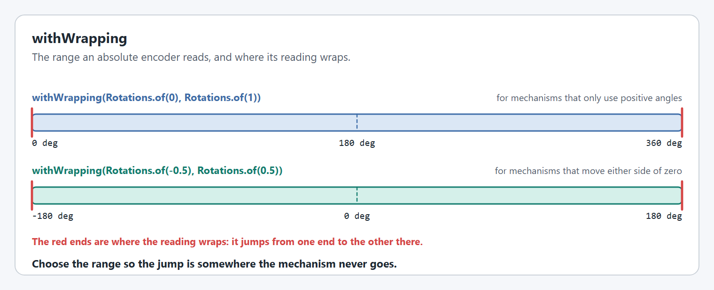
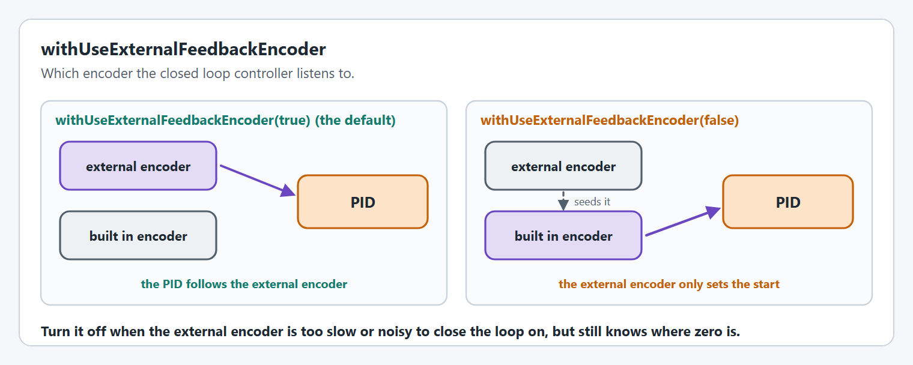
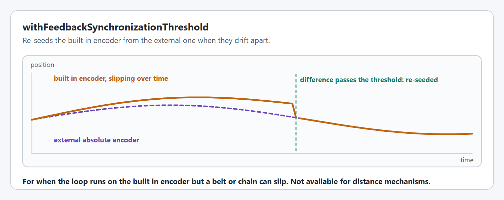
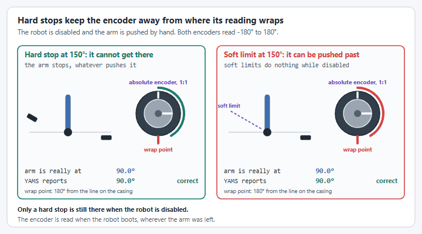
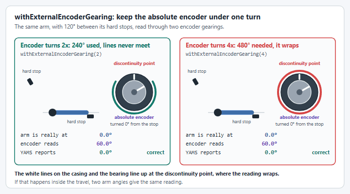

# Encoders

Every motor has a built in encoder. Many mechanisms add an external one that knows where the mechanism is when the robot turns on.


Not every option on this page is supported on every motor controller. Each option has a table showing where it works, and an option a controller cannot do throws a `SmartMotorControllerConfigurationException` or an `IllegalArgumentException` at startup. Each option says which. The [config overview](./#not-every-option-works-on-every-motor-controller) lists them all together.


<figure><figcaption><p>The built in encoder, the external encoder, and the gearing between them.</p></figcaption></figure>

## `withStartingPosition`

What the built in encoder is set to when the robot turns on.

<figure><figcaption><p>An arm that starts at 90°, with and without a starting position.</p></figcaption></figure>

```java
.withStartingPosition(Degrees.of(90))
.withStartingPosition(Meters.of(0))    // needs a circumference
```

Without it, wherever the mechanism happens to be at startup is called zero. [`withSimStartingPosition`](simulation.md#withsimstartingposition) sets a different value for simulation only.

### Why it matters for an arm with `kG`

A wrong angle is more than a wrong number on the dashboard. An [`ArmFeedforward`](feedforward.md) multiplies `kG` by the cosine of the arm's angle, so it gives the most voltage when the arm is level and none when it is straight up. It uses the angle YAMS thinks the arm is at. If the arm does not start at 0° and you do not say so, that angle is wrong, and a `kG` you tuned carefully is applied in the wrong places.

<figure><figcaption><p>The same tuned <code>kG</code>. Without the starting position it is applied at the wrong angles.</p></figcaption></figure>

| The arm is really | Needed to hold it | `kG` gives, with no starting position | What happens                                                  |
| ----------------- | ----------------- | ------------------------------------- | ------------------------------------------------------------- |
| Straight up, 90°  | Nothing           | All of `kG`                           | The arm is pushed away from where it should rest              |
| Level, 0°         | All of `kG`       | Nothing                               | The arm sags, and the PID has to make up the whole difference |
| Below level, -20° | Most of `kG`      | A negative voltage                    | The arm is pushed down, the wrong way                         |

So set the starting position before you tune `kG`. A `kG` tuned on an arm with the wrong zero only looks right at the one angle it was tuned at.

**Supported on:** every supported motor controller.

## `withEncoderInverted`

Inverts the motor's built in encoder.

<figure><figcaption><p>What a backwards encoder does to closed loop control.</p></figcaption></figure>

```java
.withEncoderInverted(true)
```

Most built in encoders are fixed to the rotor and follow [`withMotorInverted`](motor-basics.md#withmotorinverted), so they rarely need this. Flip the motor first.

**Not supported everywhere.** It only works on a TalonFXS, and throws on every other controller: a `SmartMotorControllerConfigurationException` on a TalonFX, and an `IllegalArgumentException` on a SPARK, Thrifty Nova or A301.

| TalonFX | TalonFXS | SPARK MAX / Flex | Thrifty Nova | A301 |
| ------- | -------- | ---------------- | ------------ | ---- |
| ❌       | ✅        | ❌                | ❌            | ❌    |

## `withExternalEncoderInverted`

Inverts the [external encoder](#withexternalencoder). Use it when the external encoder counts down while the mechanism moves in the positive direction.

```java
.withExternalEncoder(cancoder)
.withExternalEncoderInverted(true)
```

It throws a `SmartMotorControllerConfigurationException` if no external encoder is configured.

**Supported on:** every supported motor controller, with an external encoder.

## `withExternalEncoder`

Attaches an external encoder. It must be one the motor controller can read directly.

```java
.withExternalEncoder(spark.getAbsoluteEncoder())
.withExternalEncoder(new CANcoder(5, new CANBus(CANPort.CAN_S0)))
```

The encoders each wrapper accepts are listed in the [feature matrix](../feature-matrix.md#external-encoders). [How do I use absolute encoders on my arm?](../../../how-to/how-do-i-use-absolute-encoders-on-my-arm.md) has a complete example for each vendor.


**The rule for every absolute encoder:** it must never reach its wrap point, where its reading wraps, anywhere in the mechanism's travel. Use real hard stops, keep the travel under one turn of the encoder, and on a 1:1 encoder set the [zero offset](#withexternalencoderzerooffset) at the mechanism's zero with [`withWrapping(Rotations.of(-0.5), Rotations.of(0.5))`](#withwrapping). [Why: absolute encoders and where they wrap](#why-absolute-encoders-and-where-they-wrap) explains it.


**Supported on every motor controller.** Every controller accepts an external encoder, but only ones it can read itself. An encoder from another vendor cannot be used. An A301 only accepts its own absolute encoder, which is on its output shaft, after its gearbox: pass the `A301` itself, as in `.withExternalEncoder(a301)`. The A301 does not report that encoder's velocity, so YAMS takes it from the built in encoder.

| TalonFX               | TalonFXS              | SPARK MAX / Flex                                  | Thrifty Nova                                                    | A301 |
| --------------------- | --------------------- | ------------------------------------------------- | --------------------------------------------------------------- | ---- |
| ✅ `CANcoder`, `CANdi` | ✅ `CANcoder`, `CANdi` | ✅ its absolute encoder, its alternate (MAX) or external (Flex) quadrature encoder, or a REV `DetachedEncoder` | ✅ data port absolute or quadrature encoder, Thrifty CAN encoder | ⚠️ its own absolute encoder only |

## `withExternalEncoderGearing`

The reduction between the mechanism and the external encoder, for an encoder that is not mounted 1:1 on the mechanism's output. The default is 1:1.

The number is how many times the encoder turns for one turn of the mechanism. It appears on the right of the diagram at the top of this page.

```java
// The encoder is on an earlier stage and turns 2 times for each mechanism turn.
// Finer resolution, but YAMS warns at startup: the encoder wraps sooner.
.withExternalEncoderGearing(2)

// The encoder is geared down and turns half a turn for each mechanism turn.
// It cannot wrap within one mechanism turn, so there is no warning.
.withExternalEncoderGearing(0.5)

// The same half turn, written as a 1:2 stage.
.withExternalEncoderGearing(new MechanismGearing(GearBox.fromStages("1:2")))
```

Leave it out when the encoder is mounted 1:1 on the mechanism's output, which is the safest place for an absolute encoder. It throws a `SmartMotorControllerConfigurationException` if no external encoder is configured.

On an A301 it is the gearing from the A301's output shaft, where its absolute encoder is, to the mechanism: for example, 3 for a 3:1 chain after the A301's gearbox.


A number above 1 makes the encoder turn further than the mechanism, so it reaches its wrap point sooner. YAMS prints a warning for it, which is safe to ignore **only** if the travel between the hard stops, multiplied by the gearing, is less than one turn: see [Only gear an absolute encoder if it cannot wrap](#only-gear-an-absolute-encoder-if-it-cannot-wrap).


**Supported on:** every supported motor controller.

## `withExternalEncoderZeroOffset`

Moves an absolute encoder's zero to the mechanism's zero.

<figure><figcaption><p>The offset is what the encoder reads when the mechanism is at zero.</p></figcaption></figure>

```java
.withExternalEncoderZeroOffset(Degrees.of(37))
```

To find it, move the mechanism to where you want zero and read the external encoder. A negative offset is wrapped into the positive range for you. The wrap point moves with the zero offset: see [Zero offsets and wrapping](#zero-offsets-and-wrapping). The distance version needs a [circumference](gearing-and-units.md#withmechanismcircumference).

**Not supported everywhere.** On a quadrature encoder it throws a `SmartMotorControllerConfigurationException`.

| TalonFX | TalonFXS | SPARK MAX / Flex          | Thrifty Nova                      | A301 |
| ------- | -------- | ------------------------- | --------------------------------- | ---- |
| ✅       | ✅        | ⚠️ absolute encoders only (its absolute encoder or a `DetachedEncoder`) | ⚠️ absolute and CAN encoders only | ✅    |

## `withWrapping`

Chooses the range an absolute encoder reads, and so where its reading wraps. The closed loop does not wrap: it never takes the mechanism the other way round to a setpoint, so it can be used together with [soft limits](limits-and-protection.md#withsoftlimits).

<figure><figcaption><p>The two ranges an absolute encoder usually reads.</p></figcaption></figure>

```java
.withWrapping(Rotations.of(-0.5), Rotations.of(0.5)) // reads -180° to 180°
.withWrapping(Rotations.of(0), Rotations.of(1))      // reads 0° to 360°
```

The range is one rotation. A mechanism that can turn all the way round, such as a turret or a swerve module, uses [`withContinuousWrapping`](closed-loop-control.md#withcontinuouswrapping) instead: it sets the same range, and the closed loop also takes the shortest way to a setpoint. Without either, a SPARK, Thrifty Nova or A301 absolute encoder reads 0° to 360°, and a `CANcoder` or `CANdi` keeps the range it has.

**Not the same everywhere.** Each motor controller accepts only the ranges its encoder can read, and throws a `SmartMotorControllerConfigurationException` for any other. Without an absolute encoder, the range has no effect.

| TalonFX                                             | TalonFXS                                            | SPARK MAX / Flex                                                                                        | Thrifty Nova                                                               | A301                                     |
| --------------------------------------------------- | --------------------------------------------------- | ------------------------------------------------------------------------------------------------------- | -------------------------------------------------------------------------- | ---------------------------------------- |
| ✅ `CANcoder`, `CANdi`: any range from [-1, 0) to [0, 1) | ✅ `CANcoder`, `CANdi`: any range from [-1, 0) to [0, 1) | ⚠️ its absolute encoder: any range from [-1, 0) to [0, 1). A `DetachedEncoder`: [-0.5, 0.5) or [0, 1) | ⚠️ [0, 1) when the Nova closes its loop on the encoder, any range otherwise | ✅ any range from [-1, 0) to [0, 1) |

## `withUseExternalFeedbackEncoder`

Chooses which encoder the closed loop controller follows. The default is `true`: the external encoder, when there is one.

<figure><figcaption><p>The external encoder as the feedback sensor, or only as the starting point.</p></figcaption></figure>

```java
.withUseExternalFeedbackEncoder(false)
```

**Not the same everywhere.** On a SPARK, Thrifty Nova or A301, `false` still uses an absolute external encoder for the starting position, as in the picture. On a TalonFX or TalonFXS, `false` stops YAMS using the external encoder at all: the built in encoder starts from [`withStartingPosition`](#withstartingposition), and setting the external encoder's inversion or gearing then throws a `SmartMotorControllerConfigurationException`.

| TalonFX                                   | TalonFXS                                  | SPARK MAX / Flex | Thrifty Nova | A301 |
| ----------------------------------------- | ----------------------------------------- | ---------------- | ------------ | ---- |
| ⚠️ `false` ignores the external encoder | ⚠️ `false` ignores the external encoder | ✅                | ✅            | ✅    |

## `withFeedbackSynchronizationThreshold`

When the loop follows the built in encoder, re-seeds it from the external encoder whenever the two disagree by more than this.

<figure><figcaption><p>The built in encoder is re-seeded when it drifts past the threshold.</p></figcaption></figure>

```java
.withUseExternalFeedbackEncoder(false)
.withFeedbackSynchronizationThreshold(Degrees.of(2))
```

It is not available for distance mechanisms: it throws a `SmartMotorControllerConfigurationException` if a circumference is set.

**Not supported everywhere.** Where it is not supported it throws an `IllegalArgumentException` on a TalonFX or TalonFXS, and a `SmartMotorControllerConfigurationException` on a SPARK.

| TalonFX | TalonFXS | SPARK MAX / Flex                                                                  | Thrifty Nova                | A301                        |
| ------- | -------- | --------------------------------------------------------------------------------- | --------------------------- | --------------------------- |
| ❌       | ❌        | ⚠️ only with an exponential profile or an [LQR controller](../lqr-controllers.md) | ⚠️ only in closed loop mode | ⚠️ only in closed loop mode |

## Why: absolute encoders and where they wrap

The rule under [`withExternalEncoder`](#withexternalencoder) is all you need to set an encoder up. This section explains it.

### Keep the wrap point outside the travel

This applies to **every absolute encoder, whether it is geared or mounted 1:1**.

An absolute encoder only knows where it is within one turn of its own shaft. The place where its reading wraps is its **wrap point**. It is clearly marked on an absolute encoder, usually as a white line on the casing and another on the bearing: when the two lines line up, the encoder reads zero. With [`withWrapping`](#withwrapping) over [0, 1) and no zero offset, that is also where it wraps. Wrapping over [-0.5, 0.5) moves the wrap point to 180° from the line on the casing. The line itself does not move. A zero offset moves the wrap point too: see [Zero offsets and wrapping](encoders.md#zero-offsets-and-wrapping). If the encoder passes its wrap point anywhere inside the mechanism's travel, two different mechanism positions give the same reading and YAMS cannot tell them apart.

<figure><figcaption><p>A hard stop keeps the encoder away from its wrap point. A soft limit does not, because it does nothing while the robot is disabled.</p></figcaption></figure>

An absolute encoder should only be used when careful installation guarantees that it never reaches its wrap point anywhere in the range of motion:

* **Adequate hard stops.** The mechanism must be physically unable to leave the range. [Soft limits](limits-and-protection.md#withsoftlimits) are not enough: they do nothing when the robot is disabled and pushed by hand, and the encoder is read when the robot boots.
* **Less than one encoder turn of travel.** The travel between the hard stops must be less than one rotation of the encoder. A 1:1 encoder on a mechanism that turns all the way round, or more, cannot meet this.
* **The wrap point outside the travel.** On a 1:1 encoder, [`withWrapping(Rotations.of(-0.5), Rotations.of(0.5))`](encoders.md#withwrapping) should be sufficient. On a geared encoder, also install it so that the encoder never reaches its wrap point anywhere between the hard stops, with some margin at both ends. Move the mechanism from one hard stop to the other by hand and watch the white lines to check.


**Without gearing, wrapping over [-0.5, 0.5) should be sufficient.** With [`withWrapping(Rotations.of(0), Rotations.of(1))`](encoders.md#withwrapping) the reading goes from 0 to 360° and wraps at the line on the casing. With `withWrapping(Rotations.of(-0.5), Rotations.of(0.5))` it goes from -180° to 180° and wraps 180° from the line. The line on the casing does not move, only the wrap point does. With a [zero offset](encoders.md#zero-offsets-and-wrapping) set at the mechanism's zero, the wrap point is 180° from the mechanism's zero, so a 1:1 mechanism that stays within 180° of its zero never reaches it.


<figure><figcaption><p>Wrapping over [0, 1), the wrap point is at the line on the casing. Over [-0.5, 0.5) it is 180° from it, and the line has not moved.</p></figcaption></figure>

[Gearing the encoder](encoders.md#withexternalencodergearing) is where this needs real care, because the encoder then turns further than the mechanism and choosing the range alone is no longer enough. [That section](encoders.md#only-gear-an-absolute-encoder-if-it-cannot-wrap) has its own animation.

### Only gear an absolute encoder if it cannot wrap

Gearing an absolute encoder up gives finer resolution, but it also uses up the encoder's one turn faster, so it reaches its [wrap point](encoders.md#keep-the-wrap-point-outside-the-travel) sooner.

<figure><figcaption><p>The same arm and hard stops. Both read [0, 1), so they wrap at the line on the casing. With a gearing of 2 the white lines never meet. With a gearing of 4 they do, and the reported angle is wrong.</p></figcaption></figure>

Encoder gearing can and should be used on an absolute encoder **only** when careful installation guarantees that it never wraps anywhere in the range of motion. The [three conditions for every absolute encoder](encoders.md#keep-the-wrap-point-outside-the-travel) still apply, and the second one gets stricter: the travel between the hard stops, **multiplied by the gearing**, must be less than one rotation. In the animation, 120° x 2 = 240° fits and 120° x 4 = 480° does not.

If you cannot guarantee that, mount the encoder 1:1 on the mechanism's output, where wrapping over [-0.5, 0.5) should be sufficient.

### Zero offsets and wrapping

The zero offset and the wrapping range work together, and the order matters: **the offset is applied first, and the range is applied to the result**. So the wrap point is measured from the encoder's zero, not from the line on the casing.

<figure><figcaption><p>The zero offset moves the zero, and the wrap point moves with it. The line on the casing stays where it is.</p></figcaption></figure>

| Zero offset                 | Wrapping over [0, 1)                | Wrapping over [-0.5, 0.5)                     |
| --------------------------- | ----------------------------------- | --------------------------------------------- |
| None                        | Wraps where the white lines line up | Wraps 180° from where the white lines line up |
| Set at the mechanism's zero | Wraps at the mechanism's zero       | Wraps 180° from the mechanism's zero          |

What this means in practice:

* **The white lines tell you where the wrap is only when there is no zero offset.** Once an offset is set, work from the mechanism's zero instead.
* **Set the zero offset first, then choose the range.** With the offset at the mechanism's zero and wrapping over [-0.5, 0.5), a 1:1 encoder wraps as far from zero as it can, however it was installed.
* **A geared encoder is still limited to one turn.** The same rule applies to the encoder's own shaft: 180° of the encoder is `180° / gearing` of the mechanism. See [Only gear an absolute encoder if it cannot wrap](encoders.md#only-gear-an-absolute-encoder-if-it-cannot-wrap).

#### Where each motor controller applies them

The wrap point only moves with the zero offset because the offset is applied first. That is the case on every encoder YAMS supports:

| Encoder                                              | Zero offset applied         | Range applied                                          |
| ---------------------------------------------------- | --------------------------- | ------------------------------------------------------ |
| `CANcoder`, `CANdi` (TalonFX, TalonFXS)              | On the encoder              | On the encoder, after the offset                       |
| SPARK absolute encoder, REV CAN encoder              | On the SPARK or the encoder | On the SPARK or the encoder, after the offset          |
| Nova data port absolute encoder, Thrifty CAN encoder | On the Nova or the encoder  | By YAMS, on the reading the device has already offset  |
| A301 absolute encoder                                | By YAMS                     | By YAMS, after the offset                              |


**Gearing does not move the wrap point.** The zero offset is given in mechanism angle and converted for you, but the wrapping range is always one rotation of the **encoder's own shaft**. On a geared encoder, wrapping over [-0.5, 0.5) wraps `180° / gearing` of the mechanism from zero, not 180°. See [Only gear an absolute encoder if it cannot wrap](encoders.md#only-gear-an-absolute-encoder-if-it-cannot-wrap).



An offset you apply yourself is different. If you leave the encoder's zero offset unset and subtract an angle from the reading in your own code, the encoder's range has already been applied, so the wrap point stays where it was and only the numbers shift.


## Code reference

* [`SmartMotorControllerConfig`](https://javadocs.yassrobotics.com/yams/yams/core/motorcontrollers/SmartMotorControllerConfig.html)
