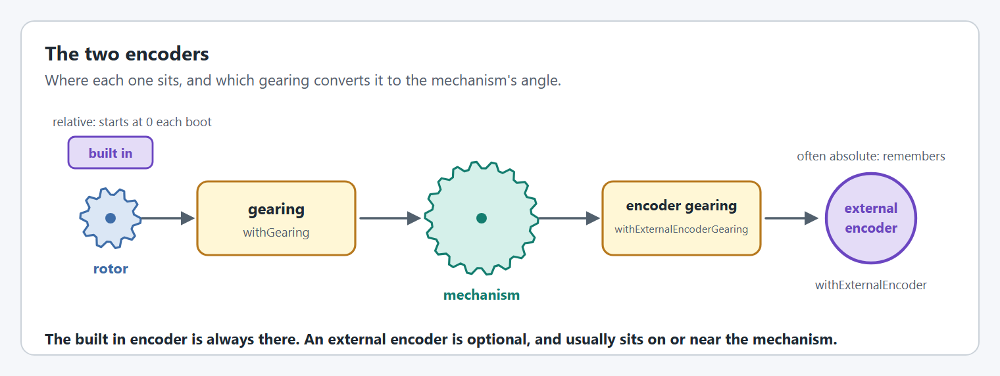
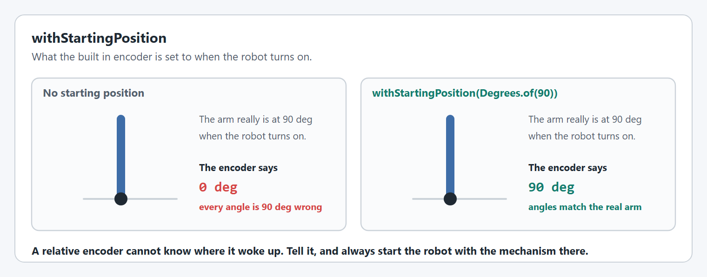
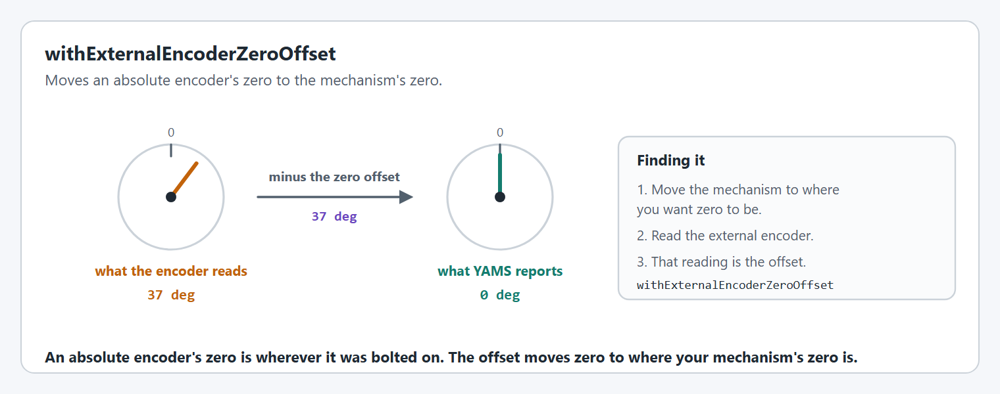
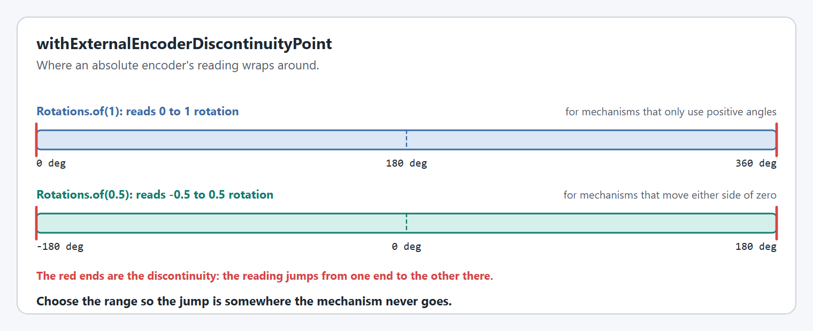
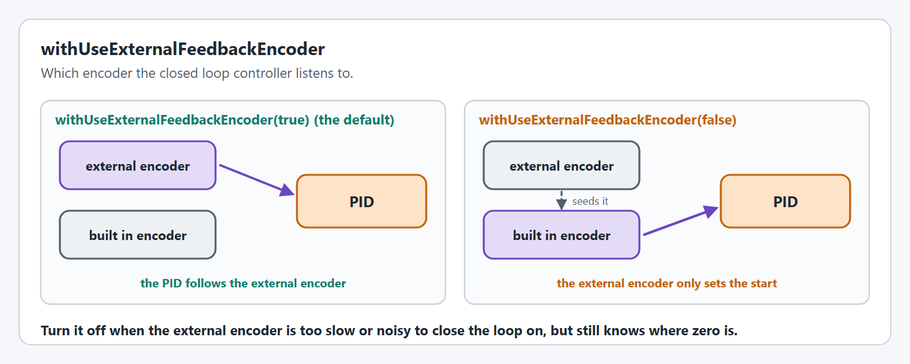
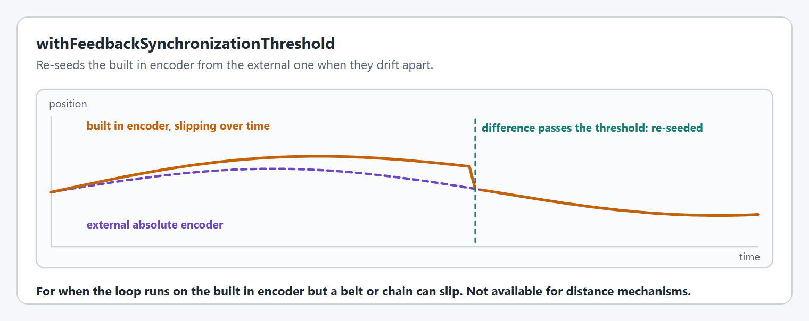

# Encoders

Every motor has a built in encoder. Many mechanisms add an external one that knows where the mechanism is when the robot turns on.


Not every option on this page is supported on every motor controller. Each option has a table showing where it works, and an option a controller cannot do throws at startup. The [config overview](README.md#not-every-option-works-on-every-motor-controller) lists them all together.


<figure><figcaption><p>The built in encoder, the external encoder, and the gearing between them.</p></figcaption></figure>

## `withStartingPosition`

What the built in encoder is set to when the robot turns on.

<figure><figcaption><p>An arm that starts at 90°, with and without a starting position.</p></figcaption></figure>

```java
.withStartingPosition(Degrees.of(90))
.withStartingPosition(Meters.of(0))    // needs a circumference
```

Without it, wherever the mechanism happens to be at startup is called zero. [`withSimStartingPosition`](simulation.md#withsimstartingposition) sets a different value for simulation only.

**Supported on:** every supported motor controller.

## `withEncoderInverted`

Inverts the built in encoder. Use `withExternalEncoderInverted` for the external one.

<figure><figcaption><p>What a backwards encoder does to closed loop control.</p></figcaption></figure>

```java
.withExternalEncoderInverted(true)
```

Most built in encoders are fixed to the rotor and follow [`withMotorInverted`](motor-basics.md#withmotorinverted), so they rarely need this.

**Not supported everywhere.** `withEncoderInverted` only works on a TalonFXS and throws on every other controller. `withExternalEncoderInverted` works on every controller that has an external encoder configured.

| TalonFX | TalonFXS | SPARK MAX / Flex | Thrifty Nova |
| --- | --- | --- | --- |
| ❌ | ✅ | ❌ | ❌ |

`withExternalEncoderInverted` throws if no external encoder is configured.

## `withExternalEncoder`

Attaches an external encoder. It must be one the motor controller can read directly.

```java
.withExternalEncoder(spark.getAbsoluteEncoder())
.withExternalEncoder(new CANcoder(5, new CANBus(CANPort.CAN_S0)))
```

The encoders each wrapper accepts are listed in the [feature matrix](../feature-matrix.md#external-encoders). [How do I use absolute encoders on my Arm?](../../../how-to/how-do-i-use-absolute-encoders-on-my-arm.md) has a complete example for each vendor.


An absolute encoder only knows its position within one rotation of its own shaft. Mount it so it turns no more than once over the mechanism's whole travel, unless you know what you are doing.


**Supported on every motor controller.** Every controller accepts an external encoder, but only ones it can read itself. An encoder from another vendor cannot be used.

| TalonFX | TalonFXS | SPARK MAX / Flex | Thrifty Nova |
| --- | --- | --- | --- |
| ✅ `CANcoder`, `CANdi` | ✅ `CANcoder`, `CANdi` | ✅ its own absolute, alternate or external encoder | ✅ data port absolute or quadrature encoder, Thrifty CAN encoder |

## `withExternalEncoderGearing`

The reduction between the mechanism and the external encoder, for an encoder that is not mounted 1:1 on the mechanism's output. The default is 1:1.

```java
.withExternalEncoderGearing(new MechanismGearing(GearBox.fromStages("1:2")))
.withExternalEncoderGearing(0.5)
```

The number is how many times the encoder turns for one turn of the mechanism: `2` means the encoder turns twice as far as the mechanism. It appears on the right of the diagram at the top of this page. It throws if no external encoder is configured.

### Only gear an absolute encoder if it cannot wrap

An absolute encoder only knows where it is within one turn of its own shaft. Gearing it up gives finer resolution, but it also uses up that one turn faster. If the encoder passes its wrap point anywhere inside the mechanism's travel, two different mechanism positions give the same reading and YAMS cannot tell them apart.

<figure><figcaption><p>The same arm and hard stops. A gearing of 2 never wraps. A gearing of 4 does, and the reported angle is wrong.</p></figcaption></figure>

Encoder gearing can and should be used on an absolute encoder **only** when careful installation guarantees that it never wraps anywhere in the range of motion:

* **Adequate hard stops.** The mechanism must be physically unable to leave the range. [Soft limits](limits-and-protection.md#withsoftlimits) are not enough: they do nothing when the robot is disabled and pushed by hand, and the encoder is read when the robot boots.
* **Less than one encoder turn of travel.** The travel between the hard stops, multiplied by the gearing, must be less than one rotation. In the animation, 120° x 2 = 240° fits and 120° x 4 = 480° does not.
* **The wrap point outside the travel.** Install the encoder, and set its [zero offset](#withexternalencoderzerooffset) and [discontinuity point](#withexternalencoderdiscontinuitypoint), so that the wrap falls outside the hard stops with some margin on both sides.

If you cannot guarantee all three, mount the encoder 1:1 on the mechanism's output.


YAMS reports a warning when the gearing makes the encoder turn further than the mechanism. It is safe to ignore **only** when all three conditions above are met.


**Supported on:** every supported motor controller.

## `withExternalEncoderZeroOffset`

Moves an absolute encoder's zero to the mechanism's zero.

<figure><figcaption><p>The offset is what the encoder reads when the mechanism is at zero.</p></figcaption></figure>

```java
.withExternalEncoderZeroOffset(Degrees.of(37))
```

A negative offset is wrapped into the positive range for you. The distance version needs a [circumference](gearing-and-units.md#withmechanismcircumference).

**Not supported everywhere.** On a quadrature encoder it throws.

| TalonFX | TalonFXS | SPARK MAX / Flex | Thrifty Nova |
| --- | --- | --- | --- |
| ✅ | ✅ | ⚠️ absolute encoders only | ⚠️ absolute and CAN encoders only |

## `withExternalEncoderDiscontinuityPoint`

Chooses where an absolute encoder's reading wraps.

<figure><figcaption><p>The two ranges an absolute encoder can report.</p></figcaption></figure>

```java
.withExternalEncoderDiscontinuityPoint(Rotations.of(0.5)) // reads -180° to 180°
.withExternalEncoderDiscontinuityPoint(Rotations.of(1))   // reads 0° to 360°
```

Only `0.5` and `1` rotations are accepted. Like the zero offset, it is for absolute encoders only.

**Not supported everywhere.** On a quadrature encoder it throws.

| TalonFX | TalonFXS | SPARK MAX / Flex | Thrifty Nova |
| --- | --- | --- | --- |
| ✅ | ✅ | ⚠️ absolute encoders only | ⚠️ absolute and CAN encoders only |

## `withUseExternalFeedbackEncoder`

Chooses which encoder the closed loop controller follows. The default is `true`: the external encoder, when there is one.

<figure><figcaption><p>The external encoder as the feedback sensor, or only as the starting point.</p></figcaption></figure>

```java
.withUseExternalFeedbackEncoder(false)
```

## `withFeedbackSynchronizationThreshold`


When the loop follows the built in encoder, re-seeds it from the external encoder whenever the two disagree by more than this.

<figure><figcaption><p>The built in encoder is re-seeded when it drifts past the threshold.</p></figcaption></figure>

```java
.withUseExternalFeedbackEncoder(false)
.withFeedbackSynchronizationThreshold(Degrees.of(2))
```

It is not available for distance mechanisms: it throws if a circumference is set.

**Not supported everywhere.** It throws where it is not supported.

| TalonFX | TalonFXS | SPARK MAX / Flex | Thrifty Nova |
| --- | --- | --- | --- |
| ❌ | ❌ | ⚠️ only with an exponential profile or an LQR controller | ⚠️ only in closed loop mode |


## Code Reference

* [`SmartMotorControllerConfig`](https://yet-another-software-suite.github.io/YAMS/javadocs/yams/motorcontrollers/SmartMotorControllerConfig.html)
