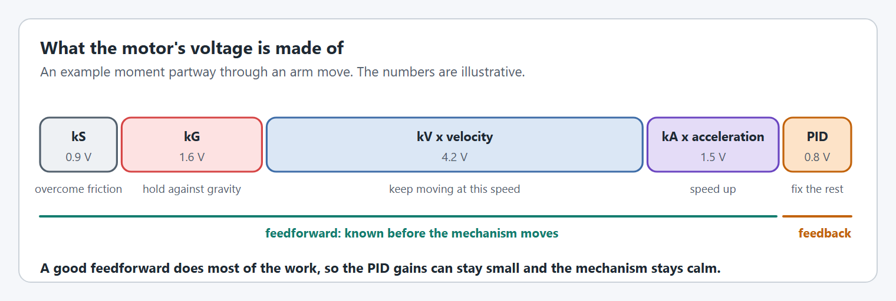
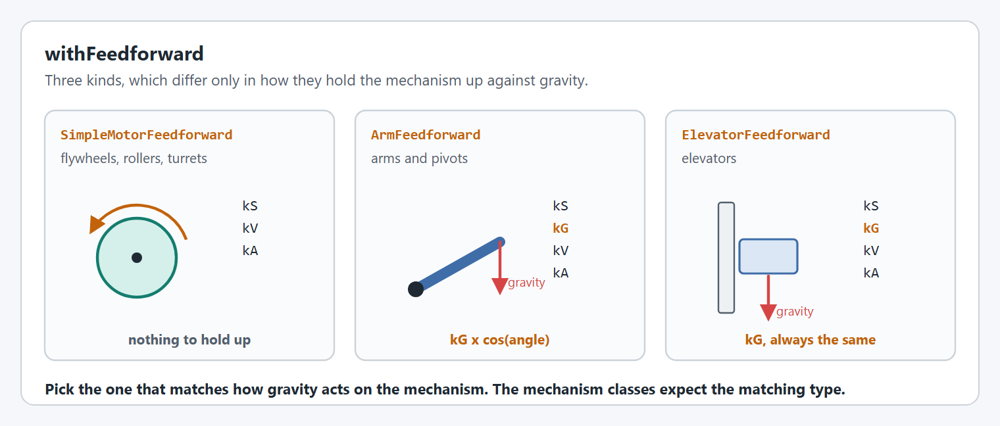

# Feedforward

A feedforward predicts the voltage a move needs from what you know about the mechanism, before any error has built up. The PID then only has to fix what the prediction missed.

<figure><figcaption><p>The parts of the output voltage at one moment in a move.</p></figcaption></figure>

## `withFeedforward`

Takes one of WPILib's three feedforward classes.

<figure><figcaption><p>The three feedforward types.</p></figcaption></figure>

```java
.withFeedforward(new SimpleMotorFeedforward(0.1, 0.12, 0.01))   // kS, kV, kA
.withFeedforward(new ArmFeedforward(0.1, 0.35, 1.2, 0.02))      // kS, kG, kV, kA
.withFeedforward(new ElevatorFeedforward(0.1, 0.4, 3.5, 0.1))   // kS, kG, kV, kA
```

| Gain | What it is for | How to find it |
| --- | --- | --- |
| `kS` | The voltage that just overcomes friction. | Raise the voltage slowly until the mechanism starts to move. |
| `kG` | The voltage that holds the mechanism against gravity. | The voltage at which it neither rises nor falls. For an arm, measure it with the arm level. |
| `kV` | The voltage per unit of speed. | Volts above `kS` divided by the steady speed it gives. |
| `kA` | The voltage per unit of acceleration. | Usually small. Raise it if the mechanism lags at the start of a move. |

`ArmFeedforward` and `SimpleMotorFeedforward` gains are per rotation of the mechanism. `ElevatorFeedforward` gains are per meter, and giving one makes the controller [distance based](closed-loop-control.md#withlinearclosedloopcontroller).

[Live tuning](../../live-tuning/README.md) has the full order for finding these, and [Exponential profiles](../exponential-profiles.md#measuring-kv-and-ka-without-sysid) shows how to measure `kV` and `kA` from one voltage step.

### Slots

A feedforward can be given a slot, so it switches together with the [PID gains in that slot](closed-loop-control.md#slots).

```java
.withFeedforward(new ArmFeedforward(0.1, 0.35, 1.2), ClosedLoopControllerSlot.SLOT_0)
.withFeedforward(new ArmFeedforward(0.1, 0.60, 1.2), ClosedLoopControllerSlot.SLOT_1) // holding a game piece
```

**Supported on:** every supported motor controller.


## Code Reference

* [`SmartMotorControllerConfig`](https://yet-another-software-suite.github.io/YAMS/javadocs/yams/motorcontrollers/SmartMotorControllerConfig.html)
