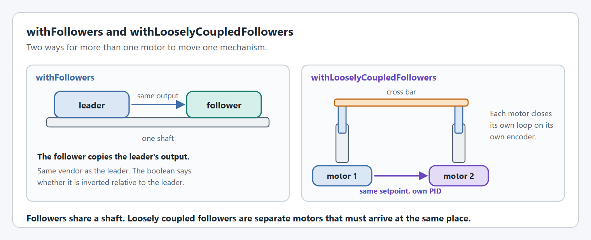

# Followers

Two ways to have more than one motor move one mechanism.

<figure><figcaption><p>Followers on one shaft, and loosely coupled followers.</p></figcaption></figure>

## `withFollowers`

For motors on the same shaft or gearbox. Each follower copies the leader's output, so only the leader needs a config.

```java
.withFollowers(Pair.of(new SparkMax(CANPorts.fromBusId(1), 4, MotorType.kBrushless), false),
               Pair.of(new SparkMax(CANPorts.fromBusId(1), 5, MotorType.kBrushless), true))
```

Pass the vendor's motor object, not a `SmartMotorController`. The boolean is whether that follower is inverted relative to the leader: motors facing each other across a gearbox usually are.

**Supported on every motor controller.** Followers must be the same vendor as the leader.

| TalonFX | TalonFXS | SPARK MAX / Flex | Thrifty Nova |
| --- | --- | --- | --- |
| ✅ TalonFX followers only | ✅ TalonFXS followers only | ✅ SPARK followers only | ✅ Nova followers only |

## `withLooselyCoupledFollowers`

For motors that are not on the same shaft but must arrive at the same place, such as two linear actuators joined by a cross bar. Each follower is a full `SmartMotorController` with its own config and its own closed loop, and is sent the leader's position and velocity setpoints.

```java
SmartMotorControllerConfig config = new SmartMotorControllerConfig(this) /* ... */;
SmartMotorController right = new TalonFXWrapper(rightTalon, DCMotor.getKrakenX60(1), config.clone());
SmartMotorController left  = new SparkWrapper(leftSpark, DCMotor.getNEO(1),
                                              config.withLooselyCoupledFollowers(right));
```

Because each motor closes its own loop, loosely coupled followers can be different vendors.

**Supported on:** every supported motor controller.


Loosely coupled followers are only sent position and velocity setpoints. Voltage and duty cycle requests are **not** forwarded, so driving the leader with a raw voltage moves the leader alone.



## Code Reference

* [`SmartMotorControllerConfig`](https://yet-another-software-suite.github.io/YAMS/javadocs/yams/motorcontrollers/SmartMotorControllerConfig.html)
