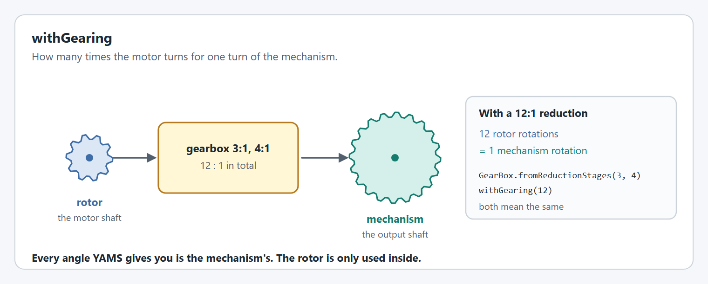
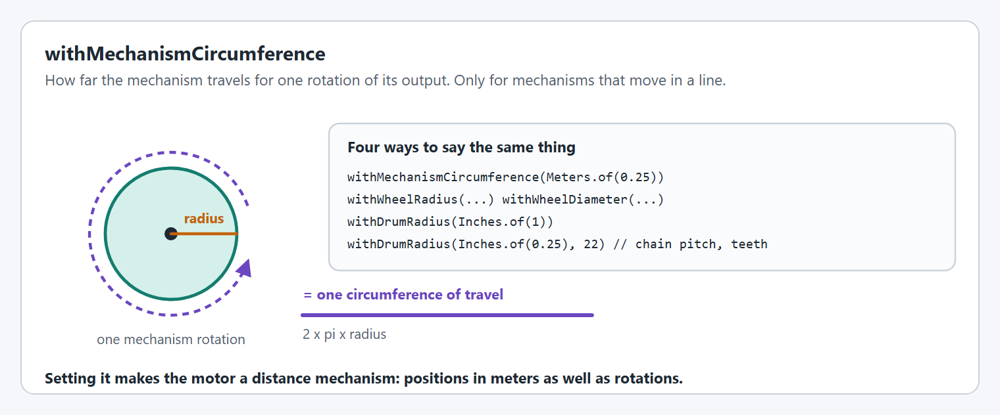
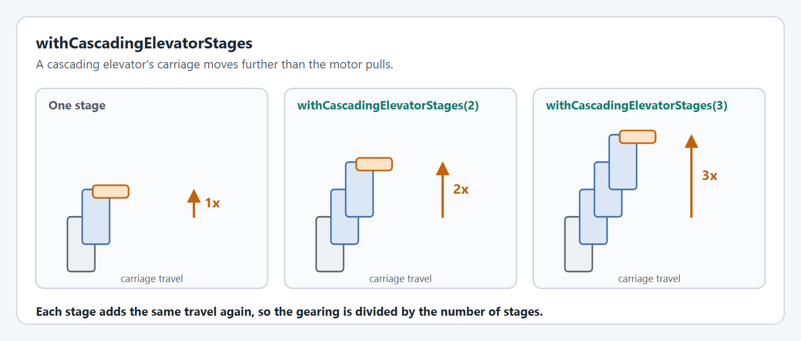

# Gearing and units

These options tell YAMS how the motor's rotation becomes the mechanism's movement. Every position and velocity YAMS reports depends on them, so get them right before tuning.

The options on this page connect the **rotor** (the motor's own shaft), the **mechanism** (the output after the gearing) and the **measurement** (the distance a mechanism moves in a line). [Rotor, mechanism and measurement](../../how-yams-drives-a-motor.md#rotor-mechanism-and-measurement) defines them with a picture.

## `withGearing`

The reduction between the rotor and the mechanism.

<figure><figcaption><p>A 12:1 reduction in two stages.</p></figcaption></figure>

```java
.withGearing(new MechanismGearing(GearBox.fromReductionStages(3, 4))) // 3:1 then 4:1
.withGearing(12)                                                       // the same, as one number
```

A reduction is a number greater than 1: a "3:1" gearbox is `3`, and a "1:2" overdrive is `0.5`. `GearBox.fromReductionStages` and `Sprocket.fromStages` let you write the stages as they are on the robot.

**Supported on:** every supported motor controller.

## `withMechanismCircumference`

How far the mechanism travels in one rotation of its output. Setting it lets you use distances (`Meters`, `Inches`) anywhere YAMS takes an angle.

<figure><figcaption><p>One rotation of the drum is one circumference of travel.</p></figcaption></figure>

```java
.withMechanismCircumference(Meters.of(0.25))
.withWheelRadius(Inches.of(2))            // or withWheelDiameter(Inches.of(4))
.withDrumRadius(Inches.of(1))
.withDrumRadius(Inches.of(0.25), 22)      // chain pitch and sprocket teeth
```

All of these set the same value. Use whichever matches what you can measure. [How do I find my mechanism's circumference?](../../../how-to/how-to-find-your-mechanism-circumference.md) covers the measuring.

Several options need it first and throw a `SmartMotorControllerConfigurationException` without it: distance `withSoftLimits`, distance `withExternalEncoderZeroOffset`, and anything else that takes a `Distance`.

**Supported on:** every supported motor controller.

## `withCascadingElevatorStages`

Divides the gearing by the number of cascading stages, because each stage adds the same travel again.

<figure><figcaption><p>The carriage of a cascading elevator moves further than the first stage.</p></figcaption></figure>

```java
.withGearing(new MechanismGearing(GearBox.fromReductionStages(5, 4)))
.withCascadingElevatorStages(2)
```

Call it after `withGearing`: it changes the gearing that is already set. Continuous elevators, where one belt or rope runs through every stage, do not need it.

**Supported on:** every supported motor controller.

## Code reference

* [`SmartMotorControllerConfig`](https://yet-another-software-suite.github.io/YAMS/javadocs/yams/motorcontrollers/SmartMotorControllerConfig.html)
