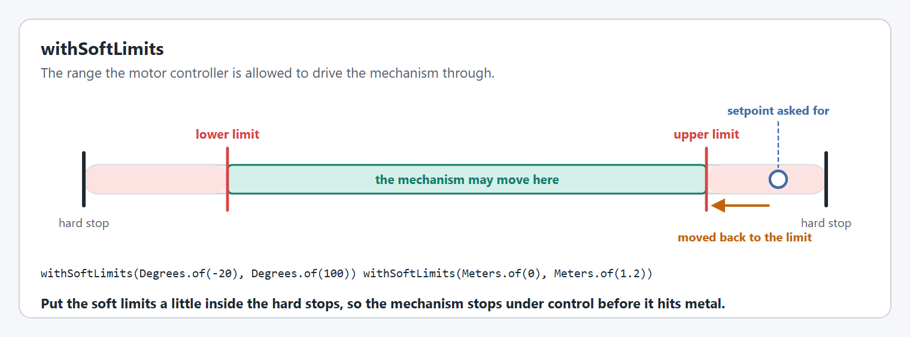
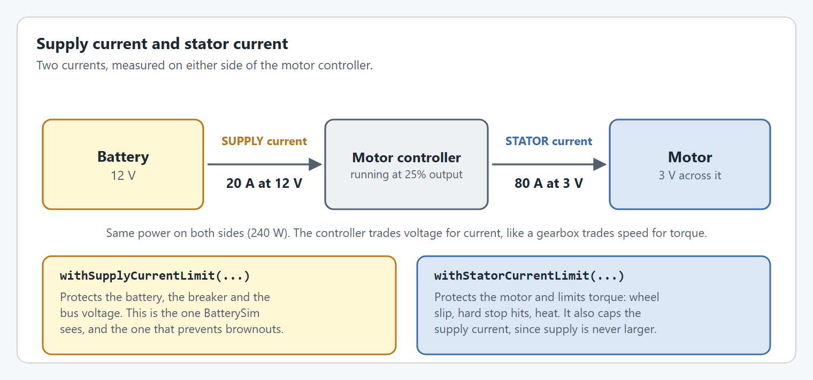
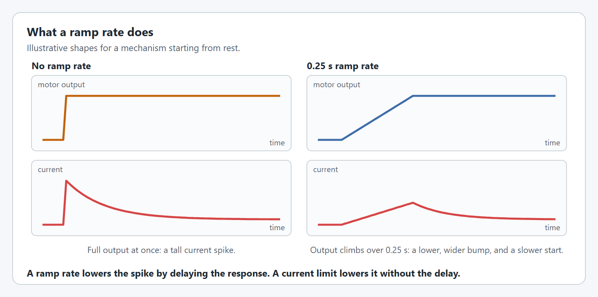
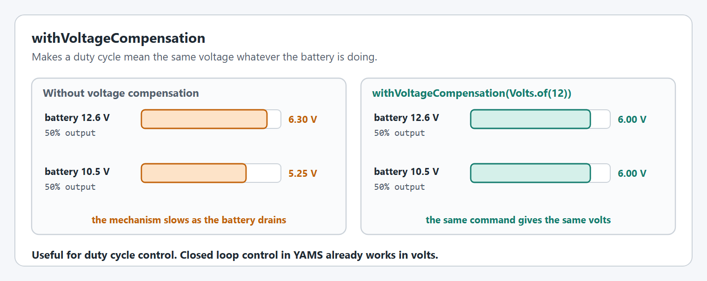
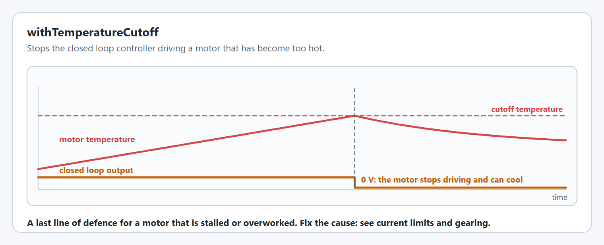

# Limits and protection

These options stop a mechanism or a motor from hurting itself or the rest of the robot.


Not every option on this page is supported on every motor controller. Each option has a table showing where it works, and an option a controller cannot do throws a `SmartMotorControllerConfigurationException` or an `IllegalArgumentException` at startup. Each option says which. The [config overview](README.md#not-every-option-works-on-every-motor-controller) lists them all together.


## `withSoftLimits`

The range the mechanism is allowed to move through.

<figure><figcaption><p>Soft limits sit a little inside the hard stops.</p></figcaption></figure>

```java
.withSoftLimits(Degrees.of(-20), Degrees.of(100))
.withSoftLimits(Meters.of(0), Meters.of(1.2))     // needs a circumference
```

The lower limit must be below the upper limit. Soft limits cannot be combined with [continuous wrapping](closed-loop-control.md#withcontinuouswrapping).

Soft limits rely on the encoder being right. If the mechanism does not start where the encoder thinks it does, the limits are in the wrong place: see [starting position](encoders.md#withstartingposition).

**Not supported everywhere.**

| TalonFX | TalonFXS | SPARK MAX / Flex | Thrifty Nova |
| --- | --- | --- | --- |
| ✅ | ✅ | ⚠️ only enforced in closed loop mode | ✅ |

## Current limits

`withStatorCurrentLimit` limits the current through the motor, which limits its torque and heat. `withSupplyCurrentLimit` limits the current drawn from the battery, which protects the breaker and the battery voltage.

<figure><figcaption><p>Supply current and stator current.</p></figcaption></figure>

```java
.withStatorCurrentLimit(Amps.of(40))
.withSupplyCurrentLimit(Amps.of(30))
```

[Limiting power consumption](../limiting-power-consumption.md#current-limits) explains how to choose them and how to test them against the [battery simulation](../../../understanding/battery-simulation.md).

**Not supported everywhere.** `withSupplyCurrentLimit` is not available on SPARKs.

| TalonFX | TalonFXS | SPARK MAX / Flex | Thrifty Nova |
| --- | --- | --- | --- |
| ✅ | ✅ | ⚠️ stator limit only: a supply limit throws a `SmartMotorControllerConfigurationException` | ✅ |

## Ramp rates

`withOpenLoopRampRate` and `withClosedLoopRampRate` set the shortest time the output may take to go from zero to full.

<figure><figcaption><p>The output with and without a ramp rate.</p></figcaption></figure>

```java
.withOpenLoopRampRate(Seconds.of(0.25))
.withClosedLoopRampRate(Seconds.of(0.1))
```

A ramp rate is the last thing to reach for. It slows everything the motor does, including the closed loop controller's reactions. To cut a mechanism's power draw, try these first, in order: a [motion profile](motion-profiles.md) if one suits the mechanism, then a [supply current limit](#current-limits) where the motor controller has one, then a [stator current limit](#current-limits) where it does not. Use a ramp rate only if none of those is enough. [Limiting power consumption](../limiting-power-consumption.md#ramp-rates) explains how they behave.

**Not supported everywhere.**

| TalonFX | TalonFXS | SPARK MAX / Flex | Thrifty Nova |
| --- | --- | --- | --- |
| ✅ | ✅ | ✅ | ⚠️ one ramp rate for both: two different values throw a `SmartMotorControllerConfigurationException` |

## `withVoltageCompensation`

Scales the output so a duty cycle means the same voltage whatever the battery voltage is.

<figure><figcaption><p>A 50% output at two battery voltages.</p></figcaption></figure>

```java
.withVoltageCompensation(Volts.of(12))
```

**Not supported everywhere.** It throws an `IllegalArgumentException` on a TalonFX or TalonFXS. Use a voltage request instead of a duty cycle there.

| TalonFX | TalonFXS | SPARK MAX / Flex | Thrifty Nova |
| --- | --- | --- | --- |
| ❌ | ❌ | ✅ | ✅ |

## `withTemperatureCutoff`

Stops the closed loop controller driving the motor once it reaches a temperature.

<figure><figcaption><p>The output drops to zero at the cutoff temperature.</p></figcaption></figure>

```java
.withTemperatureCutoff(Celsius.of(80))
```

While the motor is at or above the cutoff, the closed loop output is zero, so a mechanism that was being held up will drop. Treat it as a last resort and fix the cause with [current limits](../limiting-power-consumption.md) or gearing.


On a SPARK MAX or SPARK Flex with a **trapezoidal** profile, the cutoff does not work: the profile runs on the SPARK, and the cutoff is only checked by the loop on the SystemCore. Use an exponential profile if you rely on the cutoff.


**Not supported everywhere.** The cutoff is enforced by the closed loop running on the SystemCore, so it only works where the loop runs there. An [LQR controller](../lqr-controllers.md) always runs there, so the cutoff works with LQR on every motor controller.

| TalonFX | TalonFXS | SPARK MAX / Flex | Thrifty Nova |
| --- | --- | --- | --- |
| ⚠️ only with an [LQR controller](../lqr-controllers.md) | ⚠️ only with an [LQR controller](../lqr-controllers.md) | ⚠️ only with an exponential profile or an [LQR controller](../lqr-controllers.md) | ⚠️ only in closed loop mode |


## Code Reference

* [`SmartMotorControllerConfig`](https://yet-another-software-suite.github.io/YAMS/javadocs/yams/motorcontrollers/SmartMotorControllerConfig.html)
