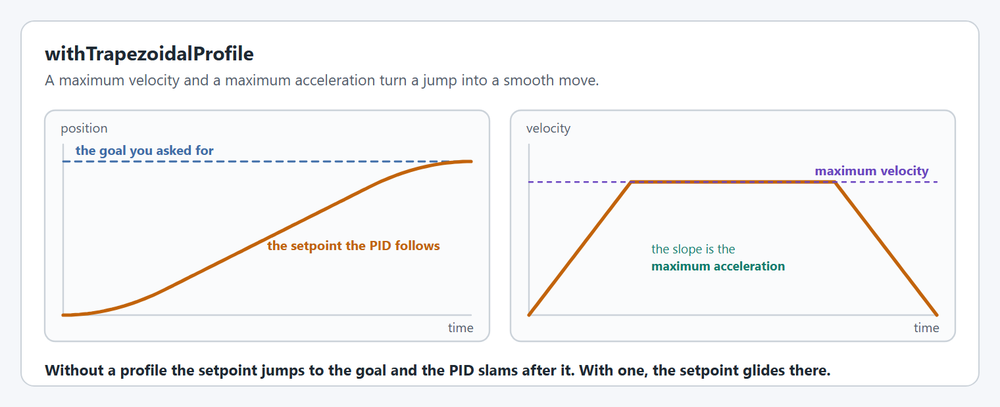
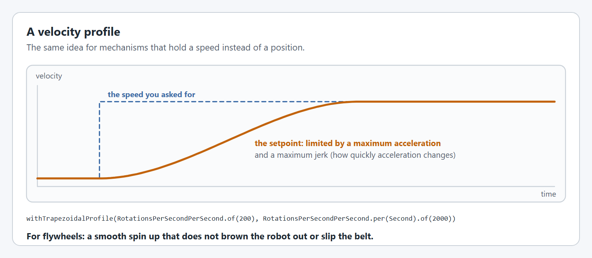

# Motion profiles

A motion profile turns a jump in the goal into a smooth path of setpoints for the closed loop controller to follow. Setting one profile replaces any other.

## `withTrapezoidalProfile`

A maximum velocity and a maximum acceleration.

<figure><figcaption><p>The setpoint glides to the goal, and its velocity makes a trapezoid.</p></figcaption></figure>

```java
.withTrapezoidalProfile(DegreesPerSecond.of(180), DegreesPerSecondPerSecond.of(360)) // arms, pivots
.withTrapezoidalProfile(MetersPerSecond.of(1.5), MetersPerSecondPerSecond.of(3))     // elevators
```

The distance version needs a [circumference](gearing-and-units.md#withmechanismcircumference) and makes the controller [distance based](closed-loop-control.md#withlinearclosedloopcontroller).

Choose limits the mechanism can really reach. If the profile asks for more than the motor can give, the mechanism falls behind and the PID fights to catch up: see [when tuning does not help](../../../tutorials/troubleshooting.md#when-tuning-does-not-help).

### Starting values

A place to start, not an answer. Add the profile after the feedforward and PID hold the mechanism and reach small moves cleanly.

* **Maximum velocity:** about half the mechanism's free speed, which is the motor's free speed divided by your gearing. A NEO (about 95 rotations per second) through 12:1 is about 7.9 rotations per second, so start near 4 rotations per second (about 1400°/s). A heavy arm may need much less.
* **Maximum acceleration:** about twice the maximum velocity, per second, so the mechanism reaches full speed in half a second.

Graph the mechanism's velocity against the setpoint velocity during a long move. If the measured line falls behind the flat top, lower the maximum velocity. If it lags on the ramps or the stator current spikes, lower the acceleration. If it follows easily with voltage to spare, raise them a step at a time. [Step 5 of the Arm tutorial](../../../tutorials/arm/tune.md) and [Tuning order](../../live-tuning/README.md#tuning-order) walk through it.

### Other ways to set it

* `withProfile(TrapezoidProfile.Constraints)` takes WPILib's constraints directly, in rotations (or meters) per second and per second squared, and replaces any exponential profile. It prints a reminder of those units at startup. Prefer `withTrapezoidalProfile`, which takes units.
* `withTrapezoidalProfileConstraints(TrapezoidProfile.Constraints)` replaces only the numbers of an existing trapezoidal profile, keeping whether it is a position or velocity profile and whether it is in rotations or meters. Live tuning uses it. You rarely need it in a config.

## Velocity profiles for flywheels

For mechanisms that hold a speed, such as a flywheel, the same method takes a maximum acceleration and a maximum jerk instead. Jerk is how quickly the acceleration changes, so limiting it rounds off the start and end of the spin up instead of slamming straight to full acceleration.

<figure><figcaption><p>A velocity setpoint limited by acceleration and jerk.</p></figcaption></figure>

```java
.withTrapezoidalProfile(RotationsPerSecondPerSecond.of(200),
                        RotationsPerSecondPerSecond.per(Second).of(2000))
```

`withVelocityTrapezoidalProfile(true)` marks an existing trapezoidal profile as a velocity profile. The overload above does that for you.

## `withExponentialProfile`

An exponential profile follows what a DC motor can actually do: hard acceleration at first, easing off as it speeds up.

<figure><figcaption><p>Trapezoidal and exponential profiles.</p></figcaption></figure>

```java
.withExponentialProfile(Volts.of(10), DCMotor.getKrakenX60(1), KilogramSquareMeters.of(0.5)) // arm or flywheel
.withExponentialProfile(Volts.of(10), DCMotor.getKrakenX60(2), Kilograms.of(8), Inches.of(1)) // elevator
.withExponentialProfile(Volts.of(10), RotationsPerSecond.of(2), RotationsPerSecondPerSecond.of(8))
```

Call it after [`withGearing`](gearing-and-units.md#withgearing): the versions that take a motor work the profile out from the gearing that is already set.

`withProfile(ExponentialProfile.Constraints)` also sets an exponential profile from WPILib's constraints directly.

You give it a maximum voltage and either the mechanism (its motor and its moment of inertia, or its mass and drum radius) or a maximum velocity and acceleration. YAMS works out starting values of the profile's kV and kA from those. Tune kV and kA directly from there, as CTRE's Motion Magic Expo documentation describes, and pass your tuned values with `ExponentialProfile.Constraints.fromCharacteristics(maxVoltage, kV, kA)`.

[Exponential profiles](../exponential-profiles.md) explains when to use one and how to tune it.

## Where each profile runs

**Supported on every motor controller.** Every controller accepts both profiles, but they do not run in the same place.

| TalonFX                                               | TalonFXS                                              | SPARK MAX / Flex                                                           | Thrifty Nova             |
| ----------------------------------------------------- | ----------------------------------------------------- | -------------------------------------------------------------------------- | ------------------------ |
| ✅ on the controller (Motion Magic, Motion Magic Expo) | ✅ on the controller (Motion Magic, Motion Magic Expo) | ✅ trapezoidal on the controller (MAXMotion), exponential on the SystemCore | ✅ both on the SystemCore |

Where the profile runs decides which other options are available: see [where the loop runs](closed-loop-control.md#where-the-loop-runs).

## Code reference

* [`SmartMotorControllerConfig`](https://yet-another-software-suite.github.io/YAMS/javadocs/yams/motorcontrollers/SmartMotorControllerConfig.html)
