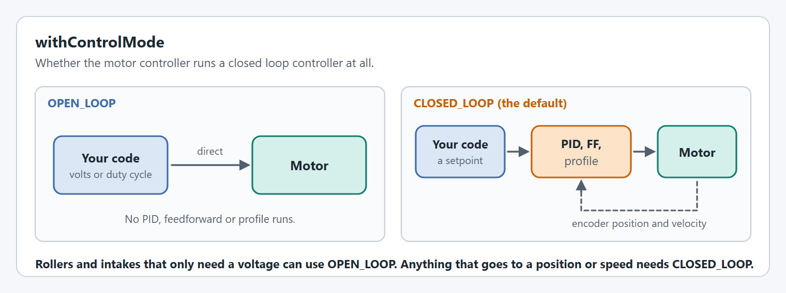
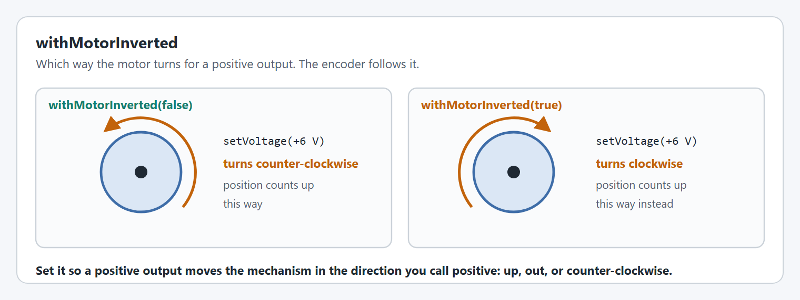
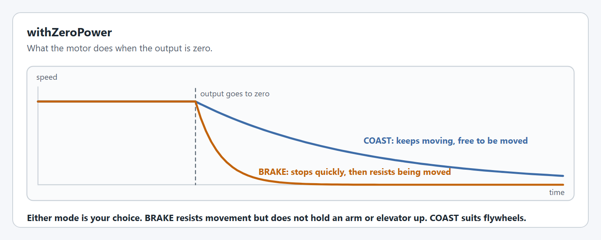
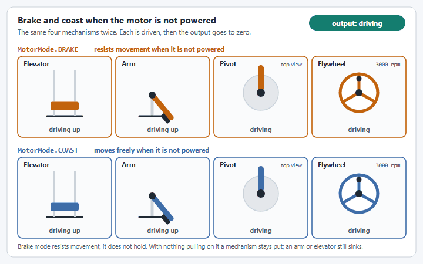
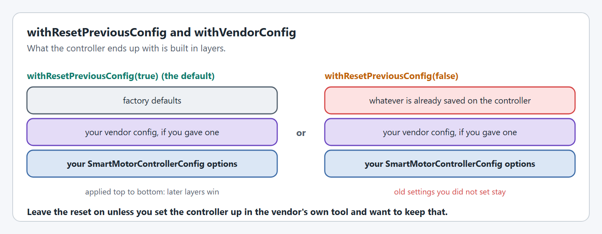

# Motor basics

The options every motor needs, whatever it drives.


Not every option on this page is supported on every motor controller. Each option has a table showing where it works, and an option a controller cannot do throws at startup. The [config overview](README.md#not-every-option-works-on-every-motor-controller) lists them all together.


## `withControlMode`

Chooses whether the motor controller runs a closed loop controller. The default is `ControlMode.CLOSED_LOOP`.

<figure><figcaption><p>Open loop sends an output straight to the motor. Closed loop drives to a setpoint.</p></figcaption></figure>

```java
.withControlMode(ControlMode.OPEN_LOOP)   // a roller that only ever gets a voltage
.withControlMode(ControlMode.CLOSED_LOOP) // anything that goes to a position or a speed
```

In `OPEN_LOOP` the closed loop options on the other pages have nothing to act on. On SPARKs the [soft limits](limits-and-protection.md#withsoftlimits) are only enabled in `CLOSED_LOOP`.

**Supported on:** every supported motor controller.

## `withMotorInverted`

Chooses which way the motor turns for a positive output.

<figure><figcaption><p>The same positive voltage, not inverted and inverted.</p></figcaption></figure>

```java
.withMotorInverted(true)
```

Decide it once, with the mechanism free to move and a small voltage, before tuning anything. Encoders have their own inversion: see [Encoders](encoders.md#withencoderinverted).

**Supported on:** every supported motor controller.

## `withZeroPower`

Chooses what the motor does when the output is zero: `MotorMode.BRAKE` or `MotorMode.COAST`.

* **`MotorMode.BRAKE`**: a motor that is not powered resists being moved. It stops quickly, and it is hard to turn by hand.
* **`MotorMode.COAST`**: a motor that is not powered moves freely. It keeps going until friction stops it, and it turns easily by hand.

<figure><figcaption><p>Brake and coast after the output goes to zero.</p></figcaption></figure>

```java
.withZeroPower(MotorMode.BRAKE)
```

What that looks like on a mechanism once the output is zero:

<figure><figcaption><p>Not powered, a mechanism in brake mode resists movement and a mechanism in coast mode moves freely.</p></figcaption></figure>

| Mechanism | Not powered in `BRAKE` | Not powered in `COAST` |
| --- | --- | --- |
| Elevator | Sinks slowly | Falls |
| Arm | Sinks slowly | Falls |
| Pivot (turret or wrist) | Stops and stays where it is | Keeps turning, and moves when bumped |
| Flywheel | Stops quickly | Keeps spinning and slows down on its own |

With nothing pulling on it, a mechanism in brake mode does not move while it is not powered, and the same mechanism in coast mode does. Gravity is something pulling on it, so most arms and elevators still sink in brake mode, only slower than they fall in coast mode.


**Brake mode is an option, not a requirement, and it is not how a mechanism holds its position.** An arm or an elevator does not need brake mode to hold: the closed loop controller and [`kG`](feedforward.md) hold it, in either mode, for as long as it is powered. Brake mode only changes what happens when it is not, such as when the robot is disabled.


**Supported on:** every supported motor controller.

## `withResetPreviousConfig`

By default YAMS resets the motor controller to factory defaults before applying your config, so settings left over from another robot or a vendor tool cannot surprise you.

<figure><figcaption><p>What the controller ends up with, with and without the reset.</p></figcaption></figure>

```java
.withResetPreviousConfig(false) // keep what is already saved on the controller
```

**Supported on:** every supported motor controller.

## `withVendorConfig`

Gives YAMS a vendor config to start from, for settings YAMS has no option for. Your `SmartMotorControllerConfig` options are applied on top of it and win where both set the same thing.

```java
.withVendorConfig(new TalonFXConfiguration()
    .withVoltage(new VoltageConfigs().withPeakReverseVoltage(0)))
```

Each wrapper accepts only its own vendor's root config class. The classes and an example for each vendor are in [vendor configuration classes](../feature-matrix.md#vendor-configuration-classes), and [How do I use a vendor hardware config?](../../../how-to/how-do-i-use-a-vendor-hardware-config.md) walks through it.

**Supported on every motor controller.** Every controller accepts a vendor config, but only its own class. Any other class throws.

| TalonFX | TalonFXS | SPARK MAX / Flex | Thrifty Nova |
| --- | --- | --- | --- |
| ✅ `TalonFXConfiguration` | ✅ `TalonFXSConfiguration` | ✅ `SparkMaxConfig` or `SparkFlexConfig` | ✅ `NovaConfig.Config` |

## `withVendorControlRequest`

Replaces the control request YAMS would send for position or velocity control with one of the vendor's own, for example to use FOC torque control on a TalonFX.

```java
.withVendorControlRequest(new MotionMagicTorqueCurrentFOC(0))
```

**Not supported everywhere.** A request that does not match the configured profile throws.

| TalonFX | TalonFXS | SPARK MAX / Flex | Thrifty Nova |
| --- | --- | --- | --- |
| ✅ Phoenix 6 position, velocity and Motion Magic requests | ✅ Phoenix 6 position, velocity and Motion Magic requests | ❌ | ❌ |


This option has no graphic: it changes which message is sent to the motor controller, not how the mechanism behaves.


## `withTelemetry`

Names the motor and chooses how much it publishes.

<figure><figcaption><p>Each verbosity level includes the one below it.</p></figcaption></figure>

```java
.withTelemetry("ArmMotor", TelemetryVerbosity.HIGH)
```

`HIGH` is what [live tuning](../../live-tuning/README.md) needs. [Telemetry](../../../understanding/telemetry.md) lists every key and how to choose fields one by one with a `SmartMotorControllerTelemetryConfig`.

**Supported on:** every supported motor controller.


## Code Reference

* [`SmartMotorControllerConfig`](https://yet-another-software-suite.github.io/YAMS/javadocs/yams/motorcontrollers/SmartMotorControllerConfig.html)
