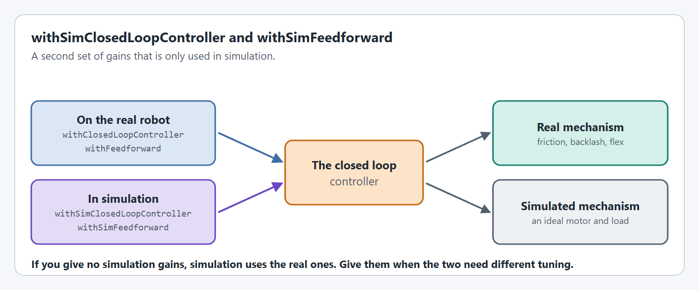
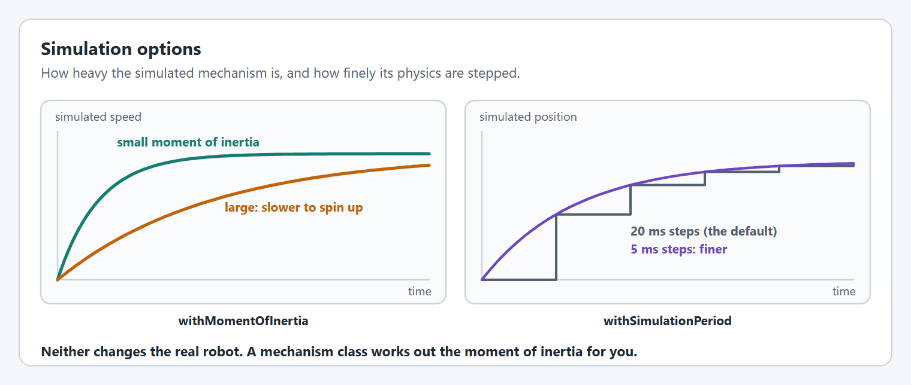

# Simulation

These options only change what happens in simulation. The real robot ignores them.

Every option on this page is supported on every supported motor controller.

## `withSimClosedLoopController` and `withSimFeedforward`

A second set of gains used only in simulation. They take the same arguments, including [slots](closed-loop-control.md#slots), as [`withClosedLoopController`](closed-loop-control.md#withclosedloopcontroller) and [`withFeedforward`](feedforward.md#withfeedforward).

<figure><figcaption><p>Real gains for the real mechanism, simulation gains for the simulated one.</p></figcaption></figure>

```java
.withClosedLoopController(4, 0, 0.2)
.withSimClosedLoopController(12, 0, 0)
.withFeedforward(new ArmFeedforward(0.15, 0.35, 1.2))
.withSimFeedforward(new ArmFeedforward(0, 0.3, 1.2))
```

[Simulation-only PID + feedforward](../simulation-only-pid-+-feedforward.md) explains why the two usually differ, with an example.

## `withSimStartingPosition`

Where the simulated mechanism starts, when that should differ from the real [starting position](encoders.md#withstartingposition).

```java
.withSimStartingPosition(Degrees.of(45))
```

It is most useful with an absolute encoder: the real robot reads its position from the encoder, and simulation needs to be told one.

## `withMomentOfInertia`

How hard the simulated load is to spin up. An `Arm`, `Pivot` and `FlyWheel` simulate with this value, and so does a `SmartMotorController` simulated on its own. The default is 0.02 kg·m², so set it for anything heavier than a small roller. An `Elevator` uses its carriage mass instead.

```java
.withMomentOfInertia(KilogramSquareMeters.of(0.02))          // from CAD
.withMomentOfInertia(Inches.of(18), Pounds.of(8))           // an arm: a rod of this length and mass, turning about one end
.withWheelMomentOfInertia(Inches.of(4), Pounds.of(1))       // a wheel or roller: a solid disk of this diameter and mass
```

Use exactly one; the last call wins. For a wheel, `withWheelMomentOfInertia` gives about a third of what the arm version gives for the same numbers, so don't use the arm version for wheels.

## `withSimulationPeriod`

How often the simulated physics are stepped. The default is 20 ms, and it is independent of [`withClosedLoopControlPeriod`](closed-loop-control.md#withclosedloopcontrolperiod).

```java
.withSimulationPeriod(Milliseconds.of(5))
```

Each `simIterate()` call steps the physics by exactly this period, so it must match how often `simIterate()` is called. To step every 1 ms, as fast as a closed loop on the motor controller runs, call it from a `Notifier`: see [How do I run a high fidelity simulation?](../../../how-to/how-do-i-run-a-high-fidelity-simulation.md)

<figure><figcaption><p>Moment of inertia and simulation period.</p></figcaption></figure>

## Running the simulation

A mechanism class steps its motor's simulation for you when you call its `simIterate()`. A `SmartMotorController` used without a mechanism class needs its own `simIterate()` called every loop in simulation, and its own `updateTelemetry()` called every loop, so it publishes values and picks up live tuning. In a Commands v2 subsystem:

```java
@Override
public void periodic() {
  smartMotorController.updateTelemetry();
}

@Override
public void simulationPeriodic() {
  smartMotorController.simIterate();
}
```

In Commands v3, call them from the methods `Robot.java` runs, as in [Where the tutorials put things](../../../tutorials/project-setup.md#where-the-tutorials-put-things). Every simulated motor also draws from the shared [battery simulation](../../../understanding/battery-simulation.md).

## Code reference

* [`SmartMotorControllerConfig`](https://yet-another-software-suite.github.io/YAMS/javadocs/yams/motorcontrollers/SmartMotorControllerConfig.html)
