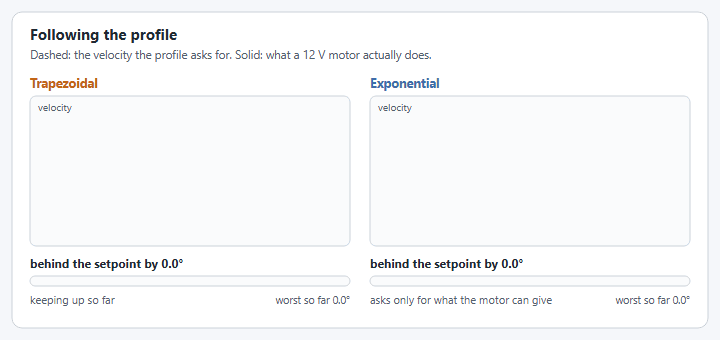
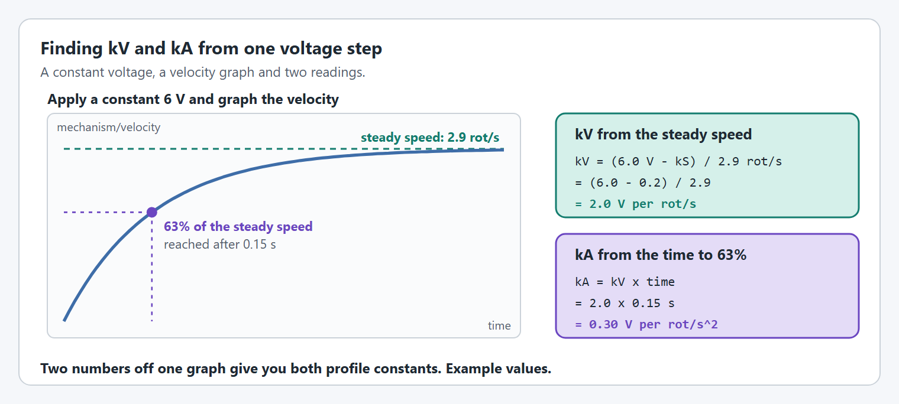

# Exponential Profiles

## What is a Motion Profile?

A motion profile is a trajectory that defines how a mechanism should move from one position to another over time. Instead of commanding a mechanism to instantly jump to a target position (which would require infinite acceleration), motion profiles generate a smooth path that respects the physical limitations of your system.

Motion profiles output a series of intermediate setpoints (position and velocity) that your closed-loop controller tracks. This results in:

* **Predictable motion** - You know exactly how long a movement will take
* **Smooth transitions** - No jerky movements that stress mechanical components
* **Controlled acceleration** - Prevents excessive current draw and brownouts

## Trapezoidal vs Exponential Profiles

<figure><figcaption><p>The two profiles, and why the motor can follow one more easily than the other.</p></figcaption></figure>

### Trapezoidal Profiles

Trapezoidal profiles are the most common type. The name comes from the trapezoidal shape of the velocity-time graph.

**Key characteristics:**

* Constant acceleration until max velocity is reached
* Cruise at max velocity (if distance is long enough)
* Constant deceleration to stop at target
* Assumes unlimited torque during acceleration phases

**When trapezoidal profiles struggle:**

* When a disturbance knocks the mechanism off the profile
* When the motor cannot actually provide the commanded acceleration
* When current limiting reduces available torque

### Exponential Profiles

Exponential profiles model how DC motors actually behave. Instead of assuming constant acceleration, they account for the motor's torque-speed curve and the system's physical dynamics.

**Key characteristics:**

* Acceleration naturally decreases as velocity increases (following motor physics)
* Models the mechanism with a kV (velocity constant) and a kA (acceleration constant)
* More accurately represents what the motor can actually achieve
* Better disturbance rejection


Exponential profiles are named for the exponential approach to maximum velocity, which mirrors the natural response of a first-order system like a DC motor.


<figure><figcaption><p>A simulated 12 V motor following each profile. The trapezoidal profile asks for more than the motor has left at speed.</p></figcaption></figure>

## The Physics Behind Exponential Profiles

DC motors produce torque proportional to current. However, as the motor spins faster, back-EMF reduces the effective voltage across the windings, which reduces current and therefore torque.

The relationship is:

$$V = kS + kV \cdot \omega + kA \cdot \alpha$$

Where:

* **V** = Applied voltage
* **kS** = Static friction voltage (voltage to overcome stiction)
* **kV** = Velocity constant (volts per unit velocity)
* **kA** = Acceleration constant (volts per unit acceleration)
* **ω** = Angular velocity
* **α** = Angular acceleration

Rearranging for acceleration:

$$\alpha = \frac{V - kS - kV \cdot \omega}{kA}$$

This shows that as velocity (ω) increases, the available acceleration (α) decreases. This is the fundamental insight that exponential profiles capture.

## When to Use Each Profile Type

| Situation                               | Recommended Profile      | Why                                                                                                                          |
| --------------------------------------- | ------------------------ | ---------------------------------------------------------------------------------------------------------------------------- |
| Motor is always current-limited         | Trapezoidal              | Current limiting makes torque roughly constant regardless of speed                                                           |
| Motor is never current-limited          | Exponential              | Motor follows natural torque-speed curve                                                                                     |
| Sometimes current-limited               | Hybrid (not yet in YAMS) | See [this whitepaper](https://www.chiefdelphi.com/t/whitepaper-trapezoidal-exponential-motion-profiling/443468/12?u=nstrike) |
| Heavy mechanism with adequate motor     | Exponential              | Gravity/friction dominate, exponential handles disturbances better                                                           |
| Lightweight mechanism                   | Either                   | Both work well when inertia is low                                                                                           |
| Mechanism with significant disturbances | Exponential              | Better recovery when knocked off profile                                                                                     |
| Precise timing required                 | Trapezoidal              | Deterministic duration calculation                                                                                           |


**Rule of thumb**: If your mechanism works well with trapezoidal profiles, keep using them. Switch to exponential profiles when you encounter disturbance rejection issues or when you want the profile to better match your motor's capabilities.


## Exponential Profiles in YAMS

YAMS provides `ExponentialProfilePIDController` (`yams.core.math.ExponentialProfilePIDController`), which combines an exponential motion profile with a PID controller and has factory methods for the profile's constraints. In a `SmartMotorControllerConfig` you set the PID gains with `withClosedLoopController(kP, kI, kD)` and the profile with `withExponentialProfile(constraints)`, instead of a trapezoidal profile (`withTrapezoidalProfile`) or no profile at all.

Exponential profiles in YAMS follow the same idea as CTRE's Motion Magic Expo, on every supported motor controller. CTRE's documentation is a good companion to this page:



### What you set

An exponential profile is defined by a kV and a kA, and those are what you tune, exactly as CTRE's documentation describes. What YAMS adds is a way to get **starting values** for them without measuring anything: you give the **maximum voltage** and one of two descriptions of the mechanism, and YAMS works out a kV and a kA to start from:

| You give | YAMS works out the starting kV and kA from |
| --- | --- |
| Maximum voltage, the motor, and the mechanism's moment of inertia (or its mass and drum radius) | The motor and the load it has to move |
| Maximum voltage, a maximum velocity and a maximum acceleration | `kV = maximum voltage / maximum velocity` and `kA = maximum voltage / maximum acceleration` |

The second row is the same relationship [CTRE's Motion Magic Expo documentation](https://v6.docs.ctr-electronics.com/en/latest/docs/api-reference/device-specific/talonfx/motion-magic.html#motion-magic-expo) gives: dividing the voltage by kV gives the maximum velocity of the profile, and dividing it by kA gives its maximum acceleration from a standstill. CTRE's page is the best description of exponential profiles there is, and this page is meant to agree with it. If the two ever differ, CTRE's is right.

From there you adjust kV and kA directly, either [live](#refining-the-profile-live) or by passing your own with `ExponentialProfile.Constraints.fromCharacteristics(maxVoltage, kV, kA)`.

`SmartMotorControllerConfig` takes all of these directly:

```java
.withExponentialProfile(Volts.of(10), DCMotor.getKrakenX60(1), KilogramSquareMeters.of(0.5))  // arm or flywheel
.withExponentialProfile(Volts.of(10), DCMotor.getKrakenX60(2), Kilograms.of(8), Inches.of(1)) // elevator
.withExponentialProfile(Volts.of(10), RotationsPerSecond.of(2), RotationsPerSecondPerSecond.of(8))
```

### Creating Constraints

YAMS provides factory methods to create exponential profile constraints for common mechanism types:

#### For Elevators

```java
ExponentialProfile.Constraints constraints = ExponentialProfilePIDController.createElevatorConstraints(
    Volts.of(12),        // Maximum voltage during profile
    DCMotor.getNEO(2),   // Motor type and quantity
    Pounds.of(15),       // Carriage mass
    Inches.of(1),        // Drum radius (or sprocket pitch radius)
    gearing              // MechanismGearing object
);
```

#### For Arms

```java
ExponentialProfile.Constraints constraints = ExponentialProfilePIDController.createArmConstraints(
    Volts.of(12),        // Maximum voltage during profile
    DCMotor.getKrakenX60(1), // Motor type and quantity
    Pounds.of(8),        // Arm mass (at center of mass)
    Inches.of(18),       // Arm length (to center of mass)
    gearing              // MechanismGearing object
);
```

#### For Flywheels

```java
ExponentialProfile.Constraints constraints = ExponentialProfilePIDController.createFlywheelConstraints(
    Volts.of(12),        // Maximum voltage during profile
    DCMotor.getFalcon500(1), // Motor type and quantity
    Pounds.of(2),        // Flywheel mass
    Inches.of(2),        // Flywheel radius
    gearing              // MechanismGearing object
);
```

#### Custom Constraints

If the factory methods don't fit your use case, you can create constraints directly:

```java
ExponentialProfile.Constraints constraints = ExponentialProfilePIDController.createConstraints(
    Volts.of(12),                    // Maximum voltage
    RotationsPerSecond.of(100),      // Maximum velocity (kV derived)
    RotationsPerSecondPerSecond.of(200) // Maximum acceleration (kA derived)
);
```

### Using with SmartMotorControllerConfig

```java
SmartMotorControllerConfig config = new SmartMotorControllerConfig(this)
    .withControlMode(ControlMode.CLOSED_LOOP)
    .withClosedLoopController(30, 0, 0) // kP, kI, kD
    .withExponentialProfile(ExponentialProfilePIDController.createElevatorConstraints(
        Volts.of(12),
        DCMotor.getNEO(2),
        Pounds.of(15),
        Inches.of(1),
        gearing
    ))
    .withGearing(gearing)
    .withFeedforward(new ElevatorFeedforward(0, 0.5, 0, 0))
    .withTelemetry("Elevator", TelemetryVerbosity.HIGH);
```

## Tuning Exponential Profiles

### Step 1: Get a starting kV and kA

Start with the maximum voltage and a description of the mechanism, and let YAMS work out a kV and a kA to begin with. Then tune them directly in [Refining the profile live](#refining-the-profile-live):

| Option | How | Good for |
| --- | --- | --- |
| The mechanism | The motor, with the moment of inertia or the mass and drum radius | A first version, and simulation |
| A maximum velocity and acceleration | The fastest you want the profile to go, and the hardest you want it to accelerate | Real mechanisms: both numbers are easy to see on a graph and to adjust |
| kV and kA, measured | One constant voltage test, see [Measuring kV and kA](#measuring-kv-and-ka-optional) | Starting closer to the real mechanism, so there is less to tune |


**Start slower than you think the mechanism can go.** CTRE's advice for Motion Magic Expo is that it is safer to start from a higher kV and kA than ideal, which is a profile with a lower maximum velocity and acceleration. So if the starting values are in doubt, raise kV and kA, or start from a lower maximum velocity and acceleration, and bring them down once the mechanism follows the profile well.



A description from the motor and the mass is theoretical. Real mechanisms have friction, cable drag and other losses, so expect to slow the profile down a little from what the numbers say.


### Measuring kV and kA (optional)

This is another way to get starting values, from the real mechanism instead of from a calculation. It needs only a button binding and a graph, and it gives you both from one run.

<figure><figcaption><p>One voltage step gives both constants. Example values.</p></figcaption></figure>



#### Find kS

Raise the voltage slowly from zero until the mechanism just starts to move. That voltage is kS.



#### Apply a constant voltage

Bind a button to a fixed voltage, well below 12 V so the mechanism does not hit a hard stop before it reaches a steady speed:

```java
driver.a().whileTrue(flywheel.setVoltage(Volts.of(6)));
```

Graph `NT:/Mechanisms/<Mechanism>/<Motor>/mechanism/velocity` in AdvantageScope while you hold the button. Leave it in rotations per second: the profile's kV and kA are per rotation of the mechanism.



#### Read the steady speed: that gives kV

Once the line goes flat, read the speed.

`kV = (voltage - kS) / steady speed`



#### Read the time to 63%: that gives kA

Find the moment the velocity reached 63% of the steady speed, and how long after the voltage was applied that was.

`kA = kV x that time`



#### Put them in the config

```java
.withExponentialProfile(ExponentialProfile.Constraints.fromCharacteristics(
    10.0, // maximum voltage the profile may ask for
    2.0,  // kV, volts per rotation per second
    0.30  // kA, volts per rotation per second squared
))
```





**Gravity gets in the way of this test.** On an elevator, subtract kG as well: `kV = (voltage - kS - kG) / steady speed`. On an arm the pull of gravity changes with the angle, so the speed never settles: start from `createArmConstraints(...)` and refine it live instead.


### Refining the profile live

This is where the profile is actually tuned, by changing kV and kA directly. However you got the starting values, YAMS stores the profile as a maximum voltage, a kV and a kA, and all three can be changed while the robot is running.



#### Turn on live tuning

Give the motor `TelemetryVerbosity.HIGH` and start the `Live Tuning` command. [Live tuning](../live-tuning/README.md) covers both.



#### Graph the profile against the mechanism

In AdvantageScope, put these two on one graph:

* `NT:/Mechanisms/<Mechanism>/<Motor>/closedloop/setpoint/velocity`: what the profile asks for.
* `NT:/Mechanisms/<Mechanism>/<Motor>/mechanism/velocity`: what the mechanism does.



#### Run a move

Command a move long enough for the mechanism to reach its top speed, and watch how closely the second line follows the first.



#### Tune `kA` on the way up

Look at the start of the move, while the mechanism is speeding up. If it falls behind the profile, raise `NT:/Tuning/<Mechanism>/<Motor>/closedloop/motionprofile/kA`. A higher `kA` lowers the profile's acceleration. Run the move again and repeat until it keeps up.



#### Tune `kV` at top speed

Look at the fastest part of the move. If the mechanism falls behind there, or never reaches the profile's top speed, raise `NT:/Tuning/<Mechanism>/<Motor>/closedloop/motionprofile/kV`. A higher `kV` lowers the profile's top speed.



#### Speed it up if there is room

If the mechanism follows the whole move easily with voltage to spare on `NT:/Mechanisms/<Mechanism>/<Motor>/motor/outputVoltage`, lower `kV` and `kA` a little at a time, or raise `NT:/Tuning/<Mechanism>/<Motor>/closedloop/motionprofile/maxInput`. Stop as soon as it starts to fall behind again, and go back one step.



#### Put the tuned values in the config

Live values are lost when the robot code restarts, so copy them into the config:

```java
.withExponentialProfile(ExponentialProfile.Constraints.fromCharacteristics(
    10.0, // maxInput: maximum voltage the profile may ask for
    2.2,  // kV, tuned
    0.35  // kA, tuned
))
```



### Step 2: Set Maximum Voltage

The maximum voltage determines how aggressively the profile will command the mechanism. Consider:

* **12V** - Full battery voltage, most aggressive
* **10V** - Leaves headroom for PID corrections
* **8V** - Conservative, good for testing

### Step 3: Tune PID Gains

With a good feedforward ([Step 4](#step-4-add-feedforward)), the feedforward does most of the work. The PID handles:

* **kP** - Corrects position error. Start low (1-5) and increase until responsive
* **kI** - Usually not needed with good feedforward. Use only if steady-state error persists
* **kD** - Dampens oscillations. Add if mechanism oscillates around target

### Step 4: Add Feedforward

The profile only plans the move. It does not drive the motor: the voltage that follows the plan comes from the feedforward and the PID. So an exponential profile still needs a full feedforward:

* **kS** for friction.
* **kG** for gravity, on arms and elevators. The profile does not know about gravity.
* **kV and kA** for the speed and acceleration the profile asks for.

```java
// For an arm
.withFeedforward(new ArmFeedforward(
    0.1,  // kS - voltage to overcome friction
    0.3,  // kG - voltage to hold horizontal
    1.2,  // kV - voltage per unit of speed
    0.05  // kA - voltage per unit of acceleration
))

// For an elevator
.withFeedforward(new ElevatorFeedforward(
    0.1,  // kS - voltage to overcome friction
    0.2,  // kG - voltage to counteract gravity
    3.0,  // kV - voltage per unit of speed
    0.1   // kA - voltage per unit of acceleration
))
```


**The profile's kV and kA are not the feedforward's kV and kA.** The profile's pair only shape the plan. The feedforward's pair turn that plan into voltage. CTRE's Motion Magic Expo example sets both, the gain slot's `kV` and `kA` and the profile's `MotionMagicExpo_kV` and `MotionMagicExpo_kA`, and YAMS keeps them separate in the same way. [Feedforward](config/feedforward.md) covers finding the feedforward's values.


## Motor Controller Support

| Motor Controller         | Trapezoidal Profile      | Exponential Profile           | Notes                       |
| ------------------------ | ------------------------ | ----------------------------- | --------------------------- |
| TalonFX (Kraken, Falcon) | On-device (Motion Magic) | On-device (Motion Magic Expo) | Best performance            |
| TalonFXS                 | On-device (Motion Magic) | On-device (Motion Magic Expo) | Best performance            |
| SparkMax/SparkFlex       | On-device (MAXMotion)    | SystemCore                    | Exponential runs on the SystemCore |
| Thrifty Nova             | SystemCore               | SystemCore                    | All closed loop control runs on the SystemCore |


When exponential profiles run on the SystemCore, there's slightly more latency compared to on-device execution. However, the profile calculation is still very fast and suitable for most mechanisms.


## Common Issues and Solutions

### Profile is too slow

* Increase maximum voltage
* Check that your mechanism parameters (mass, length, gearing) are accurate
* Verify motor type matches actual hardware

### Profile overshoots target

* Decrease kP
* Add kD for damping
* Slow the profile down: a profile that asks for more than the mechanism can do overshoots

### Mechanism can't keep up with profile

* Your motor may be undersized for the mechanism
* Reduce maximum voltage
* Check for mechanical binding or excessive friction

### Profile works in sim but not on real robot

* Slow the profile down: lower the maximum velocity and acceleration, or see [Refining the profile live](#refining-the-profile-live)
* Account for friction with kS in feedforward
* Check current limits aren't restricting torque

## Example: Complete Elevator with Exponential Profile

```java
public class ElevatorSubsystem extends SubsystemBase {

    private final Distance chainPitch = Inches.of(0.25);
    private final int toothCount = 22;
    private final Mass carriageMass = Pounds.of(15);
    private final DCMotor motors = DCMotor.getNEO(2);
    private final MechanismGearing gearing = new MechanismGearing(GearBox.fromReductionStages(5, 4));

    private final SmartMotorControllerConfig motorConfig = new SmartMotorControllerConfig(this)
        .withControlMode(ControlMode.CLOSED_LOOP)
        .withDrumRadius(chainPitch, toothCount)
        .withClosedLoopController(15, 0, 0)
        .withExponentialProfile(ExponentialProfilePIDController.createElevatorConstraints(
            Volts.of(10), // Conservative voltage for testing
            motors,
            carriageMass,
            chainPitch.times(toothCount).div(2 * Math.PI),
            gearing
        ))
        .withSimClosedLoopController(15, 0, 0)
        .withFeedforward(new ElevatorFeedforward(0.1, 0.25, 0, 0))
        .withSimFeedforward(new ElevatorFeedforward(0, 0.2, 0, 0))
        .withGearing(gearing)
        .withZeroPower(MotorMode.BRAKE)
        .withStatorCurrentLimit(Amps.of(40))
        .withSoftLimits(Meters.of(0), Meters.of(1.2))
        .withStartingPosition(Meters.of(0))
        .withTelemetry("ElevatorMotor", TelemetryVerbosity.HIGH);

    private final SparkMax leftSpark = new SparkMax(CANPorts.fromBusId(1), 1, MotorType.kBrushless);
    private final SparkMax rightSpark = new SparkMax(CANPorts.fromBusId(1), 2, MotorType.kBrushless);
    
    private final SmartMotorController motor = new SparkWrapper(
        leftSpark, 
        motors, 
        motorConfig.withFollowers(Pair.of(rightSpark, true))
    );

    private final Elevator elevator = new Elevator(
        new ElevatorConfig()
            .withHardLimits(Meters.of(-0.05), Meters.of(1.3))
            .withCarriageWeight(carriageMass)
            .withTelemetry("Elevator", TelemetryVerbosity.HIGH),
        motor
    );

    public Command goToHeight(Distance height) {
        return elevator.setHeight(height);
    }

    @Override
    public void periodic() {
        elevator.updateTelemetry();
    }

    @Override
    public void simulationPeriodic() {
        elevator.simIterate();
    }
}
```

## Further Reading

* [CTRE Motion Magic Expo Documentation](https://v6.docs.ctr-electronics.com/en/latest/docs/api-reference/device-specific/talonfx/motion-magic.html#motion-magic-expo) - CTRE's explanation of exponential profiles
* [How do I use Exponential Profiles?](../../how-to/how-do-i-use-exponential-profiles.md) - Quick how-to guide
* [Trapezoidal/Exponential Motion Profiling Whitepaper](https://www.chiefdelphi.com/t/whitepaper-trapezoidal-exponential-motion-profiling/443468/12?u=nstrike) - Advanced hybrid profiling techniques
* [WPILib Tuning Guide](https://docs.wpilib.org/en/stable/docs/software/advanced-controls/introduction/tuning-turret.html) - General PID and feedforward tuning
