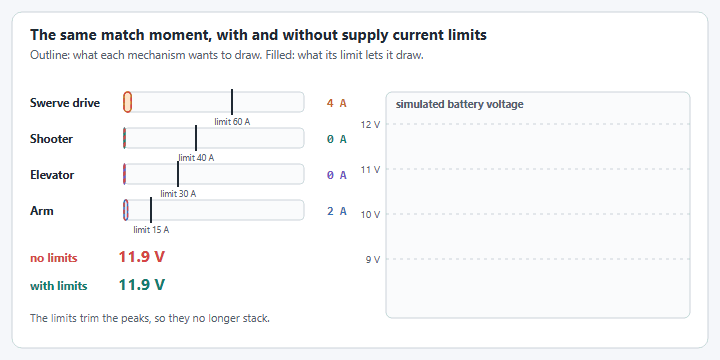

# Limiting Power Consumption

## Current limits

There are two types of currents involved in a `SmartMotorController`, the **Supply** current and the **Stator** current.

* The current input of the motor controller is the **Supply** current.
* The current output of the motor controller is the **Stator** current.

<figure><figcaption><p>The two currents, and what each limit protects.</p></figcaption></figure>


Some motor controllers, like SparkMax and SparkFlex, only support a stator current limit. `SparkWrapper` throws a `SmartMotorControllerConfigurationException` if you set a supply current limit.


CTRE has excellent documentation explaining the relationship between the supply and stator currents.



If your mechanism interacts with a game element or has a chance of getting stuck a current limit **WILL** cause the mechanism to stutter until the current is back below the limit. This can cause strains on the mechanism as it constantly starts then stops but it could save your motor controller and prevent brownouts because your mechanism will not be able to pull more power than necessary.

### Setting Current Limits in YAMS

```java
SmartMotorControllerConfig motorConfig = new SmartMotorControllerConfig(this)
      .withStatorCurrentLimit(Amps.of(200)) // Current to the motor
      .withSupplyCurrentLimit(Amps.of(40)) // Current to the motor controller
```

## Ramp Rates

Ramp rates is the minimum time it takes for a motor to go from 0% to 100% power to the motor.


If the ramp rate is omitted from configurations you will commonly see mechanisms taking up a majority of power whenever they go from rest to moving with a closed loop controller.

Whenever possible use current limits instead of ramp rates. Ramp rates delay input response and make the robot seem "slow" or "delayed".


<figure><figcaption><p>A ramp rate trades the current spike for a slower start.</p></figcaption></figure>

There are two ramp rates defined in motor controllers.

* Closed loop ramp rate
* Open loop ramp rate

These ramp rates are applied whenever the motor controller is in the appropriate mode. So the **closed loop ramp rate** is used when the motor controller **PID** is used. The **open loop ramp rate** is used when the dutycycle or voltage control is used.


The Thrifty Nova has a single ramp rate for open and closed loop control. `NovaWrapper` throws a `SmartMotorControllerConfigurationException` if the two ramp rates differ, so set only one of them, or both to the same value.


### Setting Ramp Rates in YAMS

```java
SmartMotorControllerConfig motorConfig = new SmartMotorControllerConfig(this)
      .withClosedLoopRampRate(Seconds.of(0.25)) // 0.25 seconds minimum 
      .withOpenLoopRampRate(Seconds.of(0.25)) // 0.25 seconds minimum
```

## Testing brownout scenarios in simulation

YAMS combines the current draw of every simulated mechanism into one shared battery model, so simulated voltage sag reflects the _whole_ robot pulling power at once, not just one mechanism in isolation. That makes simulation the place to choose your limits: run the busiest moment of your match, watch the battery voltage, and lower the limits on the biggest loads until the dip is acceptable.

<figure><figcaption><p>The same few seconds with and without supply current limits. Example currents and limits.</p></figcaption></figure>



#### Find the worst moment

In simulation, do the things that happen together in a match: accelerate the drive, spin up the shooter, raise the elevator. Graph the battery voltage and each motor's `current/supply`.



#### Limit the biggest load first

The drive is usually the largest draw, so a supply limit there does the most. Then the next largest.



#### Tune the limits live

At `TelemetryVerbosity.HIGH`, `current/limit/supply` and `current/limit/stator` are tunable under `NT:/Tuning/`. Change them while the simulation runs and watch the dip shrink. See [Live tuning](../live-tuning/README.md).



#### Check the mechanism still does its job

A limit that is too low makes the mechanism slow or stalls it. Lower it until the voltage is acceptable, not further.



See [Battery Simulation](../../understanding/battery-simulation.md) for how each mechanism loads the battery, and how to enable realistic discharge over a match to reproduce brownout-prone scenarios before they happen on the field.
