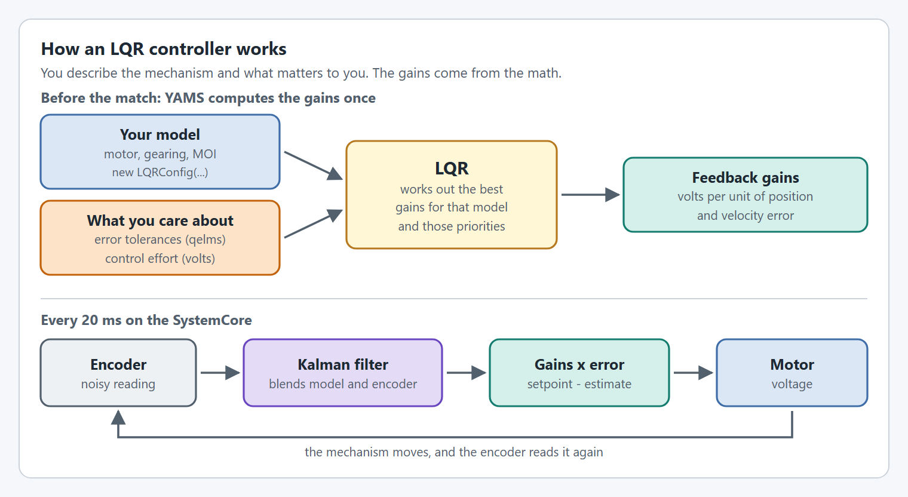
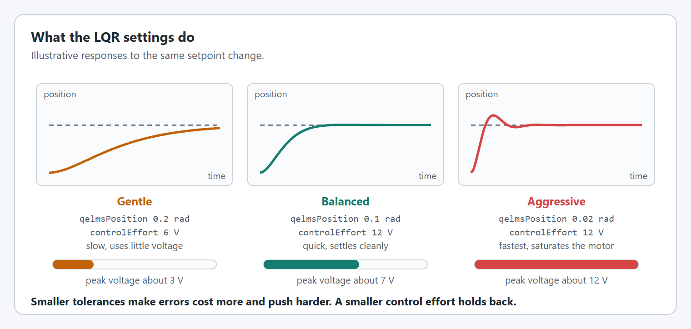
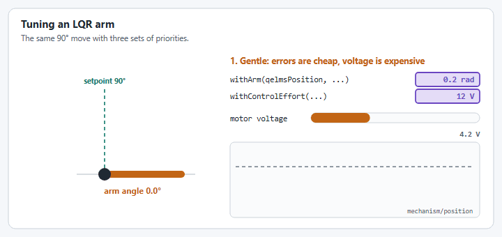

# LQR controllers

## What is LQR?

**Linear Quadratic Regulator (LQR)** is an optimal control algorithm that automatically computes controller gains to minimize a cost function balancing state error and control effort. Unlike manually-tuned PID controllers, LQR uses a mathematical model of your system to determine the optimal feedback gains.


**Key Difference from PID**: With PID, you manually tune kP, kI, and kD through trial and error. With LQR, you specify *how much you care* about position error vs velocity error vs control effort, and the algorithm computes the optimal gains for you.


<figure><figcaption><p>You supply the model and the priorities. LQR supplies the gains.</p></figcaption></figure>

## Why use LQR?

### Advantages

1. **Model-Based Tuning**: LQR uses your mechanism's physical model (mass, gearing, motor characteristics) to compute gains, reducing trial-and-error tuning
2. **Multi-State Control**: Naturally handles both position and velocity simultaneously
3. **Optimal Performance**: Mathematically minimizes a cost function you define
4. **Consistent Behavior**: Gains are derived from physics, making them more predictable across different setpoints

### When to consider LQR

- **Complex mechanisms** where PID tuning is difficult
- **High-performance requirements** where optimal response matters
- **Educational settings** where understanding control theory is valuable
- **Mechanisms with well-characterized models** (accurate mass, inertia, motor constants)

### When PID may be better

- **Simple mechanisms** that tune easily with PID
- **Limited modeling data** (unknown mass, inertia, etc.)
- **Quick prototyping** where tuning time is limited
- **Mechanisms with significant nonlinearities** that LQR's linear model can't capture

## LQR execution in YAMS


**Important**: LQR controllers are **not natively supported** by any motor controller hardware. When you configure an LQR controller in YAMS, the closed loop control **always runs on the SystemCore**. The wrapper starts a `Notifier` that calls `SmartMotorController.iterateClosedLoopController()` every closed loop control period (20 ms by default), so you never call it yourself.


### Why SystemCore-Only?

Motor controller vendors (CTRE, REV, ThriftyBot) implement PID controllers on their hardware, but none support LQR natively. LQR requires:

1. Matrix operations (solving Riccati equations)
2. State-space model storage
3. Kalman filter state estimation
4. Multi-state feedback computation

These operations are beyond what current motor controller firmware supports.

### Performance implications

| Aspect | Motor Controller PID | SystemCore LQR |
|--------|---------------------|-------------|
| **Update Rate** | 1kHz+ (on controller) | 50Hz (20 ms `Notifier`) by default |
| **Latency** | Minimal (~1ms) | CAN bus round-trip (~5-20ms) |
| **CPU Load** | None on SystemCore | Small increase on SystemCore |
| **Best For** | Fast loops, simple control | Complex control, slower mechanisms |


For most FRC mechanisms (arms, elevators), the 50Hz update rate is sufficient. LQR's optimal gains often compensate for the slower update rate compared to motor controller PID.


## Configuring LQR in YAMS

In YAMS, you create an `LQRConfig` to specify your mechanism type and tuning parameters, then create an `LQRController` from that config, and finally pass it to `SmartMotorControllerConfig.withClosedLoopController()`.

### LQRConfig overview

`LQRConfig` requires three core parameters:
- **DCMotor**: The motor model (e.g., `DCMotor.getKrakenX60(1)`)
- **MechanismGearing**: Your gear reduction
- **MomentOfInertia**: The rotational inertia of your mechanism. An elevator does not use it: its model comes from the carriage mass and drum radius you give `withElevator`. The constructor still needs a value, so pass any, such as `KilogramSquareMeters.of(0.01)`.

Then you specify the mechanism type with one of:
- `.withFlyWheel()` - For velocity-controlled flywheels
- `.withArm()` - For position-controlled arms
- `.withElevator()` - For position-controlled elevators

### Starting values

Every value below is a starting point. Change one at a time, as in [Tune it live](#tune-it-live).

| Parameter | Start at | Change it when |
| --- | --- | --- |
| Position qelms (arm, elevator) | `Radians.of(0.1)` (about 6°), `Meters.of(0.05)` | Lower it if the mechanism is slow to reach the setpoint. |
| Velocity qelms | `RadiansPerSecond.of(1.0)`, `MetersPerSecond.of(0.5)` | Lower it if an arm or elevator overshoots, or a flywheel is slow to reach speed. |
| Model trust (standard deviations) | `Radians.of(0.01)`, `RadiansPerSecond.of(0.1)`, or the same in meters | Raise it if the estimate lags behind the real mechanism. |
| Encoder trust (standard deviation) | `Radians.of(0.01)`, `RadiansPerSecond.of(0.1)` on a flywheel, `Meters.of(0.001)` | Raise it if the output is noisy. |
| `withControlEffort` | `Volts.of(12)`, the default | Lower it for a gentler response that uses less voltage. |
| `withMaxVoltage` | `Volts.of(12)`, the default | Lower it to cap the output, for example to 10 V for headroom. |

The qelms and trust values have no defaults: `withFlyWheel`, `withArm` or `withElevator` sets them.

### Flywheel LQR configuration

Flywheels use a single-state model (velocity only):

```java
LQRConfig flywheelLQRConfig = new LQRConfig(
        DCMotor.getKrakenX60(1),                           // Motor
        new MechanismGearing(GearBox.fromReductionStages(2)), // Gearing
        KilogramSquareMeters.of(0.005)                     // Moment of inertia
    )
    .withFlyWheel(
        RadiansPerSecond.of(1.0),    // qelms: Velocity error tolerance (rad/s)
        RadiansPerSecond.of(0.01),   // modelTrust: Model standard deviation
        RadiansPerSecond.of(0.1)     // encoderTrust: Encoder standard deviation
    )
    .withControlEffort(Volts.of(12))  // R: Control effort tolerance
    .withMaxVoltage(Volts.of(12));    // Maximum output voltage

LQRController flywheelLQR = new LQRController(flywheelLQRConfig);
```

**Parameter Explanation**:
| Parameter | Unit | Description |
|-----------|------|-------------|
| `qelms` (velocity) | RadiansPerSecond | Velocity error tolerance. **Decrease** to penalize velocity errors more heavily (more aggressive). |
| `modelTrust` | RadiansPerSecond | Standard deviation of your model. **Lower** = trust the model more. |
| `encoderTrust` | RadiansPerSecond | Standard deviation of encoder readings. **Lower** = trust encoder more. |
| `controlEffort` | Volts | The voltage the LQR treats as acceptable. **Decrease** for gentler control. |

### Arm LQR configuration

Arms use a two-state model (position and velocity):

```java
LQRConfig armLQRConfig = new LQRConfig(
        DCMotor.getKrakenX60(1),
        new MechanismGearing(GearBox.fromReductionStages(100)),
        KilogramSquareMeters.of(0.5)  // Arm moment of inertia
    )
    .withArm(
        Radians.of(0.1),              // qelmsPosition: Position error tolerance
        RadiansPerSecond.of(1.0),     // qelmsVelocity: Velocity error tolerance
        Radians.of(0.01),             // modelPositionTrust: Model position std dev
        RadiansPerSecond.of(0.1),     // modelVelocityTrust: Model velocity std dev
        Radians.of(0.01)              // encoderPositionTrust: Encoder position std dev
    )
    .withControlEffort(Volts.of(12))
    .withMaxVoltage(Volts.of(12));

LQRController armLQR = new LQRController(armLQRConfig);
```

**Parameter Explanation**:
| Parameter | Unit | Description |
|-----------|------|-------------|
| `qelmsPosition` | Radians | Position error tolerance. **Decrease** for faster position correction. |
| `qelmsVelocity` | RadiansPerSecond | Velocity error tolerance. **Decrease** for smoother velocity tracking. |
| `modelPositionTrust` | Radians | Model position uncertainty. |
| `modelVelocityTrust` | RadiansPerSecond | Model velocity uncertainty. |
| `encoderPositionTrust` | Radians | Encoder measurement uncertainty. |

### Elevator LQR configuration

Elevators use a two-state linear model (position and velocity in meters):

```java
LQRConfig elevatorLQRConfig = new LQRConfig(
        DCMotor.getKrakenX60(2),                              // 2 motors
        new MechanismGearing(GearBox.fromReductionStages(10)), // 10:1 reduction
        KilogramSquareMeters.of(0.01)                         // not used by an elevator, but required
    )
    .withElevator(
        Meters.of(0.02),              // qelmsPosition: Position error tolerance (m)
        MetersPerSecond.of(0.5),      // qelmsVelocity: Velocity error tolerance (m/s)
        Meters.of(0.005),             // modelPositionTrust: Model position std dev
        MetersPerSecond.of(0.1),      // modelVelocityTrust: Model velocity std dev
        Meters.of(0.001),             // encoderPositionTrust: Encoder position std dev
        Kilograms.of(5),              // mass: Carriage mass
        Inches.of(1)                  // drumRadius: Spool/drum radius
    )
    .withControlEffort(Volts.of(12))
    .withMaxVoltage(Volts.of(12));

LQRController elevatorLQR = new LQRController(elevatorLQRConfig);
```

**Elevator-Specific Parameters**:
| Parameter | Unit | Description |
|-----------|------|-------------|
| `mass` | Kilograms | Total mass of the elevator carriage and load. |
| `drumRadius` | Meters/Inches | Radius of the spool or drum that the belt/rope wraps around. |

## Using LQRController with SmartMotorControllerConfig

Once you have an `LQRController`, pass it to `withClosedLoopController()`. This is a fragment for inside a subsystem, which is the `this` passed to the config. The [complete example](#complete-example-lqr-arm) below shows a whole subsystem.

```java
// Create the LQR config and controller
LQRConfig lqrConfig = new LQRConfig(
        DCMotor.getKrakenX60(1),
        new MechanismGearing(GearBox.fromReductionStages(100)),
        KilogramSquareMeters.of(0.5)
    )
    .withArm(
        Radians.of(0.1),
        RadiansPerSecond.of(1.0),
        Radians.of(0.01),
        RadiansPerSecond.of(0.1),
        Radians.of(0.01)
    )
    .withControlEffort(Volts.of(12));

LQRController lqrController = new LQRController(lqrConfig);

// Pass to SmartMotorControllerConfig
SmartMotorControllerConfig config = new SmartMotorControllerConfig(this)
    .withControlMode(ControlMode.CLOSED_LOOP)
    .withGearing(new MechanismGearing(GearBox.fromReductionStages(100)))
    .withMomentOfInertia(Inches.of(24), Pounds.of(12))
    .withClosedLoopController(lqrController)  // Pass the LQRController here
    .withFeedforward(new ArmFeedforward(0.1, 0.45, 1.2, 0.05))
    .withZeroPower(MotorMode.BRAKE)
    .withTelemetry("LQRArm", TelemetryVerbosity.HIGH);
```

### With a motion profile

An LQR can follow a [motion profile](config/motion-profiles.md), trapezoidal or exponential, set with the usual `withTrapezoidalProfile` or `withExponentialProfile`. The profile moves the setpoint smoothly, and the LQR tracks the profile's position and velocity instead of jumping straight to the goal.

## Advanced LQR options

### Aggressiveness and measurement delay

`LQRConfig` also has `withAggressiveness(double)` and `withMeasurementDelay(Time)`. In the current release they are stored but not used by the controller, so they change nothing. Use the qelms and the control effort to change how aggressive the LQR is.

### Loop period

`LQRConfig` uses a 20ms (50Hz) period for its discrete-time calculations (see `LQRConfig.getPeriod()`), which matches the default closed loop control period of the `Notifier` that runs the controller. There is currently no setter for the LQR period, so keep the default closed loop control period when using LQR.


`SmartMotorControllerConfig.withClosedLoopControlPeriod` changes how often the `Notifier` runs, but `TalonFXWrapper` and `TalonFXSWrapper` throw an `IllegalArgumentException` if it is set, and it does not change the period `LQRConfig` was built with.


## Simulation-Only LQR

You can use different controllers for simulation and real robot. This fragment assumes `gearing` and `moi` are defined, as in the [complete example](#complete-example-lqr-arm):

```java
// Create simulation LQR
LQRConfig simLqrConfig = new LQRConfig(DCMotor.getKrakenX60(1), gearing, moi)
    .withArm(Radians.of(0.1), RadiansPerSecond.of(1.0), 
             Radians.of(0.01), RadiansPerSecond.of(0.1), Radians.of(0.01))
    .withControlEffort(Volts.of(12));

LQRController simLqr = new LQRController(simLqrConfig);

SmartMotorControllerConfig config = new SmartMotorControllerConfig(this)
    .withControlMode(ControlMode.CLOSED_LOOP)
    .withGearing(gearing)
    .withMomentOfInertia(Inches.of(24), Pounds.of(12))
    // Real robot uses PID (runs on motor controller)
    .withClosedLoopController(5.0, 0, 0.5)
    // Simulation uses LQR for validation
    .withSimClosedLoopController(simLqr)
    .withZeroPower(MotorMode.BRAKE);
```

This is useful for:
- Validating LQR tuning in simulation before deploying
- Comparing LQR vs PID performance
- Using LQR's model-based approach to inform PID tuning

## Complete example: LQR Arm

```java
public class LQRArmSubsystem extends SubsystemBase {
    private final SmartMotorController motor;
    private final Arm arm;

    public LQRArmSubsystem() {
        TalonFX talonFX = new TalonFX(1, new CANBus(CANPort.CAN_S0));
        
        // Define mechanism parameters
        DCMotor dcMotor = DCMotor.getKrakenX60(1);
        MechanismGearing gearing = new MechanismGearing(GearBox.fromReductionStages(100));
        MomentOfInertia moi = KilogramSquareMeters.of(0.5);
        
        // Create LQR configuration
        LQRConfig lqrConfig = new LQRConfig(dcMotor, gearing, moi)
            .withArm(
                Radians.of(0.05),             // Tight position tolerance
                RadiansPerSecond.of(0.5),     // Moderate velocity tolerance
                Radians.of(0.01),             // Trust the model
                RadiansPerSecond.of(0.1),
                Radians.of(0.005)             // Trust the encoder
            )
            .withControlEffort(Volts.of(10)) // A little gentler than the full 12 V
            .withMaxVoltage(Volts.of(12));
        
        // Create the LQR controller
        LQRController lqrController = new LQRController(lqrConfig);
        
        // Create motor controller config
        SmartMotorControllerConfig config = new SmartMotorControllerConfig(this)
            .withControlMode(ControlMode.CLOSED_LOOP)
            .withGearing(gearing)
            .withMomentOfInertia(Inches.of(24), Pounds.of(12))
            .withClosedLoopController(lqrController)
            .withFeedforward(new ArmFeedforward(0.1, 0.45, 1.2, 0.05))
            .withSoftLimits(Degrees.of(-10), Degrees.of(110))
            .withStartingPosition(Degrees.of(0))
            .withZeroPower(MotorMode.BRAKE)
            .withStatorCurrentLimit(Amps.of(40))
            .withTelemetry("LQRArm", TelemetryVerbosity.HIGH);
        
        motor = new TalonFXWrapper(talonFX, dcMotor, config);

        ArmConfig armConfig = new ArmConfig()
            .withLength(Inches.of(24))
            .withHardLimits(Degrees.of(-20), Degrees.of(120))
            .withTelemetry("LQRArm", TelemetryVerbosity.HIGH);

        arm = new Arm(armConfig, motor);
    }
    
    public Command goToAngle(Angle target) {
        return arm.setAngle(target);
    }

    @Override
    public void periodic() {
        arm.updateTelemetry();
    }

    @Override
    public void simulationPeriodic() {
        arm.simIterate();
    }
}
```


**Critical**: LQR runs on the SystemCore, in a `Notifier` that calls `SmartMotorController.iterateClosedLoopController()`. The wrapper starts it when the control mode is `ControlMode.CLOSED_LOOP`, whether or not you use a mechanism class. LQR does not support a closed loop tolerance: `withClosedLoopTolerance` together with an `LQRController` throws an `IllegalArgumentException`.


## Tuning strategy

<figure><figcaption><p>The two settings you will change most. Illustrative responses.</p></figcaption></figure>

<figure><figcaption><p>The same move with three sets of priorities. Illustrative, not a recording.</p></figcaption></figure>

### Starting point

1. **Begin with the balanced settings**:
   - Position qelms: `Radians.of(0.1)` or `Meters.of(0.05)`
   - Velocity qelms: `RadiansPerSecond.of(1.0)` or `MetersPerSecond.of(0.5)`
   - Control effort: `Volts.of(12)`, the full battery. The control effort is how much voltage LQR treats as acceptable, so a lower value makes it gentler.

2. **Trust values** (standard deviations):
   - Model trust: Start with small values (0.01) if your model is accurate
   - Encoder trust: Use values based on your encoder resolution and noise

### Increasing responsiveness

- **Decrease** position qelms (e.g., `Radians.of(0.1)` → `Radians.of(0.05)`)
- **Increase** control effort, up to the battery's 12 V (e.g., `Volts.of(8)` → `Volts.of(12)`)

### Reducing oscillation

- **Decrease** control effort (e.g., `Volts.of(12)` → `Volts.of(8)`)
- **Decrease** velocity qelms to penalize velocity errors more

### Tune it live

You can change every value above while the robot runs, with [live tuning](../live-tuning/README.md). With `TelemetryVerbosity.HIGH`, a motor controller configured with an LQR publishes the LQR's values under `NT:/Tuning/<Mechanism>/<Motor>/closedloop/lqr/` in place of kP, kI and kD. Start the `Live Tuning` command, then type a value, and the LQR is rebuilt with it on the next loop.

| Field, under `closedloop/lqr/` | `LQRConfig` value | Flywheel | Arm | Elevator |
| --- | --- | --- | --- | --- |
| `qelms/position` | Position qelms | | Degrees | Meters |
| `qelms/velocity` | Velocity qelms | RPM | RPM | m/s |
| `relms` | Control effort | Volts | Volts | Volts |
| `model/position` | Model position trust | | Degrees | Meters |
| `model/velocity` | Model velocity trust | RPM | RPM | m/s |
| `encoder/position` | Encoder position trust | | Degrees | Meters |
| `encoder/velocity` | Encoder trust | RPM | | |
| `maxVoltage` | Max voltage | Volts | Volts | Volts |

The fields use the same units as the tunable setpoints, and start at the values in your config. A field your LQR type does not use is not published.



#### Tune the feedforward first

The LQR only replaces kP, kI and kD. kG, kS, kV and kA are still added to its output, and still tuned as in [Tuning order](../live-tuning/README.md#tuning-order). An arm or elevator whose kG is wrong ends up short of the setpoint, whatever the LQR does.



#### Set the response with the qelms and control effort

Command small moves, or a speed on a flywheel, and change one value at a time:

* Too slow: lower `qelms/position` (on a flywheel, `qelms/velocity`), or raise `relms` up to 12 V.
* Overshoots or rings: lower `qelms/velocity` on an arm or elevator, or lower `relms`.
* `motor/outputVoltage` pinned at the limit: the LQR is asking for more than the motor has, so raise the qelms or lower `relms`.



#### Change the trust values last, if at all

`model/` and `encoder/` set how the Kalman filter weighs the model against the encoder. Leave them unless the output is noisy, in which case raise `encoder/position` (on a flywheel, `encoder/velocity`), or the estimate lags the real mechanism, in which case raise `model/position` and `model/velocity`.



#### Copy the values into your config

Live tuning changes nothing in your code. Write the values down and put them in your `LQRConfig`. In Java, the units carry over: `Degrees.of(...)`, `RPM.of(...)`, `Meters.of(...)`, `MetersPerSecond.of(...)` and `Volts.of(...)`. In C++, `WithQElems`, `WithStateStdDevs` and `WithMeasurementStdDevs` take radians, rad/s, meters and m/s, so convert the degrees and RPM first.




**Every value must be above 0.** A change rebuilds the LQR from all the fields, starting from the old LQR's state estimate, so the output does not jump and the mechanism keeps holding its setpoint. A value the LQR cannot use, such as a tolerance of 0, leaves it as it was, with a warning on the Driver Station naming the motor.


The [`lqr_mechanisms` example](https://github.com/Yet-Another-Software-Suite/YAMS/tree/master/examples/commands2/lqr_mechanisms) has an LQR arm and an LQR flywheel to practice on in simulation, for Commands v2 and Commands v3. The [YAMS Live Tuner](https://tuning.yassrobotics.com/) shows these fields as an **LQR** group.

### Always test in simulation first

LQR can behave very differently with small parameter changes. Always validate in simulation before testing on the real robot.

## Troubleshooting LQR

### Oscillation

**Symptoms**: Mechanism oscillates around setpoint
**Solutions**:
- Decrease control effort to make it gentler
- Decrease velocity qelms to penalize velocity errors
- Check for mechanical issues (backlash, friction)

### Slow response

**Symptoms**: Mechanism responds too slowly to setpoint changes
**Solutions**:
- Increase control effort, up to 12 V
- Decrease position qelms to penalize position errors more
- If the config also has a [motion profile](config/motion-profiles.md), raise its limits: the LQR follows the profile's setpoints, so a slow profile gives a slow response whatever the LQR does

### Steady-state error

**Symptoms**: Mechanism doesn't quite reach setpoint
**Solutions**:
- Verify feedforward is properly tuned (especially kG for arms/elevators)
- Decrease position qelms, so a small position error costs more
- Ensure model parameters (mass, inertia, gearing) are accurate

### Model mismatch

**Symptoms**: Simulation works but real robot doesn't
**Solutions**:
- Re-measure mass and moment of inertia
- Verify gearing ratio is correct
- Measure kV and kA on the real mechanism and compare them with the model, see [Measuring kV and kA](exponential-profiles.md#measuring-kv-and-ka-optional)
- Account for friction and other losses in feedforward

## LQR vs PID quick reference

| Aspect | PID | LQR |
|--------|-----|-----|
| **Tuning Method** | Trial and error | Model-based computation |
| **Parameters** | kP, kI, kD | Q matrix (qelms), R matrix (control effort) |
| **States Controlled** | Typically one (position or velocity) | Multiple (position AND velocity) |
| **Model Required** | No | Yes (motor, gearing, inertia) |
| **Optimality** | Not guaranteed | Mathematically optimal |
| **Hardware Support** | Motor controllers | SystemCore only |
| **Update Rate** | 1kHz+ (on controller) | 50Hz (SystemCore) |
| **YAMS API** | `withClosedLoopController(kP, kI, kD)` | `withClosedLoopController(LQRController)` |
