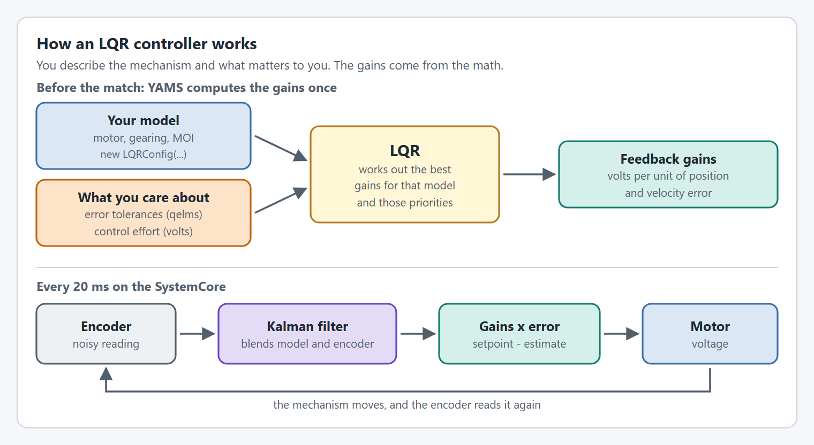
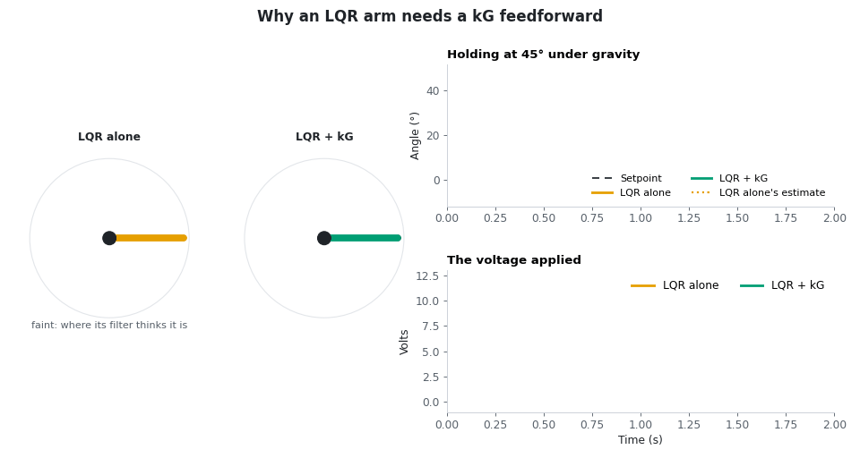

# LQR controllers

**A linear quadratic regulator (LQR)** is a closed loop controller that works out its own gains from a model of your mechanism. Instead of tuning kP and kD by trial and error, you say how much error you will accept and how much voltage you are willing to use, and LQR computes the gains that best balance the two. This page explains how it works. To set one up, see [How do I use LQR instead of PID?](../../how-to/how-do-i-use-lqr.md); every option is in [LQRConfig](lqr-config.md).


**The difference from PID:** with PID you choose the gains. With LQR you choose your priorities, and the gains follow from them and from the model.


<figure><figcaption>
You supply the model and the priorities. LQR supplies the gains.
</figcaption></figure>

## How it works

An LQR in YAMS has three parts, which run every loop:

1. **A model** of the mechanism, from the motor, the gearing and the moment of inertia (or, for an elevator, the carriage mass and drum radius). It predicts how a voltage will move the mechanism.
2. **A Kalman filter**, which combines the model's prediction with the encoder reading into an estimate of where the mechanism is and how fast it is moving.
3. **The regulator**, which multiplies the error between the setpoint and that estimate by its gains to get a voltage.

### The regulator: your tolerances become gains

You give the regulator two kinds of tolerance:

* **The state tolerances, "qelms":** how large a position error (and a velocity error) you will accept. A smaller tolerance makes an error more expensive, so the regulator pushes harder to remove it.
* **The control effort, "relms":** how much voltage you are willing to use. A smaller effort makes voltage more expensive, so the regulator is gentler.

LQR then finds the gains that minimize the total cost. Tightening the position tolerance raises kP, and the arm moves faster, until it asks for the full 12 V and can go no faster.

<figure><figcaption>
The same arm, with the position tolerance tightened step by step. Made with YAMS's LQRConfig on a simulated Kraken X60, 100:1, 0.5 kg·m² arm, with no gravity.
</figcaption></figure>

### The Kalman filter: an estimate better than the encoder

An encoder only measures position, and every reading is a little off. Differencing two readings to get the speed amplifies that noise. The Kalman filter instead predicts each loop where the model says the mechanism should be, then corrects the prediction toward the reading, by how much you trust each: the model trust and the encoder trust, as standard deviations. The result is a smooth estimate of the position and the speed, and the speed is never measured at all.

<figure><figcaption>
The encoder's readings, and what the Kalman filter makes of them. In this simulation the model is exact, so the estimate is within 0.03° of the truth; on a robot, model errors make it less clean.
</figcaption></figure>

### What the model leaves out: gravity

YAMS's LQR model has no gravity in it. On an arm or elevator, LQR alone settles short of the setpoint: its kP has to hold the weight up, and that takes an error. Worse, its Kalman filter, trusting a model that knows nothing of gravity, believes the arm is closer to the setpoint than it is, so the regulator sees an even smaller error and pushes even less. Add a feedforward with a kG, which supplies the voltage gravity needs, and the LQR only has to handle the rest.

<figure><figcaption>
LQR alone ends 9.3° short, and its filter thinks it is almost there. A kG of 0.4 V fixes it. Made with YAMS's LQRConfig on the same simulated arm, with a 6 kg load 0.4 m out.
</figcaption></figure>

## Where it runs

No motor controller runs an LQR itself: it needs a model, matrix math and a Kalman filter, which motor controller firmware does not have. So YAMS always runs an LQR on the SystemCore, on every motor controller. The wrapper starts a `Notifier` that runs the closed loop every closed loop control period, 20 ms by default; you never call it yourself.

| | PID on the motor controller | LQR on the SystemCore |
| --- | --- | --- |
| How often it runs | 1 kHz | 50 Hz by default |
| Delay | About 1 ms | A CAN round trip, about 5 to 20 ms |
| SystemCore CPU | None | A little |
| Best for | Fast loops, simple mechanisms | Arms, elevators and flywheels with a good model |

For most arms, elevators and flywheels, 50 Hz is enough.

## LQR or PID?

| | PID | LQR |
| --- | --- | --- |
| What you tune | kP, kI, kD | Error tolerances (qelms) and control effort (relms) |
| Model needed | No | Yes: motor, gearing, inertia or mass |
| What it controls | One state | Position and velocity together |
| Where it runs | On the motor controller | On the SystemCore |
| YAMS method | `withClosedLoopController(kP, kI, kD)` | `withClosedLoopController(LQRController)` |

**Reach for LQR** when you know the mechanism's model well (mass, inertia, gearing), when PID tuning is hard, or to learn how model-based control works. **Keep a PID** for a mechanism that tunes easily, when you do not know its inertia or mass, or when you need the motor controller's 1 kHz loop. For an observer that estimates the load instead of needing a model of it, see [ADRC controllers](adrc-controllers.md).
