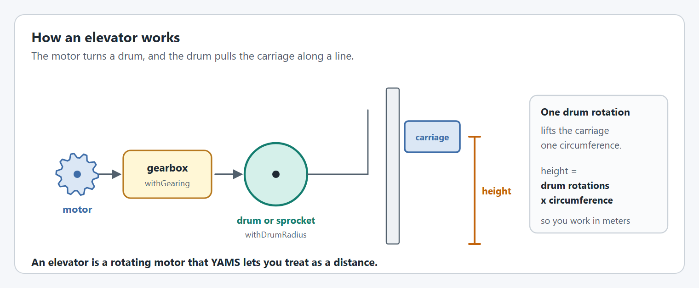
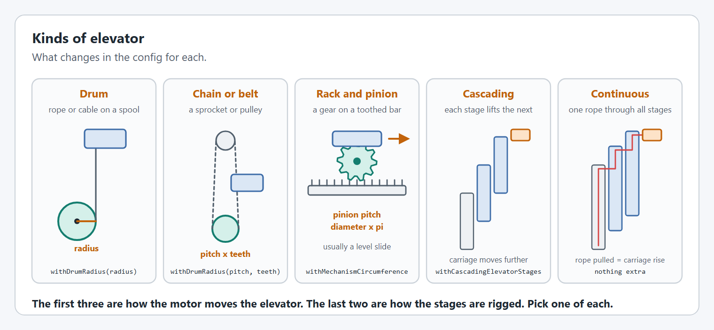

# Elevators

An `Elevator` moves a carriage along a line: a lift, a telescoping climber, or a linear slide.

## How an elevator works

<figure><figcaption><p>A rotating motor becomes a distance.</p></figcaption></figure>

The motor turns a drum or sprocket through a gearbox, and the drum pulls the carriage. One rotation of the drum moves the carriage one circumference, so once YAMS knows the [drum size](editor/config/gearing-and-units.md#withmechanismcircumference) you can work in meters and never think about rotations. [How do I find my mechanism's circumference?](../how-to/how-to-find-your-mechanism-circumference.md) covers measuring it.

A vertical elevator has to hold its carriage up, which is what the `kG` term of [`ElevatorFeedforward`](editor/config/feedforward.md#withfeedforward) is for.

## Creating an elevator

This is the shape of an elevator class, not a complete file: the imports and the motor controller object (`spark`, a `SparkMax`) are left out. [Step 2 of the Elevator tutorial](../tutorials/elevator/mechanism.md) builds the complete file. The code is the same for Commands v2 and Commands v3 except for the package you import from and the class that owns the mechanism.



```java
import yams.commands2.config.SmartMotorControllerConfig;
import yams.commands2.mechanisms.Elevator;

public class ElevatorSubsystem extends SubsystemBase
{
  private final SmartMotorControllerConfig motorConfig = new SmartMotorControllerConfig(this)
      .withControlMode(ControlMode.CLOSED_LOOP)
      .withGearing(new MechanismGearing(GearBox.fromReductionStages(3, 4)))
      .withDrumRadius(Inches.of(0.25), 22) // chain pitch and sprocket teeth
      .withClosedLoopController(4, 0, 0)
      .withFeedforward(new ElevatorFeedforward(0, 0.4, 3.5))
      .withTrapezoidalProfile(MetersPerSecond.of(1.5), MetersPerSecondPerSecond.of(3))
      .withSoftLimits(Meters.of(0), Meters.of(1.25))
      .withStartingPosition(Meters.of(0))
      .withStatorCurrentLimit(Amps.of(40))
      .withZeroPower(MotorMode.BRAKE)
      .withTelemetry("ElevatorMotor", TelemetryVerbosity.HIGH);
  private final SmartMotorController motor = new SparkWrapper(spark, DCMotor.getNEO(1), motorConfig);
  private final ElevatorConfig config = new ElevatorConfig()
      .withCarriageWeight(Pounds.of(16))
      .withHardLimits(Meters.of(0), Meters.of(1.3))
      .withTelemetry("Elevator", TelemetryVerbosity.HIGH);
  private final Elevator elevator = new Elevator(config, motor);

  @Override
  public void periodic()
  {
    elevator.updateTelemetry(); // every loop
  }

  @Override
  public void simulationPeriodic()
  {
    elevator.simIterate(); // every loop, in simulation
  }
}
```

`this` is the `Subsystem`. The scheduler calls `periodic()` and `simulationPeriodic()` for you.



```java
import yams.commands3.config.SmartMotorControllerConfig;
import yams.commands3.mechanisms.Elevator;

public class ElevatorMechanism implements Mechanism
{
  private final SmartMotorControllerConfig motorConfig = new SmartMotorControllerConfig(this)
      .withControlMode(ControlMode.CLOSED_LOOP)
      .withGearing(new MechanismGearing(GearBox.fromReductionStages(3, 4)))
      .withDrumRadius(Inches.of(0.25), 22) // chain pitch and sprocket teeth
      .withClosedLoopController(4, 0, 0)
      .withFeedforward(new ElevatorFeedforward(0, 0.4, 3.5))
      .withTrapezoidalProfile(MetersPerSecond.of(1.5), MetersPerSecondPerSecond.of(3))
      .withSoftLimits(Meters.of(0), Meters.of(1.25))
      .withStartingPosition(Meters.of(0))
      .withStatorCurrentLimit(Amps.of(40))
      .withZeroPower(MotorMode.BRAKE)
      .withTelemetry("ElevatorMotor", TelemetryVerbosity.HIGH);
  private final SmartMotorController motor = new SparkWrapper(spark, DCMotor.getNEO(1), motorConfig);
  private final ElevatorConfig config = new ElevatorConfig()
      .withCarriageWeight(Pounds.of(16))
      .withHardLimits(Meters.of(0), Meters.of(1.3))
      .withTelemetry("Elevator", TelemetryVerbosity.HIGH);
  private final Elevator elevator = new Elevator(config, motor);

  public void periodic()
  {
    elevator.updateTelemetry(); // every loop
  }

  public void simulationPeriodic()
  {
    elevator.simIterate(); // every loop, in simulation
  }
}
```

`this` is the Commands v3 `Mechanism`. A `Mechanism` has no periodic hook, so call `periodic()` yourself from `Robot.robotPeriodic()`, and run `simulationPeriodic()` in its own `Notifier`, started from `Robot.simulationInit()`. [Where the tutorials put things](../tutorials/project-setup.md#where-the-tutorials-put-things) shows both.



The options in `motorConfig` are explained in [SmartMotorControllerConfig](editor/config/), and the options in `config` in [ElevatorConfig](mechanism-configs/elevator-config.md).


The gains (`kP` of 4, `kG` of 0.4, `kV` of 3.5) and the profile are placeholders. In simulation the carriage should rise to its target and hold there, perhaps with some overshoot or sag. On your robot they will be wrong: the [Elevator tutorial](../tutorials/elevator.md) finds the real ones.


## Controlling an elevator

An elevator takes `Distance` targets: `elevator.setHeight(Meters.of(1.2))` goes to 1.2 m and holds it, `elevator.runTo(Meters.of(1.2), Centimeters.of(2))` ends when it gets there, and `elevator.getHeight()` reads where it is. [Controlling a mechanism](controlling-a-mechanism.md) lists every command, setpoint function and check, and [When mechanism commands end](run-vs-runto.md) explains how they work with a default command.

## Which kind of elevator do you have?

<figure><figcaption><p>Five kinds of elevator and what each changes in the config.</p></figcaption></figure>

Two questions decide the config: how the motor moves the elevator, and how the stages are rigged. Answer both.

### How the motor moves it



A rope, cable or strap winds onto a drum. Give the drum's radius, measured to the middle of the rope where it sits on the drum.

```java
.withGearing(new MechanismGearing(GearBox.fromReductionStages(5, 4)))
.withDrumRadius(Inches.of(0.75))
```

If the rope winds over itself, the radius grows as the elevator rises and the height reads short near the top. Use a drum wide enough for one layer, or measure the travel and work the circumference back from it.



A sprocket drives a chain that carries the carriage. The chain moves one pitch for every tooth, so give the chain pitch and the sprocket's tooth count and YAMS works out the rest.

```java
.withGearing(new MechanismGearing(GearBox.fromReductionStages(5, 4)))
.withDrumRadius(Inches.of(0.25), 22) // #25 chain is 0.25 in pitch, #35 is 0.375 in; 22 teeth
```

A timing belt on a pulley works the same way: give the belt pitch and the pulley's tooth count.



A pinion gear on the motor runs along a toothed rack. One turn of the pinion moves the carriage the pinion's pitch circumference.

```java
.withGearing(new MechanismGearing(GearBox.fromReductionStages(5)))
.withMechanismCircumference(Inches.of(1.5).times(Math.PI)) // pitch diameter x pi
```

Use the pitch diameter from the gear's datasheet, not the outside diameter. For a metric gear the pitch diameter is the module times the tooth count.

Most rack and pinion mechanisms are level linear slides. Tell the simulation there is no gravity to hold against, and expect to need [separate simulation gains](editor/simulation-only-pid-+-feedforward.md):

```java
new ElevatorConfig()
    .withAngle(Degrees.of(0))  // drawn level
    .withHorizontalElevator()  // no gravity in simulation
```

A level slide needs no `kG`, so its `ElevatorFeedforward` has `kG` of 0.



### How the stages are rigged



The carriage rides directly on the fixed frame. There is nothing more to set.



Each stage lifts the next one, so the carriage moves further than the part the motor pulls: twice as far with two moving stages, three times with three. Tell YAMS how many, and it divides the gearing to match.

```java
.withGearing(new MechanismGearing(GearBox.fromReductionStages(5, 4)))
.withDrumRadius(Inches.of(0.25), 22)
.withCascadingElevatorStages(2)
```

Call it after `withGearing`. See [`withCascadingElevatorStages`](editor/config/gearing-and-units.md#withcascadingelevatorstages). Every height you give and read is then the carriage's height.

To show each stage on an AdvantageScope robot model, also give the `ElevatorConfig` the stages with [`withStages`](mechanism-configs/elevator-config.md#withstages), and publish `elevator.getCascadePose3d()`: every stage moves at once, each by its share of the carriage's height.



One rope or belt runs through every stage. The stages may rise in any order, but the carriage always rises by the length of rope pulled, so a continuous elevator is configured like a single stage: nothing extra to set.

```java
.withGearing(new MechanismGearing(GearBox.fromReductionStages(5, 4)))
.withDrumRadius(Inches.of(0.75))
```

To show each stage on an AdvantageScope robot model, give the `ElevatorConfig` the stages with [`withStages`](mechanism-configs/elevator-config.md#withstages), and publish `elevator.getContinuousPose3d(carriageFirst)`. Pass `true` if the carriage rises the whole of its travel first, then the stage below it, and so on, or `false` if the stage nearest the fixed stage rises first and the carriage last. Watch your elevator move to see which it is.




Whatever the kind, check it the same way: command a move of a known distance and measure how far the carriage really went. If it is off by a constant factor, the circumference or the stage count is wrong.


### Elevators with a constant force spring

A spring that helps lift the carriage changes what `kG` should be. See [Elevators with a constant force spring](live-tuning/#elevators-with-a-constant-force-spring).

## Hard limits and soft limits

Hard limits are where the physical stops are, and the simulated elevator cannot pass them. Soft limits are where the motor controller keeps the real elevator. Set both, with the soft limits a little inside: see [`withHardLimits`](mechanism-configs/shared-options.md#withhardlimits).

## Configuring and tuning an elevator, step by step

Do the configuration steps first, in simulation, then tune the real elevator with [live tuning](live-tuning/). Tuning something that is configured wrong wastes the time.


Like all tuning, this can be dangerous. Keep clear of the mechanism, start with low current limits and small moves, and practice in simulation first.


### Configure it



#### Set the gearing

Give the reduction from the motor to the drum, sprocket or pinion with [`withGearing`](editor/config/gearing-and-units.md#withgearing).



#### Set how the motor moves it

Give the drum radius, the chain pitch and teeth, or the pinion's pitch circumference: see [how the motor moves it](elevators.md#how-the-motor-moves-it) below.



#### Set how the stages are rigged

Add `withCascadingElevatorStages` for a cascading elevator and nothing for a single stage or continuous one: see [how the stages are rigged](elevators.md#how-the-stages-are-rigged).



#### Make up positive

Apply a small positive voltage. If the carriage goes down, flip [`withMotorInverted`](editor/config/motor-basics.md#withmotorinverted).



#### Check the distance

Command a move of a known distance, such as 0.5 m, and measure the carriage with a tape. If it is off by a constant factor, fix the circumference or the stage count before going any further.



#### Set where it starts

Decide what height 0 means, usually the carriage fully down, and set [`withStartingPosition`](editor/config/encoders.md#withstartingposition) to where the carriage is when the robot turns on.



#### Set the limits

Put [`withHardLimits`](mechanism-configs/shared-options.md#withhardlimits) at the stops and [`withSoftLimits`](editor/config/limits-and-protection.md#withsoftlimits) a centimeter or two inside them.



#### Describe it to the simulator

Set [`withCarriageWeight`](mechanism-configs/elevator-config.md#withcarriageweight), and `withHorizontalElevator()` for a level slide.



### What is different when tuning an elevator

The [Elevator tutorial](../tutorials/elevator/tune.md) walks through tuning an elevator, and [Tuning order](live-tuning/#tuning-order) lists the order with the keys to watch. What sets an elevator apart:

* **kG is the same at every height.** Gravity pulls the carriage with the same force wherever it is, unlike an arm.
* **Find kG and kS together from two voltages.** Set kP, kI, kD and kS to 0. Raise kG until the carriage just creeps up, then lower it until it just creeps down. kG is the average of the two, and kS is half the difference.
* **Check the hold at the bottom, the middle and the top,** then again with a game piece on the carriage.
* **Tune with small moves first,** a few centimeters at a time, until the motion profile is in.

### What changes for each kind



A level rack and pinion slide has no weight to hold, so it tunes differently:

* **kG is 0.** Skip the two voltage test for kG. Find kS on its own: the voltage at which the slide just starts to move, in either direction.
* **kS matters more.** A slide's resistance is nearly all friction, so a good kS does most of the work at low speed.
* **Expect backlash.** The gap between the pinion and the rack means the carriage can move a little with the motor still. Do not raise kP to chase it, or the slide will buzz back and forth across the gap. Use a `runTo` tolerance wider than the backlash.
* **Simulate it level.** Use `withHorizontalElevator()`, and give it [its own simulation gains](editor/simulation-only-pid-+-feedforward.md), because the simulation has no friction or backlash.

A rack and pinion that lifts vertically is tuned like any other elevator, with kG.



Everything is measured at the carriage, which moves several times further than the stage the motor pulls:

* **Check the stage count first.** The distance check in the configuration steps is what catches a wrong `withCascadingElevatorStages`.
* **Expect a larger kG.** The motor lifts the carriage through a mechanical disadvantage, and lifts the moving stages as well, so it needs more voltage to hold than a single stage with the same carriage.
* **Profile limits are the carriage's.** A maximum velocity of 1.5 m/s is the carriage moving at 1.5 m/s. The first stage moves at a fraction of that.
* **Watch the current.** Because of the disadvantage, a cascading elevator draws more current for the same load. If it cannot reach the top, see [when tuning does not help](live-tuning/#when-tuning-does-not-help).



A continuous elevator is configured like a single stage, but its stages rise in whatever order friction decides:

* **Check kG at several heights.** The weight being lifted changes as each stage starts to move. If the carriage holds at the bottom but drifts higher up, use the kG that holds best in the range you use most and let kP hold the rest.
* **Expect a bump** as each stage picks up or sets down. A little kD smooths it.



A constant force spring does part of the motor's job, so kG is whatever is left over. It can be small, zero, or negative when the spring is stronger than the carriage.

* **Measure kG, do not calculate it.** Use the two voltage test in the tuning steps. With a spring, the voltage that just moves the carriage down is often negative.
* **Check the hold at the bottom, middle and top.** The springs are not perfectly constant.
* **Give it simulation gains.** The simulation knows nothing about the spring, so the real gains will not hold the simulated carriage. Set [simulation only gains](editor/simulation-only-pid-+-feedforward.md) for it.
* **The spring does not change kV, kP or kD.**

[Elevators with a constant force spring](live-tuning/#elevators-with-a-constant-force-spring) walks through the measurement with graphics.



## ElevatorConfig options

Every `ElevatorConfig` option is on the [ElevatorConfig](mechanism-configs/elevator-config.md) page under this one, with a graphic and an example for each. Options shared by every mechanism are in [Shared options](mechanism-configs/shared-options.md).

An `Elevator` needs its carriage weight, hard limits, a drum size and a starting position before it can be created in simulation: see [what simulation needs](mechanism-configs/#what-simulation-needs).

## Code reference






