# Live tuning

Live tuning lets you change gains, motion profiles and limits from a dashboard while the robot is enabled, and see the result straight away. It works over NetworkTables with AdvantageScope or Elastic.

<figure>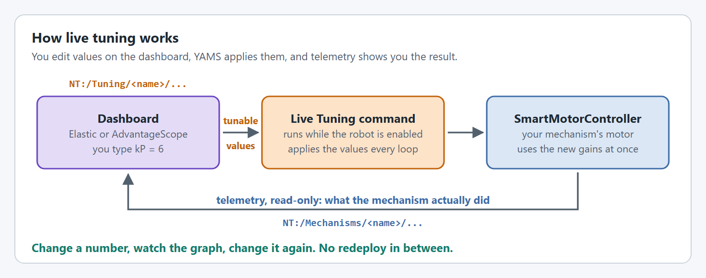<figcaption><p>Change a number, watch the graph, change it again.</p></figcaption></figure>

## Turn it on

Give the motor's telemetry `TelemetryVerbosity.HIGH`. That is all most robots need.

<pre class="language-java"><code class="lang-java">SmartMotorControllerConfig lowerFlyWheelConfig = new SmartMotorControllerConfig(this)
      .withControlMode(ControlMode.CLOSED_LOOP)
      .withZeroPower(MotorMode.COAST)
      .withGearing(new MechanismGearing(GearBox.fromReductionStages(3, 4)))
      .withMomentOfInertia(Inches.of(4), Pounds.of(2))
      .withClosedLoopController(1,
                                0,
                                0) // You generally do not want a profile because its not a position controlled loop.
      .withFeedforward(new SimpleMotorFeedforward(0, 0, 0)) // Helps track changing RPM goals
      .withMotorInverted(false)
<strong>      .withTelemetry("LowerFlyWheel", TelemetryVerbosity.HIGH) // yams.core.telemetry.enums.TelemetryVerbosity
</strong></code></pre>

| How the motor's telemetry is set up | Live Tuning command |
| --- | --- |
| `withTelemetry(name, TelemetryVerbosity.HIGH)` | Registered for you |
| `withTelemetry(name, telemetryConfig)` with a `SmartMotorControllerTelemetryConfig` | Registered for you |
| A mechanism, such as an `Arm`, `Elevator`, `Pivot` or `FlyWheel`, with `withTelemetry(...)` on its own config too | Registered for you, for the mechanism's motor controllers |
| You call `setupTelemetry(NetworkTable, NetworkTable)` yourself (Java) | Call `setupLiveTuning()` afterwards, see below |
| C++ with `TelemetryVerbosity::HIGH` and a subsystem on the config | Registered for you when `SetupTelemetry()` runs |

YAMS registers **one** `Live Tuning` command per subsystem (Commands v2) or mechanism (Commands v3). Every motor controller in that subsystem or mechanism joins the same command.

<details>

<summary>Setting up live tuning explicitly</summary>

If you set up telemetry yourself, the `Live Tuning` command is not registered for you. Call `setupLiveTuning()` on the config after the telemetry is set up:

```java
SmartMotorControllerConfig motorConfig = new SmartMotorControllerConfig(this)
    .withTelemetry("ArmMotor", TelemetryVerbosity.HIGH);
SmartMotorController motor = new TalonFXWrapper(armMotor, DCMotor.getKrakenX60(1), motorConfig);

motor.setupTelemetry(telemetryTable, tuningTable);
motorConfig.setupLiveTuning();
```

`setupLiveTuning()` does nothing when:

* the `SmartMotorController` has not set up its telemetry yet (that is what attaches the controller to the config), or
* the config has no subsystem (Commands v2) or mechanism (Commands v3).

Registering two different subsystem or mechanism instances with the same name throws an `IllegalStateException`. Give each one a unique name, for example `LeftTurret` and `RightTurret`.

In C++ there is no explicit call.

</details>


Using CTRE TalonFX or TalonFXS motors? Phoenix Tuner X can connect to your simulation too. See [TunerX in simulation](tunerx-in-simulation.md).


## Use it


Like all tuning, live tuning can be **dangerous**. It's best to practice in simulation before the real robot.




#### Try it in simulation

Run the robot code in simulation and go through the steps below there first.



#### Enable the robot

Dashboard edits are only applied while the robot is enabled and the `Live Tuning` command is running.



#### Start the `Live Tuning` command

It is published at `NT:/Tuning/SUBSYSTEM_NAME/Live Tuning`, where `SUBSYSTEM_NAME` is the name of the subsystem (Commands v2) or mechanism (Commands v3) given to the `SmartMotorControllerConfig`.



In Elastic, drag the `Live Tuning` command from `NT:/Tuning/SUBSYSTEM_NAME/Live Tuning` onto your dashboard and press its button.

It is a regular WPILib Commands v2 `Command` that requires the subsystem.



Commands v3 commands are not dashboard widgets themselves, so YAMS publishes the command through `yams.commands3.telemetry.CommandTunable`. It shows up with a single `running` boolean at `NT:/Tuning/MECHANISM_NAME/Live Tuning/running`:

* Set `running` to `true` to schedule the command on the default `Scheduler`.
* Set `running` to `false` to cancel it.
* `running` reads back whether the command is currently running.

The command requires the mechanism and runs a `while (true)` loop that applies the dashboard values and calls `coroutine.yield()` each loop.





#### Change a value

The tunable values are published under `NT:/Tuning/`. Edit one, and it is applied on the next loop.



AdvantageScope only reads NetworkTables until you turn on **tuning mode**. Click the tuning mode button, the sliders icon beside the search box at the top of the sidebar. It is only shown while AdvantageScope is connected to a live robot or simulation.

<figure>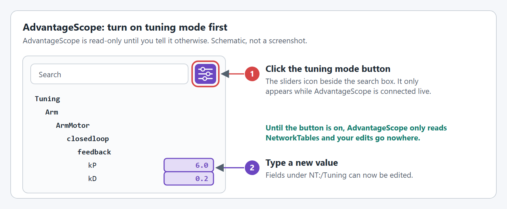<figcaption><p>Turn tuning mode on, then edit the fields under <code>NT:/Tuning</code>.</p></figcaption></figure>

With tuning mode on, the fields under `NT:/Tuning` can be edited in the sidebar. If typing a value does nothing, check this button first.



Drag a field from `NT:/Tuning/` onto the dashboard as a text or number widget and type the new value. Elastic can always write to NetworkTables, so there is nothing to turn on.





#### Watch what happens

Graph the matching read-only fields under `NT:/Mechanisms/`. [NetworkTables keys](#networktables-keys) shows where they are, and [What to tune and what to watch](#what-to-tune-and-what-to-watch) lists which key to watch for each value.




The `Live Tuning` command requires the subsystem or mechanism, so the controller, a default command, or any other trigger for that subsystem or mechanism can interrupt it. Dashboard edits stop being applied when it is interrupted.


<figure><figcaption><p>Starting the command and changing a value.</p></figcaption></figure>

<figure><figcaption><p>Tuning while the robot is enabled.</p></figcaption></figure>

## NetworkTables keys

Everything on this page is named by its NetworkTables key, which is what you see in AdvantageScope and Elastic.

| What | Where it is published |
| --- | --- |
| Values you type | `NT:/Tuning/<Mechanism>/<Motor>/<key>` |
| Values you watch | `NT:/Mechanisms/<Mechanism>/<Motor>/<key>` |
| The `Live Tuning` command | `NT:/Tuning/<Subsystem>/Live Tuning` |

`<Mechanism>` and `<Motor>` are the names given to `withTelemetry(...)` on the mechanism config and on the `SmartMotorControllerConfig`. A motor controller used without a mechanism class has no `<Mechanism>` level.

For example, an arm named `Arm` with a motor named `ArmMotor`:

* You type kP into `NT:/Tuning/Arm/ArmMotor/closedloop/feedback/kP`.
* You watch the arm at `NT:/Mechanisms/Arm/ArmMotor/mechanism/position`.


Some keys exist in both tables. `closedloop/setpoint/position` under `NT:/Tuning` is the setpoint you type. Under `NT:/Mechanisms` it is the setpoint the controller is using right now.


### The position and velocity to watch

Which keys hold the position and velocity depends on the mechanism.

| Mechanism | Position | Velocity | Units |
| --- | --- | --- | --- |
| Rotational: arms, pivots, turrets, flywheels | `mechanism/position` | `mechanism/velocity` | Rotations, rot/s |
| Linear: elevators, and anything with a mechanism circumference | `measurement/position` | `measurement/velocity` | Meters, m/s |

The tables below write `mechanism/position` and `mechanism/velocity`. On a linear mechanism, read them as `measurement/position` and `measurement/velocity`.

## Units: what you type and what you read

Tunable fields and read-only fields do not use the same units.

<figure>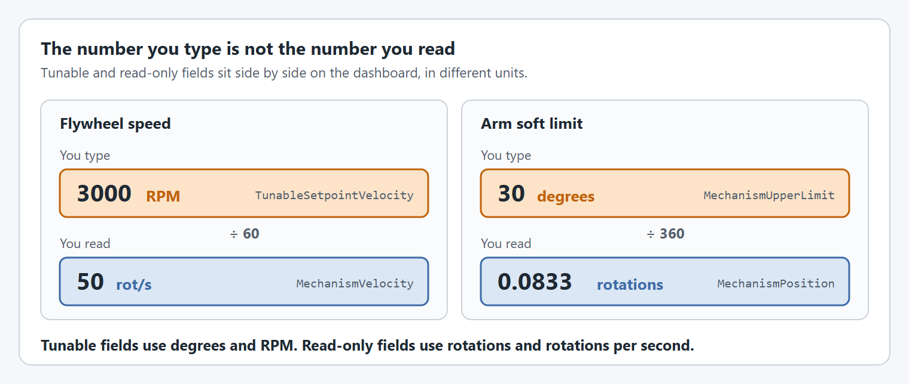<figcaption><p>The value you type is in the tunable unit, not the unit of the read-only field next to it.</p></figcaption></figure>

| Quantity | You type (tunable fields) | You read (read-only fields) |
| --- | --- | --- |
| Angular position | **Degrees** | **Rotations** |
| Angular velocity | **RPM** | **Rotations per second** |
| Angular acceleration | **RPM per second** | **Rotations per second²** |
| Linear position, velocity, acceleration (linear closed loop control) | **Meters**, **m/s**, **m/s²** | **Meters**, **m/s**, **m/s²** |
| Voltage, current | **Volts**, **Amps** | **Volts**, **Amps** |
| Temperature | Not tunable | **Fahrenheit** |

### See both in the same units with AdvantageScope

AdvantageScope can convert any read-only field for display, without changing the data or your robot code.

1. Drag the telemetry field, for example `NT:/Mechanisms/Arm/ArmMotor/mechanism/position`, into a Line Graph.
2. Right-click the field in the graph legend and choose **Convert Units…**
3. Pick the target unit: Rotations to Degrees, rot/s to RPM, Meters to Inches, and so on.

Now the graph shows degrees and RPM, the same units the tunable fields expect. When the graph shows 180°, you type `180`.


**Recommended setup for a tuning session**

* Convert `mechanism/position` and `closedloop/setpoint/position` to degrees. On a linear mechanism, convert `measurement/position` to inches if you prefer.
* Convert `mechanism/velocity` to RPM (or deg/s).
* Graph `closedloop/setpoint/position` and `mechanism/position` together. YAMS has no closed loop error field: the error is the gap between the two lines.
* Keep the graphs visible next to the tunable fields.


## What to tune and what to watch

Every tunable field has a read-only field that tells you whether your change worked.

<figure><figcaption><p>What the position graph looks like after a setpoint change.</p></figcaption></figure>



| You type (`NT:/Tuning`) | Watch (`NT:/Mechanisms`) | Why |
| --- | --- | --- |
| `closedloop/feedback/kP` | `mechanism/position` vs `closedloop/setpoint/position` | Error should shrink faster as kP rises. Oscillation means kP is too high. |
| `closedloop/feedback/kI` | `mechanism/position` vs `closedloop/setpoint/position` over time | Removes a steady error that never closes. Watch for windup causing overshoot. |
| `closedloop/feedback/kD` | `mechanism/velocity`, `motor/outputVoltage` | Dampens oscillation. If voltage spikes on direction changes, kD is too high. |

For a velocity mechanism such as a flywheel, compare `mechanism/velocity` with `closedloop/setpoint/velocity` instead.

Gains are in volts per rotation of error (per meter for linear mechanisms). See [Gain units](#gain-units) below.



| You type (`NT:/Tuning`) | Watch (`NT:/Mechanisms`) | Why |
| --- | --- | --- |
| `closedloop/feedforward/kS` | `motor/outputVoltage` at rest | Voltage to overcome static friction. Raise until the mechanism just starts to move. |
| `closedloop/feedforward/kV` | `mechanism/velocity` vs `closedloop/setpoint/velocity`, `motor/outputVoltage` | With kP = 0, adjust until measured velocity matches the setpoint at steady state. |
| `closedloop/feedforward/kA` | `mechanism/velocity` during the acceleration ramp | Improves tracking while a motion profile accelerates. |
| `closedloop/feedforward/kG` (arms, elevators) | `mechanism/position`, `motor/outputVoltage` | Arms: hold level and raise until the arm stays put. Elevators: a constant that fights gravity. |


For arms, `kG * cos(angle)` is applied: full kG when level (0°), none when vertical (±90°). YAMS handles the cosine for you.




All of these keys start with `closedloop/motionprofile/`.

| You type (`NT:/Tuning`) | Units | Watch (`NT:/Mechanisms`) | Why |
| --- | --- | --- | --- |
| `maxVelocity` | RPM (or m/s) | `mechanism/velocity` while cruising | The plateau speed. Raise to move faster; lower if the motor stalls while cruising. |
| `maxAcceleration` | RPM/s (or m/s²) | `current/stator`, `mechanism/velocity` ramp | How quickly speed builds. High acceleration means a current spike at the start. |
| `maxJerk` | RPM/s² | Shape of `mechanism/velocity` | Smooths the ramp when sudden acceleration causes mechanical shock. |
| `kV`, `kA` | Same units as the feedforward kV, kA | `mechanism/velocity` | The system constants the exponential profile plans with. |
| `maxInput` | Volts | `motor/outputVoltage` | The most voltage the exponential profile will ask for. |



| You type (`NT:/Tuning`) | Units | Watch (`NT:/Mechanisms`) | Why |
| --- | --- | --- | --- |
| `closedloop/setpoint/position` | Degrees (or m) | `mechanism/position` vs `closedloop/setpoint/position` | Send the mechanism to a position without a button binding. |
| `closedloop/setpoint/velocity` | RPM (or m/s) | `mechanism/velocity`, `motor/outputVoltage` | Command a speed, for example to find kV without a full profile. |
| `closedloop/slot` | Slot number | `closedloop/slot` | Switch which gain slot the controller uses. |



| You type (`NT:/Tuning`) | Units | Watch (`NT:/Mechanisms`) | Why |
| --- | --- | --- | --- |
| `mechanism/limit/lower` | Degrees | `mechanism/position`, `limits/mechanism/lower` (boolean) | The boolean turns true at the lower soft limit. Move the limit to change where it stops. |
| `mechanism/limit/upper` | Degrees | `mechanism/position`, `limits/mechanism/upper` (boolean) | The same for the upper soft limit. |
| `measurement/limit/lower`, `measurement/limit/upper` | Meters | `measurement/position` | Soft limits for linear mechanisms. |
| `current/limit/stator` | Amps | `current/stator`, `mechanism/velocity` | Caps torque. Watch for speed sagging when the limit is too low. |
| `current/limit/supply` | Amps | `current/supply`, `motor/outputVoltage` | Prevents brownouts. Lower it if supply current spikes dip the voltage. |



| You type (`NT:/Tuning`) | Units | Watch (`NT:/Mechanisms`) | Why |
| --- | --- | --- | --- |
| `ramprate/dutycycle/openloop` | Seconds, 0 to 100% | `motor/outputVoltage` during open loop commands | Slows voltage changes in open loop. Reduces shock on `set(dutyCycle)`. |
| `ramprate/dutycycle/closedloop` | Seconds, 0 to 100% | `motor/outputVoltage` during closed loop moves | The same for closed loop, when a setpoint step causes a big voltage jump. |
| `motor/inverted` | Boolean | `mechanism/velocity` | Flips the motor direction. Positive voltage should give a positive velocity. |
| `encoder/inverted` | Boolean | `mechanism/position` | Flips the encoder direction. |



| You type (`NT:/Tuning`) | Units | Watch (`NT:/Mechanisms`) | Why |
| --- | --- | --- | --- |
| `voltage/enabled` | Boolean | `motor/outputVoltage` | Drive the motor at `voltage/setpoint` instead of the closed loop. See [Drive a motor at a voltage](#drive-a-motor-at-a-voltage). |
| `voltage/setpoint` | Volts | `mechanism/velocity`, `current/stator` | The voltage for the motor and its loosely coupled followers. |




**Worth watching the whole time**

* `motor/temperature`: a hot motor backing off can look like a gain problem.
* `motor/outputVoltage`: the raw command the motor is getting. Confirms your feedforward math.
* `rotor/position`, `rotor/velocity`: values before gearing. Useful for checking the gearing is right.


Some settings are **not** tunable live and have to be changed in the config: the closed loop tolerance, voltage compensation, the closed loop maximum voltage and the temperature cutoff.

### Gain units

<details>

<summary>PID gains</summary>

| Gain | Unit | Meaning |
| --- | --- | --- |
| `kP` | V/rot | Volts per rotation of position error. Linear mechanisms: V/m. |
| `kI` | V/(rot·s) | Volts per accumulated position error over time. Linear: V/(m·s). |
| `kD` | V/(rot/s) | Volts per unit of velocity error. Linear: V/(m/s). |

For position control the error is in rotations of the mechanism (or meters with linear closed loop control). For velocity control it is in rotations per second (or meters per second).

</details>

<details>

<summary>Feedforward gains</summary>

| Gain | SimpleMotorFeedforward (flywheels) | ArmFeedforward (arms, pivots) | ElevatorFeedforward (elevators) |
| --- | --- | --- | --- |
| `kS` | V, static friction | V, static friction | V, static friction |
| `kG` | Not used | V, holds the arm level; applied as `kG * cos(angle)` | V, constant against gravity |
| `kV` | V/(rot/s) | V/(rot/s) | V/(m/s) |
| `kA` | V/(rot/s²) | V/(rot/s²) | V/(m/s²) |

In YAMS, `ArmFeedforward` uses rotations for kV and kA, like the other feedforward types.

</details>

<details>

<summary>Motion profile settings in code</summary>

| Profile | Setting | Unit in code |
| --- | --- | --- |
| Trapezoidal | Max velocity | Any WPILib angular velocity (or linear velocity) unit |
| Trapezoidal | Max acceleration | Any WPILib angular acceleration (or linear acceleration) unit |
| Exponential | Max input | Volts |
| Exponential | kV, kA | V/(rot/s), V/(rot/s²) |

On the dashboard, the trapezoidal values are typed in RPM and RPM per second, as in the Motion profile tab above.

</details>

## Drive a motor at a voltage

Sometimes you want no closed loop at all, just a voltage: to find the voltage that just starts a mechanism moving, to check that a positive voltage moves it the way you expect, or to see how fast it goes at 3 V. Every motor controller with `TelemetryVerbosity.HIGH` has two keys for this under `NT:/Tuning/<Mechanism>/<Motor>/`:

| You type | Units | What it is |
| --- | --- | --- |
| `voltage/enabled` | Boolean | Drive the motor at `voltage/setpoint` while `true`. |
| `voltage/setpoint` | Volts | The voltage. Set back to `0` when `voltage/enabled` turns on, and applied each time you change it while `voltage/enabled` is `true`. It is not applied while `voltage/enabled` is `false`. |

<figure>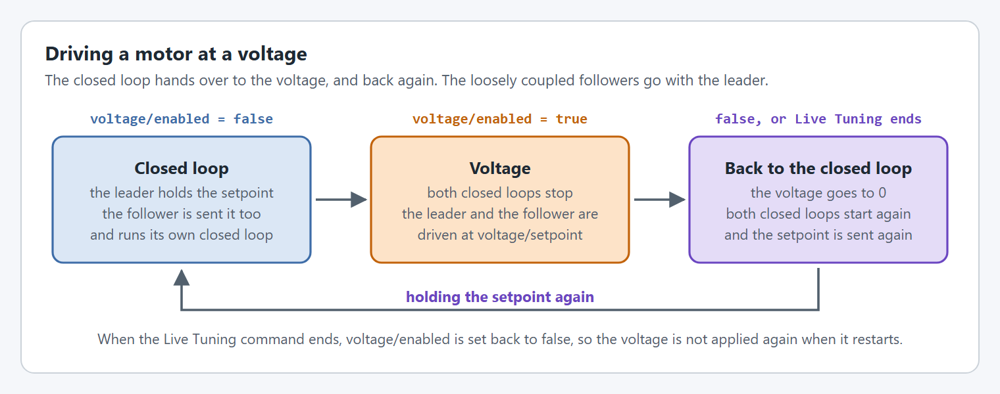<figcaption><p>The closed loop hands over to the voltage, and back again.</p></figcaption></figure>



#### Start the `Live Tuning` command

As in [Use it](#use-it). The voltage is only applied while the command runs.



#### Turn it on, then type a voltage

Set `voltage/enabled` to `true`. YAMS stops the closed loop and starts the motor at 0 V, with `voltage/setpoint` set back to `0`, so nothing moves until you type a voltage. A closed loop that runs on the SystemCore, on a Nova or with an LQR or exponential profile, would replace the voltage on its next loop, which is why it is stopped.

Now type a small voltage, such as `1`, into `voltage/setpoint`. It is sent each time you change it.



#### Watch it move

Graph `mechanism/velocity` (or `measurement/velocity`), `motor/outputVoltage` and `current/stator`. Raise or lower `voltage/setpoint` a little at a time.



#### Turn it off

Set `voltage/enabled` to `false`. The voltage goes to 0, the closed loop starts again, and the setpoint it held before is sent again, so the mechanism goes back to it.



**Setpoints typed while the voltage is on are skipped.** A value typed into `closedloop/setpoint/position` or `closedloop/setpoint/velocity` then is not saved for later. Type it again once the voltage is off. Gains, limits and the other tunable values are applied as soon as you type them, even while the voltage is on.

**Loosely coupled followers** are driven at the same voltage. A follower is normally sent its leader's setpoints and runs its own closed loop, so it is not sent a voltage the leader is driven at. With `voltage/enabled` on, YAMS stops the followers' closed loops with the leader's and sends each follower the voltage itself. Each follower's own inversion still applies. Turning the voltage off starts the followers' closed loops again and sends them the setpoint with the leader's.

**When the `Live Tuning` command ends**, because you stopped it or another command for the subsystem or mechanism interrupted it, the voltage stops too. YAMS turns the voltage off, sets `voltage/enabled` back to `false` so the voltage is not applied again as soon as the command starts again, and the closed loop holds the setpoint.


A voltage has no speed limit and no motion profile. Start low, keep the mechanism away from its hard stops, and keep a hand on disable. On an arm or elevator, a voltage too small to hold it up lets it fall.



Live tuning needs `ControlMode.CLOSED_LOOP`. The voltage keys are published at `TelemetryVerbosity.HIGH`, or with `withCustom(DoubleTelemetryField.TunableVoltage, true)` and `withCustom(BooleanTelemetryField.TunableVoltageEnabled, true)` on a `SmartMotorControllerTelemetryConfig`.


## Tuning order

Tune the feedforward first, then the feedback, then the motion profile last, one value at a time.


**New to tuning?** The WPILib docs explain what each gain does and have interactive simulations to practice on. Read the one for your mechanism before tuning the real thing:

* [Introduction to PID](https://docs.wpilib.org/en/stable/docs/software/advanced-controls/introduction/introduction-to-pid.html) and [introduction to feedforward](https://docs.wpilib.org/en/stable/docs/software/advanced-controls/introduction/introduction-to-feedforward.html)
* [Tuning a flywheel velocity controller](https://docs.wpilib.org/en/stable/docs/software/advanced-controls/introduction/tuning-flywheel.html)
* [Tuning a turret position controller](https://docs.wpilib.org/en/stable/docs/software/advanced-controls/introduction/tuning-turret.html)
* [Tuning a vertical arm position controller](https://docs.wpilib.org/en/stable/docs/software/advanced-controls/introduction/tuning-vertical-arm.html)
* [Tuning a vertical elevator](https://docs.wpilib.org/en/stable/docs/software/advanced-controls/introduction/tuning-elevator.html)


<figure>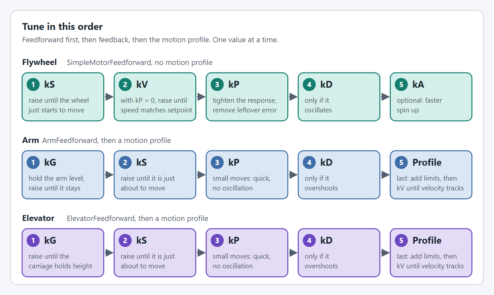<figcaption><p>The order to tune in for a flywheel, an arm and an elevator.</p></figcaption></figure>



With `SimpleMotorFeedforward`:

1. **kS**: raise slowly until the wheel just starts to move.
2. **kV**: set a target speed with kP = 0, then adjust kV until the steady speed matches.
3. **kP**: raise to remove the leftover error and speed up the response.
4. **kD**: only if it oscillates, add a little to damp it.
5. **kA** (optional): for faster spin up.


**Units example:** a kV of 0.12 V/(rot/s) means 0.12 volts for every rotation per second. At 100 rot/s (6000 RPM) the feedforward contributes 12 V.




With `ArmFeedforward`. The motion profile comes last:

1. **kG**: with kP, kI, kD and the other feedforward gains at 0, hold the arm level (0° from horizontal) and raise kG until it stays there.
2. **kS**: raise until the arm is just about to move, then back off a little.
3. **kP, then kD**: command small moves of a few degrees. Raise kP until the arm reaches them quickly without oscillating, then add kD if it overshoots. Without a profile a setpoint is a sudden jump, so keep the moves small.
4. **Motion profile**: now type a `closedloop/motionprofile/maxVelocity` (RPM) and `maxAcceleration` (RPM/s), for example 15 RPM (90°/s) and 30 RPM/s, and raise them a step at a time. Stop when `mechanism/velocity` starts falling behind the setpoint or `current/stator` spikes.
5. **kV**: kV only acts while the setpoint is moving, so tune it with the profile. Raise it until `mechanism/velocity` tracks `closedloop/setpoint/velocity` during a long move. Leave kA at 0 unless the arm lags while accelerating.


`kG * cos(angle)` is applied, so there is no gravity compensation when the arm is vertical (±90° from horizontal) and full kG when it is level.




With `ElevatorFeedforward`. An elevator is a linear mechanism, so you type meters and watch the `measurement/` keys. The motion profile comes last:

1. **kG**: with kP, kI, kD and kS at 0, raise kG until the carriage holds its height without drifting down. It is the same at every height.
2. **kS**: raise until the carriage is just about to move, then back off a little.
3. **kP, then kD**: command small moves of a few centimeters. Raise kP until `measurement/position` reaches them quickly without oscillating, then add kD if it still rings. Without a profile a setpoint is a sudden jump, so keep the moves small.
4. **Motion profile**: now type a `closedloop/motionprofile/maxVelocity` (m/s) and `maxAcceleration` (m/s²), for example 0.5 m/s and 1 m/s², and raise them a step at a time. Stop when `measurement/velocity` starts falling behind the setpoint or `current/stator` spikes.
5. **kV**: kV only acts while the setpoint is moving, so tune it with the profile. Raise it until `measurement/velocity` tracks `closedloop/setpoint/velocity` during a long move. Leave kA at 0 unless the carriage lags while accelerating.


Tune in the middle of the travel, away from the hard stops, and keep the soft limits (`measurement/limit/lower`, `measurement/limit/upper`) set while you do.




### Motion profiles on arms and elevators

Arms and elevators should end up moving on a motion profile, added once the gains hold the mechanism and reach small setpoints cleanly. Without one, a new setpoint is a sudden jump and the mechanism slams toward it. With one, the setpoint slides there at a speed and acceleration you choose.

<figure>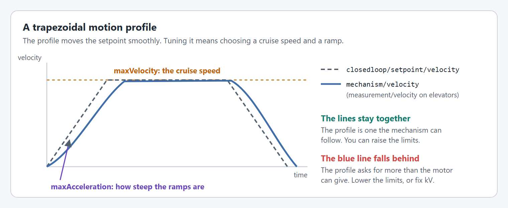<figcaption><p>What the two motion profile limits change.</p></figcaption></figure>

| You type (`NT:/Tuning/.../closedloop/motionprofile/`) | Arm | Elevator | Raise it when | Lower it when |
| --- | --- | --- | --- | --- |
| `maxVelocity` | RPM | m/s | The move is slow and the motor has voltage to spare. | The velocity never reaches the flat top of the profile. |
| `maxAcceleration` | RPM/s | m/s² | The mechanism takes too long to get up to speed. | `current/stator` spikes, the belt or chain skips, or the mechanism lags on the ramps. |

Watch `closedloop/setpoint/velocity` against `mechanism/velocity` (arm) or `measurement/velocity` (elevator). The setpoint is the profile, and the measured line should sit on top of it.


The profile only exists if the config has one, for example `withTrapezoidalProfile(MetersPerSecond.of(0.5), MetersPerSecondPerSecond.of(1))` on an elevator. For an exponential profile, tune `kV`, `kA` and `maxInput` under the same `closedloop/motionprofile/` keys instead. See [Exponential profiles](../editor/exponential-profiles.md).


### Elevators with a constant force spring

A constant force spring pulls the carriage up with about the same force at every height. It does part of the motor's job, which changes what kG should be.

<figure>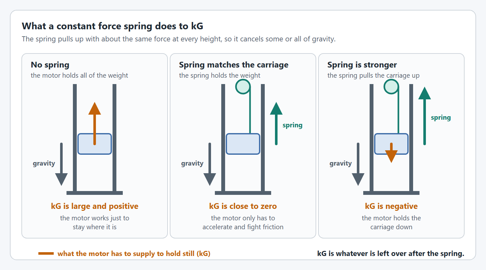<figcaption><p>kG is what is left for the motor to do after the spring.</p></figcaption></figure>

Do not copy kG from a calculation or from the robot before the springs went on. Measure it. The steps below type the voltages into `closedloop/feedforward/kG`; you can type them into [`voltage/setpoint`](#drive-a-motor-at-a-voltage) with `voltage/enabled` on instead, which takes the closed loop out of the way without zeroing any gains:

<figure>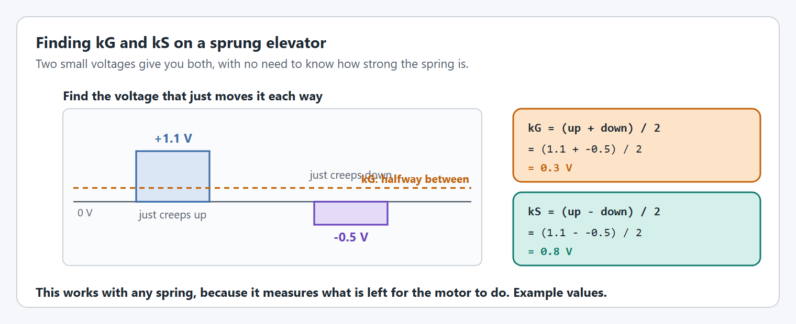<figcaption><p>Two voltages give kG and kS. Example values.</p></figcaption></figure>



#### Find the voltage that just moves it up

Put the carriage in the middle of the travel and start the `Live Tuning` command. Set kP, kI, kD and `closedloop/feedforward/kS` to 0. Now `closedloop/feedforward/kG` is the only voltage reaching the motor. Raise it slowly until the carriage just creeps upward, and write the value down.



#### Find the voltage that just moves it down

Lower `closedloop/feedforward/kG` slowly until the carriage just creeps downward. This number is often negative on a sprung elevator. Write it down.



#### Work out kG and kS

`kG = (up + down) / 2` and `kS = (up - down) / 2`. Type them into `closedloop/feedforward/kG` and `closedloop/feedforward/kS`.



#### Check it at the bottom, middle and top

With only the feedforward, the carriage should stay where you leave it at every height. "Constant force" springs are not perfectly constant, and each stage of a multi stage elevator can have its own springs. If the carriage drifts at one end, use the kG that holds best in the range you care about most and let kP hold the rest.



#### Tune kV, kP and kD as usual

Follow the elevator steps in [Tuning order](#tuning-order). The spring does not change them.



| With a spring, expect | Why |
| --- | --- |
| kG near zero, or negative | The spring carries the weight. If it is stronger than the carriage, the motor has to pull down. |
| A larger kS | The spring and its spool add friction. |
| Different effort up and down | Check `motor/outputVoltage` in both directions. Size the motion profile's `maxAcceleration` for the direction that needs more. |
| A drift when the load changes | A spring sized for the empty carriage is too weak with a game piece, and the other way round. Tune for the load you hold longest. |


The simulation does not know about the spring: it models the full carriage weight from `ElevatorConfig.withCarriageWeight(...)`. Keep a separate kG for simulation with `withSimFeedforward(...)`, so a sprung robot's small kG does not make the simulated elevator sag.


## When tuning does not help

Some mechanisms cannot be tuned, because the motor does not have enough torque for the job. No gain fixes that, and it is worth recognizing early so you stop chasing numbers.



<figure>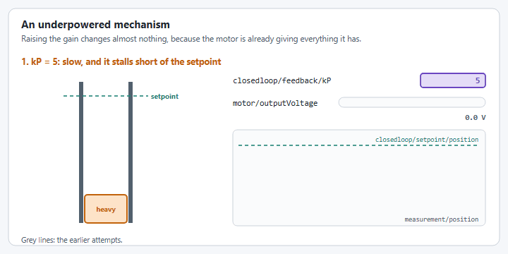<figcaption><p>Sixteen times the gain, the same move. Illustrative, not a recording.</p></figcaption></figure>

Raising kP does nothing, because the motor was already at full voltage with the smaller gain.



<figure>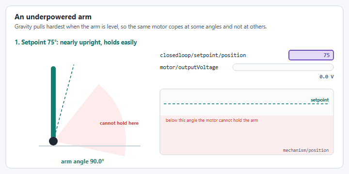<figcaption><p>The same arm at three setpoints. Illustrative, not a recording.</p></figcaption></figure>

An arm needs the most torque when it is level and almost none when it is upright. An underpowered arm therefore looks fine at some setpoints and hopeless at others. If it only misbehaves near level, suspect torque before you suspect the gains.



<figure>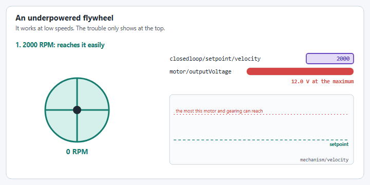<figcaption><p>The same flywheel at three setpoints. Illustrative, not a recording.</p></figcaption></figure>

A flywheel has a top speed set by the motor, the gearing and the battery voltage. Below it everything works, and the closer the setpoint gets to it the longer the spin up takes. Above it, no gain will ever get there. Remember that the battery sags under load, so the top speed in a match is lower than on a fresh battery on the bench.



### It works at low setpoints

This is what makes an underpowered mechanism hard to spot. It tunes well on the easy moves, and then the same gains fail on the hard ones:

| Mechanism | Works | Fails |
| --- | --- | --- |
| Elevator | Short moves, slow profiles, an empty carriage | Long fast moves, or carrying a game piece |
| Arm | Setpoints near upright | Setpoints near level, where gravity pulls hardest |
| Flywheel | Low speeds | Speeds near the motor's top speed, and recovery between shots |

When that happens, do not retune for the hard case. Look at `motor/outputVoltage` during the move that fails. If it is at the maximum, the gains are not the problem.

### It gets slower every time

An overworked motor heats up, and a hot motor is weaker. The first few moves look fine, then each one takes a little longer, until the mechanism stops reaching its setpoint at all.

<figure>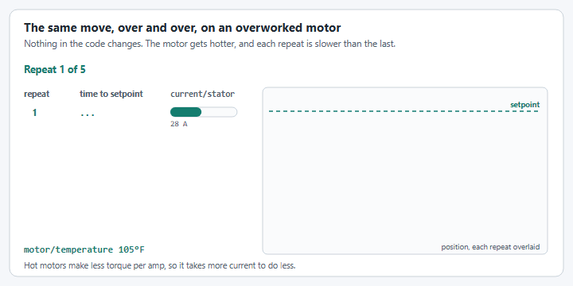<figcaption><p>Five repeats of one move. Illustrative numbers.</p></figcaption></figure>

| Watch (`NT:/Mechanisms`) | What you see |
| --- | --- |
| `current/stator` | Higher on every repeat of the same move, until it sits on the limit. |
| `motor/temperature` | Climbing steadily and not coming back down between moves. |
| `mechanism/velocity` or `measurement/velocity` | The peak speed of the same move dropping over time. |
| `mechanism/position` or `measurement/position` | Arriving later each time, then stopping short. |


If the gains that worked ten minutes ago no longer work, check `motor/temperature` before you touch them. Retuning to a hot motor gives you gains that are wrong once it cools, and running it harder is how motors burn out. Stop, let it cool, and fix the load.


**How to recognize it**

| Watch (`NT:/Mechanisms`) | What you see |
| --- | --- |
| `motor/outputVoltage` | Pinned at the maximum for most of the move, not just at the start. |
| `current/stator` | Sitting on the stator current limit. |
| `mechanism/position` or `measurement/position` | The same slow curve whatever you set kP to, and it may stop short of the setpoint. |
| `mechanism/velocity` or `measurement/velocity` | Far below the profile's `closedloop/setpoint/velocity`, however the profile is set. |
| `motor/temperature` | Climbing quickly while the mechanism holds a position. |

**What to do about it**

The fix is mechanical or electrical, not a gain:

* **More gear reduction.** The most common fix. It trades top speed, which you are not reaching anyway, for torque.
* **More motors**, or a stronger motor.
* **Take load off the motor**: a lighter mechanism, a counterweight, or a [constant force spring](#elevators-with-a-constant-force-spring) on an elevator.
* **Check the current limit.** A stator limit set too low makes a capable motor look underpowered. Raise `current/limit/stator` and see whether the move changes. See [Limiting power consumption](../editor/limiting-power-consumption.md).
* **Check for binding.** Disable the robot and move the mechanism by hand through its whole travel.
* **Ask for less.** Lower the motion profile's `maxVelocity` and `maxAcceleration` to what the motor can deliver.


Check this in simulation first. With the real motor, gearing and mass in the config, an underpowered mechanism shows the same pinned voltage in simulation, before anything is built.


## Swerve drive

`SwerveDrive` has its own tuning command and its own keys. It can tune three things, one at a time:

| Mode | Turn it on with | What it does |
| --- | --- | --- |
| Module azimuth motors | `modules/azimuth/enabled` | Turns every module to an angle you type. |
| Module drive motors | `modules/drive/enabled` | Runs every module's drive motor at a velocity you type. |
| Auto-align | `autoalign/enabled` | Drives the robot to a pose you type, using the translation and rotation PID gains. |

| What | Where it is published |
| --- | --- |
| Values you type | `NT:/Tuning/<name>/<key>` |
| The tuning command | `NT:/Mechanisms/<name>/tuning` |
| The robot pose to watch | `NT:/Mechanisms/<name>/pose` |

`<name>` is the name given to `SwerveDriveConfig.withTelemetry(name, ...)`. The keys are published at `TelemetryVerbosity.HIGH`.

Only one mode drives the robot at a time. Auto-align outranks drive tuning, and drive tuning outranks azimuth tuning: turning on a mode turns the ones below it back off, in NetworkTables too, so the dashboard shows what is actually running.


The tuning command is only published when both a translation and a rotation controller are set with `withTranslationController(...)` and `withRotationController(...)`. Nothing you type is applied unless the command is running.


### Start the tuning command



Drag `NT:/Mechanisms/<name>/tuning` onto your Elastic dashboard and press its button, or bind it to a controller button.



The command is published through `CommandTunable`. Set `NT:/Mechanisms/<name>/tuning/running` to `true` to start it and `false` to stop it.



Starting the command resets the translation and rotation PID controllers. Stopping it turns every mode off and holds the wheels where they are.

### Tune the swerve modules

Tune the modules before auto-align: auto-align can only be as good as the modules under it. Do the azimuth motors first, so the wheels point where they are told while you tune the drive motors.

The module keys are shared. One value is applied to all four modules, which is what you want when the modules are built the same.

| What | Where it is published |
| --- | --- |
| Values you type | `NT:/Tuning/<name>/modules/azimuth/...` and `NT:/Tuning/<name>/modules/drive/...` |
| One motor's telemetry | `NT:/Mechanisms/<name>/modules/<module>/<motor>/...` |
| All four modules at once | `NT:/Mechanisms/<name>/states/desired` and `states/current` |

`<module>` and `<motor>` are the names given to the module's and the motor's `withTelemetry(...)`. In AdvantageScope, drag `states/desired` and `states/current` onto a **Swerve** tab to see every module's target and actual state together.


Always start on the real robot with it lifted on blocks, and every wheel clear of the blocks and of the ground, for the azimuth and drive steps.



**Simulation is practice, not tuning.** Going through these steps in simulation first is a great way to learn them and to catch config mistakes, but gains found in simulation cannot be relied on for the first run of the real modules. Even if you tuned in simulation, tune again on the lifted robot before the wheels touch the ground.


#### Azimuth motors

<figure>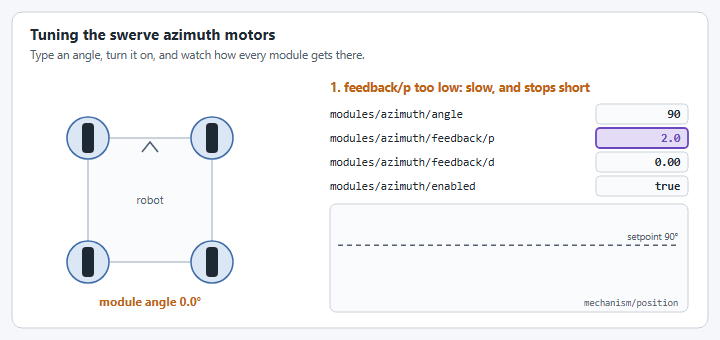<figcaption><p>What each azimuth gain change looks like.</p></figcaption></figure>

| You type (`NT:/Tuning/<name>/`) | Units | What it is |
| --- | --- | --- |
| `modules/azimuth/enabled` | Boolean | Hold the angle while `true`. |
| `modules/azimuth/angle` | Degrees | Target angle for every module. |
| `modules/azimuth/feedback/p`, `i`, `d` | PID gains | Azimuth motor feedback gains. |
| `modules/azimuth/feedforward/s`, `v`, `a` | Feedforward gains | Azimuth motor kS, kV, kA. |
| `modules/azimuth/voltage/enabled` | Boolean | Turn the azimuth motors at `voltage/setpoint` instead of holding the angle. See [Characterize the modules](#characterize-the-modules). |
| `modules/azimuth/voltage/setpoint` | Volts | Voltage for every azimuth motor. |

Watch one azimuth motor's `mechanism/position` against its `closedloop/setpoint/position`, or the module arrows on the Swerve tab.



#### Start the tuning command and turn the mode on

Start `NT:/Mechanisms/<name>/tuning`, type `0` into `modules/azimuth/angle`, then set `modules/azimuth/enabled` to `true`. The drive motors are held at 0, so the wheels only turn in place.



#### Step the angle

Type `90` into `NT:/Tuning/<name>/modules/azimuth/angle`, then `0`, and keep switching. That key is the setpoint angle for every azimuth motor, in degrees. Each change is a step you can judge the gains by.



#### Raise `feedback/p`

Raise it until the modules snap to the angle quickly. If they stop short or turn lazily, it is too low. If they overshoot and shake, it is too high: back it off.



#### Add `feedback/d` if it still overshoots

A small amount takes out the last of the overshoot. Leave `feedback/i` at 0.



#### Add `feedforward/s` if the modules stop just short

If they settle a degree or two away from the angle, a little kS overcomes the friction.



#### Save the gains and turn the mode off

Copy the gains into the azimuth motor's `withClosedLoopController(...)` and `withFeedforward(...)`. Values typed on the dashboard are lost when the robot code restarts. Set `modules/azimuth/enabled` to `false`. The modules stay at the last angle; they do not return to 0°.



<figure>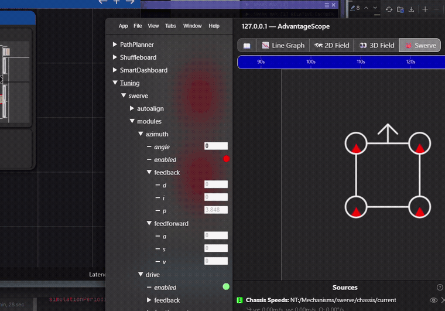<figcaption><p>In AdvantageScope: every module following <code>modules/azimuth/angle</code>.</p></figcaption></figure>

<figure>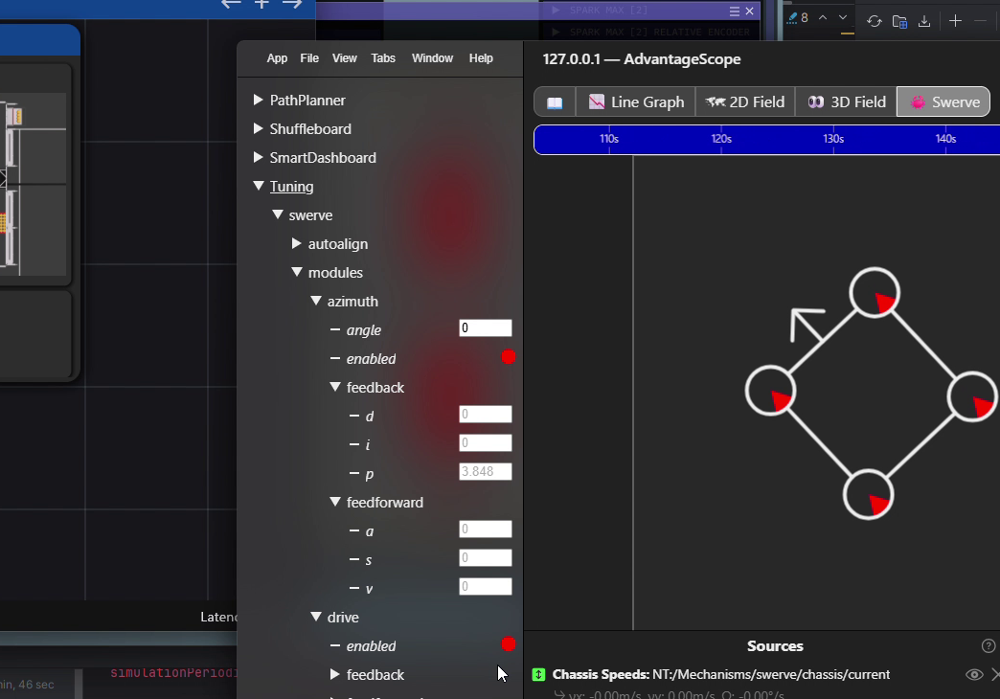<figcaption><p>The <code>Tuning/swerve/modules</code> tree.</p></figcaption></figure>

#### Drive motors

<figure>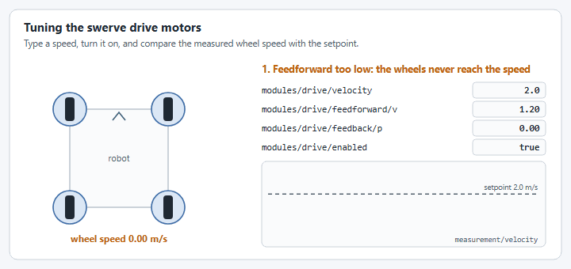<figcaption><p>What each drive gain change looks like.</p></figcaption></figure>

| You type (`NT:/Tuning/<name>/`) | Units | What it is |
| --- | --- | --- |
| `modules/drive/enabled` | Boolean | Run the drive motors while `true`. |
| `modules/drive/velocity` | Meters per second | Wheel speed for every module. |
| `modules/drive/inplace` | Boolean | `false`: every module points at 0° and the robot drives straight. `true`: the modules point tangent to the robot center and the robot spins in place. |
| `modules/drive/feedback/p`, `i`, `d` | PID gains | Drive motor feedback gains. |
| `modules/drive/feedforward/s`, `v`, `a` | Feedforward gains | Drive motor kS, kV, kA. |
| `modules/drive/voltage/enabled` | Boolean | Drive the drive motors at `voltage/setpoint` instead of the velocity. See [Characterize the modules](#characterize-the-modules). |
| `modules/drive/voltage/setpoint` | Volts | Voltage for every drive motor. |

Watch one drive motor's `measurement/velocity` against its `closedloop/setpoint/velocity`. The gains start at the first module's configured values.



#### Start the tuning command and turn the mode on

Start `NT:/Mechanisms/<name>/tuning`, type `0` into `modules/drive/velocity`, then set `modules/drive/enabled` to `true`.



#### Zero the feedback

Set `modules/drive/feedback/p`, `i` and `d` to 0 so you can see what the feedforward does on its own.



#### Find `feedforward/s`

Type a very small velocity, such as `0.1`, into `NT:/Tuning/<name>/modules/drive/velocity`. That key is the setpoint velocity for every drive motor, in meters per second. Raise `modules/drive/feedforward/s` until the wheels just start to turn, then back it off slightly.



#### Find `feedforward/v`

Type a normal driving speed, such as `2`, into `NT:/Tuning/<name>/modules/drive/velocity`. Raise `modules/drive/feedforward/v` until the motor's `measurement/velocity` settles on its `closedloop/setpoint/velocity`. Check a second speed, such as `1` or `3`, in the same key: it should match there too.



#### Add `feedback/p`

Raise `modules/drive/feedback/p` until the speed reaches the setpoint quickly and holds when the wheels are loaded. If the speed starts to buzz or oscillate, it is too high. `feedback/d` is rarely needed on a drive motor.



#### Check it on the ground with `inplace`

Take the robot off the blocks and set `modules/drive/inplace` to `true`. The modules point tangent to the robot center, so the robot spins in place instead of crossing the field. A positive `modules/drive/velocity` spins it counter-clockwise.



#### Save the gains and turn the mode off

Copy the gains into the drive motor's `withClosedLoopController(...)` and `withFeedforward(...)`, then set `modules/drive/enabled` to `false`. The drive motors are commanded to 0 m/s once it is off.



<figure>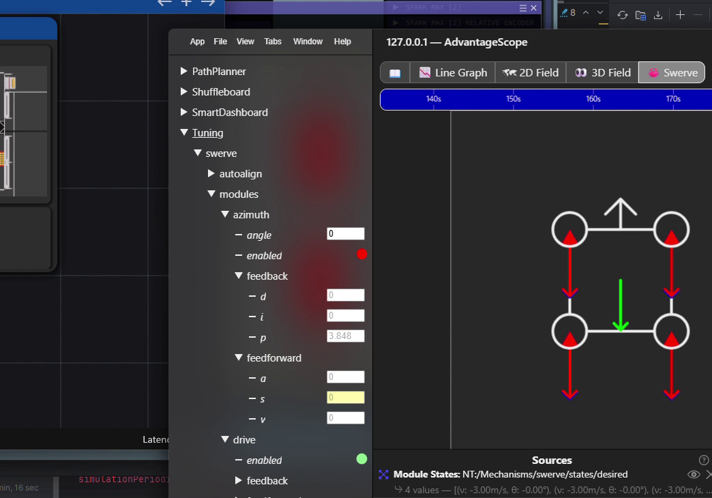<figcaption><p>In AdvantageScope: every module driving at the typed velocity.</p></figcaption></figure>

<figure>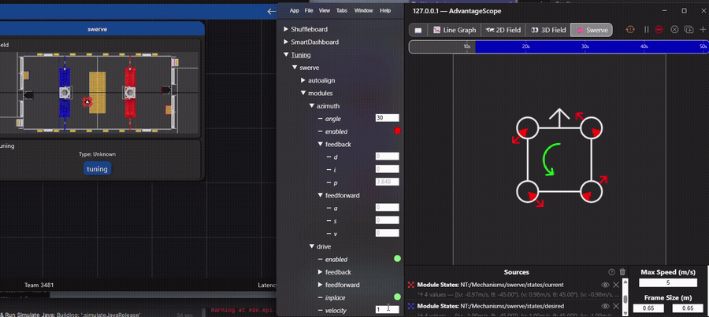<figcaption><p>In AdvantageScope: spinning in place with <code>modules/drive/inplace</code>.</p></figcaption></figure>

### Characterize the modules

Instead of tuning by hand, the modules can be driven at a voltage and the gains worked out from how they move, the way WPILib's SysId does. While drive or azimuth tuning is on, set its `voltage/enabled` to `true` and type a voltage into `voltage/setpoint`:

* **Drive:** every drive motor runs at the voltage, without its closed loop. The wheels point forward, or around the robot with `modules/drive/inplace`, and are not optimized, so they always drive the same way.
* **Azimuth:** every azimuth motor turns at the voltage, without its closed loop, and the drive motors are held still.

A closed loop that runs on the SystemCore, on a Nova or with an LQR or exponential profile, would replace the voltage on its next loop, so YAMS stops it while the voltage is on and starts it again when the voltage turns off. The setpoint you typed is sent again then, or the wheels are held where they are if no mode is on.


The YAGSL config generator's [Quick Start Guide](https://config.yagsl.com/guide) uses these keys in its Live mode: **Auto**, next to the gain fields, runs a slow ramp and a quick step each way, fits the feedforward, works out the feedback with an LQR, and fills in all six gains. The feedback depends on how often the closed loop runs, which each motor controller publishes as `closedloop/period` at `TelemetryVerbosity.HIGH`.



A voltage has no speed limit. On a real robot, do this on blocks with every wheel clear, and keep the voltage low.


### Tune auto-align

| You type (`NT:/Tuning/<name>/`) | Units | What it is |
| --- | --- | --- |
| `autoalign/enabled` | Boolean | Drive to the pose while `true`. |
| `autoalign/setpoint/x`, `autoalign/setpoint/y` | Meters | Field relative target position. |
| `autoalign/setpoint/rot` | Degrees | Field relative target heading. |
| `autoalign/translation/p`, `i`, `d` | PID on meters | Translation gains. |
| `autoalign/rotation/p`, `i`, `d` | PID on radians | Rotation gains. |

The gains start at the values given to `withTranslationController(...)` and `withRotationController(...)`, not `0`.

1. Start the tuning command.
2. Type the target into `autoalign/setpoint/x`, `autoalign/setpoint/y` and `autoalign/setpoint/rot`.
3. Set `autoalign/enabled` to `true`. The robot drives to the pose with the current gains.
4. Change a gain and watch `NT:/Mechanisms/<name>/pose` on a 2D field. Changing a gain only resets that controller when the value actually changed.
5. Copy the gains you like into `withTranslationController(...)` and `withRotationController(...)`. Values typed on the dashboard are lost when the robot code restarts.
6. Set `autoalign/enabled` back to `false` before handing control back to the driver.

<figure>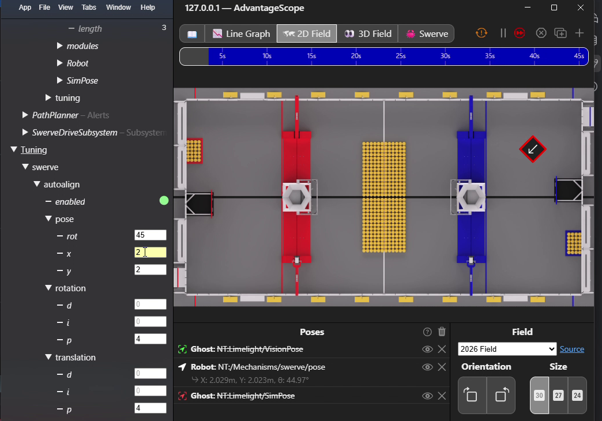<figcaption><p>The <code>Tuning/swerve/autoalign</code> tree next to a 2D field.</p></figcaption></figure>

<figure>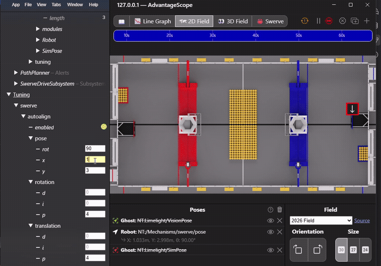<figcaption><p>Driving to <code>x=12</code>, <code>y=4</code>, <code>rot=90</code> in simulation.</p></figcaption></figure>

<figure>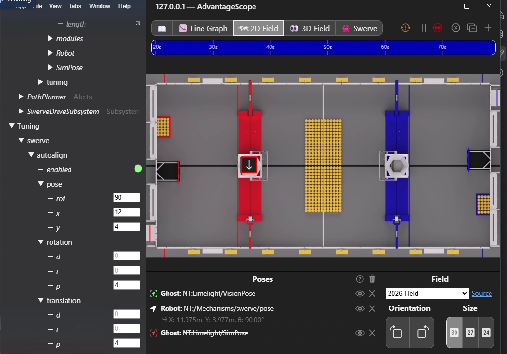<figcaption><p>Settled at the target pose.</p></figcaption></figure>

### Good to know

* **One mode at a time.** If more than one `enabled` key is `true`, YAMS keeps one and sets the others back to `false`. Auto-align wins over drive tuning, and drive tuning wins over azimuth tuning.
* **Every module shares the values.** The `modules/drive/*` and `modules/azimuth/*` keys apply to all modules at once. There are no per-module keys.
* **Module optimization still applies.** Both module modes go through `SwerveDrive.setSwerveModuleStates(...)`, so `withOptimization(true)` behaves the same as it does while driving.
* **No gyro needed in simulation.** The simulated drive tracks its own heading, so you can practice tuning the drive and azimuth motors before writing any gyro code. On a real robot, `SwerveDrive` throws an `IllegalStateException` if `withGyro(...)` was never called.
