# YAMS Live Tuner

The [YAMS Live Tuner](https://tuning.yassrobotics.com/) is a web page that tunes an elevator, arm, pivot or flywheel through [live tuning](README.md). It connects to the robot or simulation over NetworkTables, finds every YAMS motor controller with live tuning, and walks you through checking it before anything moves: a safety checklist, the motor inversion, and the range of motion. Then you send setpoints, drive with voltage and change gains while watching a graph.

It writes the same `NT:/Tuning` keys you would edit in AdvantageScope or Elastic, so everything on the [Live tuning](README.md) page still applies.


The Live Tuner drives the motor at a voltage while it checks the inversion and the range of motion. That needs a YAMS release newer than 2026.10.19, which adds `voltage/enabled` and `voltage/setpoint` to live tuning, and registers the `Live Tuning` command for mechanisms such as `Elevator` and `Arm`.


The screenshots below come from the YAMS Commands v3 examples running in simulation, with each mechanism's simulation in its own `Notifier`: the BroncBotz 2025 elevator and coral arm, the BroncBotz 2026 turret and kicker, and the `double_flywheel` example. Each motor is set up with `withTelemetry(name, TelemetryVerbosity.HIGH)` and its mechanism with `withTelemetry(...)` too, which is all live tuning needs.


Like all tuning, this can be **dangerous** on a real robot. Practice in simulation first. Press **Space** anywhere on the page to stop straight away, and keep a hand on the Driver Station's disable.


## Connect

Open [tuning.yassrobotics.com](https://tuning.yassrobotics.com/). Pick where the robot code is running, then press **Connect**:

* **Robot (team)**: the robot, from your team number.
* **Simulation**: robot code running in simulation on this computer.
* **Custom host**: any other address.

Once connected, the badge shows the host and the robot's mode. Enable the robot, in Teleop or Test, from the Driver Station before anything moves.

<figure>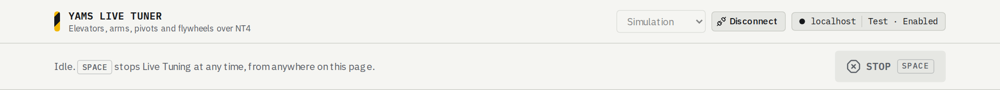<figcaption>
Connected to a simulation, with the robot enabled in Teleop.
</figcaption></figure>


No robot code to hand? Pick **Demo (no robot)**, or open [tuning.yassrobotics.com/?demo](https://tuning.yassrobotics.com/?demo), to try the Live Tuner on a robot simulated in the page.



If your browser asks whether the page may connect to devices on your local network, allow it. The robot and the simulation are on your local network.


## Tune a mechanism

The strip at the top of the page shows the five steps: **Mechanism**, **Checklist**, **Inversions**, **Range** and **Live tune**. Only one step is shown at a time, next to the telemetry, and each one has to be finished, or skipped where that is allowed, before the next. While nothing is running, select a finished step in the strip to open it again.

The telemetry card shows the position, velocity, stator current and output voltage, with a graph of the measured value against the setpoint. Select the motor temperature under the graph to switch between °C and °F.

Pick the tab for your kind of mechanism.





#### Pick the mechanism

Choose the motor controller under **Telemetry name**, and the subsystem (Commands v2) or mechanism (Commands v3) under **Live Tuning command**. The lists are filled in from what the robot publishes under `NT:/Tuning`, so a motor controller only shows up once live tuning is [turned on](README.md#turn-it-on) for it.

Set **Type** to **Elevator**. Setpoints are in meters. Then press **Continue**.

<figure>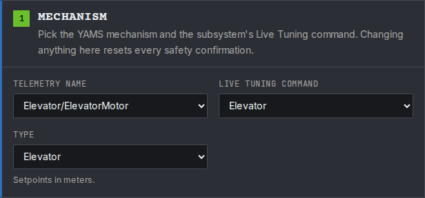<figcaption>
The BroncBotz 2025 elevator: its motor, its mechanism's <code>Live Tuning</code> command, and the Elevator type.
</figcaption></figure>

Changing anything in this step resets every confirmation after it.



#### Go through the pre-motion checklist

Tick every item, then press **Continue**. **Current trip (A)** stops Live Tuning if the stator current stays above it for 250 ms, which catches a stalled or jammed mechanism. You can change it later on the Settings card's **Tuner** tab.

<figure>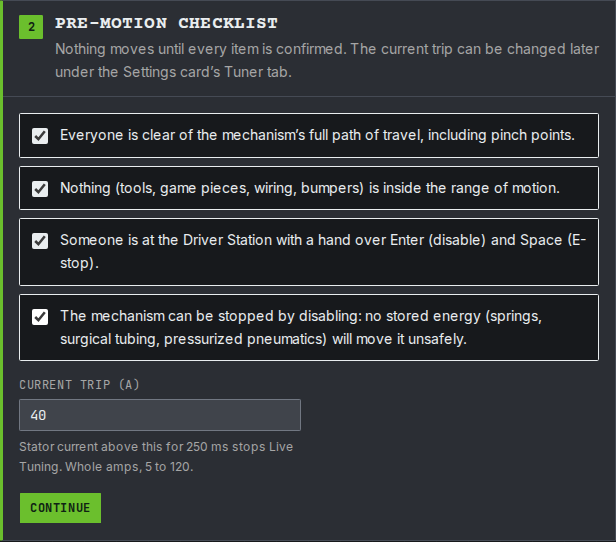<figcaption>
Every item confirmed, with a 40 A current trip.
</figcaption></figure>



#### Check the inversions

This step drives the motor at a small voltage, with no closed loop, to check that a positive voltage moves the mechanism in its positive direction and that the position reading goes the same way.

Read the warning, tick the confirmation, and press **Start voltage control**. If the inversions were already checked on this robot, **Skip (already checked)** goes straight to the next step.

<figure>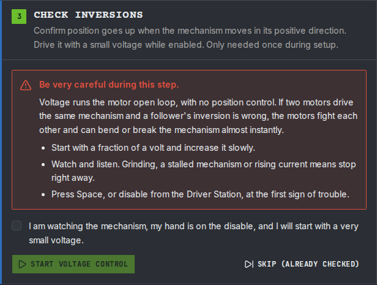<figcaption>
Voltage control only starts once you confirm you are watching the mechanism.
</figcaption></figure>

Drag the slider, or type a voltage under **Type a voltage** and press **Enter** or **Apply**. With **Back to 0 V on release** on, the slider goes back to 0 V when you let go; a typed voltage holds until you change it. Type 0, or press Space, to stop. The slider's ends start at −1 V and +1 V; select either end to change it.

Start with a fraction of a volt and raise it until the mechanism moves, at least 0.25 V. Gravity pulls an elevator down, so it can need more voltage to move up than down.

<figure>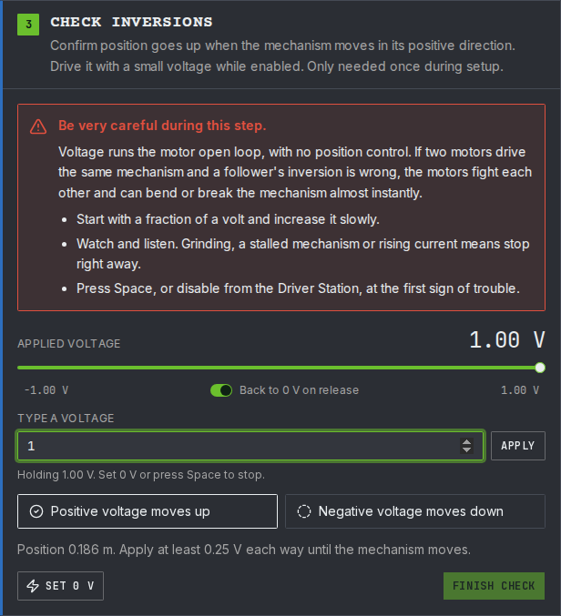<figcaption>
At +1 V the position rises, so <strong>Positive voltage moves up</strong> is ticked.
</figcaption></figure>

One direction is enough. Once it is ticked, set the voltage back to 0 and press **Finish check**.

If the position goes the wrong way, the Live Tuner warns you. Stop and fix `withMotorInverted(...)`, or the encoder inversion, in the robot code before going on.



#### Verify the range of motion

The Live Tuner only sends setpoints inside a range of motion you have set. There are two ways to set it:

* **Find ends by driving**: drive to each physical end of travel, and mark each end.
* **Enter range manually**: type each end, or move the mechanism by hand with the robot disabled and press **Use current position** under each end. Then press **Use this range**. Nothing is driven.

To find the ends by driving, choose how to hold the mechanism between drives first. **Voltage, no closed loop** is safe before tuning: on an elevator, press **Use robot kG** so the **Gravity hold voltage** holds the carriage up. **Closed loop (tuned gains)** holds it with the gains it has.

Press **Start verification**, then hold **Hold: drive up** or **Hold: drive down**. They drive at the ends of the **Voltage** slider, ±1 V to start with, and the slider drives at any voltage in between. Voltage is only applied while you hold a button or the slider. **When the voltage is let go** sets whether it cuts to 0 V, the default, or ramps down.

Press **Mark upper end here** and **Mark lower end here** at each end. A hard stop, the current trip, or a soft limit on the way marks that end for you. While it drives, the bar at the top of the window reads **VERIFYING RANGE**, and Space stops it.

<figure>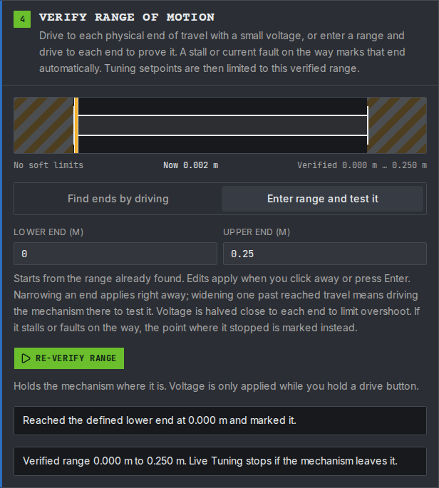<figcaption>
Driven up to 0.165 m and marked, then driven down until the hard stop marked 0 m.
</figcaption></figure>

Once both ends are marked, press **Finish verification**. **Skip verification** goes on without a range, so only the robot's soft limits, if it has any, bound the travel.



#### Live tune

Press **Start Live Tuning**. This starts the mechanism's `Live Tuning` command, so the setpoints and gains you send are applied every loop.

On the **Setpoints** tab, send a setpoint by typing it and pressing **Send**, with the slider, or with **Lower**, **25%**, **Mid**, **75%** and **Upper**. The slider's ends start at the range of motion; select either end to change it. With **Follow slider** off, the setpoint is sent when you let go. The graph shows the measured position against the setpoint, with the stator current, the current trip and the range.

Change a gain on the **Settings** card, described in [The Settings card](#the-settings-card), and send the setpoints again. On an elevator, start with kG: the output while it holds still is the voltage it takes to hold the carriage up against gravity. Then raise kP until it reaches each setpoint without overshooting.

<figure>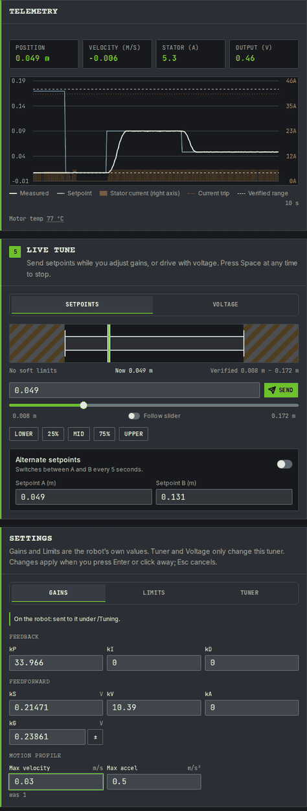<figcaption>
Max velocity cut to 0.03 m/s, then put back with <strong>was 1</strong>: the elevator crawls to each setpoint, then gets there quickly again.
</figcaption></figure>

<figure>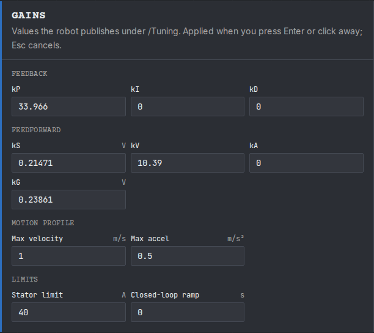<figcaption>
The elevator's gains and motion profile.
</figcaption></figure>

**Alternate between two setpoints**

Turn on **Alternate setpoints** to switch between **Setpoint A** and **Setpoint B** every 5 seconds. Each step is the same, so you can change a gain and compare the next step with the last one.

<figure>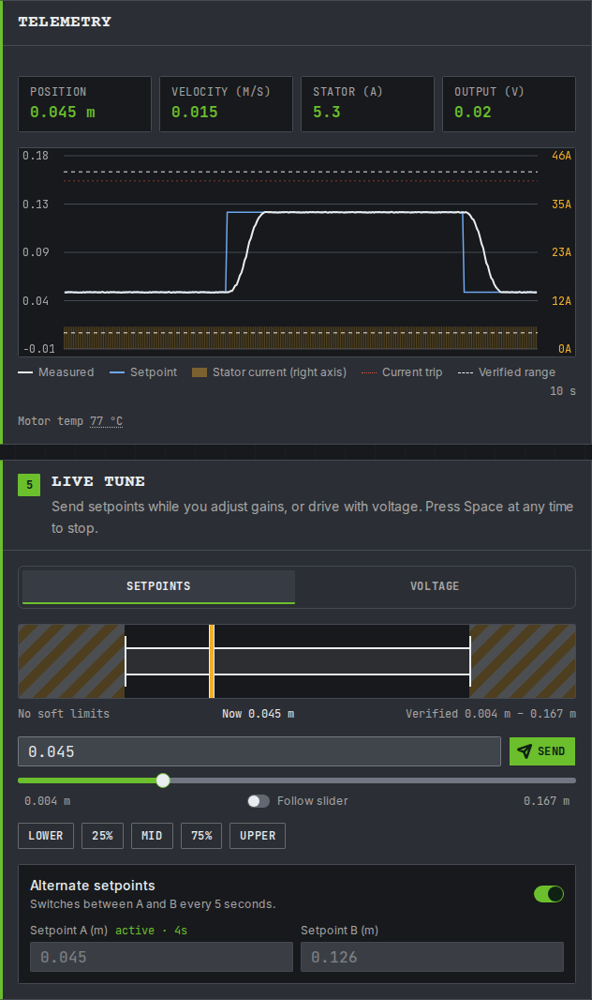<figcaption>
Stepping between 0.045 m and 0.126 m.
</figcaption></figure>








#### Pick the mechanism

Choose the motor controller under **Telemetry name**, and the subsystem (Commands v2) or mechanism (Commands v3) under **Live Tuning command**. The lists are filled in from what the robot publishes under `NT:/Tuning`, so a motor controller only shows up once live tuning is [turned on](README.md#turn-it-on) for it.

Set **Type** to **Arm** for an arm that gravity pulls on, or **Pivot** for anything else that turns, such as a turret. Setpoints are in degrees. Then press **Continue**.

<figure>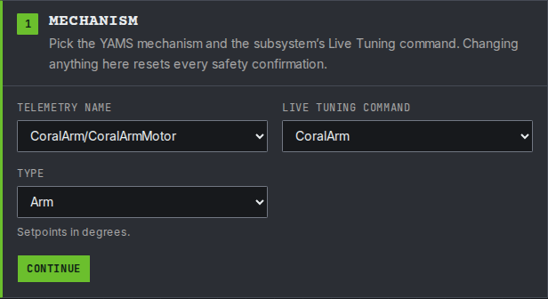<figcaption>
The BroncBotz 2025 coral arm, as an Arm.
</figcaption></figure>

<figure>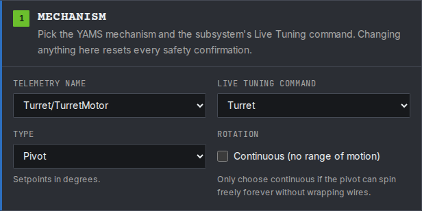<figcaption>
The BroncBotz 2026 turret, as a Pivot.
</figcaption></figure>

For a pivot, tick **Continuous (no range of motion)** only if it can spin freely forever without wrapping wires.

Changing anything in this step resets every confirmation after it.



#### Go through the pre-motion checklist

Tick every item, then press **Continue**. **Current trip (A)** stops Live Tuning if the stator current stays above it for 250 ms, which catches a stalled or jammed mechanism. You can change it later on the Settings card's **Tuner** tab.

<figure>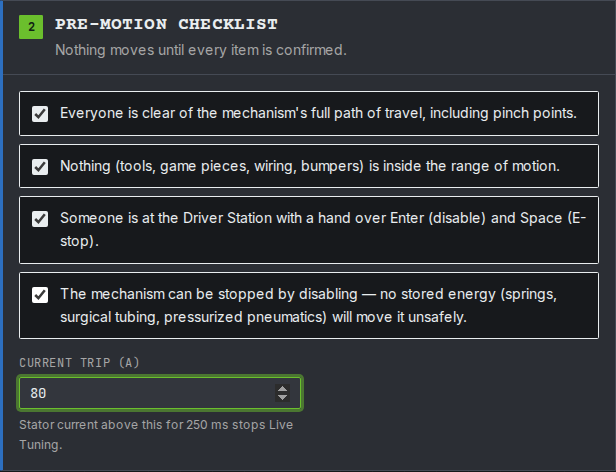<figcaption>
Every item confirmed.
</figcaption></figure>



#### Check the inversions

This step drives the motor at a small voltage, with no closed loop, to check that a positive voltage moves the mechanism in its positive direction and that the position reading goes the same way.

Read the warning, tick the confirmation, and press **Start voltage control**. If the inversions were already checked on this robot, **Skip (already checked)** goes straight to the next step.

Drag the slider, or type a voltage under **Type a voltage** and press **Enter** or **Apply**. With **Back to 0 V on release** on, the slider goes back to 0 V when you let go; a typed voltage holds until you change it. Type 0, or press Space, to stop.

Start with a fraction of a volt and raise it until the mechanism moves, at least 0.25 V. Near horizontal, gravity can be stronger than a small voltage on an arm, so try a little more voltage before changing an inversion.

<figure>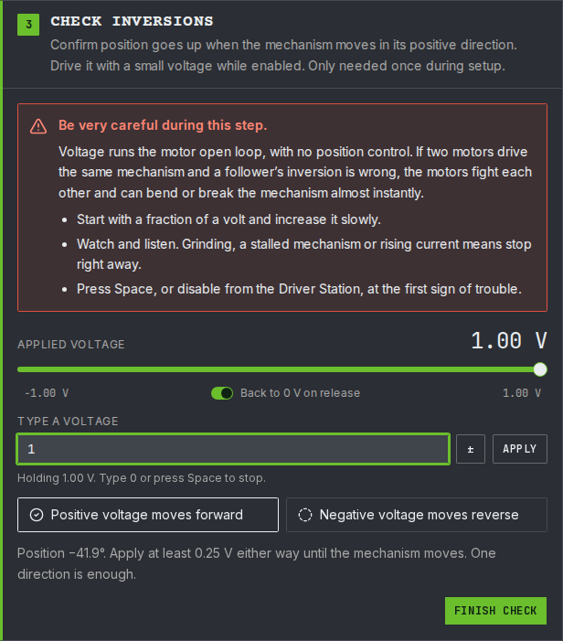<figcaption>
At +1 V the angle rises, so <strong>Positive voltage moves forward</strong> is ticked.
</figcaption></figure>

One direction is enough. Once it is ticked, set the voltage back to 0 and press **Finish check**.

If the position goes the wrong way, the Live Tuner warns you. Stop and fix `withMotorInverted(...)`, or the encoder inversion, in the robot code before going on.



#### Set the range of motion

The Live Tuner only sends setpoints inside a range of motion you have set. There are two ways to set it:

* **Find ends by driving**: hold the drive buttons, or the **Voltage** slider, to drive to each physical end of travel, and mark each end. It works as on an elevator, see the **Elevators** tab. On an arm, the **Gravity hold voltage** is scaled by the cosine of the angle, like kG.
* **Enter range manually**: type each end, or move the mechanism by hand with the robot disabled and press **Use current position** under each end. Then press **Use this range**. Nothing is driven.

The manual ends start at the robot's soft limits, if it publishes any.

<figure>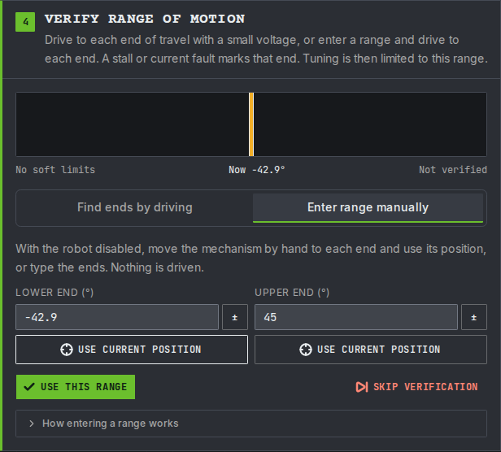<figcaption>
The coral arm: the lower end from where it rests, the upper end typed.
</figcaption></figure>

A continuous pivot has no end of travel, so it has no range to set.



#### Live tune

Press **Start Live Tuning**. This starts the mechanism's `Live Tuning` command, so the setpoints and gains you send are applied every loop.

On the **Setpoints** tab, send a setpoint by typing it and pressing **Send**, with the slider, or with **Lower**, **25%**, **Mid**, **75%** and **Upper**. The graph shows the measured angle against the setpoint, with the stator current, the current trip and the range.

<figure>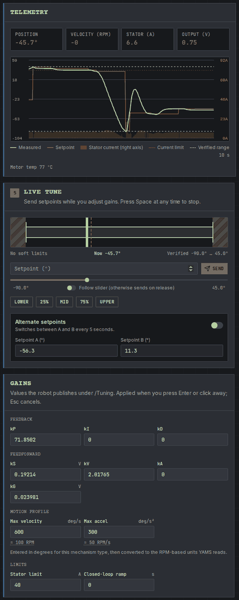<figcaption>
The coral arm with Max velocity cut to 20 deg/s, then put back. Both times it settles a few degrees under each setpoint.
</figcaption></figure>

<figure>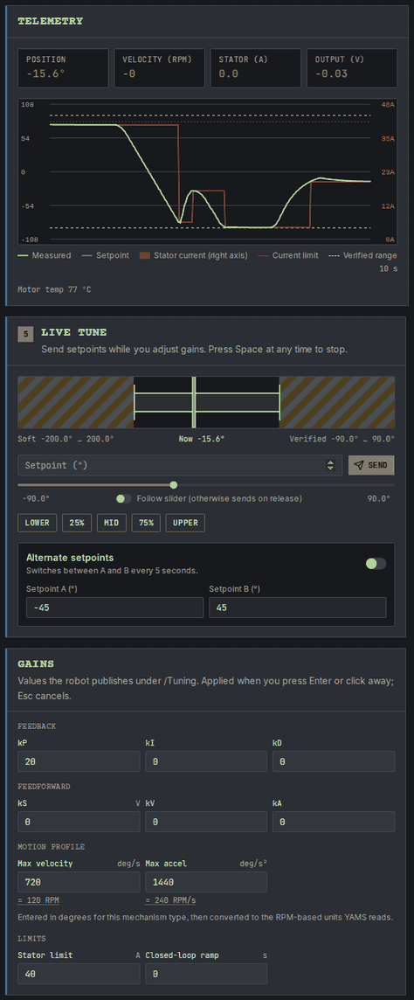<figcaption>
The turret, a pivot, with Max velocity cut to 45 deg/s, then put back.
</figcaption></figure>

Change a gain on the **Settings** card, described in [The Settings card](#the-settings-card), and send the setpoints again. On an arm, start with kG: raise it until the arm holds still when it is horizontal. A pivot has no kG. Then raise kP until the mechanism reaches each setpoint without overshooting.

On an arm or pivot, the motion profile is typed in degrees per second. The RPM that YAMS reads is shown under each value.

<figure>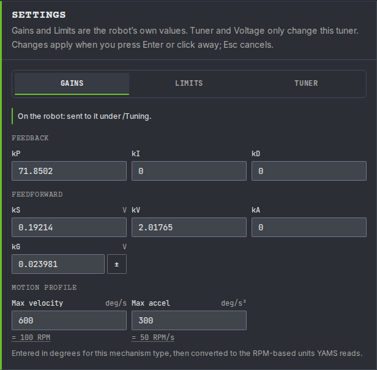<figcaption>
The coral arm's gains, with its motion profile in degrees.
</figcaption></figure>

**Alternate between two setpoints**

Turn on **Alternate setpoints** to switch between **Setpoint A** and **Setpoint B** every 5 seconds. Each step is the same, so you can change a gain and compare the next step with the last one.

<figure>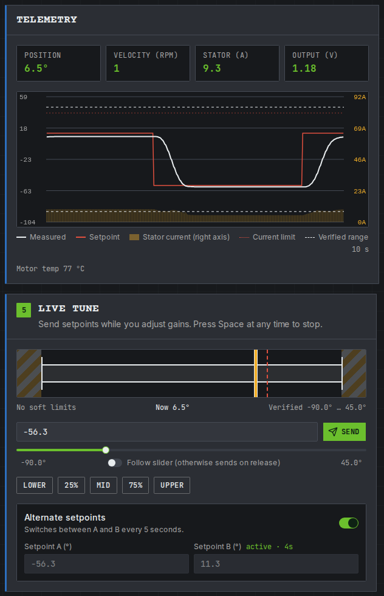<figcaption>
The coral arm stepping between −20.9° and 23°.
</figcaption></figure>








#### Pick the mechanism

Choose the motor controller under **Telemetry name**, and the subsystem (Commands v2) or mechanism (Commands v3) under **Live Tuning command**. The lists are filled in from what the robot publishes under `NT:/Tuning`, so a motor controller only shows up once live tuning is [turned on](README.md#turn-it-on) for it.

Set **Type** to **Flywheel**. Setpoints are in RPM. Leave **Second flywheel** at **None**, unless it is a [double flywheel](#double-flywheels). Then press **Continue**.

<figure>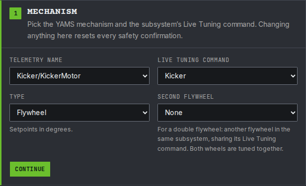<figcaption>
The BroncBotz 2026 kicker, as a Flywheel.
</figcaption></figure>

Changing anything in this step resets every confirmation after it.



#### Go through the pre-motion checklist

Tick every item, then press **Continue**. **Current trip (A)** stops Live Tuning if the stator current stays above it for 250 ms, which catches a stalled or jammed mechanism. You can change it later on the Settings card's **Tuner** tab.

<figure>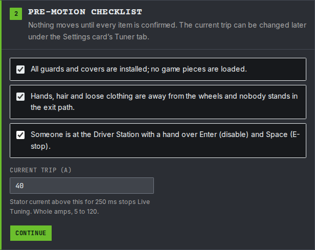<figcaption>
Every item confirmed, with a 40 A current trip.
</figcaption></figure>



#### Check the inversions

This step drives the motor at a small voltage, with no closed loop, to check that a positive voltage spins the flywheel forward and that the speed reading goes the same way.

Read the warning, tick the confirmation, and press **Start voltage control**. If the inversions were already checked on this robot, **Skip (already checked)** goes straight to the next step.

Drag the slider, or type a voltage under **Type a voltage** and press **Enter** or **Apply**. Start with a fraction of a volt, at least 0.25 V. A flywheel keeps spinning after you let go, so set 0 V and let it stop before you drive it the other way.

<figure>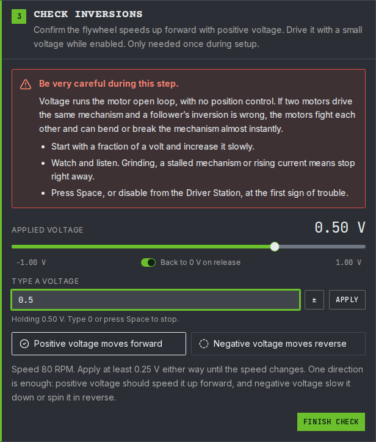<figcaption>
At +0.5 V the kicker spins forward.
</figcaption></figure>

One direction is enough. Once it is ticked, set the voltage back to 0 and press **Finish check**.

If the speed goes the wrong way, the Live Tuner warns you. Stop and fix `withMotorInverted(...)`, or the encoder inversion, in the robot code before going on.



#### No range of motion

A flywheel spins continuously, so it has no range to set, and Live tune opens next. The speed slider's range caps it instead.



#### Live tune

Press **Start Live Tuning**. This starts the mechanism's `Live Tuning` command, so the speeds and gains you send are applied every loop.

On the **Setpoints** tab, send a speed by typing it and pressing **Send**, with the slider, or with **Idle (0)** and the buttons at a quarter, half, three quarters and all of the slider's range. Speeds are limited to the slider's range, which starts at the ±4000 RPM safety default; select either end to change it. The graph shows the measured speed against the setpoint, with the stator current.

Change a gain on the **Settings** card, described in [The Settings card](#the-settings-card), and send the speeds again. On a flywheel, start with kV: raise or lower it until the measured speed settles on the setpoint. Then add kP to recover speed quickly after each shot.

<figure>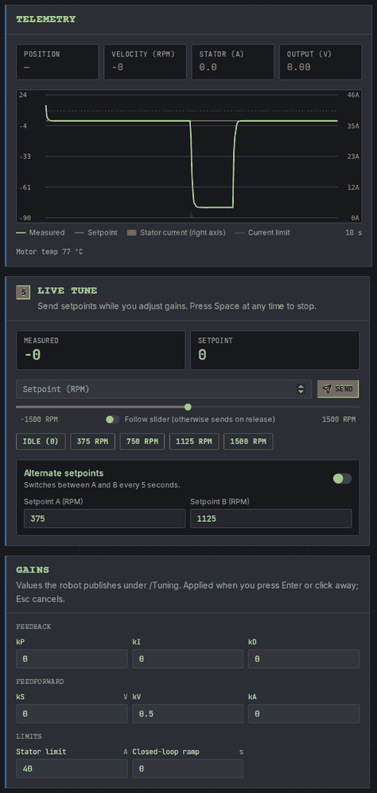<figcaption>
The kicker with kP raised to 0.5, then put back to 0. With kP, the speed at the 1000 RPM setpoint comes closer to it.
</figcaption></figure>

<figure>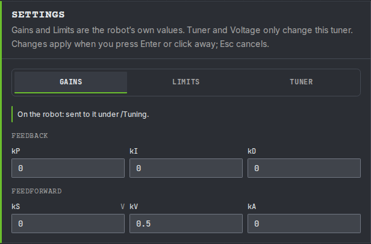<figcaption>
The kicker's gains.
</figcaption></figure>

**Alternate between two setpoints**

Turn on **Alternate setpoints** to switch between **Setpoint A** and **Setpoint B** every 5 seconds. Each step is the same, so you can change a gain and compare the next step with the last one.

<figure>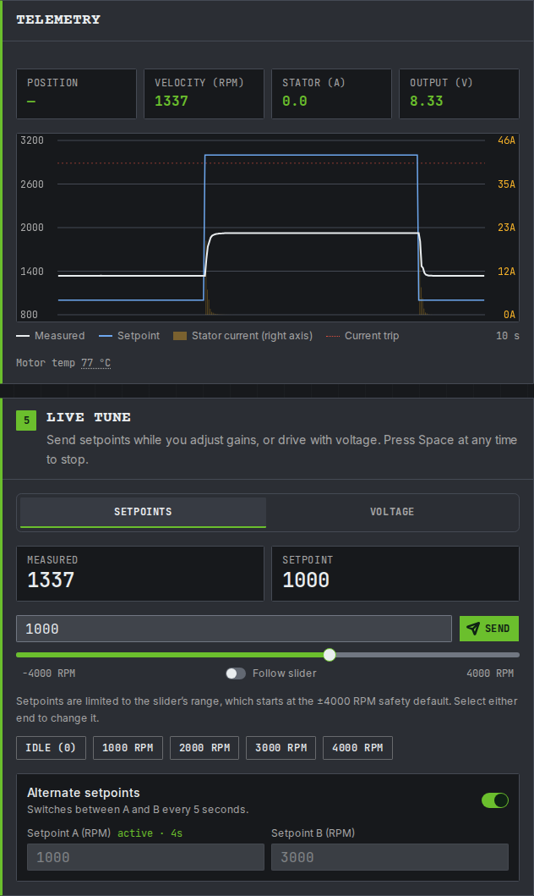<figcaption>
The kicker stepping between 1000 and 3000 RPM, with neither speed on its setpoint yet.
</figcaption></figure>




### Double flywheels

A double flywheel is two YAMS flywheels in one subsystem, sharing its `Live Tuning` command, such as the [`double_flywheel` example](https://github.com/Yet-Another-Software-Suite/YAMS/tree/master/examples/commands3/double_flywheel). Pick one wheel under **Telemetry name** and the other under **Second flywheel**, and both are tuned together.

<figure>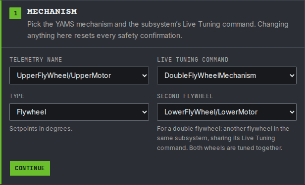<figcaption>
The <code>double_flywheel</code> example's upper and lower wheels.
</figcaption></figure>

* **Inversions:** check one wheel at a time. The step passes once both wheels have.
* **Setpoints:** each wheel has its own box and slider. **Send both** sends both boxes. Turn on **Same speed for both** to move both sliders together. The buttons, such as **Both 2000 RPM**, and **Alternate setpoints** drive both wheels.
* **Wheel:** the **Wheel** picker on the telemetry card and the Settings card chooses which wheel's readings, gains and voltage drive you see. The graph plots both wheels, the second one dashed.
* **Copy these gains:** on the **Gains** tab, copies one wheel's feedback, feedforward and motion profile to the other, for wheels that are alike.
* **Safety:** the current trip watches each motor, and a stop spins both wheels down.

<figure>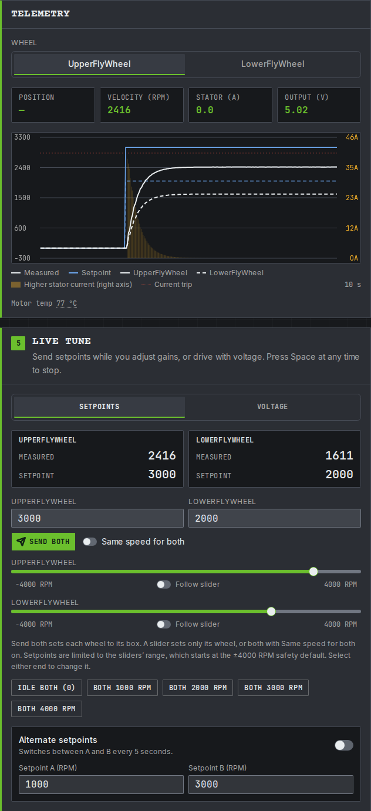<figcaption>
3000 and 2000 RPM sent together. With the example's starting gains, both wheels settle short.
</figcaption></figure>

<figure>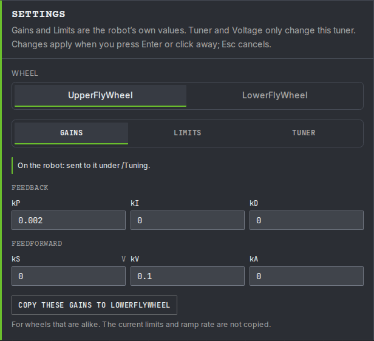<figcaption>
The upper wheel's gains, ready to copy to the lower wheel.
</figcaption></figure>



## The Settings card

The **Settings** card sits under the Live tune card. A line under its tabs says whether that tab's values live on the robot or only in this tuner.

| Tab | Where it lives | What is on it |
| --- | --- | --- |
| **Gains** | On the robot, under `NT:/Tuning` | Feedback, feedforward and motion profile |
| **Limits** | On the robot, under `NT:/Tuning` | Current limits, soft limits and the closed-loop ramp rate |
| **Tuner** | Only in this tuner | The current trip, and the range of motion |
| **Voltage** | Only in this tuner | What happens when you let go of the voltage, and the gravity hold voltage. Only shown while the Live tune card is on its **Voltage** tab |

Type a new value: it is applied when you press **Enter** or click away. **Esc** puts the old value back. [What to tune and what to watch](keys-and-units.md#what-to-tune-and-what-to-watch) lists what each gain does.

* **was …:** under a setting you changed, **was** shows its value before the change. Press it to put that value back, and press it again to go one change further back. When more than one value is saved, the count is shown, as in **was 160 (2)**.
* **Number fields:** a field only takes what fits it. Gains take up to 4 significant digits, and only kG can be negative. Current limits and the current trip are whole amps. A comma is read as a decimal point.
* **±:** a field that takes negative numbers, such as kG or a soft limit, has a **±** button next to it, since a phone's number keypad has no minus key.

<figure>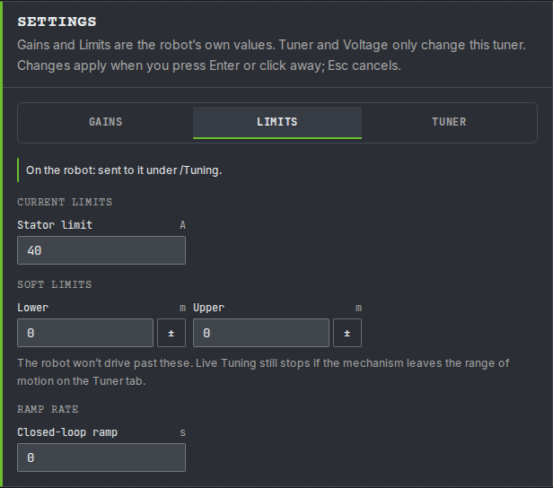<figcaption>
The <strong>Limits</strong> tab, for the elevator.
</figcaption></figure>

On the **Tuner** tab, **Range of motion** changes the range the range step set. Live Tuning stops if the mechanism leaves it, and setpoints are limited to it. It can go past what you verified, with a warning under the field, but that can drive the mechanism into a hard stop.

<figure>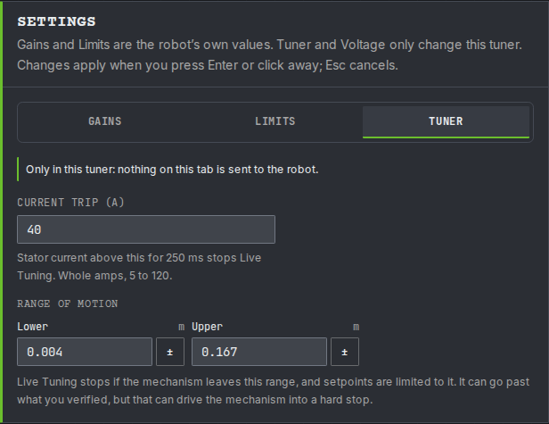<figcaption>
The <strong>Tuner</strong> tab, with the current trip and the range of motion.
</figcaption></figure>

## Drive with voltage

The Live tune card's **Voltage** tab moves the mechanism with voltage instead of the closed loop, for example to feel how much voltage it takes, or to bring it somewhere by hand.

Hold **Hold: drive up** or **Hold: drive down**, or drag the **Voltage** slider. The buttons drive at the slider's ends, ±2 V to start with; select either end to change it. The drive stops at the ends of the range of motion, or the soft limits if there is none.

* **During Live Tuning:** with **Stay in voltage control** on, letting go keeps voltage control at the gravity hold voltage, or 0 V. Switch back to **Setpoints**, or turn it off, to hand back to the closed loop, which holds where the mechanism is. A flywheel goes back to the speed it had.
* **Without Live Tuning:** **Start voltage control** drives with voltage only, and the motor gets 0 V, or the gravity hold voltage, between presses.

<figure>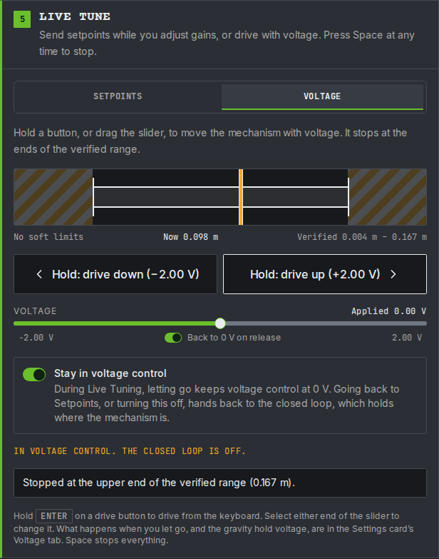<figcaption>
Driven up to the end of the range, where the drive stopped. The closed loop is off until you go back to <strong>Setpoints</strong>.
</figcaption></figure>

The Settings card's **Voltage** tab sets **When the voltage is let go**, **Cut to 0 V** or **Ramp to 0 V**, and the **Gravity hold voltage**. On an elevator or arm, the gravity hold voltage is added to every drive, and an arm's is scaled by the cosine of its angle, like kG. **Use robot kG** copies kG into it, and **Set kG to this** sends it to the robot as kG.

<figure>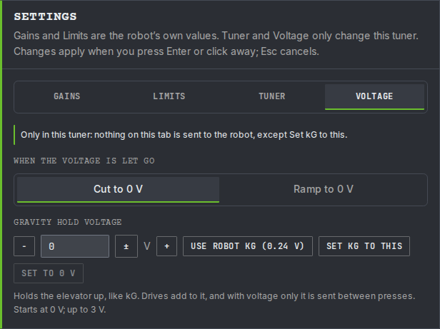<figcaption>
The <strong>Voltage</strong> tab, for the elevator.
</figcaption></figure>

## If the mechanism is outside the range

If the mechanism is outside its range of motion, for example an arm that sagged below its lower end while disabled, the Live tune card says so before you start. Start Live Tuning anyway, then send a setpoint inside the range, or drive it back on the **Voltage** tab. Until it is back inside, the bar at the top of the window shows an **Out of range** warning, and moving further out stops Live Tuning.

## Stop

While anything runs, the bar at the top of the window says what is running and stays there as you scroll.

<figure><figcaption>
The bar while Live Tuning runs on the elevator.
</figcaption></figure>

Press **Space**, or **STOP**, at any time and from anywhere on the page. The Live Tuner sets the setpoint to where the mechanism is, or slows a flywheel down first, and then ends the `Live Tuning` command. The subsystem's default command, if it has one, takes over from there. Closing the page stops Live Tuning too, and so does disabling the robot from the Driver Station.

When you are happy with the gains, copy them into the robot code.
