# YAMS Live Tuner

The YAMS Live Tuner is a web page that tunes an elevator, arm, pivot or flywheel through [live tuning](README.md). It connects to the robot or simulation over NetworkTables, finds every YAMS motor controller with live tuning, and walks you through checking it before anything moves: a safety checklist, the motor inversion, and the range of motion. Then you send setpoints and change gains while watching a graph.

It writes the same `NT:/Tuning` keys you would edit in AdvantageScope or Elastic, so everything on the [Live tuning](README.md) page still applies.


The Live Tuner drives the motor at a voltage while it checks the inversion and the range of motion. That needs a YAMS release newer than 2026.10.19, which adds `voltage/enabled` and `voltage/setpoint` to live tuning, and registers the `Live Tuning` command for mechanisms such as `Elevator` and `Arm`.


The screenshots below tune the elevator of the YAMS `simple_robot` example in simulation. Its motor is set up with `withTelemetry("ElevatorMotor", TelemetryVerbosity.HIGH)` and the elevator with `withTelemetry("Elevator", TelemetryVerbosity.HIGH)`, which is all live tuning needs.


Like all tuning, this can be **dangerous** on a real robot. Practice in simulation first. Press **Space** anywhere on the page to stop Live Tuning straight away, and keep a hand on the Driver Station's disable.


## Connect

Pick where the robot code is running, then press **Connect**:

* **Robot (team)**: the robot, from your team number.
* **Simulation**: robot code running in simulation on this computer.
* **Custom host**: any other address.

Once connected, the badge shows the host and the robot's mode. Enable the robot, in Teleop or Test, from the Driver Station before anything moves.

<figure><figcaption>
Connected to a simulation. <strong>STOP</strong>, or Space, stops Live Tuning at any time.
</figcaption></figure>


If your browser asks whether the page may connect to devices on your local network, allow it. The robot and the simulation are on your local network.


## Step 1: Pick the mechanism

Choose the motor controller under **Telemetry name**, and the subsystem (Commands v2) or mechanism (Commands v3) whose `Live Tuning` command it belongs to. The lists are filled in from what the robot publishes under `NT:/Tuning`, so a motor controller only shows up once live tuning is [turned on](README.md#turn-it-on) for it.

Set **Type** to the kind of mechanism. Position setpoints are in meters for an elevator and in degrees for an arm or a pivot.

<figure>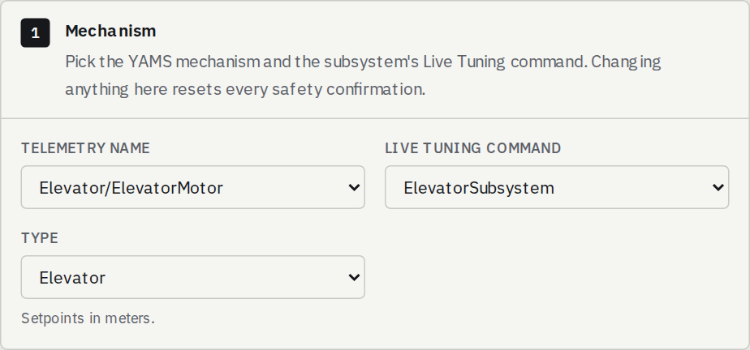<figcaption>
The elevator motor, its subsystem's <code>Live Tuning</code> command, and the Elevator type.
</figcaption></figure>

Changing anything in this step resets every confirmation below it.

## Step 2: Go through the pre-motion checklist

Nothing moves until every item is ticked. **Current trip** stops Live Tuning if the stator current stays above it for 250 ms, which catches a stalled or jammed mechanism.

<figure>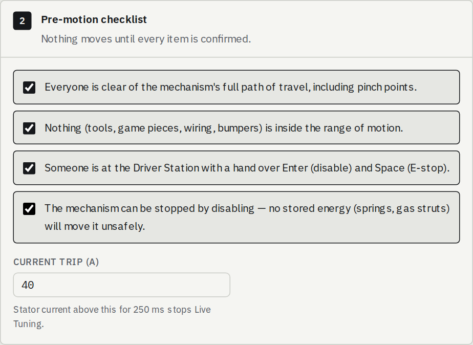<figcaption>
Every item confirmed, with a 40 A current trip.
</figcaption></figure>

## Step 3: Check the inversions

This step drives the motor at a small voltage, with no closed loop, to check that a positive voltage moves the mechanism in its positive direction and that the position reading goes the same way.

Read the warning, tick the confirmation, and press **Start voltage control**. If the inversions were already checked on this robot, **Skip (already checked)** goes straight to the next step.

<figure>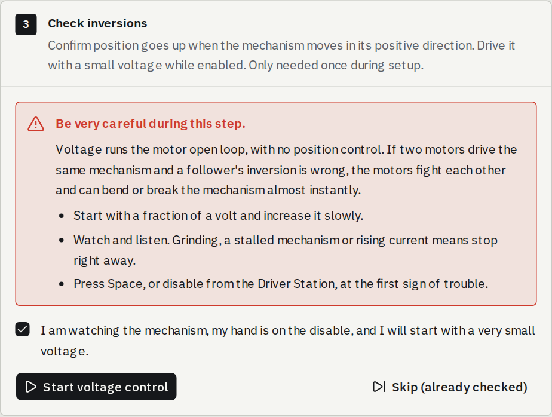<figcaption>
Voltage control only starts once you confirm you are watching the mechanism.
</figcaption></figure>

Drag the slider, or type a voltage and press **Enter** or **Apply**. The slider goes back to 0 V when you let go; a typed voltage holds until you change it. Start with a fraction of a volt and raise it until the mechanism moves. The elevator here needed 1 V to lift off its bottom stop against gravity.

<figure>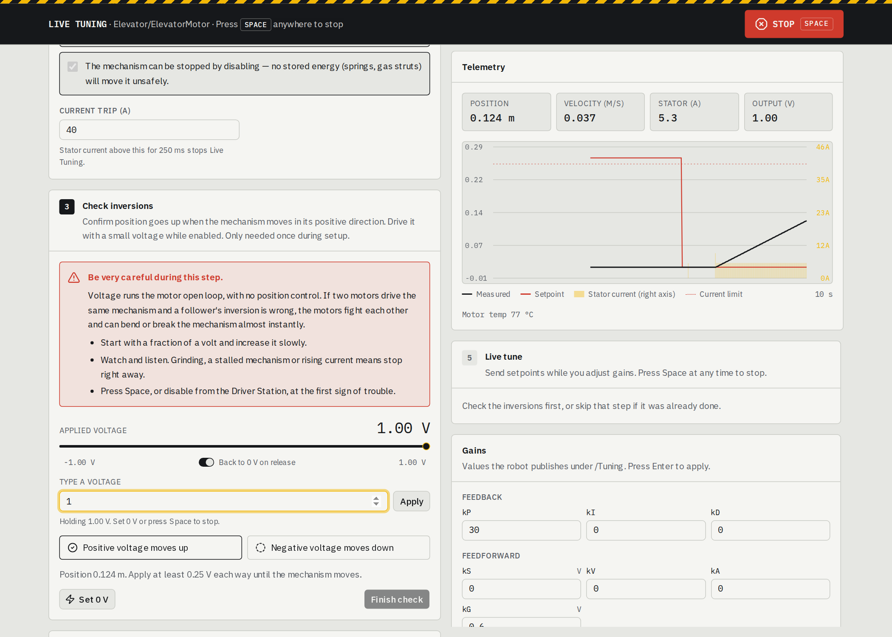<figcaption>
At +1 V the position rises, so <strong>Positive voltage moves up</strong> is ticked.
</figcaption></figure>

Then drive it the other way. Once both directions are ticked, press **Set 0 V** and **Finish check**.

<figure>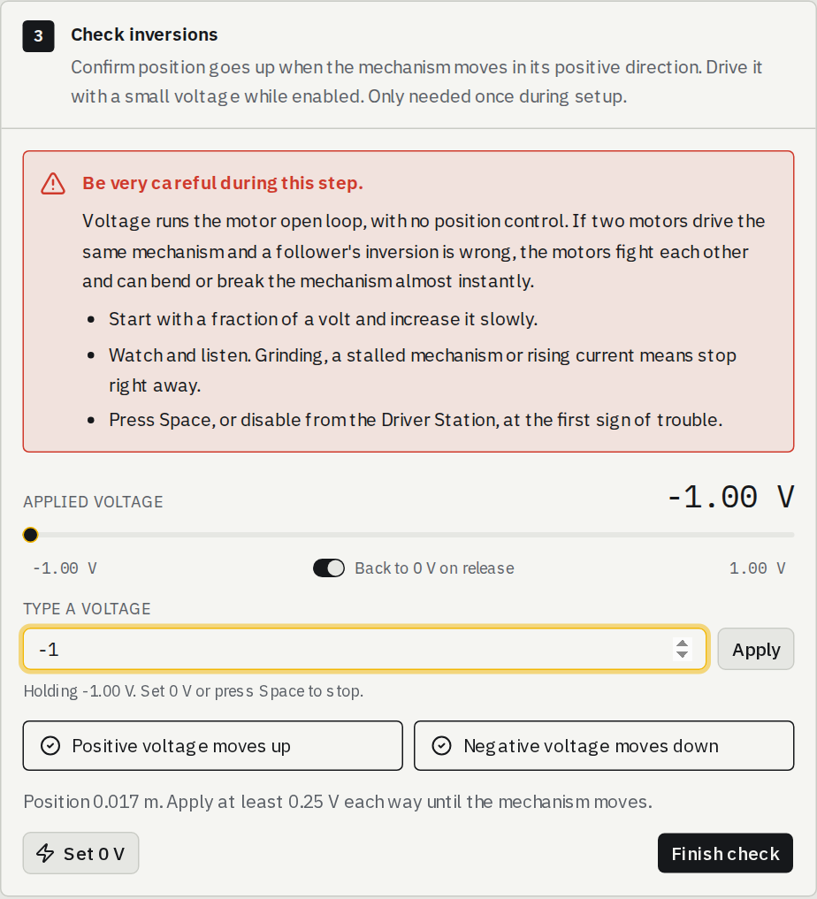<figcaption>
Both directions checked.
</figcaption></figure>

If the position goes the wrong way, stop and fix `withMotorInverted(...)`, or the encoder inversion, in the robot code before going on.

## Step 4: Verify the range of motion

The Live Tuner only sends setpoints inside a range that the mechanism has actually been driven across. There are two ways to set it:

* **Find ends by driving**: hold the drive buttons to drive to each physical end of travel, then mark each end.
* **Enter range and test it**: type the lower and upper ends, then hold each drive button until the mechanism gets there. It starts from the soft limits the robot publishes.

Press **Start verification**, set **Drive voltage**, and hold a drive button. Voltage is only applied while you hold it, and it is halved close to each end to limit overshoot. A stall, or the current trip, on the way marks that end where the mechanism stopped.

<figure>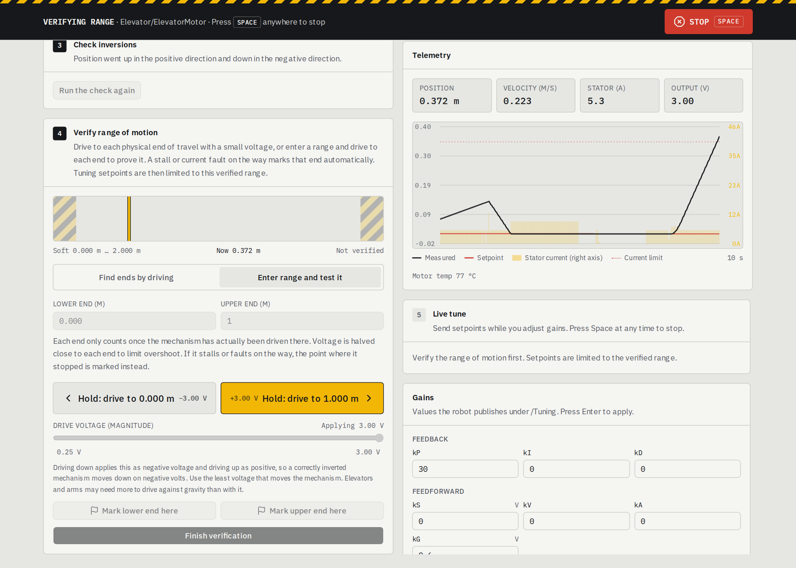<figcaption>
Holding <strong>Hold: drive to 1.000 m</strong> at 3 V. The banner shows what is running and that Space stops it.
</figcaption></figure>

Once both ends are marked, press **Finish verification**.

<figure>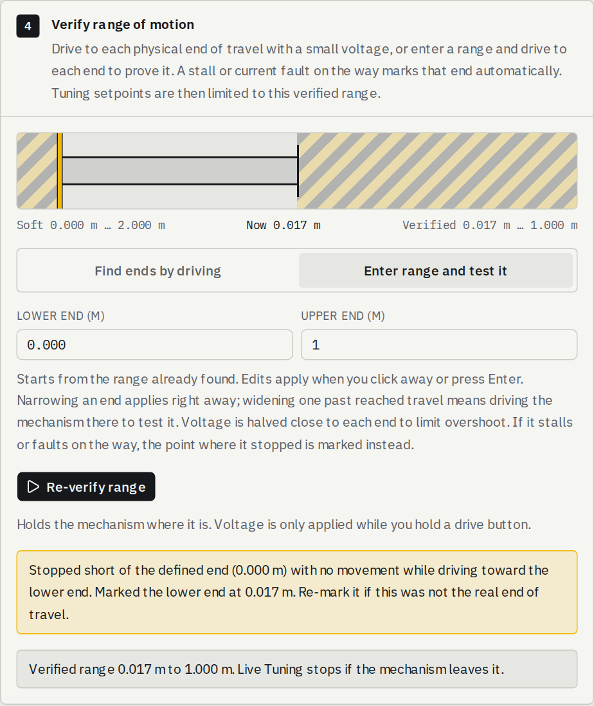<figcaption>
Verified from 0.017 m to 1.000 m. The elevator stopped on its hard stop just short of 0 m, so the lower end was marked there.
</figcaption></figure>

Live Tuning stops if the mechanism leaves the verified range.

## Step 5: Live tune

Press **Start Live Tuning**. This starts the subsystem's `Live Tuning` command, so the setpoints and gains you send are applied every loop.

Send a setpoint by typing it, with the slider, or with **Lower**, **25%**, **Mid**, **75%** and **Upper**. The graph shows the measured position against the setpoint, with the stator current and the verified range.

<figure>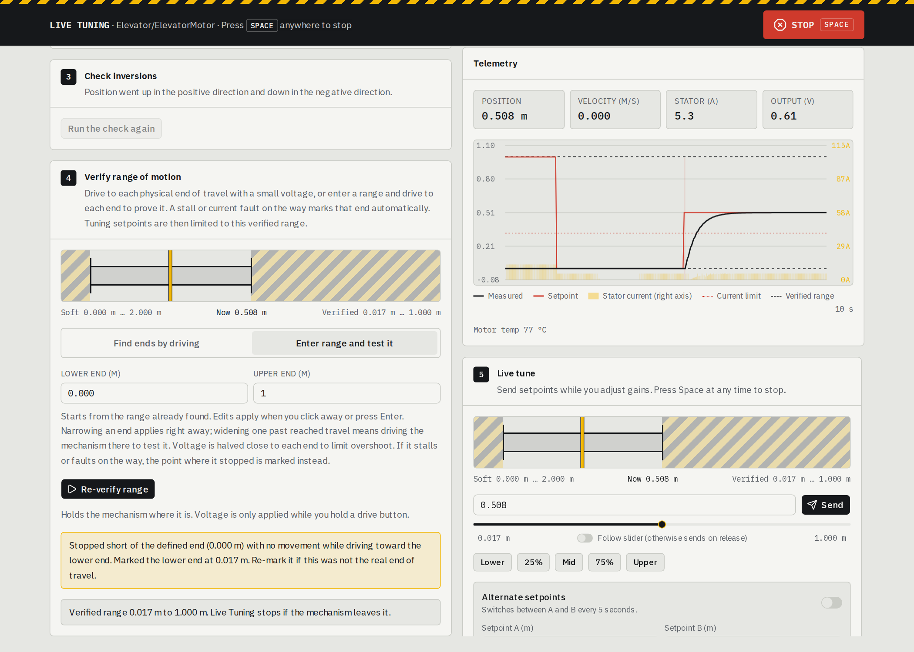<figcaption>
Sent <strong>Mid</strong>, and the elevator settles on it.
</figcaption></figure>

### Change the gains

The **Gains** card shows the values the robot publishes under `NT:/Tuning`. Type a new value and press **Enter** to apply it.

While the elevator held still, the output read about 0.6 V: that is the voltage it takes to hold the carriage up against gravity, so it is a good kG. Here kG is raised from the example's 0.1 V to 0.6 V, which leaves less for kP to make up.

<figure>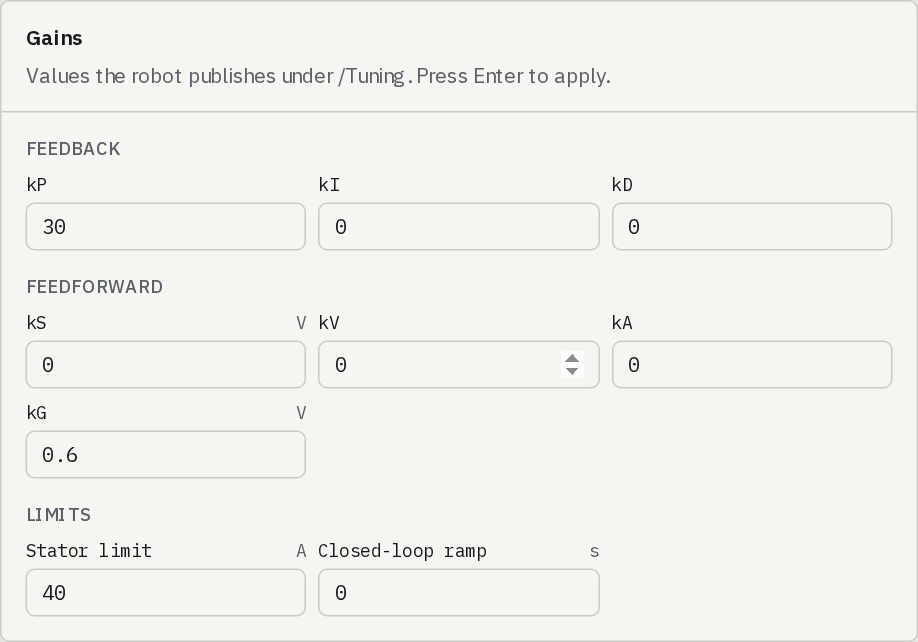<figcaption>
kG raised to 0.6 V.
</figcaption></figure>

<figure>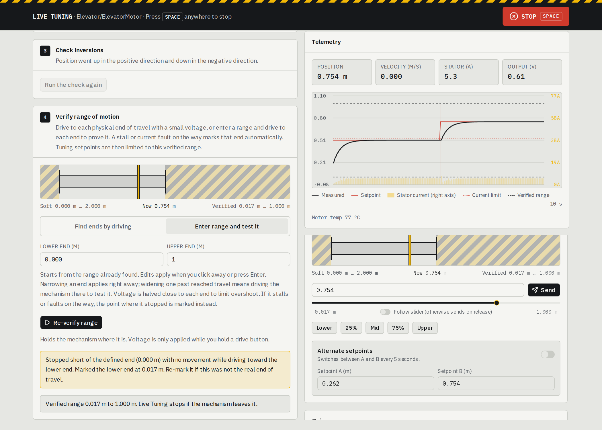<figcaption>
With kG at 0.6 V, sent <strong>75%</strong>: the elevator moves to 0.754 m and holds it.
</figcaption></figure>

[What to tune and what to watch](README.md#what-to-tune-and-what-to-watch) lists what each gain does.

### Alternate between two setpoints

Turn on **Alternate setpoints** to switch between **Setpoint A** and **Setpoint B** every 5 seconds. Each step is the same, so you can change a gain and compare the next step with the last one.

<figure>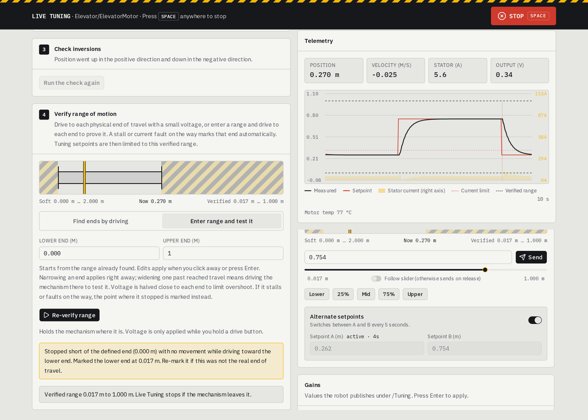<figcaption>
Stepping between 0.262 m and 0.754 m.
</figcaption></figure>

## Stop

Press **Space**, or **STOP**, at any time and from anywhere on the page. The Live Tuner sets the setpoint to where the mechanism is, or slows a flywheel down first, and then ends the `Live Tuning` command. The subsystem's default command, if it has one, takes over from there. Closing the page stops Live Tuning too, and so does disabling the robot from the Driver Station.

When you are happy with the gains, copy them into the robot code.
