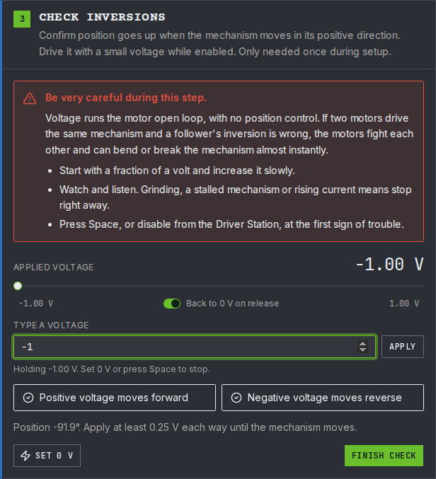
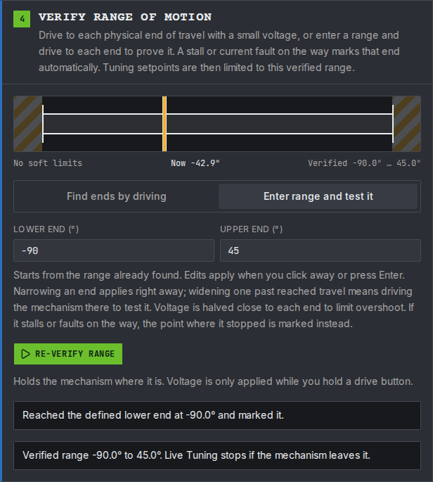
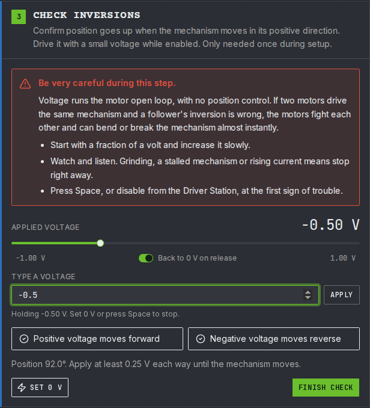

# YAMS Live Tuner

The [YAMS Live Tuner](https://tuning.yassrobotics.com/) is a web page that tunes an elevator, arm, pivot or flywheel through [live tuning](README.md). It connects to the robot or simulation over NetworkTables, finds every YAMS motor controller with live tuning, and walks you through checking it before anything moves: a safety checklist, the motor inversion, and the range of motion. Then you send setpoints and change gains while watching a graph.

It writes the same `NT:/Tuning` keys you would edit in AdvantageScope or Elastic, so everything on the [Live tuning](README.md) page still applies.


The Live Tuner drives the motor at a voltage while it checks the inversion and the range of motion. That needs a YAMS release newer than 2026.10.19, which adds `voltage/enabled` and `voltage/setpoint` to live tuning, and registers the `Live Tuning` command for mechanisms such as `Elevator` and `Arm`.


The screenshots below come from the YAMS Commands v3 examples running in simulation, with each mechanism's simulation in its own `Notifier`: the BroncBotz 2025 elevator and coral arm, and the BroncBotz 2026 turret and kicker. Each motor is set up with `withTelemetry(name, TelemetryVerbosity.HIGH)` and its mechanism with `withTelemetry(...)` too, which is all live tuning needs.


Like all tuning, this can be **dangerous** on a real robot. Practice in simulation first. Press **Space** anywhere on the page to stop Live Tuning straight away, and keep a hand on the Driver Station's disable.


## Connect

Open [tuning.yassrobotics.com](https://tuning.yassrobotics.com/). Pick where the robot code is running, then press **Connect**:

* **Robot (team)**: the robot, from your team number.
* **Simulation**: robot code running in simulation on this computer.
* **Custom host**: any other address.

Once connected, the badge shows the host and the robot's mode. Enable the robot, in Teleop or Test, from the Driver Station before anything moves.

<figure><figcaption>
Connected to a simulation, with the robot enabled in Teleop.
</figcaption></figure>


No robot code to hand? Open [tuning.yassrobotics.com/?demo](https://tuning.yassrobotics.com/?demo) to try the Live Tuner on a robot simulated in the page.



If your browser asks whether the page may connect to devices on your local network, allow it. The robot and the simulation are on your local network.


## Tune a mechanism

The Live Tuner's numbered steps unlock one after another. Each one has to be finished, or skipped where that is allowed, before the next. Pick the tab for your kind of mechanism.





#### Pick the mechanism

Choose the motor controller under **Telemetry name**, and the subsystem (Commands v2) or mechanism (Commands v3) whose `Live Tuning` command it belongs to. The lists are filled in from what the robot publishes under `NT:/Tuning`, so a motor controller only shows up once live tuning is [turned on](README.md#turn-it-on) for it.

Set **Type** to **Elevator**. Setpoints are in meters.

<figure><figcaption>
The BroncBotz 2025 elevator: its motor, its mechanism's <code>Live Tuning</code> command, and the Elevator type.
</figcaption></figure>

Changing anything in this step resets every confirmation below it.



#### Go through the pre-motion checklist

Nothing moves until every item is ticked. **Current trip** stops Live Tuning if the stator current stays above it for 250 ms, which catches a stalled or jammed mechanism.

<figure><figcaption>
Every item confirmed, with a 40 A current trip.
</figcaption></figure>



#### Check the inversions

This step drives the motor at a small voltage, with no closed loop, to check that a positive voltage moves the mechanism in its positive direction and that the position reading goes the same way.

Read the warning, tick the confirmation, and press **Start voltage control**. If the inversions were already checked on this robot, **Skip (already checked)** goes straight to the next step.

<figure><figcaption>
Voltage control only starts once you confirm you are watching the mechanism.
</figcaption></figure>

Drag the slider, or type a voltage and press **Enter** or **Apply**. The slider goes back to 0 V when you let go; a typed voltage holds until you change it. Start with a fraction of a volt and raise it until the mechanism moves. Gravity pulls an elevator down, so it can need more voltage to move up than down.

<figure><figcaption>
At +1 V the position rises, so <strong>Positive voltage moves up</strong> is ticked.
</figcaption></figure>

Then drive it the other way. Once both directions are ticked, press **Set 0 V** and **Finish check**.

<figure><figcaption>
Both directions checked.
</figcaption></figure>

If the position goes the wrong way, stop and fix `withMotorInverted(...)`, or the encoder inversion, in the robot code before going on.



#### Verify the range of motion

The Live Tuner only sends setpoints inside a range that the mechanism has actually been driven across. There are two ways to set it:

* **Find ends by driving**: hold the drive buttons to drive to each physical end of travel, then mark each end.
* **Enter range and test it**: type the lower and upper ends, then hold each drive button until the mechanism gets there. It starts from the soft limits the robot publishes.

Press **Start verification**, set **Drive voltage**, and hold a drive button. Voltage is only applied while you hold it, and it is halved close to each end to limit overshoot. A stall, or the current trip, on the way marks that end where the mechanism stopped. While it drives, the banner at the top reads **VERIFYING RANGE**, and Space stops it.

Once both ends are marked, press **Finish verification**. Live Tuning stops if the mechanism leaves the verified range.

<figure><figcaption>
Verified from 0 m to 0.25 m with <strong>Enter range and test it</strong>.
</figcaption></figure>



#### Live tune

Press **Start Live Tuning**. This starts the mechanism's `Live Tuning` command, so the setpoints and gains you send are applied every loop.

Send a setpoint by typing it, with the slider, or with **Lower**, **25%**, **Mid**, **75%** and **Upper**. The graph shows the measured position against the setpoint, with the stator current and the verified range.

<figure><figcaption>
kP cut to a fifth, then put back: the elevator lags each setpoint, then follows it.
</figcaption></figure>

**Change the gains**

The **Gains** card shows the values the robot publishes under `NT:/Tuning`. Type a new value and press **Enter** to apply it. [What to tune and what to watch](README.md#what-to-tune-and-what-to-watch) lists what each gain does. On an elevator, start with kG: the output while it holds still is the voltage it takes to hold the carriage up against gravity. Then raise kP until it reaches each setpoint without overshooting.

<figure><figcaption>
The elevator's gains, motion profile and limits.
</figcaption></figure>

**Alternate between two setpoints**

Turn on **Alternate setpoints** to switch between **Setpoint A** and **Setpoint B** every 5 seconds. Each step is the same, so you can change a gain and compare the next step with the last one.

<figure><figcaption>
Stepping between 0.063 m and 0.188 m.
</figcaption></figure>








#### Pick the mechanism

Choose the motor controller under **Telemetry name**, and the subsystem (Commands v2) or mechanism (Commands v3) whose `Live Tuning` command it belongs to. The lists are filled in from what the robot publishes under `NT:/Tuning`, so a motor controller only shows up once live tuning is [turned on](README.md#turn-it-on) for it.

Set **Type** to **Arm** for an arm that gravity pulls on, or **Pivot** for anything else that turns, such as a turret. Setpoints are in degrees.

<figure><figcaption>
The BroncBotz 2025 coral arm, as an Arm.
</figcaption></figure>

<figure><figcaption>
The BroncBotz 2026 turret, as a Pivot.
</figcaption></figure>

For a pivot, tick **Continuous (no range of motion)** only if it can spin freely forever without wrapping wires.

Changing anything in this step resets every confirmation below it.



#### Go through the pre-motion checklist

Nothing moves until every item is ticked. **Current trip** stops Live Tuning if the stator current stays above it for 250 ms, which catches a stalled or jammed mechanism.

<figure><figcaption>
Every item confirmed.
</figcaption></figure>



#### Check the inversions

This step drives the motor at a small voltage, with no closed loop, to check that a positive voltage moves the mechanism in its positive direction and that the position reading goes the same way.

Read the warning, tick the confirmation, and press **Start voltage control**. If the inversions were already checked on this robot, **Skip (already checked)** goes straight to the next step.

Drag the slider, or type a voltage and press **Enter** or **Apply**. The slider goes back to 0 V when you let go; a typed voltage holds until you change it. Start with a fraction of a volt and raise it until the mechanism moves. Near horizontal, gravity can be stronger than a small voltage on an arm, so try a little more voltage before changing an inversion.

<figure><figcaption>
At +1 V the angle rises, so <strong>Positive voltage moves forward</strong> is ticked.
</figcaption></figure>

Then drive it the other way. Once both directions are ticked, press **Set 0 V** and **Finish check**.

<figure><figcaption>
Both directions checked.
</figcaption></figure>

If the position goes the wrong way, stop and fix `withMotorInverted(...)`, or the encoder inversion, in the robot code before going on.



#### Verify the range of motion

The Live Tuner only sends setpoints inside a range that the mechanism has actually been driven across. There are two ways to set it:

* **Find ends by driving**: hold the drive buttons to drive to each physical end of travel, then mark each end.
* **Enter range and test it**: type the lower and upper ends, then hold each drive button until the mechanism gets there. It starts from the soft limits the robot publishes.

Press **Start verification**, set **Drive voltage**, and hold a drive button. Voltage is only applied while you hold it, and it is halved close to each end to limit overshoot. A stall, or the current trip, on the way marks that end where the mechanism stopped. While it drives, the banner at the top reads **VERIFYING RANGE**, and Space stops it.

Once both ends are marked, press **Finish verification**. Live Tuning stops if the mechanism leaves the verified range. A continuous pivot has no end of travel, so it has no range to verify.

<figure><figcaption>
The coral arm verified from -90° to 45°.
</figcaption></figure>



#### Live tune

Press **Start Live Tuning**. This starts the mechanism's `Live Tuning` command, so the setpoints and gains you send are applied every loop.

Send a setpoint by typing it, with the slider, or with **Lower**, **25%**, **Mid**, **75%** and **Upper**. The graph shows the measured angle against the setpoint, with the stator current and the verified range.

<figure><figcaption>
The coral arm. With kP at a fifth of its value, gravity holds it below its setpoint; with kP put back, it follows.
</figcaption></figure>

<figure><figcaption>
The turret, a pivot. kP starts at a fifth of its value, then goes back.
</figcaption></figure>

**Change the gains**

The **Gains** card shows the values the robot publishes under `NT:/Tuning`. Type a new value and press **Enter** to apply it. [What to tune and what to watch](README.md#what-to-tune-and-what-to-watch) lists what each gain does. On an arm, start with kG: raise it until the arm holds still when it is horizontal. A pivot has no kG. Then raise kP until the mechanism reaches each setpoint without overshooting.

<figure><figcaption>
The coral arm's gains.
</figcaption></figure>

**Alternate between two setpoints**

Turn on **Alternate setpoints** to switch between **Setpoint A** and **Setpoint B** every 5 seconds. Each step is the same, so you can change a gain and compare the next step with the last one.

<figure><figcaption>
The coral arm stepping between two angles.
</figcaption></figure>








#### Pick the mechanism

Choose the motor controller under **Telemetry name**, and the subsystem (Commands v2) or mechanism (Commands v3) whose `Live Tuning` command it belongs to. The lists are filled in from what the robot publishes under `NT:/Tuning`, so a motor controller only shows up once live tuning is [turned on](README.md#turn-it-on) for it.

Set **Type** to **Flywheel**. Setpoints are in RPM.

<figure><figcaption>
The BroncBotz 2026 kicker, as a Flywheel.
</figcaption></figure>

Changing anything in this step resets every confirmation below it.



#### Go through the pre-motion checklist

Nothing moves until every item is ticked. **Current trip** stops Live Tuning if the stator current stays above it for 250 ms, which catches a stalled or jammed mechanism. Also set **Max speed (RPM)**: every velocity setpoint is clamped to it.

<figure><figcaption>
Every item confirmed, with a 40 A current trip and a 1500 RPM max speed.
</figcaption></figure>



#### Check the inversions

This step drives the motor at a small voltage, with no closed loop, to check that a positive voltage moves the mechanism in its positive direction and that the position reading goes the same way.

Read the warning, tick the confirmation, and press **Start voltage control**. If the inversions were already checked on this robot, **Skip (already checked)** goes straight to the next step.

Drag the slider, or type a voltage and press **Enter** or **Apply**. The slider goes back to 0 V when you let go; a typed voltage holds until you change it. Start with a fraction of a volt and raise it until the mechanism moves. A flywheel keeps spinning after you let go, so set 0 V and let it stop before you drive it the other way.

<figure><figcaption>
At +0.5 V the kicker spins forward.
</figcaption></figure>

Then drive it the other way. Once both directions are ticked, press **Set 0 V** and **Finish check**.

<figure><figcaption>
Both directions checked.
</figcaption></figure>

If the position goes the wrong way, stop and fix `withMotorInverted(...)`, or the encoder inversion, in the robot code before going on.



#### Skip the range of motion

A flywheel spins continuously, so it has no range to verify. The max speed caps it instead.



#### Live tune

Press **Start Live Tuning**. This starts the mechanism's `Live Tuning` command, so the speeds and gains you send are applied every loop.

Send a speed by typing it, with the slider, or with **Idle (0)** and the buttons at a quarter, half, three quarters and all of the max speed. The graph shows the measured speed against the setpoint, with the stator current.

<figure><figcaption>
The kicker. With kV at 0.25 it runs slow; at 0.374 it settles on each setpoint.
</figcaption></figure>

**Change the gains**

The **Gains** card shows the values the robot publishes under `NT:/Tuning`. Type a new value and press **Enter** to apply it. [What to tune and what to watch](README.md#what-to-tune-and-what-to-watch) lists what each gain does. On a flywheel, start with kV: raise or lower it until the measured speed settles on the setpoint. Then add kP to recover speed quickly after each shot.

<figure><figcaption>
kV at 0.374.
</figcaption></figure>

**Alternate between two setpoints**

Turn on **Alternate setpoints** to switch between **Setpoint A** and **Setpoint B** every 5 seconds. Each step is the same, so you can change a gain and compare the next step with the last one.

<figure><figcaption>
The kicker stepping between two speeds.
</figcaption></figure>






## Stop

Press **Space**, or **STOP**, at any time and from anywhere on the page. The Live Tuner sets the setpoint to where the mechanism is, or slows a flywheel down first, and then ends the `Live Tuning` command. The subsystem's default command, if it has one, takes over from there. Closing the page stops Live Tuning too, and so does disabling the robot from the Driver Station.

When you are happy with the gains, copy them into the robot code.
