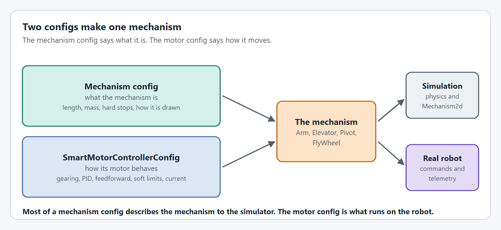

# Mechanism configs

Every mechanism is built from two configs: a mechanism config that says what the mechanism is, and a [`SmartMotorControllerConfig`](../editor/config/README.md) that says how its motor behaves.

<figure><figcaption><p>Two configs go into one mechanism.</p></figcaption></figure>

```java
SmartMotorController motor  = new SparkWrapper(spark, DCMotor.getNEO(1), motorConfig); // how the motor behaves
ArmConfig            config = new ArmConfig()                                          // what the arm is
    .withLength(Feet.of(3))
    .withHardLimits(Degrees.of(-30), Degrees.of(110))
    .withTelemetry("Arm", TelemetryVerbosity.HIGH);
Arm arm = new Arm(config, motor);
```

## The pages

| Page | Config | For |
| --- | --- | --- |
| [Shared options](shared-options.md) | all four below | Telemetry, hard limits, and how the mechanism is drawn. |
| [ArmConfig](arm-config.md) | `ArmConfig` | Arms that swing against gravity. |
| [ElevatorConfig](elevator-config.md) | `ElevatorConfig` | Elevators and linear slides. |
| [PivotConfig](pivot-config.md) | `PivotConfig` | Turrets and wrists. A pivot does not account for gravity. |
| [FlyWheelConfig](flywheel-config.md) | `FlyWheelConfig` | Shooters, rollers, intakes and anything else that spins. |
| [SwerveDriveConfig](swerve-drive-config.md) | `SwerveDriveConfig` | The whole swerve drive base. |
| [SwerveModuleConfig](swerve-module-config.md) | `SwerveModuleConfig` | One swerve module. |

## Which options each config has

| Option | Arm | Elevator | Pivot | FlyWheel |
| --- | --- | --- | --- | --- |
| [`withTelemetry`](shared-options.md#withtelemetry) | ✅ | ✅ | ✅ | ✅ |
| [`withSimColor`](shared-options.md#withsimcolor) | ✅ | ✅ | ✅ | ✅ |
| [`withMechanismPositionConfig`](shared-options.md#withmechanismpositionconfig) | ✅ | ✅ | ✅ | ✅ |
| [`withHardLimits`](shared-options.md#withhardlimits) | ✅ angles | ✅ distances | ✅ angles | ❌ |
| [`withLength`](arm-config.md#withlength) | ✅ | ❌ | ❌ | ❌ |
| [`withCarriageWeight`](elevator-config.md#withcarriageweight) | ❌ | ✅ | ❌ | ❌ |
| [`withAngle`](elevator-config.md#withangle), [`withHorizontalElevator`](elevator-config.md#withhorizontalelevator) | ❌ | ✅ | ❌ | ❌ |
| [`withDiameter`](flywheel-config.md#withdiameter) | ❌ | ❌ | ❌ | ✅ |
| [`withSpeedometerSimulation`](flywheel-config.md#withspeedometersimulation) | ❌ | ❌ | ❌ | ✅ |

The swerve configs are different enough to have their own pages and their own option lists.

## What simulation needs


Most mechanism config options describe the mechanism to the simulator and do nothing on the real robot. Some of them are **required** in simulation: the mechanism throws when it is created in simulation if they are missing. The exception is the mechanism's own, such as an `ArmConfigurationException` or a `PivotConfigurationException`, or a `SmartMotorControllerConfigurationException` when the missing option belongs to the motor config, such as an elevator's starting height. Each option page says where the option is used.


| Mechanism | Must be set for simulation to start |
| --- | --- |
| `Arm` | [`withLength`](arm-config.md#withlength), [`withHardLimits`](shared-options.md#withhardlimits), and a [starting position](../editor/config/encoders.md#withstartingposition) inside the hard limits. |
| `Elevator` | [`withCarriageWeight`](elevator-config.md#withcarriageweight), [`withHardLimits`](shared-options.md#withhardlimits), a [circumference](../editor/config/gearing-and-units.md#withmechanismcircumference), and a [starting position](../editor/config/encoders.md#withstartingposition) inside the hard limits. |
| `Pivot` | [`withHardLimits`](shared-options.md#withhardlimits), and a [starting position](../editor/config/encoders.md#withstartingposition) inside the hard limits. |
| `FlyWheel` | Nothing on the mechanism config. Its moment of inertia comes from the [motor config](../editor/config/simulation.md#withmomentofinertia). |

## Options that live on the motor config

Several things you might look for on a mechanism config are on the motor's config, because they change what the motor controller does:

| Looking for | It is |
| --- | --- |
| Soft limits | [`withSoftLimits`](../editor/config/limits-and-protection.md#withsoftlimits) |
| Where the mechanism starts | [`withStartingPosition`](../editor/config/encoders.md#withstartingposition) |
| Gear ratio, drum or wheel size | [Gearing and units](../editor/config/gearing-and-units.md) |
| Gains, feedforward, motion profile | [Closed loop control](../editor/config/closed-loop-control.md), [Feedforward](../editor/config/feedforward.md), [Motion profiles](../editor/config/motion-profiles.md) |
| Mass or moment of inertia of an arm, pivot or flywheel | [`withMomentOfInertia`](../editor/config/simulation.md#withmomentofinertia) |
| An absolute encoder | [Encoders](../editor/config/encoders.md) |


## Code Reference

* `ArmConfig`
* `ElevatorConfig`
* `PivotConfig`
* `FlyWheelConfig`
* `SwerveDriveConfig`
* `SwerveModuleConfig`
