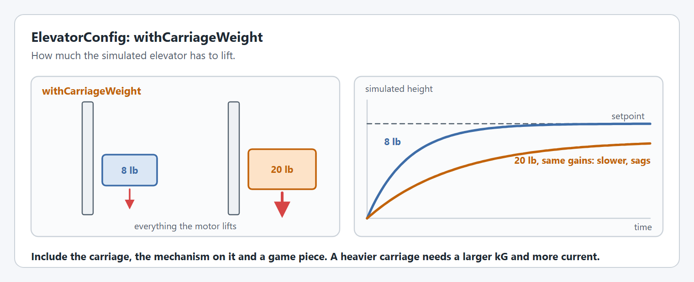
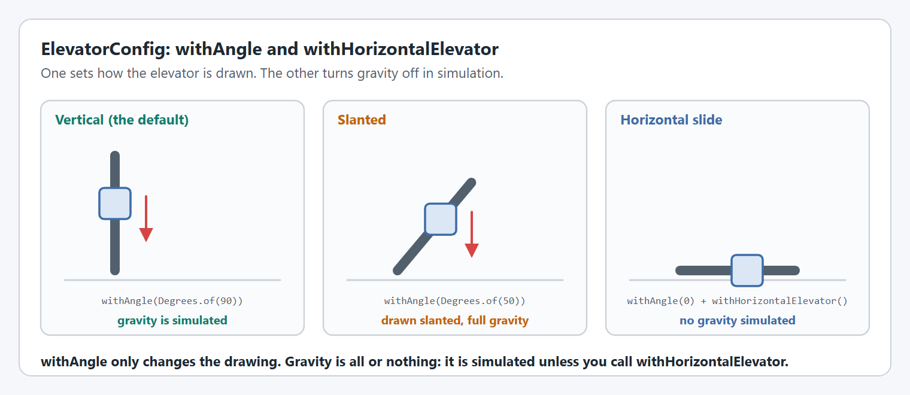

# ElevatorConfig

An elevator moves a carriage along a line. The [Elevators](../elevators.md) page shows a complete elevator.

`ElevatorConfig` has the [shared options](shared-options.md) and four of its own.

## `withCarriageWeight`

Everything the motor lifts: the carriage, whatever is mounted on it, and a game piece if it carries one.

<figure><figcaption><p>The same gains on a light and a heavy carriage.</p></figcaption></figure>

```java
new ElevatorConfig().withCarriageWeight(Pounds.of(16));
```

**Used in:** simulation only. **Required** for an `Elevator` to be created in simulation.

## `withAngle`

The angle the elevator is drawn at. The default is 90°, straight up.

<figure><figcaption><p>withAngle sets the drawing. withHorizontalElevator turns gravity off.</p></figcaption></figure>

```java
new ElevatorConfig().withAngle(Degrees.of(50));
```


`withAngle` only changes the drawing, and the direction [`getPose3d()`](../../how-to/how-do-i-show-my-mechanisms-on-a-3d-robot-model.md) moves the carriage in. It does not reduce the gravity the simulation applies: a slanted elevator is simulated with full gravity, as if it were vertical.


**Used in:** simulation only.

## `withHorizontalElevator`

Turns gravity off in the simulation, for a linear slide that moves level with the ground.

```java
new ElevatorConfig()
    .withAngle(Degrees.of(0))
    .withHorizontalElevator();
```

A slide with no gravity needs no `kG`, so it will want [different simulation gains](../editor/config/simulation.md#withsimclosedloopcontroller-and-withsimfeedforward) from a vertical elevator.

**Used in:** simulation only.

## `withStages`

How far each moving stage travels relative to the stage below it, from the stage nearest the fixed stage to the carriage, which is the last. Give one height for each stage that moves: the number of heights is the number of stages. `Elevator.getCascadePose3d()` and `getContinuousPose3d(carriageFirst)` use them to give each stage's pose, to show the stages on an [AdvantageScope robot model](../../how-to/how-do-i-show-my-mechanisms-on-a-3d-robot-model.md#elevator-stages).

```java
new ElevatorConfig()
    // Two stages that each travel 0.6 m, then a carriage that travels 0.5 m.
    .withStages(Meters.of(0.6), Meters.of(0.6), Meters.of(0.5));
```

1 stage, an elevator with only a carriage, is valid, but has no stage poses: both methods need 2 or more stages. `withStages` throws for no heights, or a height that is not positive.

The stages carry the carriage from the bottom to the top, so they also give the elevator's height: without [`withHardLimits`](shared-options.md#withhardlimits), the elevator goes from 0 to the stage heights' total, which `getStageHeightTotal()` returns. With hard limits as well, the stage heights must add up to the maximum height, or the `Elevator` throws an `ElevatorConfigurationException` saying how far apart they are.

```java
new ElevatorConfig()
    // 0 m to 1.7 m, from the stages. No withHardLimits needed.
    .withStages(Meters.of(0.6), Meters.of(0.6), Meters.of(0.5));
```


`withStages` does not change the gearing. A cascading elevator also needs [`withCascadingElevatorStages`](../editor/config/gearing-and-units.md#withcascadingelevatorstages) on its motor config, so the carriage's height is right: see [how the stages are rigged](../elevators.md#how-the-stages-are-rigged).


**Used in:** stage poses only.

## What else an elevator needs

| For                        | Use                                                                                                                                      |
| -------------------------- | ---------------------------------------------------------------------------------------------------------------------------------------- |
| The physical stops         | [`withHardLimits`](shared-options.md#withhardlimits) on `ElevatorConfig`                                                                 |
| The limits the motor obeys | [`withSoftLimits`](../editor/config/limits-and-protection.md#withsoftlimits) on the motor config                                         |
| Heights in meters          | [`withDrumRadius` or `withMechanismCircumference`](../editor/config/gearing-and-units.md#withmechanismcircumference) on the motor config |
| A cascading elevator       | [`withCascadingElevatorStages`](../editor/config/gearing-and-units.md#withcascadingelevatorstages)                                       |
| Holding against gravity    | [`ElevatorFeedforward`](../editor/config/feedforward.md#withfeedforward) with `kG`                                                       |
| A constant force spring    | [Elevators with a constant force spring](../live-tuning/#elevators-with-a-constant-force-spring)                                         |

## Code reference

* `ElevatorConfig`
* `Elevator`
