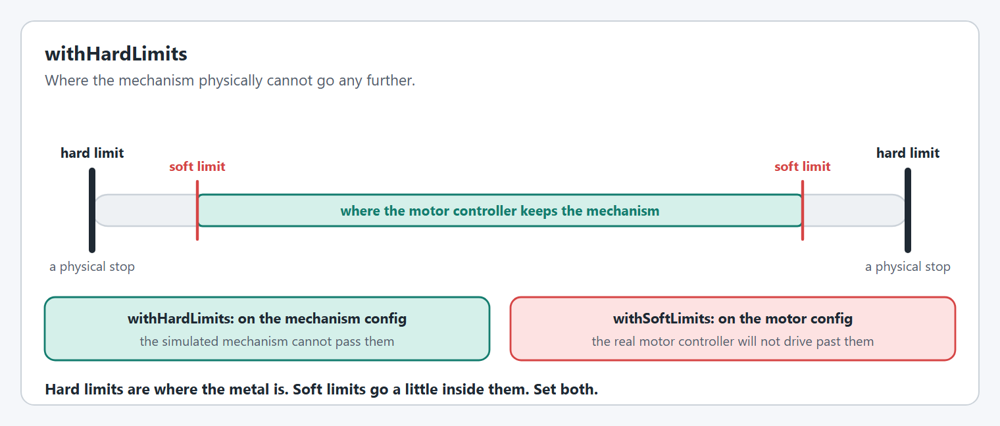
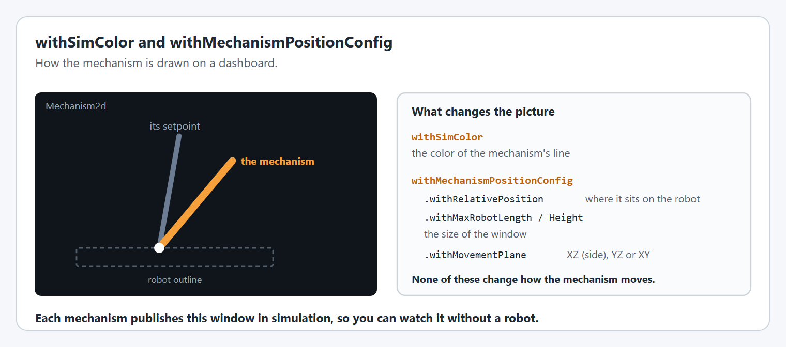

# Shared options

`ArmConfig`, `ElevatorConfig`, `PivotConfig` and `FlyWheelConfig` share these options. They work the same way on each.

## `withTelemetry`

Names the mechanism and chooses how much it publishes. This is the mechanism's own name: the motor inside it has its own [`withTelemetry`](../editor/config/motor-basics.md#withtelemetry).

<figure><figcaption><p>Where a mechanism's values appear in NetworkTables.</p></figcaption></figure>

```java
.withTelemetry("Arm", TelemetryVerbosity.HIGH)
```

The name is the `<Mechanism>` part of every NetworkTables path, and the name [live tuning](../live-tuning/README.md) uses. [Telemetry](../../understanding/telemetry.md) explains the paths and verbosity levels.

**Used in:** simulation and on the real robot.

**Available on:** `ArmConfig`, `ElevatorConfig`, `PivotConfig`, `FlyWheelConfig`.

## `withHardLimits`

Where the mechanism physically cannot go any further.

<figure><figcaption><p>Hard limits are physical stops. Soft limits sit inside them.</p></figcaption></figure>

```java
new ArmConfig().withHardLimits(Degrees.of(-30), Degrees.of(110));
new ElevatorConfig().withHardLimits(Meters.of(0), Meters.of(1.3));
new PivotConfig().withHardLimits(Degrees.of(-180), Degrees.of(180));
```

The simulated mechanism stops dead at them, as the real one would against metal. They do not stop the real motor: that is what [`withSoftLimits`](../editor/config/limits-and-protection.md#withsoftlimits) is for. Set both, with the soft limits a little inside the hard ones.

**Used in:** simulation only. **Required** for `Arm`, `Elevator` and `Pivot` to be created in simulation. On the real robot they do not stop the motor.

**Available on:** `ArmConfig` and `PivotConfig` (angles), `ElevatorConfig` (distances). **Not on** `FlyWheelConfig`: a flywheel has no end to its travel.

## `withSimColor`

The color of the mechanism's line in its `Mechanism2d` window. The default is orange.

```java
.withSimColor(new Color8Bit(Color.BLUE))
```

**Used in:** simulation only.

**Available on:** `ArmConfig`, `ElevatorConfig`, `PivotConfig`, `FlyWheelConfig`.

## `withMechanismPositionConfig`

Places the mechanism on a drawing of the robot, so several mechanisms line up when you view them together.

<figure><figcaption><p>The Mechanism2d window, and what each option changes in it.</p></figcaption></figure>

```java
.withMechanismPositionConfig(new MechanismPositionConfig()
    .withRelativePosition(new Translation3d(0.2, 0.0, 0.3)) // 20 cm forward, 30 cm up
    .withMaxRobotLength(Meters.of(0.85))
    .withMaxRobotHeight(Meters.of(1.2))
    .withMovementPlane(MechanismPositionConfig.Plane.XZ))
```

| Option | What it sets |
| --- | --- |
| `withRelativePosition` | Where the mechanism's root is on the robot. |
| `withMaxRobotLength`, `withMaxRobotHeight` | The size of the window. Without them it is twice the mechanism's length. |
| `withMovementPlane` | The plane the mechanism moves in: `XZ` (seen from the side, the default), `YZ` or `XY`. |

**Used in:** simulation only. It changes the drawing and the mechanism's reported 3D position, never how the mechanism moves.

**Available on:** `ArmConfig`, `ElevatorConfig`, `PivotConfig`, `FlyWheelConfig`.


## Code Reference

* `MechanismPositionConfig`
