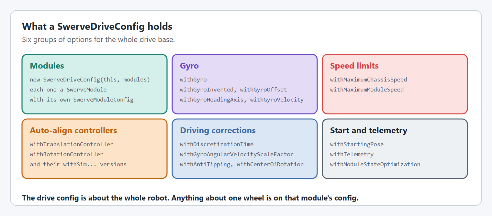
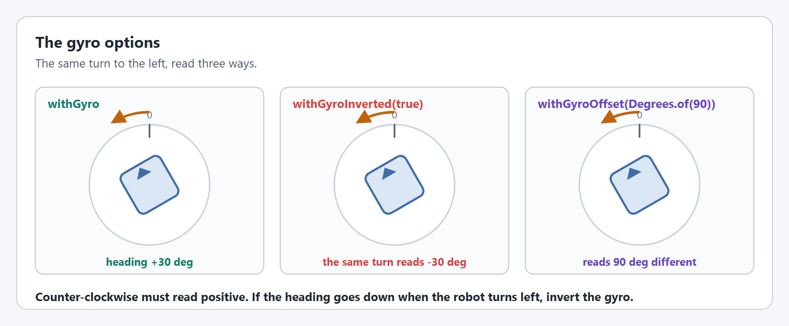
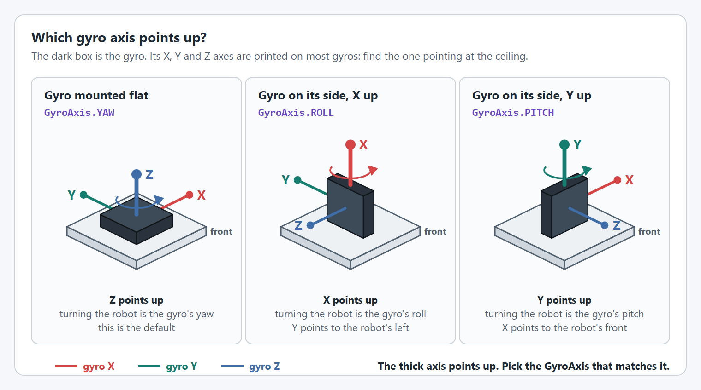
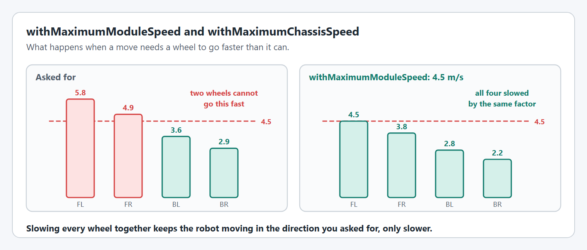
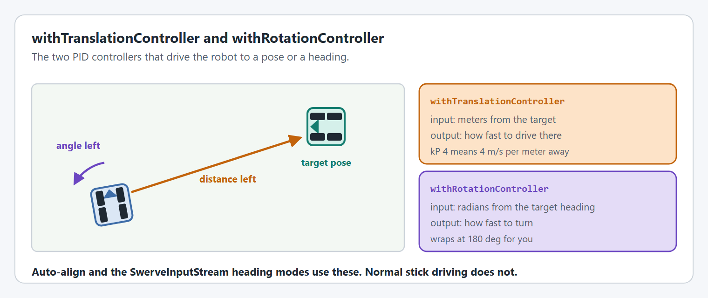
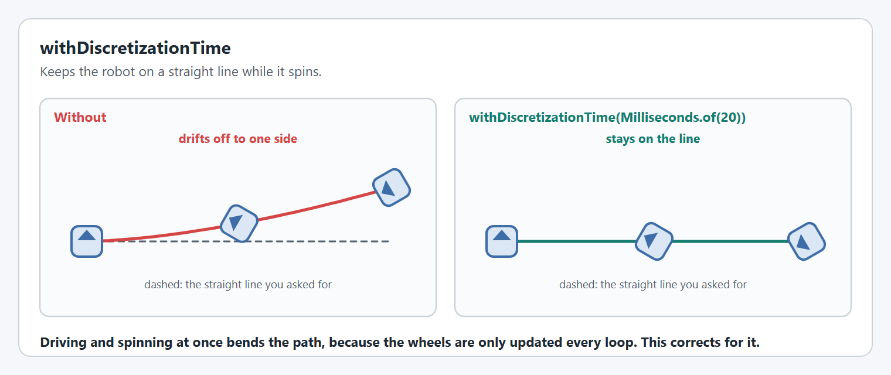
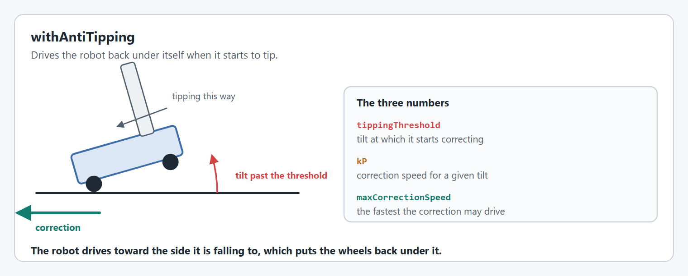
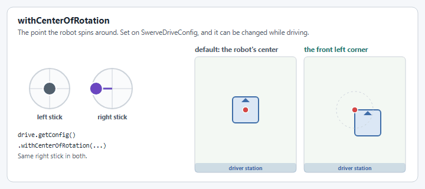
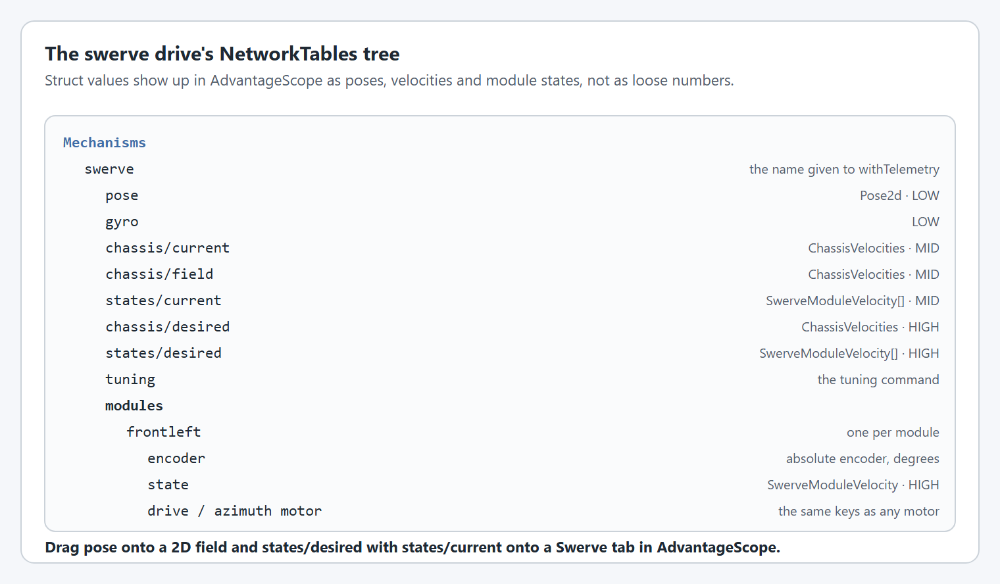

# SwerveDriveConfig

`SwerveDriveConfig` describes the whole drive base. Anything about a single wheel is on that module's [`SwerveModuleConfig`](swerve-module-config.md). The [Swerve Drive](../swerve-drive.md) page shows a complete drive.

<figure><figcaption><p>The option groups on a SwerveDriveConfig.</p></figcaption></figure>

Every option on this page is used on the real robot and in simulation unless it says otherwise. Options with a `withSim...` twin use that value in simulation instead, when it is set.

## The modules

The modules are given to the constructor, or with `withModules`. The drive's kinematics are built from [each module's location](swerve-module-config.md#withlocation).

```java
SwerveDriveConfig config = new SwerveDriveConfig(this, frontLeft, frontRight, backLeft, backRight);
```

### `withModuleStateOptimization`

Turns [state optimization](swerve-module-config.md#withoptimization) on or off for every module at once, overriding each module's own setting. It can be changed while the drive is running.

```java
drive.getConfig().withModuleStateOptimization(false);
```

## The gyro

<figure><figcaption><p>The gyro options change how the same turn is read.</p></figcaption></figure>

| Option                                        | What it does                                                                                                                                                                               |
| --------------------------------------------- | ------------------------------------------------------------------------------------------------------------------------------------------------------------------------------------------ |
| `withGyro(Supplier<Rotation3d>)`              | Supplies the robot's attitude. Its yaw is the heading.                                                                                                                                     |
| `withGyroInverted(boolean)`                   | Flips the heading, for a gyro that reads clockwise as positive.                                                                                                                            |
| `withGyroOffset(Angle)`                       | Adds a fixed angle to the heading.                                                                                                                                                         |
| `withGyroHeadingAxis(GyroAxis)`               | Chooses which axis is the heading, for a gyro mounted on its side.                                                                                                                         |
| `withGyroVelocity(Supplier<AngularVelocity>)` | Supplies the turn rate, used by [`withGyroAngularVelocityScaleFactor`](swerve-drive-config.md#withgyroangularvelocityscalefactor). Without it the turn rate is estimated from the heading. |

```java
config.withGyro(pigeon::getRotation3d)
      .withGyroVelocity(() -> pigeon.getAngularVelocityZWorld().getValue());
```

<figure><figcaption><p>A gyro lying flat and standing on each side.</p></figcaption></figure>

[How do I use a gyro mounted on its side?](../../how-to/how-do-i-use-a-gyro-mounted-on-its-side.md) covers `withGyroHeadingAxis`.

In simulation the heading comes from the simulated drive, not from the gyro supplier.

## Speed limits

<figure><figcaption><p>Wheel speeds before and after they are limited.</p></figcaption></figure>

```java
config.withMaximumModuleSpeed(MetersPerSecond.of(4.5))
      .withMaximumChassisSpeed(MetersPerSecond.of(4.5), DegreesPerSecond.of(540));
```

| Option                    | What it does                                                                                                        |
| ------------------------- | ------------------------------------------------------------------------------------------------------------------- |
| `withMaximumModuleSpeed`  | The fastest a wheel can go. When a move needs more, every wheel is slowed by the same factor.                       |
| `withMaximumChassisSpeed` | The fastest the robot should drive and turn. With both set, the slowdown also keeps the mix of driving and turning. |

Without `withMaximumModuleSpeed` nothing is limited, and wheels asked to go too fast each fall short by a different amount, which bends the robot's path.

`withMaximumChassisSpeed` is also the starting value for a [`SwerveInputStream`](../swerve-input-stream.md#velocity-limits)'s maximum velocities.

## Auto-align controllers

<figure><figcaption><p>The translation and rotation controllers.</p></figcaption></figure>

```java
config.withTranslationController(new PIDController(4, 0, 0))
      .withRotationController(new PIDController(5, 0, 0));
```

They are used by [auto-align](../swerve-drive.md#auto-align) and by the heading, aim and translation-only modes of a [`SwerveInputStream`](../swerve-input-stream-aim.md#modes-are-chosen-automatically), which throw a `SwerveDriveConfigurationException` if no rotation controller is set. Normal stick driving does not use them.

`withSimTranslationController` and `withSimRotationController` give different gains for simulation only. [Tune a swerve drive](../live-tuning/swerve-drive.md#tune-auto-align) shows how to find the values.

## Driving corrections

### `withDiscretizationTime`

Corrects the path of a robot that is driving and turning at the same time.

<figure><figcaption><p>A straight line while spinning, without and with discretization.</p></figcaption></figure>

```java
config.withDiscretizationTime(Milliseconds.of(20)); // the robot's loop time
```

`withSimDiscretizationTime` sets a different value for simulation.

### `withGyroAngularVelocityScaleFactor`

A second correction for the same drift, using how fast the gyro says the robot is turning. It is a number from 0 to 1, found by experiment: drive in a straight line while spinning and adjust it until the drift is smallest.

```java
config.withGyroVelocity(() -> pigeon.getAngularVelocityZWorld().getValue())
      .withGyroAngularVelocityScaleFactor(0.1);
```

It needs a gyro: without `withGyroVelocity(...)` it reads the gyro set with `withGyro(...)`, and throws an `IllegalStateException` if that is not set either. `withSimGyroAngularVelocityScaleFactor` sets a different value for simulation.


This option has no graphic of its own: it corrects the same drift shown above for `withDiscretizationTime`.


### `withAntiTipping`

Drives the robot back under itself when it starts to tip.

<figure><figcaption><p>The correction drives toward the side the robot is falling to.</p></figcaption></figure>

```java
config.withAntiTipping(MetersPerSecond.of(2), Degrees.of(8), MetersPerSecond.of(1.5));
//                     kP                     threshold      maximum correction
```

Set the threshold a few degrees above the most the robot tilts in normal driving. It reads pitch and roll from the gyro, so it needs [`withGyro`](swerve-drive-config.md#the-gyro).

### `withCenterOfRotation`

The point the robot spins around. The default is the center of the robot.

<figure><figcaption><p>The same turn around the center and around a corner.</p></figcaption></figure>

```java
config.withCenterOfRotation(Meters.of(0.3), Meters.of(0.3)); // forward, left
```

It can be changed while driving: see [Center of Rotation](../swerve-input-stream.md#center-of-rotation).

## Start and telemetry

### `withStartingPose`

Where on the field the robot starts. The default is `new Pose2d()`. An autonomous routine or a vision measurement usually replaces it.

```java
config.withStartingPose(new Pose2d(2, 4, Rotation2d.fromDegrees(180)));
```

### `withTelemetry`

Names the drive and chooses what it publishes. The default name is `swerve`.

<figure><figcaption><p>What a swerve drive publishes.</p></figcaption></figure>

```java
config.withTelemetry("swerve", TelemetryVerbosity.HIGH);
```

[Telemetry](../../understanding/telemetry.md#swerve-drive-telemetry) lists what each level publishes, and [Tune a swerve drive](../live-tuning/swerve-drive.md) needs `HIGH`.

## Code reference

* `SwerveDriveConfig`
* `SwerveDrive`
