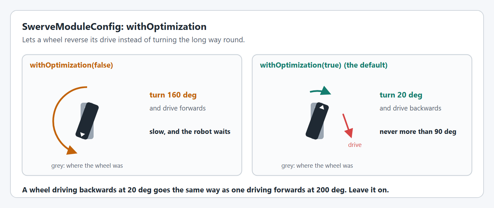
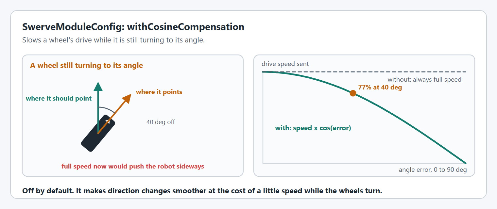
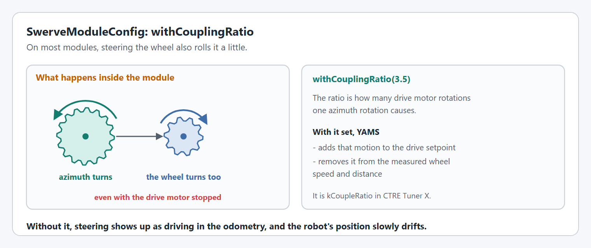

# SwerveModuleConfig

`SwerveModuleConfig` describes one swerve module: its two motors, where it is on the robot, and how its wheel is steered. The [Swerve Module](../swerve-module.md) page shows a complete module.

Every option on this page is used on the real robot and in simulation.

## The two motors

A module is built from a drive `SmartMotorController` and an azimuth `SmartMotorController`, each with its own [`SmartMotorControllerConfig`](../editor/config/README.md).

```java
SwerveModuleConfig config = new SwerveModuleConfig(driveMotor, azimuthMotor);
```

The drive motor's config needs the wheel size, with [`withWheelRadius` or `withWheelDiameter`](../editor/config/gearing-and-units.md#withmechanismcircumference). `SwerveModuleConfig.withWheelRadius` and `withWheelDiameter` set the same thing from here, but the motor config is the better place for it. The azimuth motor's config usually has [`withContinuousWrapping`](../editor/config/closed-loop-control.md#withcontinuouswrapping).

## `withLocation`

Where the module is, measured from the center of the robot.

<figure><figcaption><p>Module locations: X is forward and Y is left.</p></figcaption></figure>

```java
config.withLocation(Meters.of(0.3), Meters.of(0.3));  // front, left
config.withLocation(Meters.of(0.42), Degrees.of(45)); // distance and angle from the center
```

`withDistanceFromCenterOfRotation(front, left)` is the same as the first form. Every module needs a location: a missing or wrong one gives wrong kinematics, not an error. See [Module Location Drives the Kinematics](../swerve-drive.md#module-location-drives-the-kinematics).

## The absolute encoder

<figure><figcaption><p>Zero is the wheel pointing forward with the bevel to the left.</p></figcaption></figure>

| Option | What it does |
| --- | --- |
| `withAbsoluteEncoder(Object)` | An absolute encoder from the **same vendor** as the azimuth motor, read by the motor controller. |
| `withAbsoluteEncoder(Supplier<Angle>)` | An absolute encoder from **any vendor**, read by your code. |
| `withAbsoluteEncoderOffset(Angle)` | Makes the encoder read 0 when the wheel points forward with the bevel to the left. |
| `withAbsoluteEncoderGearing(GearBox)` | For an encoder that is not 1:1 with the azimuth. |

```java
config.withAbsoluteEncoder(new CANcoder(11, new CANBus(CANPort.CAN_S0)))
      .withAbsoluteEncoderOffset(Degrees.of(64));
```


`withAbsoluteEncoder(Object)` only accepts an encoder the azimuth motor controller can read itself, which means the same vendor: see the [encoders each controller accepts](../editor/config/encoders.md#withexternalencoder). For any other encoder use the `Supplier<Angle>` form.


[Absolute Encoder Wiring](../swerve-module.md#absolute-encoder-wiring) covers both forms in detail.

## `withOptimization`

Lets a wheel reverse its drive instead of turning more than 90°. It is on by default.

<figure><figcaption><p>Turning 160° without optimization, 20° with it.</p></figcaption></figure>

```java
config.withOptimization(true);
```

[`SwerveDriveConfig.withModuleStateOptimization`](swerve-drive-config.md#withmodulestateoptimization) overrides it on every module at once. [The Flip-Decision Feedback Loop](../swerve-module.md#the-flip-decision-feedback-loop) explains how a wheel avoids flipping back and forth.

## `withCosineCompensation`

Slows a wheel's drive while it is still turning to its angle. It is off by default.

<figure><figcaption><p>Drive speed scaled by the cosine of the angle error.</p></figcaption></figure>

```java
config.withCosineCompensation(true);
```

## `withVelocityDeadband`

A wheel asked to go slower than this stops and holds its angle. The default is 0.1 m/s.

<figure><figcaption><p>Requested and commanded wheel speed with the default deadband.</p></figcaption></figure>

```java
config.withVelocityDeadband(MetersPerSecond.of(0.05));
```

[Velocity Deadband](../swerve-module.md#velocity-deadband) explains why it exists and what it costs when the robot is meant to creep.

## `withCouplingRatio`

Compensates for steering also rolling the wheel.

<figure><figcaption><p>Turning the azimuth turns the wheel through the drive gearing.</p></figcaption></figure>

```java
config.withCouplingRatio(3.5); // drive motor rotations per azimuth rotation
```

It depends on the module's gearing, and some modules do not need it. See [Steer to Drive Coupling](../swerve-module.md#steer-to-drive-coupling).

## `withTelemetry`

Names the module and chooses what it publishes. The name appears under the drive's `modules` table.

```java
config.withTelemetry("frontleft", TelemetryVerbosity.HIGH);
```

[Module Telemetry](../swerve-module.md#module-telemetry) lists the keys, and [tuning the swerve modules](../live-tuning/README.md#tune-the-swerve-modules) uses them.


## Code Reference

* `SwerveModuleConfig`
* `SwerveModule`
