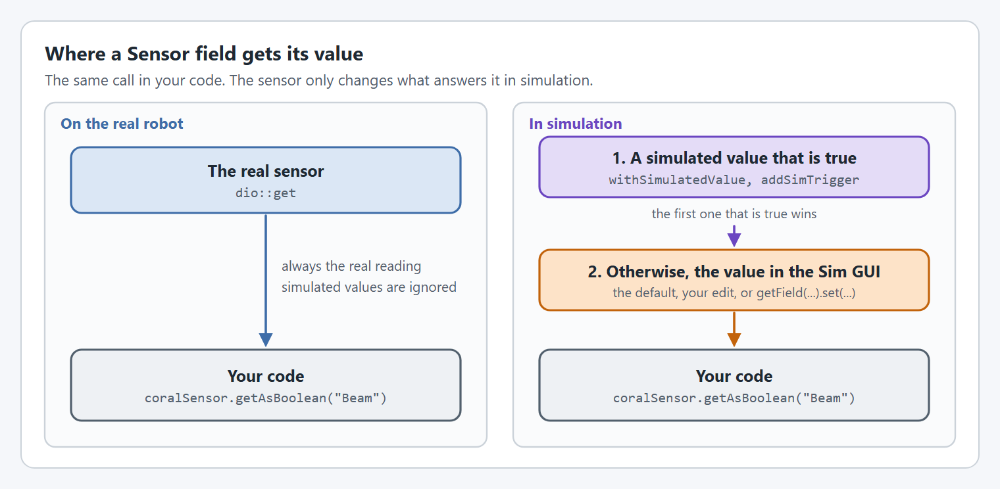
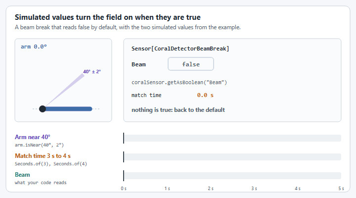

# Sensors

## What is a `Sensor`?

A `Sensor` is a wrapper around what would be a real sensor on your robot, like a `CanandColor`, beam break, `CANRange`, `LaserCAN`, or anything else! While some of these have really good simulation capabilities; others have no simulation capabilities.

Sensors essentially report back primitive values. Sometimes we know the sensor should trip at a certain time during the match, like autonomous, or under certain conditions like game piece trade offs or intaking for a second or more. Sometimes we want to trigger the sensor ourselves too!

<figure><figcaption><p>Your code makes the same call on the real robot and in simulation.</p></figcaption></figure>

## How do I create a `Sensor`?


Using a `Sensor` wrapper will NEVER be as fast or efficient as using the original input.


You can create a sensor using `SensorConfig` which is where you define the Sensor name, and fields.

```java
import org.wpilib.hardware.discrete.DigitalInput;
import yams.core.mechanisms.config.SensorConfig;
import yams.core.motorcontrollers.simulation.Sensor;

private DigitalInput dio = new DigitalInput(0); // Standard DIO
private final Sensor coralSensor = new SensorConfig("CoralDetectorBeamBreak") // Name of the sensor 
  .withField("Beam", dio::get, false) // Add a Field to the sensor named "Beam" whose value is dio.get() and defaults to false
  .withSimulatedValue("Beam", Seconds.of(3), Seconds.of(4), true) // Change the "Beam" field to true between 3s and 4s into a match
  .withSimulatedValue("Beam",()->arm.isNear(Degrees.of(40), Degrees.of(2)), true) // Change "Beam" field to true when the arm is near 40deg +- 2deg
  .getSensor(); // Get the sensor.
```

You can use `int`, `long`, `double`, or `bool` as sensor field values.

## How do I add simulated values to a sensor?

You can add simulated values to an existing `Sensor` using `Sensor.addSimTrigger(field, value, trigger)` like below. The value is a `HALValue` (`org.wpilib.hardware.hal.HALValue`), for example `HALValue.makeBoolean(true)`.

<pre class="language-java"><code class="lang-java">private DigitalInput dio = new DigitalInput(0); // Standard DIO
private final Sensor coralSensor = new SensorConfig("CoralDetectorBeamBreak") // Name of the sensor 
  .withField("Beam", dio::get, false) // Add a Field to the sensor named "Beam" whose value is dio.get() and defaults to false
  .withSimulatedValue("Beam", Seconds.of(3), Seconds.of(4), true) // Change the "Beam" field to true between 3s and 4s into a match
  .getSensor(); // Get the sensor.

...
<strong>coralSensor.addSimTrigger("Beam", HALValue.makeBoolean(true), ()->arm.isNear(Degrees.of(40), Degrees.of(2))); // Change "Beam" field to true when the arm is near 40deg +- 2deg
</strong></code></pre>

<figure><figcaption><p>The field reads true while either simulated value is true, and goes back to what it was when neither is.</p></figcaption></figure>

## What does this look like?

<figure><figcaption></figcaption></figure>

The circled value changes when the Arm is near 40deg +-2 deg. You can also change it in the Simulation GUI manually.

## How do I use the value from a `Sensor`?


The sensor field value will only automatically update if the sensor is checked!


Instead of doing `dio.get()` in the example, you would have to do `coralSensor.getAsBoolean("Beam")` like the example below.&#x20;

<pre class="language-java"><code class="lang-java">public boolean getBeamBreak()
{
  // return dio.get() // Will not work because the value is not modified by Sensor or automatically updated.
<strong>  return coralSensor.getAsBoolean("Beam");
</strong>}
</code></pre>

## How do I simulate the sensor value?

You can set the sensor value manually by getting the field (`.getField`) from a sensor and calling the `.set` function. It will overwrite the previous value of the sensor field until its changed from glass or via `.set` again.


This will only change the sensor value when running under simulations. It does not affect the real value when running on the robot.




```java
public void setBeamBreakWhenArmIsLow()
{
    arm.lte(Degrees.of(10)).onTrue(Commands.runOnce(()->coralSensor.getField("Beam").set(true)));
}
```



```java
public void setBeamBreakWhenArmIsLow()
{
    arm.lte(Degrees.of(10)).onTrue(Command.noRequirements(coroutine -> coralSensor.getField("Beam").set(true))
                                          .named("Set Beam Break"));
}
```



## How do I simulate a sensor the mechanism triggers?

Some sensors are triggered by the mechanism itself, like a limit switch at a hard stop, or a beam break the arm passes through. Simulate those from where the simulated mechanism really is, rather than from what its encoder says. The motor's sim supplier (`SmartMotorController.getSimSupplier()`) has the simulated mechanism's position. It is empty on a real robot, so the condition is `false` there.

```java
private final DigitalInput lowerSwitchInput = new DigitalInput(4);
private final Sensor lowerSwitch = new SensorConfig("ArmLowerSwitch")
  .withField("Pressed", lowerSwitchInput::get, false)
  // Pressed while the simulated arm is within 0.05° of its lower hard stop at -30°.
  .withSimulatedValue("Pressed", () -> motor.getSimSupplier()
      .map(sim -> sim.getMechanismPosition().lte(Degrees.of(-29.95)))
      .orElse(false), true)
  .getSensor();
```

For an elevator, convert the simulated position to a height with the motor controller's config: `smcConfig.convertFromMechanism(sim.getMechanismPosition())`.

A real limit switch is pressed by the mechanism, not by its encoder. If the encoder is off, say after a belt skips, a switch simulated from the encoder (`arm.isNear(...)`) is pressed in the wrong place. One simulated from the sim supplier is pressed at the hard stop, as the real one is.


Declare the `Sensor` after `motor` (and the mechanism, if its lambda uses it). Java does not let a field's initializer use a field declared after it, even inside a lambda.


## How do I home a mechanism with a limit switch `Sensor`?

Set the motor's encoder to the hard stop each time the switch is pressed. A `Trigger` runs its command once each time the switch goes from released to pressed, and the scheduler reads the `Sensor` every loop, as its simulated values need.



```java
public boolean isLowerSwitchPressed()
{
  return lowerSwitch.getAsBoolean("Pressed");
}

public ArmSubsystem()
{
  new Trigger(this::isLowerSwitchPressed)
      .onTrue(Commands.runOnce(() -> motor.setEncoderPosition(Degrees.of(-30))).withName("Arm Home LowerSwitch"));
}
```



```java
public boolean isLowerSwitchPressed()
{
  return lowerSwitch.getAsBoolean("Pressed");
}

public ArmMechanism()
{
  new Trigger(this::isLowerSwitchPressed)
      .onTrue(Command.noRequirements(coroutine -> motor.setEncoderPosition(Degrees.of(-30)))
                     .named("Arm Home LowerSwitch"));
}
```




A SystemCore Smart IO port has a pull-down resistor, unlike a roboRIO's pull-up. A normally open switch wired between the signal and power pins reads `true` while it is pressed, so its field is `input::get`, not `!input.get()`.


[YAMG](https://yamg.yassrobotics.com) generates all of this when you turn on **Homing**. For the wiring and the common pitfalls, see [How do I home a mechanism with limit switches?](../how-to/how-do-i-home-a-mechanism-with-limit-switches.md)
