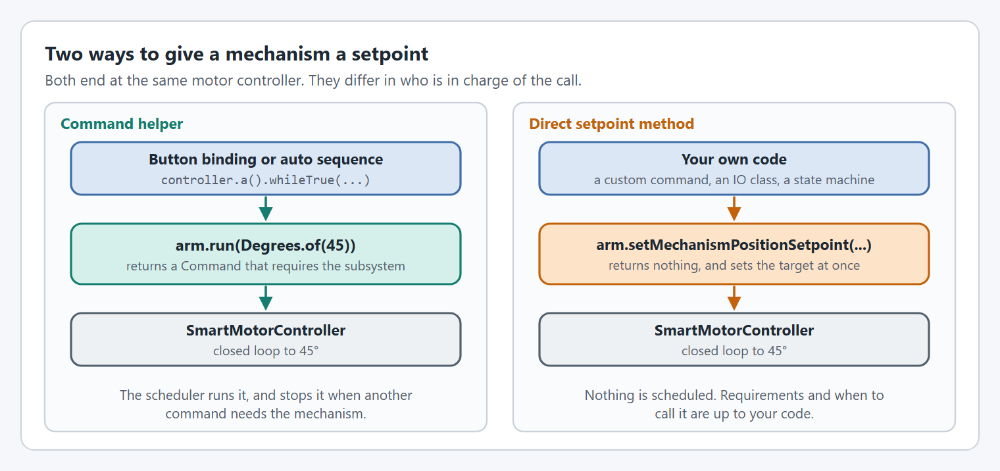
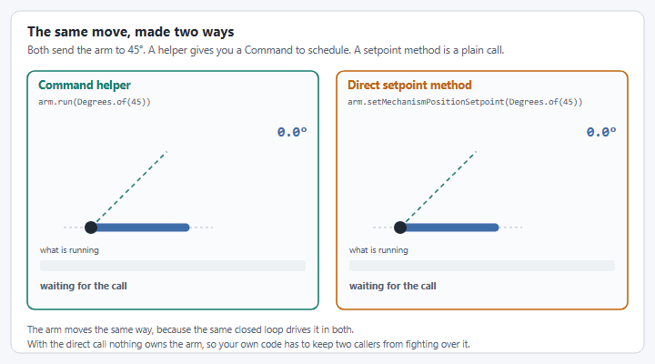
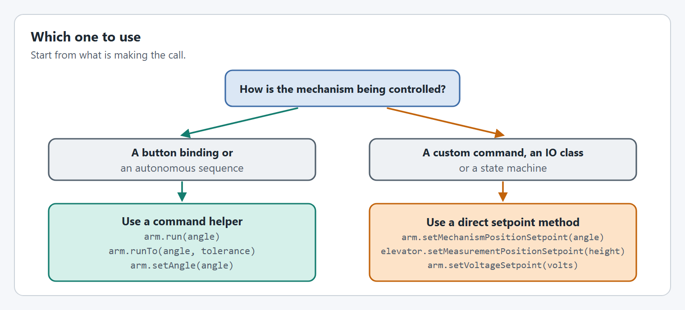

# Setpoint Methods vs Command Helpers

YAMS Mechanism classes provide two ways to control mechanisms: **direct setpoint methods** inherited from `SmartMechanism`, and **command helper methods** that return `Command` objects. Understanding when to use each is key to writing clean, effective robot code.

The command helpers come from the mechanism classes in `yams.commands2.mechanisms` (Commands v2) or `yams.commands3.mechanisms` (Commands v3). Both have the same method names and arguments; only the returned `Command` and `Trigger` types differ (`org.wpilib.command2.Command` and `org.wpilib.command2.button.Trigger`, or `org.wpilib.command3.Command` and `org.wpilib.command3.Trigger`). The direct setpoint methods come from `yams.core.mechanisms.SmartMechanism` and are the same in both.

## Overview

| Approach | Example | Returns | Use Case |
|----------|---------|---------|----------|
| **Command Helpers** | `arm.run(Degrees.of(45))` | `Command` | Button bindings, autonomous sequences |
| **Direct Setpoint Methods** | `arm.setMechanismPositionSetpoint(Degrees.of(45))` | `void` | Custom commands, AdvantageKit IO, low-level control |

With the direct setpoint methods you also [start or stop the closed loop controller](#starting-and-stopping-the-systemcore-closed-loop) yourself. The command helpers do it for you.

<figure><figcaption><p>Both paths end at the same motor controller.</p></figcaption></figure>

<figure><figcaption><p>A helper gives you a <code>Command</code> that stays scheduled. A setpoint method is one call.</p></figcaption></figure>

## Command Helper Methods

Command helpers are methods on Mechanism classes that return `Command` objects. These are the **recommended approach** for most use cases.

### Why Use Command Helpers?

1. **Subsystem Requirements** - Commands automatically require their subsystem (or Commands v3 mechanism), preventing conflicts
2. **Lifecycle Management** - Commands handle starting/stopping the closed loop controller
3. **Composability** - Easy to chain with `.andThen()`, `.alongWith()`, etc. in Commands v2, or to `await` inside a coroutine in Commands v3
4. **Trigger Integration** - Work directly with button triggers like `controller.a().onTrue()`
5. **Naming** - Commands are automatically named for debugging

<figure><figcaption><p>When each kind of command ends.</p></figcaption></figure>

### Available Command Helpers by Mechanism

#### Arm / Pivot

```java
// Run continuously to an angle (use for teleop)
arm.run(Degrees.of(45))
arm.run(() -> Degrees.of(joystick.getY() * 90))  // Supplier version
arm.setAngle(Degrees.of(45))         // Alias for run()

// Run to angle and end when reached (use in autonomous sequences)
arm.runTo(Degrees.of(45), Degrees.of(1))  // with tolerance

// Open loop control
arm.set(0.5)                         // Duty cycle [-1, 1]
arm.set(() -> joystick.getY())       // Duty cycle supplier
arm.setVoltage(Volts.of(6))          // Voltage
arm.setVoltage(() -> Volts.of(6))    // Voltage supplier
```

#### Elevator

```java
// Run continuously to a height (use for teleop)
elevator.run(Meters.of(1.0))
elevator.run(() -> Meters.of(joystick.getY()))
elevator.setHeight(Meters.of(1.0))   // Alias for run()

// Run to height and end when reached (use in autonomous sequences)
elevator.runTo(Meters.of(1.0), Centimeters.of(2))  // with tolerance

// Open loop control
elevator.set(0.5)
elevator.setVoltage(Volts.of(6))
```

#### FlyWheel

```java
// Run continuously at a velocity (use for teleop)
flywheel.run(RPM.of(5000))
flywheel.run(() -> RPM.of(targetRPM))

// Run to velocity and end when reached (use for spin-up sequences)
flywheel.runTo(RPM.of(5000), RPM.of(100))  // with tolerance

// Linear velocity (requires circumference configured)
flywheel.run(MetersPerSecond.of(20))
flywheel.runTo(MetersPerSecond.of(20), MetersPerSecond.of(0.5))

// Open loop control
flywheel.set(0.8)
flywheel.setVoltage(Volts.of(10))
```

### Example: Button Bindings



```java
// Teleop controls - use run() for continuous control
controller.a().whileTrue(arm.run(Degrees.of(45)));
controller.b().whileTrue(arm.run(Degrees.of(-30)));
controller.x().whileTrue(elevator.run(Meters.of(1.0)));
controller.y().whileTrue(flywheel.run(RPM.of(5000)));

// Autonomous-style - use runTo() when you need to wait for completion
controller.leftBumper().onTrue(
    arm.runTo(Degrees.of(90), Degrees.of(2))
        .andThen(shooter.runTo(RPM.of(5000), RPM.of(50)))
        .andThen(intake.feedNote())
);
```



```java
// Teleop controls - use run() for continuous control
controller.a().whileTrue(arm.run(Degrees.of(45)));
controller.b().whileTrue(arm.run(Degrees.of(-30)));
controller.x().whileTrue(elevator.run(Meters.of(1.0)));
controller.y().whileTrue(flywheel.run(RPM.of(5000)));

// Autonomous-style - await each runTo() inside a coroutine instead of chaining
controller.leftBumper().onTrue(Command.noRequirements(coroutine -> {
  coroutine.await(arm.runTo(Degrees.of(90), Degrees.of(2)));
  coroutine.await(shooter.runTo(RPM.of(5000), RPM.of(50)));
  coroutine.await(intake.feedNote());
}).named("Aim And Shoot"));
```



## Direct Setpoint Methods

Direct setpoint methods are inherited from `SmartMechanism` and set the motor controller's target immediately without returning a Command.


**Start or stop the closed loop controller yourself.** The direct setpoint methods do not do it for you.

* Before a position or velocity setpoint, call `arm.getMotorController().startClosedLoopController()`.
* Before a voltage or duty cycle setpoint, call `arm.getMotorController().stopClosedLoopController()`.

Get it wrong and the mechanism either ignores the setpoint or fights your output. See [Starting and stopping the SystemCore closed loop](#starting-and-stopping-the-systemcore-closed-loop).


### SmartMechanism Setpoint Methods

All Mechanism classes inherit these methods from `SmartMechanism`:

```java
// Position setpoints
void setMechanismPositionSetpoint(Angle angle)      // Rotational position (Arm, Pivot)
void setMeasurementPositionSetpoint(Distance dist)  // Linear position (Elevator)

// Velocity setpoints
void setMechanismVelocitySetpoint(AngularVelocity vel)  // Rotational velocity
void setMeasurementVelocitySetpoint(LinearVelocity vel) // Linear velocity (Elevator, FlyWheel)

// Open loop setpoints
void setVoltageSetpoint(Voltage volts)              // Voltage control
void setDutyCycleSetpoint(double dutyCycle)         // Duty cycle [-1, 1]
```

### When to Use Direct Setpoint Methods

1. **AdvantageKit IO Classes** - When implementing IO interfaces that don't use Commands
2. **Custom Command Logic** - When building complex commands with custom execute() methods
3. **State Machine Control** - When a state machine directly controls mechanism state
4. **Performance Critical** - Avoiding Command overhead in tight loops (rare)

### Example: AdvantageKit IO

```java
public class ArmIOYAMS implements ArmIO {
  private final Arm arm;

  @Override
  public void setTargetAngle(double rotations) {
    // Use direct setpoint method - no Command needed
    arm.setMechanismPositionSetpoint(Rotations.of(rotations));
  }
}
```

### Example: Custom Command



```java
public class ComplexArmCommand extends Command {
  private final Arm arm;
  private final Supplier<Angle> targetSupplier;

  @Override
  public void execute() {
    Angle target = targetSupplier.get();
    // Apply custom logic before setting
    if (arm.getAngle().lt(Degrees.of(0))) {
      target = target.plus(Degrees.of(5)); // Offset when below horizontal
    }
    arm.setMechanismPositionSetpoint(target);
  }
}
```



Commands v3 has no command classes with `execute()`. Write the same logic as a `while (true)` coroutine on your mechanism:

```java
public Command complexArmCommand(Supplier<Angle> targetSupplier) {
  return run(coroutine -> {
    while (true) {
      Angle target = targetSupplier.get();
      // Apply custom logic before setting
      if (arm.getAngle().lt(Degrees.of(0))) {
        target = target.plus(Degrees.of(5)); // Offset when below horizontal
      }
      arm.setMechanismPositionSetpoint(target);
      coroutine.yield();
    }
  }).named("Complex Arm Command");
}
```



### Example: State machine (Commands v3)

WPILib's Commands v3 has a state machine built in: `org.wpilib.command3.StateMachine`. Each state runs one command, and transitions say when to move from one state to another. The state machine cancels the current state's command and starts the next one for you.

The direct setpoint methods fit inside the command for each state:

```java
public class ArmMechanism implements Mechanism {
  private static final Angle STOW_ANGLE = Degrees.of(0);
  private static final Angle INTAKE_ANGLE = Degrees.of(-20);
  private static final Angle SCORE_ANGLE = Degrees.of(80);
  private static final Angle TOLERANCE = Degrees.of(2);

  private final Arm arm;
  private final BooleanSupplier hasGamePiece;

  public ArmMechanism(BooleanSupplier hasGamePiece) {
    this.hasGamePiece = hasGamePiece;
    // createArm() stands for the usual setup: the SmartMotorControllerConfig, the SmartMotorController and the Arm.
    arm = createArm();
  }

  /**
   * The command for one state: it sends the angle with a direct setpoint method every loop, until
   * the state machine cancels it to move on.
   */
  private Command holdAt(String name, Angle angle) {
    return run(coroutine -> {
      // Position control needs the closed loop running: start it once, before the loop.
      arm.getMotorController().startClosedLoopController();
      while (true) {
        arm.setMechanismPositionSetpoint(angle);
        coroutine.yield();
      }
    }).named(name);
  }

  /**
   * Build the arm's state machine.
   *
   * @param intakeRequested True when the driver asks to intake.
   * @param scoreRequested True when the driver asks to score.
   * @return The state machine, which is itself a Command.
   */
  public Command stateMachine(BooleanSupplier intakeRequested, BooleanSupplier scoreRequested) {
    // Declare the state machine
    StateMachine machine = new StateMachine("Arm State Machine");

    // Declare states: each one runs a single command
    State stowed = machine.addState(holdAt("Arm Stowed", STOW_ANGLE));
    State intaking = machine.addState(holdAt("Arm Intaking", INTAKE_ANGLE));
    State scoring = machine.addState(holdAt("Arm Scoring", SCORE_ANGLE));

    // Set the initial state
    machine.setInitialState(stowed);

    // Declare transitions
    stowed.switchTo(intaking).when(intakeRequested);
    stowed.switchTo(scoring).when(() -> scoreRequested.getAsBoolean() && hasGamePiece.getAsBoolean());
    // Once a game piece is in, stow by itself
    intaking.switchTo(stowed).when(hasGamePiece);
    // Once the arm is up and the game piece has left, stow by itself
    scoring.switchTo(stowed).when(() -> arm.isNear(SCORE_ANGLE, TOLERANCE) && !hasGamePiece.getAsBoolean());

    return machine;
  }

  public void periodic() {
    arm.updateTelemetry();
  }

  public void simulationPeriodic() {
    arm.simIterate();
  }
}
```

A `StateMachine` is itself a `Command`, so schedule it like any other:

```java
// The buttons are the conditions for the transitions. A Trigger is a BooleanSupplier.
Scheduler.getDefault().schedule(arm.stateMachine(controller.a(), controller.b()));
```

How it fits together:

* **`addState(command)`** makes a state from a command. Here each state's command sends its angle with `setMechanismPositionSetpoint(...)` inside a `while (true)` loop that ends each pass with `coroutine.yield()`.
* **`setInitialState(state)`** is required before the state machine runs.
* **`from.switchTo(to).when(condition)`** moves between states when the condition turns true. Two of the transitions here come from buttons and two happen by themselves.
* **Each state's command requires the arm, and the state machine itself requires nothing.** Another command that takes the arm cancels the running state, and the state machine then exits.
* **A state whose command ends with no transition ends the state machine.** These commands never end on their own, so this one keeps running until it is canceled.

### Starting and stopping the SystemCore closed loop

<figure><figcaption><p>Start the closed loop for position and velocity setpoints. Stop it for voltage and duty cycle setpoints.</p></figcaption></figure>

Some closed loops run on the motor controller and some run on the SystemCore. [Where the loop runs](editor/config/closed-loop-control.md#where-the-loop-runs) lists which is which. A loop on the SystemCore is a piece of YAMS code that runs every control period and writes an output to the motor, and it keeps doing that until it is stopped. So with the direct setpoint methods, **you** have to start and stop it to match the kind of control you want:

| You want | The SystemCore closed loop must be | Why |
| --- | --- | --- |
| Position or velocity control (`setMechanismPositionSetpoint`, `setMechanismVelocitySetpoint` and the measurement versions) | Running | A stopped loop does nothing with the setpoint, so the mechanism does not move to it |
| Voltage or duty cycle control (`setVoltageSetpoint`, `setDutyCycleSetpoint`) | Stopped | A running loop writes its own output on its next run and overrides yours |

<pre class="language-java"><code class="lang-java"><strong>arm.getMotorController().startClosedLoopController(); // before position or velocity control
</strong><strong>arm.getMotorController().stopClosedLoopController();  // before voltage or duty cycle control
</strong></code></pre>


The [command helpers](#command-helper-methods) already do this. `set(...)` and `setVoltage(...)` stop the closed loop while they run and start it again when they end. You only need to do it yourself when you use the direct setpoint methods.


The pattern is always the same: put the loop in the state your command needs when the command starts, and put it back when the command ends, however it ends.



Use `startRun` to set the loop up once and then run every loop, and `finallyDo` to put it back whether the command finishes or is interrupted.

```java
/** Drive the arm by voltage, for example from a joystick. */
public Command manual(Supplier<Voltage> volts) {
  return startRun(
          () -> arm.getMotorController().stopClosedLoopController(),   // once, at the start
          () -> arm.setVoltageSetpoint(volts.get()))                    // every loop
      .finallyDo(() -> arm.getMotorController().startClosedLoopController()) // at the end, always
      .withName("Arm Manual");
}

/** Hold an angle that can change while the command runs. */
public Command track(Supplier<Angle> angle) {
  return startRun(
          () -> arm.getMotorController().startClosedLoopController(),  // once, at the start
          () -> arm.setMechanismPositionSetpoint(angle.get()))          // every loop
      .withName("Arm Track");
}
```



Set the loop up before the `while (true)` loop, and use `whenCanceled` to put it back.

```java
/** Drive the arm by voltage, for example from a joystick. */
public Command manual(Supplier<Voltage> volts) {
  return run(coroutine -> {
    arm.getMotorController().stopClosedLoopController();                // once, at the start
    while (true) {
      arm.setVoltageSetpoint(volts.get());                              // every loop
      coroutine.yield();
    }
  }).whenCanceled(() -> arm.getMotorController().startClosedLoopController()) // at the end
    .named("Arm Manual");
}

/** Hold an angle that can change while the command runs. */
public Command track(Supplier<Angle> angle) {
  return run(coroutine -> {
    arm.getMotorController().startClosedLoopController();               // once, at the start
    while (true) {
      arm.setMechanismPositionSetpoint(angle.get());                    // every loop
      coroutine.yield();
    }
  }).named("Arm Track");
}
```




**Starting the loop resets it.** `startClosedLoopController()` resets the PID controller and starts the motion profile again from where the mechanism is now. Call it once when a command starts, as above, and not every loop, or the profile never gets going.



**The same code is safe on every motor controller.** When the closed loop runs on the motor controller itself, there is no SystemCore loop, and both calls do nothing. So you can write commands this way without knowing where the loop runs, and they keep working if you change motor controller or profile later.


## Setpoint Method Support Matrix

Every Mechanism class inherits all of these methods, but not all of them make sense for every mechanism. "No" below means the method does not apply to that mechanism.

### Position Setpoint Methods

| Method | Arm | Pivot | Elevator | FlyWheel |
|--------|-----|-------|----------|----------|
| `setMechanismPositionSetpoint(Angle)` | Yes | Yes | Yes | No |
| `setMeasurementPositionSetpoint(Distance)` | No | No | Yes | No |

### Velocity Setpoint Methods

| Method | Arm | Pivot | Elevator | FlyWheel |
|--------|-----|-------|----------|----------|
| `setMechanismVelocitySetpoint(AngularVelocity)` | Yes | Yes | Yes | Yes |
| `setMeasurementVelocitySetpoint(LinearVelocity)` | No | No | Yes | Yes* |

*FlyWheel requires circumference to be configured for linear velocity.

### Open Loop Setpoint Methods

| Method | Arm | Pivot | Elevator | FlyWheel |
|--------|-----|-------|----------|----------|
| `setVoltageSetpoint(Voltage)` | Yes | Yes | Yes | Yes |
| `setDutyCycleSetpoint(double)` | Yes | Yes | Yes | Yes |


**Linear Methods**: The `Distance` and `LinearVelocity` methods convert through the mechanism circumference in the `SmartMotorControllerConfig`. Calling one without a circumference configured (like `setMeasurementPositionSetpoint(Distance)` on an `Arm`) throws a `SmartMotorControllerConfigurationException`, and `FlyWheel.setMeasurementVelocitySetpoint(LinearVelocity)` throws a `FlyWheelConfigurationException` if the FlyWheel diameter is not set. Check the matrix above before using direct setpoint methods.


## Checking Position with near() and isNear()

To check if a mechanism is near a target, use `near()`, which returns a `Trigger`:

```java
// Arm / Pivot - uses Angle.isNear() internally
Trigger nearTarget = arm.near(Degrees.of(45), Degrees.of(2));

// Elevator - uses Distance.isNear() internally  
Trigger nearHeight = elevator.near(Meters.of(1.0), Centimeters.of(2));

// FlyWheel - uses AngularVelocity.isNear() internally
Trigger atSpeed = flywheel.near(RPM.of(5000), RPM.of(100));
```

These methods use WPILib's built-in `isNear()` function on the `Angle`, `Distance`, and `AngularVelocity` measure classes for accurate tolerance checking.


The `Trigger` factory used to be called `isNear()` and was renamed to `near()` to match the other Trigger factories (`gte()`, `lte()`, `between()`, `max()`, `min()`). `isNear()` with the same arguments still exists and returns a plain `boolean`, for use outside a `Command` or `Trigger`.


<figure><figcaption><p>The same questions as Triggers or as booleans.</p></figcaption></figure>

### Using near() in Commands



```java
// Wait until arm is near target
Commands.waitUntil(arm.near(Degrees.of(45), Degrees.of(1)))

// Conditional logic based on position
arm.near(Degrees.of(90), Degrees.of(5)).onTrue(ledSubsystem.setGreen());

// In a command's isFinished(), use the boolean isNear()
@Override
public boolean isFinished() {
    return arm.isNear(targetAngle, tolerance);
}
```



```java
// Wait until arm is near target, inside a coroutine
coroutine.waitUntil(arm.near(Degrees.of(45), Degrees.of(1)));

// Conditional logic based on position
arm.near(Degrees.of(90), Degrees.of(5)).onTrue(leds.setGreen());

// Plain boolean check, e.g. in an if statement inside a coroutine
if (arm.isNear(targetAngle, tolerance)) {
  // ...
}
```



## Decision Guide

<figure><figcaption><p>Start from what is making the call.</p></figcaption></figure>

## Best Practices

1. **Prefer Command Helpers** - They handle subsystem requirements and closed loop lifecycle
2. **Use run() for Teleop** - Continuous control that responds to interruption
3. **Use runTo() for Sequences** - When you need to wait for the mechanism to reach a target
4. **Use Direct Methods for IO** - When implementing AdvantageKit IO or custom commands
5. **Always Check Support** - Verify the method is supported before using direct setpoint methods
6. **Use Triggers for State** - Use `near()`, `max()`, `min()` triggers instead of polling

## See Also

- [run() vs runTo() Commands](run-vs-runto.md) - Important differences between continuous and goal-based commands
- [AdvantageKit Integration](advantagekit-integration.md) - Using YAMS with AdvantageKit's IO pattern
- [Live Tuning](live-tuning/README.md) - Units for all tunable parameters
