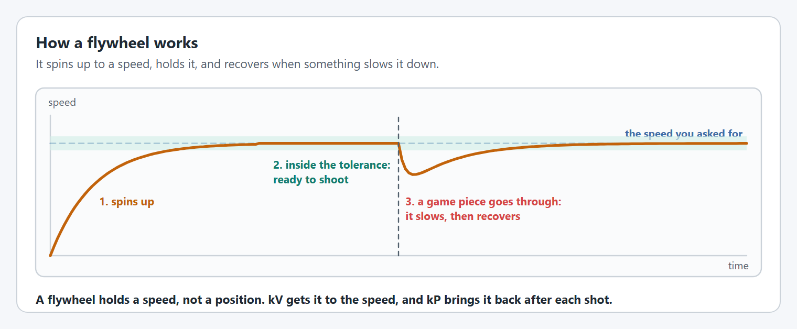
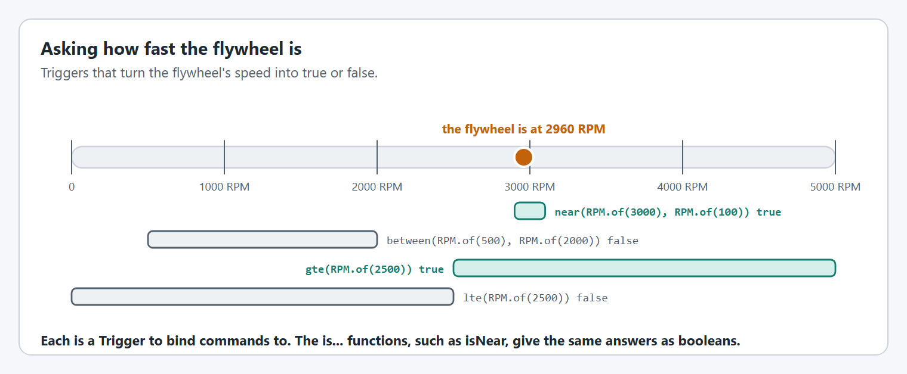

# Shooters

A shooter is a `FlyWheel` in YAMS, and so is anything else that spins: rollers, intakes, feeders and indexers.

## How a flywheel works

<figure><figcaption><p>A flywheel holds a speed.</p></figcaption></figure>

Where an arm or an elevator goes to a position, a flywheel goes to a speed. Most of the voltage comes from the `kV` term of [`SimpleMotorFeedforward`](editor/config/feedforward.md#withfeedforward), which is the voltage that speed needs, and a small `kP` corrects what is left and brings the wheel back after a game piece slows it.

A roller that only ever needs a voltage is still a `FlyWheel`: put its motor in [`ControlMode.OPEN_LOOP`](editor/config/motor-basics.md#withcontrolmode) and drive it with `set` or `setVoltage`.

<figure><figcaption><p>The same chain runs every mechanism.</p></figcaption></figure>

A YAMS `FlyWheel` is a thin layer over one [`SmartMotorController`](editor/). The `FlyWheel` knows what the mechanism is, turns your commands into setpoints, and runs its simulation. The motor controller does the closed loop control. Keep one mechanism per subsystem, so live tuning and command requirements stay simple.

## Creating a flywheel

The code is the same for Commands v2 and Commands v3 except for the package you import from and the class that owns the mechanism.



```java
import yams.commands2.config.SmartMotorControllerConfig;
import yams.commands2.mechanisms.FlyWheel;

public class FlyWheelSubsystem extends SubsystemBase
{
  private final SmartMotorControllerConfig motorConfig = new SmartMotorControllerConfig(this)
      .withControlMode(ControlMode.CLOSED_LOOP)
      .withGearing(new MechanismGearing(1))
      .withClosedLoopController(0.1, 0, 0)
      .withFeedforward(new SimpleMotorFeedforward(0.1, 0.12, 0.01))
      .withMomentOfInertia(Inches.of(4), Pounds.of(1))
      .withStatorCurrentLimit(Amps.of(40))
      .withZeroPower(MotorMode.COAST)
      .withTelemetry("ShooterMotor", TelemetryVerbosity.HIGH);
  private final SmartMotorController motor = new SparkWrapper(spark, DCMotor.getNEO(1), motorConfig);
  private final FlyWheelConfig config = new FlyWheelConfig()
      .withDiameter(Inches.of(4))
      .withTelemetry("Shooter", TelemetryVerbosity.HIGH);
  private final FlyWheel flywheel = new FlyWheel(config, motor);

  @Override
  public void periodic()
  {
    flywheel.updateTelemetry(); // every loop
  }

  @Override
  public void simulationPeriodic()
  {
    flywheel.simIterate(); // every loop, in simulation
  }
}
```

`this` is the `Subsystem`. The scheduler calls `periodic()` and `simulationPeriodic()` for you.



```java
import yams.commands3.config.SmartMotorControllerConfig;
import yams.commands3.mechanisms.FlyWheel;

public class FlyWheelMechanism implements Mechanism
{
  private final SmartMotorControllerConfig motorConfig = new SmartMotorControllerConfig(this)
      .withControlMode(ControlMode.CLOSED_LOOP)
      .withGearing(new MechanismGearing(1))
      .withClosedLoopController(0.1, 0, 0)
      .withFeedforward(new SimpleMotorFeedforward(0.1, 0.12, 0.01))
      .withMomentOfInertia(Inches.of(4), Pounds.of(1))
      .withStatorCurrentLimit(Amps.of(40))
      .withZeroPower(MotorMode.COAST)
      .withTelemetry("ShooterMotor", TelemetryVerbosity.HIGH);
  private final SmartMotorController motor = new SparkWrapper(spark, DCMotor.getNEO(1), motorConfig);
  private final FlyWheelConfig config = new FlyWheelConfig()
      .withDiameter(Inches.of(4))
      .withTelemetry("Shooter", TelemetryVerbosity.HIGH);
  private final FlyWheel flywheel = new FlyWheel(config, motor);

  public void periodic()
  {
    flywheel.updateTelemetry(); // every loop
  }

  public void simulationPeriodic()
  {
    flywheel.simIterate(); // every loop, in simulation
  }
}
```

`this` is the Commands v3 `Mechanism`. A `Mechanism` has no periodic hook, so call `periodic()` yourself from `Robot.robotPeriodic()`, and run `simulationPeriodic()` in its own `Notifier`, started from `Robot.simulationInit()`. [Where the tutorials put things](../tutorials/project-setup.md#where-the-tutorials-put-things) shows both.



The options in `motorConfig` are explained in [SmartMotorControllerConfig](editor/config/), and the options in `config` in [FlyWheelConfig](mechanism-configs/flywheel-config.md).

## Commands

Every command below exists with the same name in Commands v2 and Commands v3.

<figure><figcaption><p>When each kind of command ends.</p></figcaption></figure>

| Command                                             | What it does                                                                                                                | Ends                                    |
| --------------------------------------------------- | --------------------------------------------------------------------------------------------------------------------------- | --------------------------------------- |
| `run(AngularVelocity)`                              | Spin at this speed and hold it.                                                                                             | Never, until interrupted.               |
| `run(LinearVelocity)`                               | Spin so the wheel's surface moves at this speed. Needs [`withDiameter`](mechanism-configs/flywheel-config.md#withdiameter). | Never, until interrupted.               |
| `runTo(AngularVelocity, AngularVelocity tolerance)` | Spin up to this speed.                                                                                                      | When the wheel is within the tolerance. |
| `runTo(LinearVelocity, LinearVelocity tolerance)`   | The same, as a surface speed.                                                                                               | When the wheel is within the tolerance. |
| `set(double)`                                       | Output a duty cycle, with the closed loop off.                                                                              | Never, until interrupted.               |
| `setVoltage(Voltage)`                               | Output a voltage, with the closed loop off.                                                                                 | Never, until interrupted.               |

`run` and `runTo` also take suppliers, for a speed that changes while the command runs, such as one that depends on the distance to the target. A flywheel has no `setAngle` or `setHeight`: `run` is the command that holds.



```java
// In the subsystem
public Command hold(AngularVelocity speed)
{
  return flywheel.run(speed); // never ends: a good default command
}

public Command moveTo(AngularVelocity speed)
{
  return flywheel.runTo(speed, RPM.of(50)); // ends when it gets there
}

// In RobotContainer
shooter.setDefaultCommand(shooter.hold(RPM.of(0)));
Command score = shooter.moveTo(RPM.of(3000)).andThen(intake.eject());
```



```java
// In the mechanism
public Command hold(AngularVelocity speed)
{
  return run(coroutine -> coroutine.await(flywheel.run(speed)))
      .withPriority(Command.LOWEST_PRIORITY) // so any other command can take over
      .named("FlyWheel Hold");
}

public Command moveTo(AngularVelocity speed)
{
  return flywheel.runTo(speed, RPM.of(50)); // ends when it gets there
}

// In Robot
shooter.setDefaultCommand(shooter.hold(RPM.of(0)));
Command score = Command.noRequirements(coroutine -> {
  coroutine.await(shooter.moveTo(RPM.of(3000)));
  coroutine.await(intake.eject());
}).named("Score");
```



When a command ends the motor keeps its last request, so a mechanism that reached its goal stays there until another command, usually the default one, gives it something else. [run() vs runTo() Commands](run-vs-runto.md) covers the pitfalls, including a default command undoing a `runTo()`.

## Setpoint functions

The commands above are built on plain functions that set the setpoint and return at once. Use them when you write your own command, or when something other than a command decides the setpoint, such as an AdvantageKit IO layer.

| Function                                         | What it does                                                                                                        |
| ------------------------------------------------ | ------------------------------------------------------------------------------------------------------------------- |
| `setMechanismVelocitySetpoint(AngularVelocity)`  | Spin at this speed with closed loop control.                                                                        |
| `setMeasurementVelocitySetpoint(LinearVelocity)` | Spin so the surface moves at this speed. Needs [`withDiameter`](mechanism-configs/flywheel-config.md#withdiameter). |
| `setVoltageSetpoint(Voltage)`                    | Output this voltage. Stops the closed loop.                                                                         |
| `setDutyCycleSetpoint(double)`                   | Output this duty cycle, from -1 to 1. Stops the closed loop.                                                        |
| `getMechanismSetpointVelocity()`                 | The current speed setpoint, if there is one.                                                                        |

```java
flywheel.setMechanismVelocitySetpoint(RPM.of(3000));
```

These do not require the subsystem or mechanism, so nothing stops two callers fighting over the setpoint. Prefer the commands unless you need these. [Setpoint Methods vs Command Helpers](setpoint-methods.md) compares the two in detail.

## Asking where it is

<figure><figcaption><p>The same questions as Triggers or as booleans.</p></figcaption></figure>

| As a `Trigger`             | As a boolean                   | True when                                            |
| -------------------------- | ------------------------------ | ---------------------------------------------------- |
| `near(speed, within)`      | `isNear(speed, within)`        | The wheel is within `within` of `speed`.             |
| `between(start, end)`      | `isBetween(start, end)`        | The wheel's speed is between the two.                |
| `gte(speed)`, `lte(speed)` | `isGte(speed)`, `isLte(speed)` | The wheel is at or above, or at or below, the speed. |

`getSpeed()` returns the wheel's speed and `getLinearVelocity()` its surface speed. A flywheel has no `max()` or `min()`, because it has no end to its travel.

```java
shooter.near(RPM.of(3000), RPM.of(50)).whileTrue(feeder.feed()); // only feed at speed
```

## Shooting

A shot is two flywheels working together: the shooter spins up, and a feeder pushes the game piece in once the shooter is at speed. Use `near(...)` on the shooter to gate the feeder, as above. [How do I shoot with a shooter?](../how-to/how-to-shoot-with-a-shooter.md) walks through it, and [Double FlyWheel](../tutorials/double-flywheel.md) covers two wheels spinning at different speeds.

## When a flywheel will not reach its speed

A flywheel that reaches low speeds but not high ones, or that slows down more with every shot, is usually short of power and not badly tuned: see [when tuning does not help](live-tuning/#when-tuning-does-not-help).

## Configuring and tuning a flywheel, step by step

Do the configuration steps first, in simulation, then the tuning steps on the real mechanism with [live tuning](live-tuning/). Tuning something that is configured wrong wastes the time.


Like all tuning, this can be dangerous. Keep clear of the mechanism, start with low current limits and small moves, and practice in simulation first.


### Configure it



#### Set the gearing

Give the reduction from the motor to the wheel with [`withGearing`](editor/config/gearing-and-units.md#withgearing). An overdrive, where the wheel spins faster than the motor, is a number below 1.



#### Choose the positive direction

Positive should be the direction that shoots or intakes. Flip [`withMotorInverted`](editor/config/motor-basics.md#withmotorinverted) if it is not.



#### Let it coast

Use `MotorMode.COAST` so the wheel is not braked to a stop every time the command ends, and set a [stator current limit](editor/config/limits-and-protection.md#current-limits).



#### Set the diameter

Set [`withDiameter`](mechanism-configs/flywheel-config.md#withdiameter) if you want to ask for surface speeds.



#### Describe it to the simulator

Set [`withMomentOfInertia`](editor/config/simulation.md#withmomentofinertia) on the motor config.



### Tune it



#### Find kS

Set kP, kI and kD to 0. Raise `closedloop/feedforward/kS` until the wheel is just about to turn.



#### Find kV

Ask for a speed in the middle of your range. Raise `closedloop/feedforward/kV` until `mechanism/velocity` settles on the setpoint with no help from kP. Check it at a low and a high speed too.



#### Add a little kP

Raise kP until the wheel recovers quickly after a game piece goes through. Too much makes the speed ripple.



#### Choose the tolerance

Shoot at the edges of your `near(...)` tolerance and see whether the shots still land. Use the widest tolerance that does, so the shooter is ready sooner.



#### If it browns out the robot

If spinning up browns out the robot, work down this list and stop at the first thing that fixes it:

1. A [velocity profile](editor/config/motion-profiles.md#a-velocity-profile), if one suits the mechanism, so it asks for less at the start.
2. A [supply current limit](editor/config/limits-and-protection.md#current-limits), where the motor controller has one.
3. A [stator current limit](editor/config/limits-and-protection.md#current-limits), where it does not.
4. A [ramp rate](editor/config/limits-and-protection.md#ramp-rates), only if nothing else works.

Test each against the [battery simulation](../understanding/battery-simulation.md).



[Tuning order](live-tuning/#tuning-order) has the same steps with the NetworkTables keys to watch.

## FlyWheelConfig options

Every `FlyWheelConfig` option is on the [FlyWheelConfig](mechanism-configs/flywheel-config.md) page under this one, with a graphic and an example for each. Options shared by every mechanism are in [Shared options](mechanism-configs/shared-options.md).

A `FlyWheel` needs nothing on its config to be simulated. Its [moment of inertia](editor/config/simulation.md#withmomentofinertia) is on the motor config.

## Code reference




