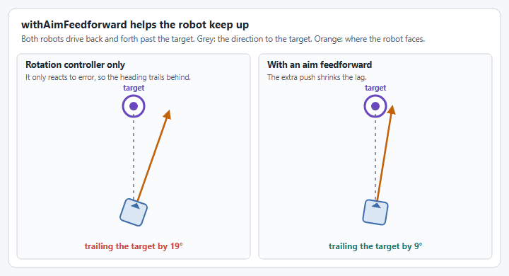
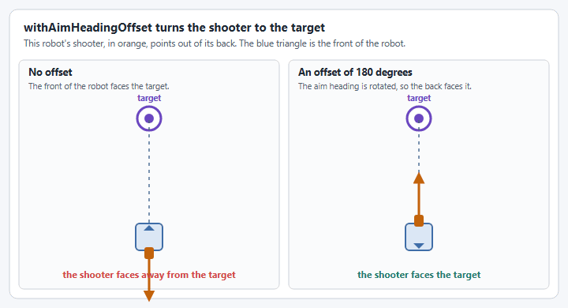

# Heading and aim modes

A [`SwerveInputStream`](swerve-input-stream.md) normally turns the robot at the rate the rotation stick asks for. This page covers the other ways it can turn the robot: facing a heading, aiming at a target, and holding the heading while it drives. Build the stream first, as [Building a stream](swerve-input-stream.md#building-a-stream) shows.

In the examples, `input` is your stream and `driverController` is the `CommandGamepad` from the [Swerve Drive tutorial](../tutorials/swerve-drive.md). Its buttons are `Trigger`s, which can be passed wherever a `BooleanSupplier` is expected. The methods are the same in Commands v2 and Commands v3, and C++ has each one in PascalCase.

## Modes are chosen automatically

A stream is always in exactly one of four internal modes: `ANGULAR_VELOCITY` (the default), `TRANSLATION_ONLY`, `HEADING`, or `AIM`. You never select a mode directly. `get()` re-derives it on every call from which optional pieces are configured and whether the relevant `BooleanSupplier` trigger currently reports true, then transitions cleanly (resetting the relevant PID controllers) if the mode changed since the last call. Mode priority, highest to lowest: `TRANSLATION_ONLY` > `AIM` > `HEADING` > `ANGULAR_VELOCITY`. `getCurrentModeName()` returns the mode the last `get()` used.

`HEADING`, `AIM` and `TRANSLATION_ONLY` turn the robot with the rotation controller from `SwerveDriveConfig.withRotationController(...)`, so configure one before using them.


`SwerveInputStream` used to have a `DRIVE_TO_POSE` mode and a matching `atTargetPose(...)` method; both have been removed. Use [`SwerveDrive.driveToPose(...)`](swerve-drive.md#auto-align) for auto-align instead.


## Heading-snap control

### `withHeadingControl`

`withHeadingControl(trigger)` enables `HEADING` while `trigger` reports true, snapping to a heading derived from [`withControllerHeadingAxis(x, y)`](swerve-input-stream.md#withcontrollerheadingaxis) instead of rotating at a velocity. The robot stops turning while the heading stick is inside the deadband.

<figure><figcaption><p><code>HEADING</code> mode: as the right stick moves around, the robot turns to face where it points.</p></figcaption></figure>

```java
SwerveInputStream headingStream = input.clone()
    .withControllerHeadingAxis(() -> -driverController.getRightX(), () -> -driverController.getRightY())
    .withHeadingControl(driverController.faceDown());
```

### `withHeading`

`withHeading(Supplier<Angle>)` faces a field-relative heading from code instead of a stick, and replaces any controller heading axes.

<figure><figcaption><p>A heading from code, enabled while A is held.</p></figcaption></figure>

```java
input.withHeading(() -> Degrees.of(90))
     .withHeadingControl(driverController.faceDown());
```

## Aim at a target

`withAim(Supplier<Pose2d> targetPose, BooleanSupplier trigger)` enables `AIM` while `trigger` reports true, rotating to face `targetPose` while translation keeps working normally. See [Mutations apply immediately](swerve-input-stream.md#mutations-apply-immediately) for an example that retargets it live.

<figure><figcaption><p><code>AIM</code> mode: the left stick drives, the robot keeps facing the target.</p></figcaption></figure>

```java
// The target on the field. Use your game's real position.
Pose2d speakerPose = new Pose2d(Meters.of(0.2), Meters.of(5.5), Rotation2d.ZERO);
input.withAim(() -> speakerPose, driverController.rightBumper());
```

`withAim` points the front of the robot at the pose it is given. The options below refine that. They are the same in Commands v2 and Commands v3, and C++ has each one in PascalCase.


Aiming at a target is not the same as shooting on the move. The stream turns the robot, and it knows nothing about your shooter or how long a shot is in the air. [How do I shoot on the move?](../how-to/how-do-i-shoot-on-the-move.md) explains what these options cover and what you still have to work out yourself.


### Aim lookahead

`withAimLookahead(Time)` aims from where the robot will be after a delay, instead of where it is now. The pose is moved along the robot's field relative velocity by that time before the direction to the target is worked out.

<figure><figcaption><p>The robot turns to the direction it will need a moment from now.</p></figcaption></figure>

A game piece leaves the robot a moment after the aim was calculated: the camera, the loop, the motors and the feed all take time, and the robot keeps moving through all of it. Add those delays together for a starting value, then tune it. It is often 100 to 200 milliseconds.

```java
input.withAimLookahead(Milliseconds.of(150));
```

The lookahead assumes the robot keeps its current velocity, so it works best while driving in a straight line.

### Aim feedforward

`withAimFeedforward(SimpleMotorFeedforward)` adds a feedforward to the aim rotation. The rotation controller only reacts to heading error, so while the robot drives past a target it trails a little behind. The feedforward is calculated from the robot's current angular velocity to the angular velocity the controller asks for, and its result is added to that angular velocity.

<figure><figcaption><p>The lag is largest as the robot passes in front of the target. A feedforward shrinks it.</p></figcaption></figure>

```java
input.withAimFeedforward(new SimpleMotorFeedforward(0, 0.1));
```

**How to use it:** hold the aim button and drive sideways past the target while you watch the heading, or [`aimLock`](#aim-lock). With telemetry at `MID` or above, graph the [rotation controller's measurement against its setpoint](swerve-input-stream-telemetry.md#rotation-controller-inputs) to see the lag. If the robot trails the target, start with a small `kV` and raise it until it keeps up. Too much makes the heading overshoot and wobble. `kS` and `kA` can usually stay at 0.

The feedforward does not remove the lag completely, and it is no substitute for a rotation controller that is tuned well. Tune the controller in [`SwerveDriveConfig`](mechanism-configs/swerve-drive-config.md) first.

### Aim heading offset

`withAimHeadingOffset(Rotation2d)` rotates the aim heading, for a shooter that does not point out of the front of the robot. The offset is counter-clockwise positive. `withAimHeadingOffset(Rotation2d, BooleanSupplier)` only applies it while the supplier is true.

<figure><figcaption><p><code>withAim</code> points the front of the robot at the target. The offset turns the side with the shooter to it instead.</p></figcaption></figure>

```java
// The shooter points out of the back of the robot.
input.withAimHeadingOffset(Rotation2d.fromDegrees(180));
```

**How to use it:** the offset is the angle from the front of the robot to the direction the shooter points, counter-clockwise positive. A shooter out of the back is 180 degrees, out of the left side is 90 degrees, and out of the right side is -90 degrees. A small offset, such as 2 degrees, also works as a trim for a shooter that throws slightly to one side.

The version with a `BooleanSupplier` lets one stream serve two mechanisms: aim the front at a target for an intake, and turn the offset on while a shooter on the back is in use.

### Aim lock

`aimLock(Angle)` returns a `Trigger` that is true while the robot is aiming and its heading is within the tolerance of the aim heading. `isAimLocked(Angle)` gives the same answer as a plain `boolean`. Use them to decide when to feed a game piece.

```java
Trigger aimed = input.aimLock(Degrees.of(2));
```

The lock only updates while the stream is being read, and it is false whenever aiming is not enabled. C++ has `IsAimLocked(tolerance)` and no trigger version.

### Building your own aim

Two methods expose the pieces the aim mode is made of:

| Method                            | Returns                                                                                                       |
| --------------------------------- | ------------------------------------------------------------------------------------------------------------- |
| `getTargetVector(Pose2d)`         | The field relative vector from the robot to a target, from the looked ahead position if a lookahead is set.   |
| `calculateAngularVelocity(Angle)` | The angular velocity that turns the robot to a heading, from the rotation controller and the aim feedforward. |

## Translation only

`withTranslationOnly(trigger)` enables `TRANSLATION_ONLY` while `trigger` reports true, locking the current heading and suppressing rotation entirely:

<figure><figcaption><p><code>TRANSLATION_ONLY</code> mode: the right stick is ignored and the heading is held.</p></figcaption></figure>

```java
input.withTranslationOnly(driverController.leftStick()); // while the left stick is pressed in
```

## Code reference


