# Swerve Input Stream

`SwerveInputStream` bridges raw joystick axes (each in the range `[-1, 1]`) and the field-relative `ChassisVelocities` (WPILib 2027's name for `ChassisSpeeds`) that [`SwerveDrive.setFieldRelativeChassisSpeeds(...)`](swerve-drive.md) expects. It implements `Supplier<ChassisVelocities>`, so once built it is read with `get()` every loop by the command that drives the robot.

Import it from the package that matches your vendordep: `yams.commands2.swerve.SwerveInputStream` (Commands v2) or `yams.commands3.swerve.SwerveInputStream` (Commands v3). The API is the same in both. In C++ it is `yams::mechanisms::swerve::utility::SwerveInputStream<NumModules>` from `yams/mechanisms/swerve/utility/SwerveInputStream.hpp`, with the same methods in PascalCase (`Of`, `WithDeadband`, `Get`, ...).

<figure>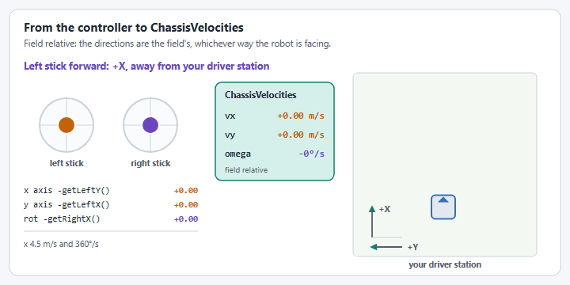<figcaption><p>How each stick movement becomes a field relative velocity.</p></figcaption></figure>


The output is **field relative**, even with `withRobotRelative()`. Drive with it through `setFieldRelativeChassisSpeeds(...)`, not `SwerveDrive.drive(...)`, which expects robot-relative speeds. If you do want `drive(...)`, convert it first: `drive.drive(() -> input.get().toRobotRelative(drive.getGyroRotation3d().toRotation2d()))`.


## Building a Stream

`SwerveInputStream.of(drive, x, y)` is the base factory, translation axes only. `SwerveInputStream.of(drive, x, y, rot)` (or the matching constructor) adds an angular velocity axis, and the `new SwerveInputStream(drive, x, y, headingX, headingY)` constructor adds heading axes for point-and-hold control instead. `drive` is your YAMS `SwerveDrive`. From there, `with*()` methods layer on deadbanding, scaling, non-linear response, and alliance-relative flipping:



```java
NiDsXboxController driver = new NiDsXboxController(0);

SwerveInputStream input =
    SwerveInputStream.of(drive, () -> -driver.getLeftY(), () -> -driver.getLeftX())
        .withControllerRotationAxis(() -> -driver.getRightX())
        .withDeadband(0.05)
        .withScaleTranslation(0.8)
        .withScaleRotation(0.6)
        .withMaximumLinearVelocity(MetersPerSecond.of(4.5))
        .withMaximumAngularVelocity(DegreesPerSecond.of(360))
        .withCubeTranslationControllerAxis()
        .withAllianceRelativeControl();

// SwerveInputStream output is field relative.
setDefaultCommand(run(() -> drive.setFieldRelativeChassisSpeeds(input.get())));
```



```java
// In a teleop opmode. robot.drive is the swerve Mechanism; getSwerveDrive() returns its YAMS SwerveDrive.
var controller = robot.xboxController;
robot.drive.setInputStream(SwerveInputStream.of(
        robot.drive.getSwerveDrive(),
        () -> -controller.getLeftY(),
        () -> -controller.getLeftX(),
        () -> -controller.getRightX())
    .withDeadband(0.05)
    .withCubeTranslationControllerAxis()
    .withAllianceRelativeControl());
robot.drive.setDefaultCommand(robot.drive.driveInputStream());
```

The Mechanism's drive command reads the active stream every loop:

```java
public Command driveInputStream() {
  return run(coroutine -> {
    while (true) {
      drive.setFieldRelativeChassisSpeeds(inputStream.get());
      coroutine.yield();
    }
  }).named("Swerve Drive Input Stream");
}
```



```cpp
#include "yams/mechanisms/swerve/utility/SwerveInputStream.hpp"

using namespace yams::mechanisms::swerve::utility;

// Member of your subsystem.
SwerveInputStream<4> m_driveStream = SwerveInputStream<4>::Of(m_drive,
    [this]{ return -m_driverController.GetLeftY(); },
    [this]{ return -m_driverController.GetLeftX(); })
  .WithControllerRotationAxis([this]{ return -m_driverController.GetRightX(); })
  .WithDeadband(0.05)
  .WithScaleTranslation(0.8);

// In Periodic(). SwerveInputStream output is field relative.
void Periodic() override {
    m_drive.SetFieldRelativeChassisSpeeds(m_driveStream.Get());
}
```

C++ has `Of(drive, x, y)` plus constructors taking a rotation axis or two heading axes.



## Mutations Apply Immediately

<figure>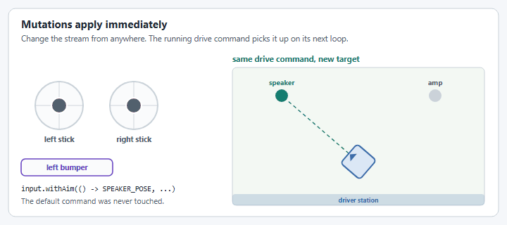<figcaption><p>Changing the aim target from a button. The drive command keeps running.</p></figcaption></figure>

Every `with*()` method mutates the stream in place and returns `this`; none of them return a new copy. That matters because a `SwerveInputStream` is usually stored once and read by a long-lived drive command. Calling a mutator on that same reference later, from anywhere else in your code, changes what the already-running default command does on its very next loop; you never need to rebuild the stream or call `setDefaultCommand(...)` again.

For example, auto-aim can be retargeted on the fly from a completely separate button binding, without touching the drive command at all:

```java
input.withAim(() -> FieldConstants.SPEAKER_POSE, driver::getRightBumperButton);
setDefaultCommand(run(() -> drive.setFieldRelativeChassisSpeeds(input.get())));

new Trigger(driver::getLeftBumperButton).onTrue(Commands.runOnce(() ->
    input.withAim(() -> FieldConstants.AMP_POSE, driver::getRightBumperButton)));
```

Pressing the left bumper swaps the aim target from the speaker to the amp. The default command keeps reading the exact same `input` instance; it just starts computing `ChassisVelocities` toward a different pose the moment the mutation happens.


`clone()` is the one method here that doesn't mutate: it returns an independent copy, useful for deriving a second variant of a stream from a shared base configuration without one affecting the other. See [Copying a Stream](#copying-a-stream) below.


## From Stick to Velocity

Every loop, `get()` runs the stick values through the same steps, in this order:

<figure>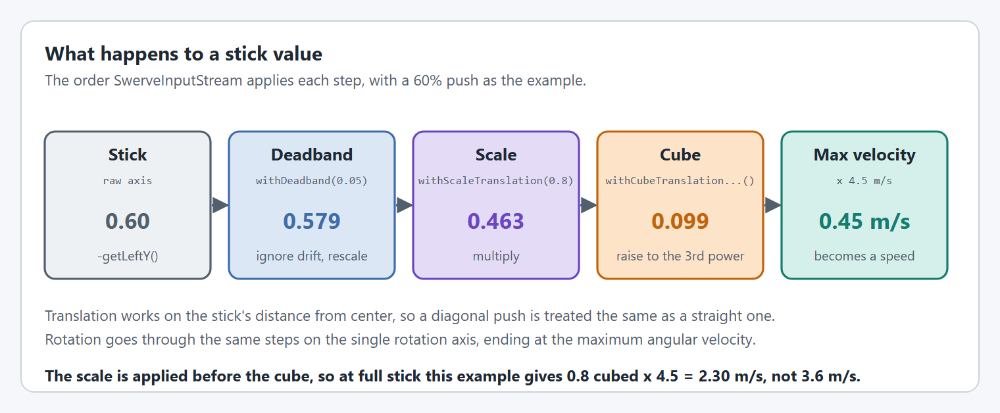<figcaption><p>A 60% push, step by step.</p></figcaption></figure>

| Step | Method | What it does |
| --- | --- | --- |
| Deadband | `withDeadband(...)` | Ignores small values near the center, then rescales the rest to the full range. |
| Scale | `withScaleTranslation(...)`, `withScaleRotation(...)` | Multiplies by a constant. |
| Cube | `withCubeTranslationControllerAxis()`, `withCubeRotationControllerAxis()` | Raises to the third power for finer control near the center. |
| Alliance flip | `withAllianceRelativeControl()` | Turns translation 180 degrees on the red alliance. |
| Maximum velocity | `withMaximumLinearVelocity(...)`, `withMaximumAngularVelocity(...)` | Turns the result into meters per second and radians per second. |


The scale is applied **before** the cube. With `withScaleTranslation(0.8)` and the cube enabled, a full stick gives `0.8³ = 0.512` of the maximum velocity, not `0.8`.


<figure>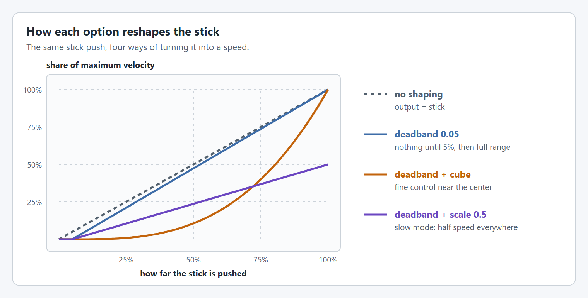<figcaption><p>What each option does to the stick's response.</p></figcaption></figure>

## Velocity Limits

The maximum velocities are what a fully pushed stick produces.

### `withMaximumLinearVelocity`

`withMaximumLinearVelocity(LinearVelocity)` sets the top driving speed.

<figure>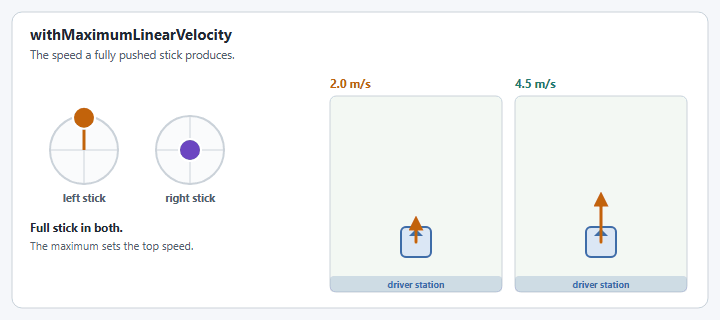<figcaption><p>The same full stick with two maximum velocities.</p></figcaption></figure>

```java
input.withMaximumLinearVelocity(MetersPerSecond.of(4.5));
```

### `withMaximumAngularVelocity`

`withMaximumAngularVelocity(AngularVelocity)` sets the top turn rate.

<figure>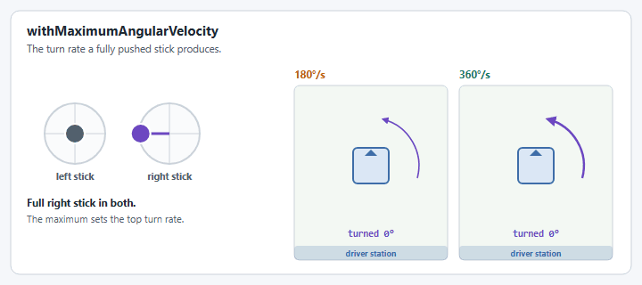<figcaption><p>The same full stick with two maximum angular velocities.</p></figcaption></figure>

```java
input.withMaximumAngularVelocity(DegreesPerSecond.of(360));
```


A stream copies `SwerveDriveConfig.withMaximumChassisSpeed(...)`'s value (if set) into its own maximum fields once, at construction time; if the drive has no maximum configured, the stream starts from its own defaults (4 m/s, 1 rotation/s) instead. Calling `withMaximumLinearVelocity(...)`/`withMaximumAngularVelocity(...)` afterward overrides that starting value for this stream only and takes effect immediately; the drive's config is never re-checked after construction, so the override sticks.


## Controller Axes

Both methods set or replace a rotation source after construction. That is useful when a stream starts out with `SwerveInputStream.of(drive, x, y)` (no rotation source at all) and gains one later.

### `withControllerRotationAxis`

`withControllerRotationAxis(DoubleSupplier)` sets the axis that says how fast the robot turns.

<figure>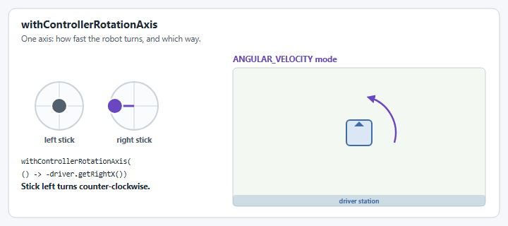<figcaption><p>One axis sets a turn rate.</p></figcaption></figure>

```java
input.withControllerRotationAxis(() -> -driver.getRightX());
```

### `withControllerHeadingAxis`

`withControllerHeadingAxis(DoubleSupplier, DoubleSupplier)` sets the pair of axes whose direction becomes a target heading. It does nothing on its own: the heading is used by [`withHeadingControl`](#withheadingcontrol) in `HEADING` mode.

<figure>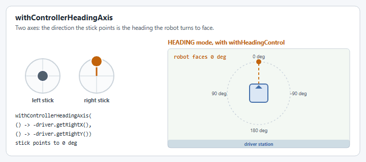<figcaption><p>Two axes set a direction, and the robot turns to face it.</p></figcaption></figure>

```java
input.withControllerHeadingAxis(() -> -driver.getRightX(), () -> -driver.getRightY());
```

## Deadband

`withDeadband(double)` (an alias for `deadband(double)`) applies the same deadband to every axis before any scaling or cubing happens. `0` clears it.

<figure>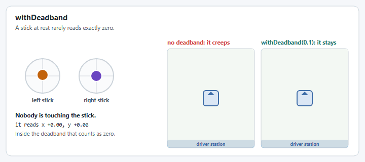<figcaption><p>Stick drift with and without a deadband.</p></figcaption></figure>

```java
input.withDeadband(0.05);
```

## Axis Scaling

The scale methods multiply the stick output by a constant in `(0, 1]`, useful for a "slow mode" that doesn't require re-mapping the physical stick range.

### `withScaleTranslation`

`withScaleTranslation(double)` scales the driving speed.

<figure>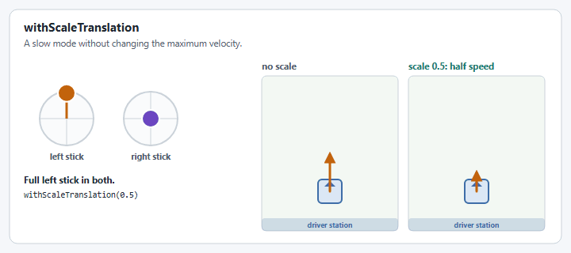<figcaption><p>A translation scale of 0.5.</p></figcaption></figure>

```java
input.withScaleTranslation(0.5); // e.g. bound to a "slow mode" trigger
```

### `withScaleRotation`

`withScaleRotation(double)` scales the turn rate.

<figure>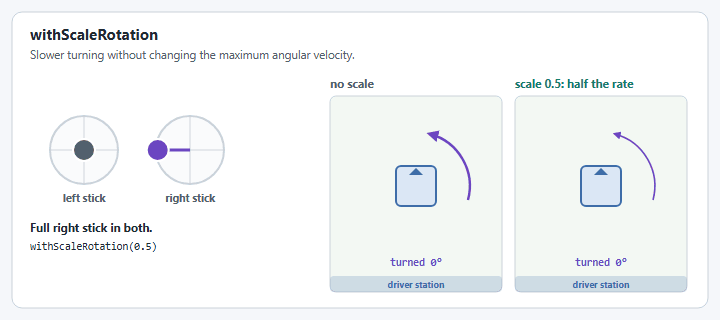<figcaption><p>A rotation scale of 0.5.</p></figcaption></figure>

```java
input.withScaleRotation(0.5);
```

## Non-Linear (Cubic) Response

Cubing gives finer control near the center of the stick without sacrificing full speed at the edges. Each method also has a `BooleanSupplier` overload to toggle the effect live.

### `withCubeTranslationControllerAxis`

`withCubeTranslationControllerAxis()` cubes the translation magnitude.

<figure>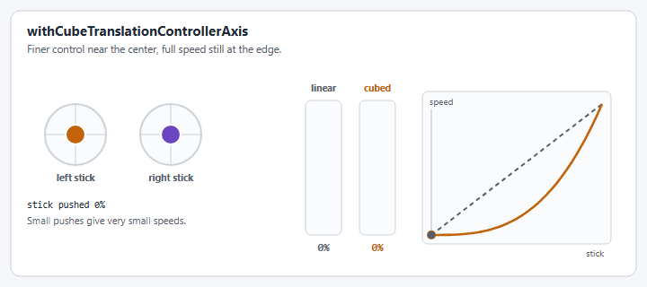<figcaption><p>Linear and cubed response to the same stick.</p></figcaption></figure>

```java
input.withCubeTranslationControllerAxis();
```

### `withCubeRotationControllerAxis`

`withCubeRotationControllerAxis()` cubes the rotation axis.

<figure>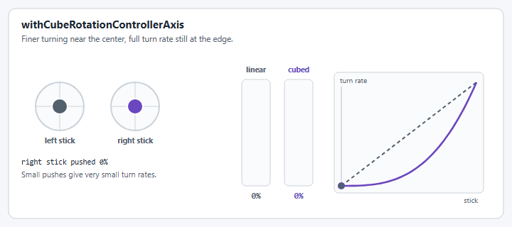<figcaption><p>Linear and cubed turn rate from the same stick.</p></figcaption></figure>

```java
input.withCubeRotationControllerAxis(driver::getBButton); // only while B is held
```

## Modes Are Chosen Automatically

A stream is always in exactly one of four internal modes: `ANGULAR_VELOCITY` (the default), `TRANSLATION_ONLY`, `HEADING`, or `AIM`. You never select a mode directly. `get()` re-derives it on every call from which optional pieces are configured and whether the relevant `BooleanSupplier` trigger currently reports true, then transitions cleanly (resetting the relevant PID controllers) if the mode changed since the last call. Mode priority, highest to lowest: `TRANSLATION_ONLY` > `AIM` > `HEADING` > `ANGULAR_VELOCITY`. `getCurrentModeName()` returns the mode the last `get()` used.

`HEADING`, `AIM` and `TRANSLATION_ONLY` turn the robot with the rotation controller from `SwerveDriveConfig.withRotationController(...)`, so configure one before using them.


`SwerveInputStream` used to have a `DRIVE_TO_POSE` mode and a matching `atTargetPose(...)` method; both have been removed. Use [`SwerveDrive.driveToPose(...)`](swerve-drive.md#auto-align) for auto-align instead.


### Heading-Snap Control

#### `withHeadingControl`

`withHeadingControl(trigger)` enables `HEADING` while `trigger` reports true, snapping to a heading derived from [`withControllerHeadingAxis(x, y)`](#withcontrollerheadingaxis) instead of rotating at a velocity. The robot stops turning while the heading stick is inside the deadband.

<figure>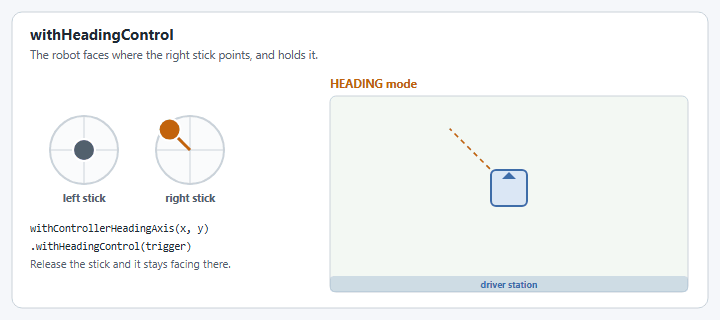<figcaption><p><code>HEADING</code> mode: as the right stick moves around, the robot turns to face where it points.</p></figcaption></figure>

```java
SwerveInputStream headingStream = input.clone()
    .withControllerHeadingAxis(() -> -driver.getRightX(), () -> -driver.getRightY())
    .withHeadingControl(driver::getAButton);
```

#### `withHeading`

`withHeading(Supplier<Angle>)` faces a field-relative heading from code instead of a stick, and replaces any controller heading axes.

<figure>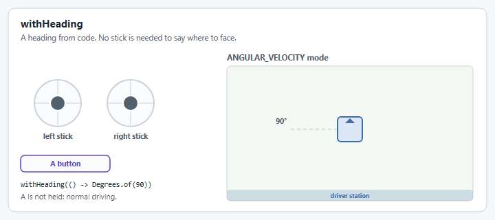<figcaption><p>A heading from code, enabled while A is held.</p></figcaption></figure>

```java
input.withHeading(() -> Degrees.of(90))
     .withHeadingControl(driver::getAButton);
```

### Aim At a Target

`withAim(Supplier<Pose2d> targetPose, BooleanSupplier trigger)` enables `AIM` while `trigger` reports true, rotating to face `targetPose` while translation keeps working normally. See [Mutations Apply Immediately](#mutations-apply-immediately) above for an example that retargets it live.

<figure><figcaption><p><code>AIM</code> mode: the left stick drives, the robot keeps facing the target.</p></figcaption></figure>

```java
input.withAim(() -> FieldConstants.SPEAKER_POSE, driver::getRightBumperButton);
```

### Translation Only

`withTranslationOnly(trigger)` enables `TRANSLATION_ONLY` while `trigger` reports true, locking the current heading and suppressing rotation entirely:

<figure>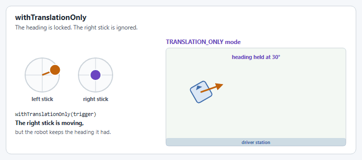<figcaption><p><code>TRANSLATION_ONLY</code> mode: the right stick is ignored and the heading is held.</p></figcaption></figure>

```java
input.withTranslationOnly(driver::getStartButton);
```

## Robot-Relative Control

<figure>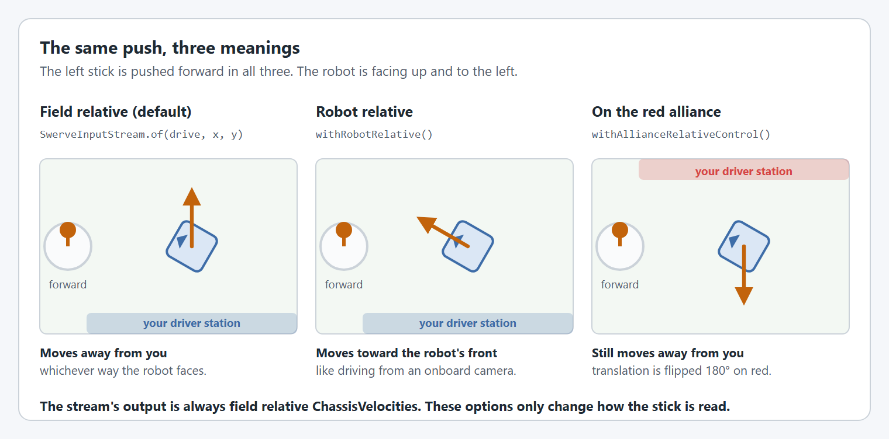<figcaption><p>Field relative, robot relative and alliance relative control.</p></figcaption></figure>

By default the translation axes are field relative. `withRobotRelative()` treats them as robot relative instead, so pushing the stick forward drives toward the robot's front. The stream still outputs **field-relative** `ChassisVelocities` (it converts using the current heading), so the drive command does not change. The `withRobotRelative(BooleanSupplier)` overload toggles it live, e.g. while a button is held.

<figure>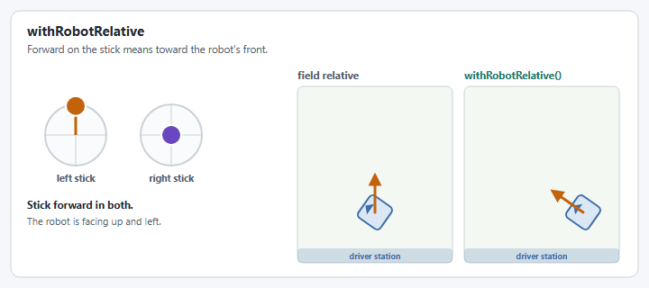<figcaption><p>Stick forward, field relative and robot relative.</p></figcaption></figure>

```java
input.withRobotRelative(driver::getXButton); // robot-relative while X is held
```

## Alliance-Relative Control

`withAllianceRelativeControl()` flips the field-relative translation 180 degrees on the Red alliance, so "forward" always means away from your own driver station regardless of which side you're on. `withAllianceRelativeControl(BooleanSupplier)` toggles it live.

<figure>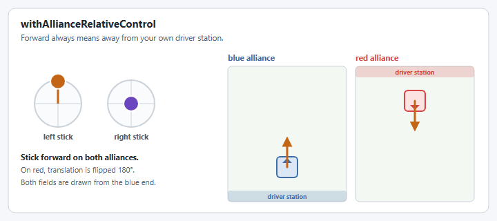<figcaption><p>Stick forward on each alliance.</p></figcaption></figure>

```java
input.withAllianceRelativeControl();
```


`withAllianceRelativeControl()` and `withRobotRelative()` can both be set. While robot-relative control is active, alliance flipping is skipped.


## Translation Heading Offset

`withTranslationHeadingOffset(Rotation2d)` rotates the translation direction by a fixed angle before it's output, useful when a secondary driver's "forward" should map to something other than the robot's own forward. `withTranslationHeadingOffset(Rotation2d, BooleanSupplier)` only applies it while the supplier is true.

<figure>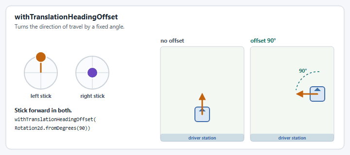<figcaption><p>A 90° offset turns forward into left.</p></figcaption></figure>

```java
input.withTranslationHeadingOffset(Rotation2d.fromDegrees(90));
```

## Center of Rotation

The stream outputs a rotation rate, and the drive decides which point the robot rotates around. That point is not part of the stream: it is `SwerveDriveConfig.withCenterOfRotation(...)`. The default is the center of the robot.

<figure><figcaption><p>The same turn around two different points.</p></figcaption></figure>

```java
// 0, 0 is the center of the robot. X is forward and Y is left.
SwerveDriveConfig config = new SwerveDriveConfig(this, fl, fr, bl, br)
    .withCenterOfRotation(Meters.of(0.3), Meters.of(0.3)); // the front left corner
```

Like the stream, the config is mutable, and the drive reads the center of rotation every loop. Changing it on the running drive's config takes effect on the next loop, for example to pivot around a corner while a button is held:

```java
new Trigger(driver::getLeftBumperButton)
    .onTrue(Commands.runOnce(() -> drive.getConfig().withCenterOfRotation(Meters.of(0.3), Meters.of(0.3))))
    .onFalse(Commands.runOnce(() -> drive.getConfig().withCenterOfRotation(Meters.of(0), Meters.of(0))));
```

## Copying a Stream

`clone()` is the only method on this page that doesn't mutate the original; it returns an independent copy that shares the base stream's configuration at the moment it was called. Changing the copy afterward, or changing the original, doesn't affect the other. A clone has no [telemetry](#telemetry-and-live-tuning); call `withTelemetry` on it if it needs its own.

```java
SwerveInputStream headingStream = input.clone();
```

## Telemetry and Live Tuning

Telemetry is off until you call `withTelemetry(name, verbosity)` on a stream. It publishes every time the stream is read with `get()`, so there is nothing to call each loop. `getTelemetry()` returns the stream's `SwerveInputStreamTelemetry` as an `Optional`.

| Verbosity | Publishes                                                                                 |
| --------- | ----------------------------------------------------------------------------------------- |
| `LOW`     | The current drive mode                                                                    |
| `MID`     | Also the stream's configuration, read-only                                                |
| `HIGH`    | Also editable copies of the configuration, and a `Live Tuning` command on the dashboard  |

Call `withTelemetry` last, after the rest of the configuration, so the dashboard starts with the configured values. Calling it again replaces the stream's telemetry, and `getTelemetry().get().close()` stops publishing it, e.g. when replacing a stream with another of the same name.



```java
SwerveInputStream driveStream =
    SwerveInputStream.of(drive, () -> -controller.getLeftY(), () -> -controller.getLeftX())
        .withControllerRotationAxis(() -> -controller.getRightX())
        .withDeadband(0.05)
        .withScaleTranslation(0.8)
        .withTelemetry("Driver", TelemetryVerbosity.HIGH);

// SwerveInputStream output is field relative.
swerve.setDefaultCommand(swerve.run(() -> drive.setFieldRelativeChassisSpeeds(driveStream.get())));
```

The `Live Tuning` command is a Commands v2 `Command`.



```java
// In a teleop opmode.
robot.drive.setInputStream(SwerveInputStream.of(robot.drive.getSwerveDrive(),
                                                () -> -controller.getLeftY(),
                                                () -> -controller.getLeftX(),
                                                () -> -controller.getRightX())
    .withDeadband(0.05)
    .withScaleTranslation(0.8)
    .withTelemetry("Driver", TelemetryVerbosity.HIGH));
robot.drive.setDefaultCommand(robot.drive.driveInputStream());
```

The `Live Tuning` command is a Commands v3 `Command`, published through `CommandTunable`. When an opmode replaces the active stream, close the old stream's telemetry first:

```java
public void setInputStream(SwerveInputStream inputStream) {
  if (this.inputStream != null) {
    this.inputStream.getTelemetry().ifPresent(SwerveInputStreamTelemetry::close);
  }
  this.inputStream = inputStream;
}
```



```cpp
SwerveInputStream<4> m_driveStream = SwerveInputStream<4>::Of(m_drive,
    [this]{ return -m_driverController.GetLeftY(); },
    [this]{ return -m_driverController.GetLeftX(); })
  .WithControllerRotationAxis([this]{ return -m_driverController.GetRightX(); })
  .WithDeadband(0.05)
  .WithScaleTranslation(0.8)
  .WithTelemetry("Driver", SwerveDriveConfig::TelemetryVerbosity::HIGH);
```

C++ has the same API: `WithTelemetry(name, verbosity)` and `GetTelemetry()`, which returns a `std::optional<std::reference_wrapper<SwerveInputStreamTelemetry<N>>>`. The verbosities are `SwerveDriveConfig::TelemetryVerbosity`: `LOW`, `MEDIUM` (Java's `MID`) and `HIGH`, and `NONE` turns telemetry off. The `Live Tuning` command is a Commands v2 `Command`, from `GetLiveTuningCommand()`.

The stream is a value type, so ownership works differently from Java:

* `WithTelemetry` stores the name and verbosity. The telemetry is created when the stream is first read with `Get()` or `GetTelemetry()` is called, so the copies made while building a stream do not publish.
* The stream owns its telemetry and stops publishing when it is destroyed.
* A copy of a stream keeps the telemetry settings and publishes under the same name once it is read. `Clone()` returns a copy without telemetry.
* Moving a stream moves the settings; the moved-from stream stops publishing.



Neither framework's `Live Tuning` command requires a subsystem or mechanism, so running it does not interrupt the command driving with the stream.

### Live Tuning

At `HIGH`, values edited on the dashboard are applied to the stream every loop while the `Live Tuning` command runs. Start and stop it from the dashboard, or bind `getTelemetry().get().getLiveTuningCommand()` to a button. Tunable values stay in sync both ways while it runs: a change made in code, such as a slow mode binding calling `withScaleTranslation`, or a `BooleanSupplier` passed to `withAllianceRelativeControl` changing, is published to the dashboard and is not overridden. Dashboard values outside the allowed range are replaced with the stream's current value.

### NetworkTables Topics

`mode` (the current drive mode: `ANGULAR_VELOCITY`, `HEADING`, `AIM` or `TRANSLATION_ONLY`) is published to `/SwerveInputStream/<name>/` at every verbosity. At `MID` (`MEDIUM` in C++) and `HIGH`, the values below are also published there read-only. At `HIGH` they are published as tunable values under `/Tuning/SwerveInputStream/<name>/`, with the command at `/Tuning/SwerveInputStream/<name>/Live Tuning`.

| Topic                | Type    | Range  | Description                                                                                      |
| -------------------- | ------- | ------ | ------------------------------------------------------------------------------------------------ |
| `deadband`           | double  | [0, 1) | Controller axis deadband                                                                         |
| `translationScale`   | double  | (0, 1] | Translation axis scaling factor                                                                  |
| `rotationScale`      | double  | (0, 1] | Rotation axis scaling factor                                                                     |
| `maxLinearVelocity`  | double  | > 0    | Maximum chassis linear velocity (m/s). Starts at the drive config's maximum and overrides it     |
| `maxAngularVelocity` | double  | > 0    | Maximum chassis angular velocity (rad/s). Starts at the drive config's maximum and overrides it  |
| `translationCube`    | boolean | -      | Enable cubic translation response curve                                                          |
| `rotationCube`       | boolean | -      | Enable cubic rotation response curve                                                             |
| `allianceRelative`   | boolean | -      | Enable alliance-relative translation flip                                                        |
| `robotRelative`      | boolean | -      | Enable robot-relative control                                                                    |

The output velocities are not published: reading them would call `get()` a second time each loop, which runs the heading controller twice. Log the speeds you send to the drive instead.


Once the values feel right, copy them from NetworkTables back into the stream's `with*()` calls in code. Values edited live are not persisted. For competition, use `TelemetryVerbosity.LOW`; in Java `getTelemetry().get().close()` stops publishing, and in C++ `WithTelemetry(name, TelemetryVerbosity::NONE)` does.


| Issue                     | Solution                                                                           |
| ------------------------- | ---------------------------------------------------------------------------------- |
| Telemetry not appearing   | Check the stream was given `withTelemetry` and is read with `get()` every loop     |
| Changes don't apply       | Start the `Live Tuning` command; it only exists at `TelemetryVerbosity.HIGH`       |
| A dashboard value snaps back | The value is outside the allowed range in the table above                       |

## Code Reference


