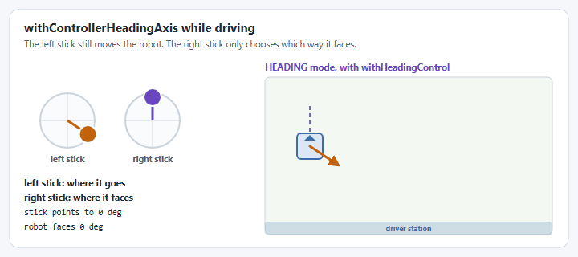

# Swerve input stream

`SwerveInputStream` bridges raw joystick axes (each in the range `[-1, 1]`) and the field-relative `ChassisVelocities` (WPILib 2027's name for `ChassisSpeeds`) that [`SwerveDrive.setFieldRelativeChassisSpeeds(...)`](swerve-drive.md) expects. It implements `Supplier<ChassisVelocities>`, so once built it is read with `get()` every loop by the command that drives the robot.

Import it from the package that matches your vendordep: `yams.commands2.swerve.SwerveInputStream` (Commands v2) or `yams.commands3.swerve.SwerveInputStream` (Commands v3). The API is the same in both. In C++ it is `yams::mechanisms::swerve::utility::SwerveInputStream<NumModules>` from `yams/mechanisms/swerve/utility/SwerveInputStream.hpp`, with the same methods in PascalCase (`Of`, `WithDeadband`, `Get`, ...). In the examples on this page, `driverController` is the `CommandGamepad` from the [Swerve Drive tutorial](../tutorials/swerve-drive.md). Its buttons, such as `driverController.rightBumper()`, are `Trigger`s, which can be passed wherever a `BooleanSupplier` is expected.

<figure><figcaption><p>How each stick movement becomes a field relative velocity.</p></figcaption></figure>


The output is **field relative**, even with `withRobotRelative()`. Drive with it through `setFieldRelativeChassisSpeeds(...)`, not `SwerveDrive.drive(...)`, which expects robot-relative speeds. If you do want `drive(...)`, convert it first: `drive.drive(() -> input.get().toRobotRelative(drive.getGyroRotation3d().toRotation2d()))`.


This page covers building a stream and shaping the sticks. Two more pages cover the rest:

* [Heading and aim modes](swerve-input-stream-aim.md): facing a heading, aiming at a target, and driving without turning.
* [Input stream telemetry and live tuning](swerve-input-stream-telemetry.md): what a stream publishes, and changing it from a dashboard.

## Building a stream

`SwerveInputStream.of(drive, x, y)` is the base factory, translation axes only. `SwerveInputStream.of(drive, x, y, rot)` (or the matching constructor) adds an angular velocity axis, and the `new SwerveInputStream(drive, x, y, headingX, headingY)` constructor adds heading axes for point-and-hold control instead. `drive` is your YAMS `SwerveDrive`. From there, `with*()` methods layer on deadbanding, scaling and a non-linear response.

These examples follow the [Swerve Drive tutorial](../tutorials/swerve-drive.md): the subsystem or mechanism builds the stream, because only it can see the YAMS `SwerveDrive`, and a `driveFieldRelative` command drives with it.




```java
/** Turn three controller axes into field relative chassis speeds. */
public SwerveInputStream getChassisSpeedsSupplier(DoubleSupplier translationX, DoubleSupplier translationY,
                                                  DoubleSupplier rotation) {
  return SwerveInputStream.of(drive, translationX, translationY)
      .withControllerRotationAxis(rotation)
      .withDeadband(0.05)
      .withScaleTranslation(0.8)
      .withScaleRotation(0.6)
      .withMaximumLinearVelocity(MetersPerSecond.of(4.5))
      .withMaximumAngularVelocity(DegreesPerSecond.of(360))
      .withCubeTranslationControllerAxis();
}

/** Drive with field relative chassis speeds. */
public Command driveFieldRelative(Supplier<ChassisVelocities> speedsSupplier) {
  return run(() -> drive.setFieldRelativeChassisSpeeds(speedsSupplier.get()))
      .withName("Field Oriented Drive");
}
```



```java
// SwerveInputStream output is field relative.
drive.setDefaultCommand(drive.driveFieldRelative(
    drive.getChassisSpeedsSupplier(
        () -> -driverController.getLeftY(),
        () -> -driverController.getLeftX(),
        () -> -driverController.getRightX())));
```





```java
/** Turn three controller axes into field relative chassis speeds. */
public SwerveInputStream getChassisSpeedsSupplier(DoubleSupplier translationX, DoubleSupplier translationY,
                                                  DoubleSupplier rotation) {
  return SwerveInputStream.of(drive, translationX, translationY)
      .withControllerRotationAxis(rotation)
      .withDeadband(0.05)
      .withScaleTranslation(0.8)
      .withScaleRotation(0.6)
      .withMaximumLinearVelocity(MetersPerSecond.of(4.5))
      .withMaximumAngularVelocity(DegreesPerSecond.of(360))
      .withCubeTranslationControllerAxis();
}

/** Drive with field relative chassis speeds. */
public Command driveFieldRelative(Supplier<ChassisVelocities> speedsSupplier) {
  return run(coroutine -> {
    while (true) {
      drive.setFieldRelativeChassisSpeeds(speedsSupplier.get());
      coroutine.yield();
    }
  }).named("Field Oriented Drive");
}
```



```java
// SwerveInputStream output is field relative.
robot.drive.setDefaultCommand(robot.drive.driveFieldRelative(
    robot.drive.getChassisSpeedsSupplier(
        () -> -robot.exampleController.getLeftY(),
        () -> -robot.exampleController.getLeftX(),
        () -> -robot.exampleController.getRightX())));
```





```cpp
// m_inputStream is a std::optional<SwerveInputStream<4>> member of the subsystem,
// because the drive command reads it every loop.
wpi::cmd::CommandPtr SwerveSubsystem::DriveWithSticks(std::function<double()> translationX,
                                                      std::function<double()> translationY,
                                                      std::function<double()> rotation) {
  m_inputStream.emplace(
      utility::SwerveInputStream<4>::Of(m_drive.value(), translationX, translationY)
          .WithControllerRotationAxis(rotation)
          .WithDeadband(0.05)
          .WithScaleTranslation(0.8));

  // SwerveInputStream output is field relative.
  return Run([this] { m_drive->SetFieldRelativeChassisSpeeds(m_inputStream->Get()); })
      .WithName("Field Oriented Drive");
}
```



```cpp
drive.SetDefaultCommand(drive.DriveWithSticks(
    [this] { return -driverController.GetLeftY(); },
    [this] { return -driverController.GetLeftX(); },
    [this] { return -driverController.GetRightX(); }));
```


C++ has `Of(drive, x, y)` plus constructors taking a rotation axis or two heading axes.



The single-line examples on the rest of this page call a method on `input`, a stream like the one `getChassisSpeedsSupplier` returns. Keep a reference to the stream if you want to change it later.

## Mutations apply immediately

<figure><figcaption><p>Changing the aim target from a button. The drive command keeps running.</p></figcaption></figure>

Every `with*()` method mutates the stream in place and returns `this`; none of them return a new copy. That matters because a `SwerveInputStream` is usually stored once and read by a long-lived drive command. Calling a mutator on that same reference later, from anywhere else in your code, changes what the already-running default command does on its very next loop; you never need to rebuild the stream or call `setDefaultCommand(...)` again.

For example, auto-aim can be retargeted on the fly from a completely separate button binding, without touching the drive command at all:

A Commands v2 fragment. `input` is the stream the default command drives with:

```java
// Two targets on the field. Use your game's real positions.
Pose2d speakerPose = new Pose2d(Meters.of(0.2), Meters.of(5.5), Rotation2d.ZERO);
Pose2d ampPose = new Pose2d(Meters.of(1.8), Meters.of(8.0), Rotation2d.ZERO);

// Aim at the speaker while the right bumper is held.
input.withAim(() -> speakerPose, driverController.rightBumper());

// Pressing the left bumper retargets the same stream at the amp.
driverController.leftBumper().onTrue(Commands.runOnce(() ->
    input.withAim(() -> ampPose, driverController.rightBumper())));
```

Pressing the left bumper swaps the aim target from the speaker to the amp. The default command keeps reading the exact same `input` instance; it just starts computing `ChassisVelocities` toward a different pose the moment the mutation happens.


`clone()` is the one method here that doesn't mutate: it returns an independent copy, useful for deriving a second variant of a stream from a shared base configuration without one affecting the other. See [Copying a stream](#copying-a-stream) below.


## From stick to velocity

Every loop, `get()` runs the stick values through the same steps, in this order:

<figure><figcaption><p>A 60% push, step by step.</p></figcaption></figure>

| Step             | Method                                                                    | What it does                                                                    |
| ---------------- | ------------------------------------------------------------------------- | ------------------------------------------------------------------------------- |
| Deadband         | `withDeadband(...)`                                                       | Ignores small values near the center, then rescales the rest to the full range. |
| Scale            | `withScaleTranslation(...)`, `withScaleRotation(...)`                     | Multiplies by a constant.                                                       |
| Cube             | `withCubeTranslationControllerAxis()`, `withCubeRotationControllerAxis()` | Raises to the third power for finer control near the center.                    |
| Alliance flip    | `withAllianceRelativeControl()`                                           | Turns translation 180 degrees on the red alliance.                              |
| Maximum velocity | `withMaximumLinearVelocity(...)`, `withMaximumAngularVelocity(...)`       | Turns the result into meters per second and radians per second.                 |


The scale is applied **before** the cube. With `withScaleTranslation(0.8)` and the cube enabled, a full stick gives `0.8³ = 0.512` of the maximum velocity, not `0.8`.


<figure><figcaption><p>What each option does to the stick's response.</p></figcaption></figure>

## Velocity limits

The maximum velocities are what a fully pushed stick produces.

### `withMaximumLinearVelocity`

`withMaximumLinearVelocity(LinearVelocity)` sets the top driving speed.

<figure><figcaption><p>The same full stick with two maximum velocities.</p></figcaption></figure>

```java
input.withMaximumLinearVelocity(MetersPerSecond.of(4.5));
```

### `withMaximumAngularVelocity`

`withMaximumAngularVelocity(AngularVelocity)` sets the top turn rate.

<figure><figcaption><p>The same full stick with two maximum angular velocities.</p></figcaption></figure>

```java
input.withMaximumAngularVelocity(DegreesPerSecond.of(360));
```


A stream copies `SwerveDriveConfig.withMaximumChassisSpeed(...)`'s value (if set) into its own maximum fields once, at construction time; if the drive has no maximum configured, the stream starts from its own defaults (4 m/s, 1 rotation/s) instead. Calling `withMaximumLinearVelocity(...)`/`withMaximumAngularVelocity(...)` afterward overrides that starting value for this stream only and takes effect immediately; the drive's config is never re-checked after construction, so the override sticks.


## Controller axes

Both methods set or replace a rotation source after construction. That is useful when a stream starts out with `SwerveInputStream.of(drive, x, y)` (no rotation source at all) and gains one later.

### `withControllerRotationAxis`

`withControllerRotationAxis(DoubleSupplier)` sets the axis that says how fast the robot turns.

<figure><figcaption><p>One axis sets a turn rate.</p></figcaption></figure>

```java
input.withControllerRotationAxis(() -> -driverController.getRightX());
```

### `withControllerHeadingAxis`

`withControllerHeadingAxis(DoubleSupplier, DoubleSupplier)` sets the pair of axes whose direction becomes a target heading. It does nothing on its own: the heading is used by [`withHeadingControl`](swerve-input-stream-aim.md#withheadingcontrol) in `HEADING` mode.

<figure><figcaption><p>Two axes set a direction, and the robot turns to face it.</p></figcaption></figure>

The heading axes only replace rotation. The left stick keeps driving the robot, so it can move one way while facing another:

<figure><figcaption><p>Driving with the left stick while the right stick sets the heading.</p></figcaption></figure>

```java
input.withControllerHeadingAxis(() -> -driverController.getRightX(), () -> -driverController.getRightY());
```

## Deadband

`withDeadband(double)` (an alias for `deadband(double)`) applies the same deadband to every axis before any scaling or cubing happens. `0` clears it.

<figure><figcaption><p>Stick drift with and without a deadband.</p></figcaption></figure>

```java
input.withDeadband(0.05);
```

## Axis scaling

The scale methods multiply the stick output by a constant in `(0, 1]`, useful for a "slow mode" that doesn't require re-mapping the physical stick range.

### `withScaleTranslation`

`withScaleTranslation(double)` scales the driving speed.

<figure><figcaption><p>A translation scale of 0.5.</p></figcaption></figure>

```java
input.withScaleTranslation(0.5); // e.g. bound to a "slow mode" trigger
```

### `withScaleRotation`

`withScaleRotation(double)` scales the turn rate.

<figure><figcaption><p>A rotation scale of 0.5.</p></figcaption></figure>

```java
input.withScaleRotation(0.5);
```

## Non-linear (cubic) response

Cubing gives finer control near the center of the stick without sacrificing full speed at the edges. Each method also has a `BooleanSupplier` overload to toggle the effect live.

### `withCubeTranslationControllerAxis`

`withCubeTranslationControllerAxis()` cubes the translation magnitude.

<figure><figcaption><p>Linear and cubed response to the same stick.</p></figcaption></figure>

```java
input.withCubeTranslationControllerAxis();
```

### `withCubeRotationControllerAxis`

`withCubeRotationControllerAxis()` cubes the rotation axis.

<figure><figcaption><p>Linear and cubed turn rate from the same stick.</p></figcaption></figure>

```java
input.withCubeRotationControllerAxis(driverController.faceRight()); // only while the right face button is held
```

## Robot-relative control


By default the translation axes are field relative. `withRobotRelative()` treats them as robot relative instead, so pushing the stick forward drives toward the robot's front. The stream still outputs **field-relative** `ChassisVelocities` (it converts using the current heading), so the drive command does not change. The `withRobotRelative(BooleanSupplier)` overload toggles it live, e.g. while a button is held.

<figure><figcaption><p>Field relative, robot relative and alliance relative control.</p></figcaption></figure>

<figure><figcaption><p>Stick forward, field relative and robot relative.</p></figcaption></figure>

```java
input.withRobotRelative(driverController.faceLeft()); // robot-relative while the left face button is held
```

## Alliance-relative control

`withAllianceRelativeControl()` flips the field-relative translation 180 degrees on the Red alliance, so "forward" always means away from your own driver station regardless of which side you're on. `withAllianceRelativeControl(BooleanSupplier)` toggles it live.

<figure><figcaption><p>Stick forward on each alliance.</p></figcaption></figure>

```java
input.withAllianceRelativeControl();
```


Alliance-relative control assumes the robot's pose is a real field pose, where a heading of 0 degrees faces the red alliance wall. On red, a robot facing away from its own driver station has a heading of 180 degrees. If the robot starts at a pose of 0 degrees on red (the default starting pose, or after `zeroGyro()`) the flip sends it toward its own driver station. Set the real pose first, from your autonomous routine, vision, or `resetOdometry(...)`.



`withAllianceRelativeControl()` and `withRobotRelative()` can both be set. While robot-relative control is active, alliance flipping is skipped.


## Translation heading offset

`withTranslationHeadingOffset(Rotation2d)` rotates the translation direction by a fixed angle before it's output, useful when a secondary driver's "forward" should map to something other than the robot's own forward. `withTranslationHeadingOffset(Rotation2d, BooleanSupplier)` only applies it while the supplier is true.

<figure><figcaption><p>A 90° offset turns forward into left.</p></figcaption></figure>

```java
input.withTranslationHeadingOffset(Rotation2d.fromDegrees(90));
```

## Center of rotation

The stream outputs a rotation rate, and the drive decides which point the robot rotates around. That point is not part of the stream: it is `SwerveDriveConfig.withCenterOfRotation(...)`. The default is the center of the robot.

<figure><figcaption><p>The same turn around two different points.</p></figcaption></figure>

```java
// 0, 0 is the center of the robot. X is forward and Y is left.
SwerveDriveConfig config = new SwerveDriveConfig(this, fl, fr, bl, br)
    .withCenterOfRotation(Meters.of(0.3), Meters.of(0.3)); // the front left corner
```

Like the stream, the config is mutable, and the drive reads the center of rotation every loop. Changing it on the running drive's config takes effect on the next loop, for example to pivot around a corner while a button is held:

```java
driverController.leftBumper()
    .onTrue(Commands.runOnce(() -> drive.getConfig().withCenterOfRotation(Meters.of(0.3), Meters.of(0.3))))
    .onFalse(Commands.runOnce(() -> drive.getConfig().withCenterOfRotation(Meters.of(0), Meters.of(0))));
```

## Copying a stream

`clone()` is the only method on this page that doesn't mutate the original; it returns an independent copy that shares the base stream's configuration at the moment it was called. Changing the copy afterward, or changing the original, doesn't affect the other. A clone has no [telemetry](swerve-input-stream-telemetry.md); call `withTelemetry` on it if it needs its own.

```java
SwerveInputStream headingStream = input.clone();
```

## Turning to a heading, aiming, and telemetry

* [Heading and aim modes](swerve-input-stream-aim.md): `withHeadingControl`, `withHeading`, `withAim` and its options, and `withTranslationOnly`.
* [Input stream telemetry and live tuning](swerve-input-stream-telemetry.md): `withTelemetry`, the rotation controller's inputs, and the `Live Tuning` command.

## Code reference


