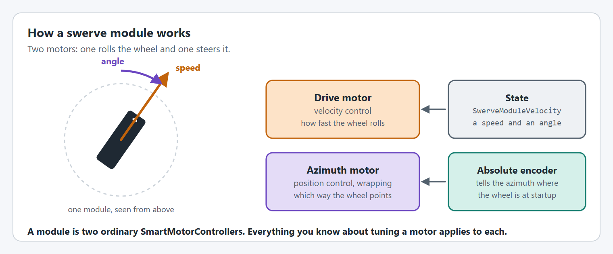
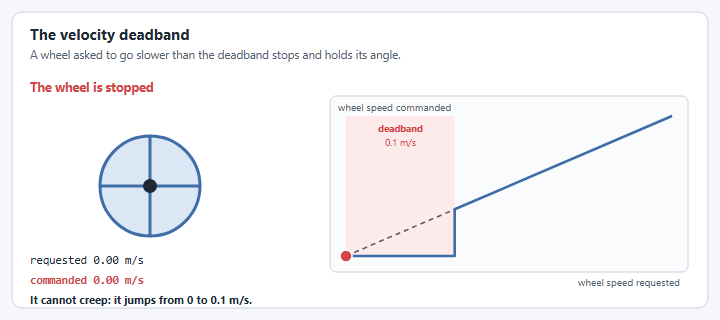

# Swerve module

Every `SwerveModuleConfig` option, with a graphic and an example, is on the [SwerveModuleConfig](mechanism-configs/swerve-module-config.md) page under this one.

## How a swerve module works

<figure><figcaption><p>One module is a drive motor, an azimuth motor and an absolute encoder.</p></figcaption></figure>

A module has one job: make its wheel roll at a speed, pointing at an angle. The drive motor runs velocity control for the speed, and the azimuth motor runs position control for the angle. An absolute encoder tells the azimuth which way the wheel points when the robot turns on, because the azimuth motor's own encoder starts at zero wherever the wheel happens to be.

Both motors are ordinary [`SmartMotorController`s](editor/), each with its own [`SmartMotorControllerConfig`](editor/config/), so everything about gearing, gains and current limits applies to them unchanged.

## Commands v2, Commands v3 and functions

A `SwerveModule` has no commands of its own, and is the same class in Commands v2 and Commands v3: `yams.core.mechanisms.swerve.SwerveModule`. The only difference is the package its two motor configs come from, `yams.commands2.config` or `yams.commands3.config`. The [`SwerveDrive`](swerve-drive.md#commands) is what you command, and it sets each module for you.

You rarely call a module directly, but these are the functions it has:

| Function                                                   | What it does                                                                                                                                                                                             |
| ---------------------------------------------------------- | -------------------------------------------------------------------------------------------------------------------------------------------------------------------------------------------------------- |
| `setSwerveModuleState(SwerveModuleVelocity)`               | Set the wheel's speed and angle. The [optimization, cosine compensation and velocity deadband](mechanism-configs/swerve-module-config.md) are applied first. An overload adds a drive feedforward force. |
| `setAzimuthAngle(Rotation2d)`                              | Turn the wheel to an angle without driving it.                                                                                                                                                           |
| `getState()`                                               | The wheel's current speed and angle, and how fast the azimuth is turning.                                                                                                                                |
| `getPosition()`                                            | How far the wheel has rolled, and its angle. Used for odometry.                                                                                                                                          |
| `seedAzimuthEncoder()`                                     | Set the azimuth motor's encoder from the absolute encoder.                                                                                                                                               |
| `getRawAbsoluteEncoderAngle()`                             | The absolute encoder's reading with no offset, for [finding the offset](mechanism-configs/swerve-module-config.md#withabsoluteencoderoffset).                                                                 |
| `getDriveMotorController()`, `getAzimuthMotorController()` | The two motors, for anything YAMS does not wrap.                                                                                                                                                         |

`SwerveDrive.updateTelemetry()` and `SwerveDrive.simIterate()` update every module, so you do not call those on a module yourself.

See [Swerve Drive](swerve-drive.md) first for how modules fit into the drive as a whole. This page goes deeper on `SwerveModule` and `SwerveModuleConfig` themselves.

Both are in `yams.core` and are shared by Commands v2 and Commands v3, so the imports are the same whichever vendordep you use:

```java
import yams.core.mechanisms.config.SwerveModuleConfig;
import yams.core.mechanisms.swerve.SwerveModule;
```

Module states are WPILib 2027 `SwerveModuleVelocity`s (the 2027 name for `SwerveModuleState`).

## Setting up a module on a real robot

Finding each module's absolute encoder offset, checking which way the motors turn and tuning the azimuth and drive motors are steps in a tutorial now: see [Step 4: On the real robot](../tutorials/swerve-drive/real-robot.md).

## A fully configured module

Here's every `SwerveModuleConfig` option from this page in one place. The sections below explain each call, and [SwerveModuleConfig](mechanism-configs/swerve-module-config.md) has one section per option:

```java
SwerveModuleConfig moduleConfig = new SwerveModuleConfig(driveSMC, azimuthSMC)
      .withAbsoluteEncoder(encoder.getAbsolutePosition().asSupplier())
      .withAbsoluteEncoderOffset(Rotations.of(0.25))
      .withAbsoluteEncoderGearing(new GearBox(new double[]{1.5}))
      .withLocation(Meters.of(0.3), Meters.of(0.3))
      .withOptimization(true)
      .withCosineCompensation(true)
      .withVelocityDeadband(MetersPerSecond.of(0.05))
      .withTelemetry("frontleft", TelemetryVerbosity.HIGH);

SwerveModule fl = new SwerveModule(moduleConfig);
```


`withWheelRadius(Distance)`/`withWheelDiameter(Distance)` also exist on `SwerveModuleConfig`, but the source recommends setting wheel size on the drive motor's `SmartMotorControllerConfig` instead (see [Swerve Drive's Basic Swerve Config](swerve-drive.md#basic-swerve-config)), so they're left out above.


## Two motors, one module

A `SwerveModule` pairs exactly two `SmartMotorController`s: a drive motor (velocity control, drives the wheel) and an azimuth motor (position control, steers the wheel). `SwerveModuleConfig`'s constructor takes both directly:

```java
SwerveModuleConfig moduleConfig = new SwerveModuleConfig(driveSMC, azimuthSMC);
SwerveModule fl = new SwerveModule(moduleConfig);
```

See [Swerve Drive's Basic Swerve Config](swerve-drive.md#basic-swerve-config) for a full worked example with the rest of the chain filled in.


There's also a no-arg `SwerveModuleConfig()` constructor paired with `withSmartMotorController(drive, azimuth)`, for cases where the config needs to exist before both motor controllers are ready. Calling `withSmartMotorController` twice on the same config throws an `IllegalStateException`, it's meant to be set exactly once.


```java
SwerveModuleConfig moduleConfig = new SwerveModuleConfig();
moduleConfig.withSmartMotorController(driveSMC, azimuthSMC);
```

## Absolute encoder wiring

Unlike an `Arm` or `Elevator`, a swerve azimuth motor has no safe "starting position" to assume, the wheel could be facing any direction when the robot powers on. That's why `SwerveModule` reads the absolute encoder and seeds the azimuth motor's relative encoder from it at construction time (`seedAzimuthEncoder()`), rather than requiring a homing routine.

`SwerveModuleConfig.withAbsoluteEncoder(...)` has two forms:

* Pass a same-vendor absolute encoder object directly, and YAMS wires it into the azimuth `SmartMotorControllerConfig` as an external feedback encoder. The azimuth config must also have `withUseExternalFeedbackEncoder(true)`.
* Pass a `Supplier<Angle>` (or `DoubleSupplier`) for any other absolute encoder, such as a CANcoder read through its own API on a non-CTRE azimuth motor.

A CANcoder feeding a `TalonFXWrapper` azimuth motor is same-vendor, so it can be passed directly. The azimuth motor's closed loop then runs on the CANcoder, so its config needs `withUseExternalFeedbackEncoder(true)`. Without it, `new SwerveModule(...)` throws a `SmartMotorControllerConfigurationException` (`External encoder cannot be used without external feedback`).

```java
CANBus canBus = new CANBus(CANPort.CAN_S0);
CANcoder canCoder = new CANcoder(3, canBus);

SmartMotorControllerConfig azimuthCfg = new SmartMotorControllerConfig(this)
      .withClosedLoopController(4, 0, 0)
      .withContinuousWrapping(Rotations.of(-0.5), Rotations.of(0.5))
      .withGearing(new MechanismGearing(12.8))
      // Required with a same-vendor absolute encoder: SwerveModule throws without it.
      .withUseExternalFeedbackEncoder(true);
SmartMotorController azimuthSMC = new TalonFXWrapper(new TalonFX(2, canBus), DCMotor.getKrakenX60(1), azimuthCfg);

SwerveModuleConfig moduleConfig = new SwerveModuleConfig(driveSMC, azimuthSMC)
      .withAbsoluteEncoder(canCoder)
      .withAbsoluteEncoderOffset(Rotations.of(0.25)); // the encoder's reading with the wheel forward, bevel left

// withAbsoluteEncoder and withAbsoluteEncoderOffset change azimuthCfg, so apply it again.
azimuthSMC.applyConfig(azimuthCfg);
```

You can also set the external encoder inside the azimuth config yourself, which also lets you set its other options. `withExternalEncoderZeroOffset(...)` is read back with `getExternalEncoderZeroOffset()` (formerly `getZeroOffset()`).

```java
SmartMotorControllerConfig azimuthCfg = new SmartMotorControllerConfig(this)
      .withExternalEncoder(canCoder)
      .withExternalEncoderZeroOffset(Rotations.of(0.25))
      .withExternalEncoderInverted(true)
      .withExternalEncoderDiscontinuityPoint(Rotations.of(0.5))
      .withUseExternalFeedbackEncoder(true);

SmartMotorController azimuthSMC = new TalonFXWrapper(new TalonFX(2, canBus), DCMotor.getKrakenX60(1), azimuthCfg);

SwerveModuleConfig moduleConfig = new SwerveModuleConfig(driveSMC, azimuthSMC);
```

`withExternalEncoderDiscontinuityPoint(Angle)` must be `Rotations.of(0.5)` or `Rotations.of(1)`. `withUseExternalFeedbackEncoder(true)` makes the azimuth's closed-loop controller run on the absolute encoder all the time. Whenever the azimuth config has an external encoder, `SwerveModule` requires it, and throws if it is missing. To read an absolute encoder only once at startup and run the closed loop on the motor's own encoder, use the `Supplier<Angle>` form below instead: the module seeds the motor's encoder from it with `seedAzimuthEncoder()`.

A CANcoder feeding a REV azimuth motor is a different vendor, so it goes through the `Supplier<Angle>` form instead:

```java
.withAbsoluteEncoder(canCoder.getAbsolutePosition().asSupplier())
.withAbsoluteEncoderOffset(Rotations.of(0.25)) // bevel-left zero offset
```

`getAbsoluteEncoderAngle()` returns the angle with gearing and offset applied, the value actually used for seeding and optimization. `getRawAbsoluteEncoderAngle()` returns the same reading with no offset or gearing conversion applied, and the module publishes it as `encoder`: that raw reading, taken with the wheel forward and the bevel gear left, is the offset. [Step 4: On the real robot](../tutorials/swerve-drive/real-robot.md#set-the-absolute-encoder-offsets) walks through it.

```java
Angle angle = moduleConfig.getAbsoluteEncoderAngle();
Angle raw = moduleConfig.getRawAbsoluteEncoderAngle().get();
```

## Optimization and cosine compensation

Two `SwerveModuleConfig` flags exist purely to make a module track its setpoint more efficiently:

* `withOptimization(true)` optimizes each state like WPILib's `SwerveModuleVelocity.optimize(...)`, so a module never rotates more than 90 degrees to reach a target heading (it reverses the drive direction instead of steering the long way around). `SwerveDriveConfig.withModuleStateOptimization(boolean)` overrides this flag on every module of a drive at once, even while it is running.
* `withCosineCompensation(true)` scales the commanded drive velocity by the cosine of the angle error between the module's current heading and its desired heading, so a module that hasn't finished rotating yet doesn't also try to drive at full speed in the wrong direction.

```java
moduleConfig.withOptimization(true)
            .withCosineCompensation(true);
```

Both are safe to leave enabled for essentially every swerve module; they exist as flags mainly so you can disable them while debugging module behavior in isolation. `SwerveModuleConfig.getOptimizedState(...)` is what `SwerveModule.setSwerveModuleState(...)` calls every loop to apply both before commanding the motors.

### The flip-decision feedback loop

When optimization is enabled, the module decides every loop whether to flip 180 degrees (and reverse the drive) or steer straight to the target.

Kinematics recomputes the raw desired angle from scratch every loop with no memory of a prior flip, and a wheel that is still turning can sit near 90 degrees from both orientations of a target that keeps moving, such as a path starting off in a new direction. Choosing by the measured angle alone would reverse the wheel back and forth. `SwerveModuleConfig` therefore remembers `lastCommandedAngle`, the orientation it last actually sent, and keeps that orientation unless the other one is better by more than 30 degrees of hysteresis (see `SwerveModuleVelocityWithAzimuth.optimize(...)`). That avoids the module chattering between two headings.

## Velocity deadband

`SwerveModuleConfig.withVelocityDeadband(LinearVelocity)` sets a wheel speed at or below which the module stops and holds its current angle, instead of steering to the angle the kinematics ask for. The default is 0.1 m/s.

<figure><figcaption><p>Requested and commanded wheel speed with the default 0.1 m/s deadband.</p></figcaption></figure>

**Why it exists.** When the driver lets go of the stick the requested speed is nearly zero, and the direction of a nearly zero velocity is mostly noise. Without the deadband every module would keep steering to chase that noise, which looks like constant, pointless wheel chatter.

**What it costs.** The robot cannot move slower than the deadband:

| Requested wheel speed    | What the module does                       |
| ------------------------ | ------------------------------------------ |
| Above the deadband       | Drives at that speed and steers normally.  |
| At or below the deadband | Stops, and holds the angle it already has. |

That matters whenever the robot is meant to creep:

* **Lining up slowly by hand.** Gentle stick pushes do nothing until the request passes the deadband, then the robot starts with a small jump.
* **The end of auto-align or a path.** As a PID closes in on its target it asks for smaller and smaller speeds. Once they drop inside the deadband the wheels stop, and the robot can settle a little short of the target.
* **Slow turns.** Wheels closer to the center of rotation move slower, so they can fall inside the deadband while the others keep driving.

If the robot stops short or will not creep, lower the deadband. If the wheels twitch at rest, raise it. Pass `null` to turn it off and always steer.

```java
moduleConfig.withVelocityDeadband(MetersPerSecond.of(0.05));
```

The deadband does not apply when the drive locks its wheels with [`lockPose()`](swerve-drive.md#locking-the-wheels-x-pattern): `SwerveModule.setAzimuthAngle(Rotation2d)` uses `SwerveModuleConfig.getLockedState(...)`, which turns the wheel to the lock angle at zero speed instead of holding it where it is. Azimuth [live tuning](live-tuning/README.md#swerve-drive) turns the wheels the same way, through `SwerveDrive.setAzimuthAngles(Rotation2d)`.

## Steer to drive coupling

On most modules the drive gearing turns the wheel when the azimuth rotates, even with the drive motor still, so steering alone would drive the wheel and skew its speed and odometry. `withCouplingRatio(...)` compensates for this the same way the CTRE swerve API does: the drive setpoint includes the motion steering causes, and that motion is removed from the measured wheel speed and distance.

```java
moduleConfig.withCouplingRatio(3.5); // drive motor rotations per azimuth rotation, e.g. kCoupleRatio from CTRE Tuner X
```

`withCouplingRatio(GearBox)` takes the same ratio as a `GearBox` from the drive motor (input) to the azimuth (output). A ratio of `0` disables compensation.

## Module telemetry

`SwerveModuleConfig.withTelemetry(name, TelemetryVerbosity)` (or the `SwerveModuleTelemetryConfig` overload for finer control) is separate from the parent drive's telemetry, but `SwerveDrive` wires it up for you: `SwerveDriveTelemetry.setupTelemetry(...)` calls `SwerveModule.setupTelemetry(driveName)` for every module, which nests each module's NetworkTables entries under `Mechanisms/<driveName>/modules/<moduleName>`.

`SwerveModuleTelemetryConfig` publishes two fields:

| Field                  | NetworkTables key | `LOW` | `MID` | `HIGH` |
| ---------------------- | ----------------- | :---: | :---: | :----: |
| Absolute encoder angle, raw (no offset), in degrees | `encoder`         |   ✓   |   ✓   |    ✓   |
| SwerveModuleVelocity   | `state`           |       |       |    ✓   |

See [Telemetry](../understanding/telemetry.md) for how struct-encoded fields and verbosity presets work across YAMS generally.

### Using `SwerveModuleTelemetryConfig` directly

Pass a `SwerveModuleTelemetryConfig` instead of a verbosity level when you need to route a single module's telemetry somewhere specific, such as nesting its DataLog entries under the same prefix as the parent drive:

```java
SwerveModuleTelemetryConfig telemetryCfg =
    new SwerveModuleTelemetryConfig(TelemetryVerbosity.HIGH)
        .withDataLogName("swerve/modules/frontleft");

SwerveModuleConfig moduleConfig = new SwerveModuleConfig(driveSMC, azimuthSMC)
      .withAbsoluteEncoder(encoder.getAbsolutePosition().asSupplier())
      .withLocation(Meters.of(0.3), Meters.of(0.3))
      .withOptimization(true)
      .withTelemetry("frontleft", telemetryCfg);
```

`SwerveModuleTelemetryConfig(TelemetryVerbosity)` is a shorthand constructor equivalent to `new SwerveModuleTelemetryConfig().withTelemetryVerbosity(verbosity)`.

## How SwerveDrive uses each module

`SwerveDrive` computes one `SwerveModuleVelocity[]` per loop from the requested `ChassisVelocities` via kinematics, then calls `setSwerveModuleState(...)` on each module. That call is also where [optimization and cosine compensation](swerve-module.md#optimization-and-cosine-compensation) are actually applied, so the state `SwerveDrive` asked for and the state a module actually drives to can differ slightly by design.

## Code reference


