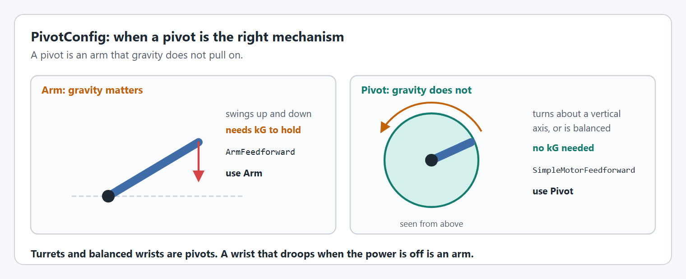
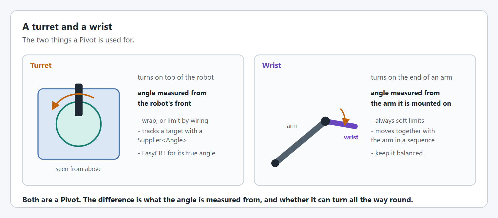

# Turrets/Wrists

Turrets and wrists are both a `Pivot` in YAMS: a mechanism that turns to an angle. A `Pivot` is different from an `Arm` because it does not account for gravity.

## How a pivot works

<figure><figcaption><p>An Arm accounts for gravity. A Pivot does not.</p></figcaption></figure>

A pivot is controlled exactly like an arm, with one difference: a `Pivot` does not account for gravity. It has no `kG`, its simulation applies no gravity, and it uses [`SimpleMotorFeedforward`](editor/config/feedforward.md#withfeedforward) where an arm uses `ArmFeedforward`.

That is the right model for a turret, which turns about a vertical axis, and for a wrist that is balanced about its shaft: neither needs voltage just to stay where it is. It also makes a pivot simpler to tune.

If your mechanism needs voltage to hold itself up, it needs gravity accounted for: use an [Arm](arms.md).

## Creating a pivot

This is the shape of a turret class, not a complete file: the imports and the motor controller object (`spark`, a `SparkMax`) are left out. The [Arm tutorial](../tutorials/arm/mechanism.md) builds a complete mechanism file the same way. The code is the same for Commands v2 and Commands v3 except for the package you import from and the class that owns the mechanism.



```java
import yams.commands2.config.SmartMotorControllerConfig;
import yams.commands2.mechanisms.Pivot;

public class TurretSubsystem extends SubsystemBase
{
  private final SmartMotorControllerConfig motorConfig = new SmartMotorControllerConfig(this)
      .withControlMode(ControlMode.CLOSED_LOOP)
      .withGearing(new MechanismGearing(GearBox.fromReductionStages(3, 4)))
      .withClosedLoopController(4, 0, 0)
      .withFeedforward(new SimpleMotorFeedforward(0.1, 0.5, 0)) // kS, kV, kA: no kG on a pivot
      .withTrapezoidalProfile(DegreesPerSecond.of(180), DegreesPerSecondPerSecond.of(90))
      .withSoftLimits(Degrees.of(-170), Degrees.of(170))
      .withStartingPosition(Degrees.of(0))
      .withMomentOfInertia(Meters.of(0.25), Pounds.of(4))
      .withStatorCurrentLimit(Amps.of(40))
      .withZeroPower(MotorMode.BRAKE)
      .withTelemetry("TurretMotor", TelemetryVerbosity.HIGH);
  private final SmartMotorController motor = new SparkWrapper(spark, DCMotor.getNEO(1), motorConfig);
  private final PivotConfig config = new PivotConfig()
      .withHardLimits(Degrees.of(-180), Degrees.of(180))
      .withTelemetry("Turret", TelemetryVerbosity.HIGH);
  private final Pivot pivot = new Pivot(config, motor); // the YAMS Pivot inside the turret

  @Override
  public void periodic()
  {
    pivot.updateTelemetry(); // every loop
  }

  @Override
  public void simulationPeriodic()
  {
    pivot.simIterate(); // every loop, in simulation
  }
}
```

`this` is the `Subsystem`. The scheduler calls `periodic()` and `simulationPeriodic()` for you.



```java
import yams.commands3.config.SmartMotorControllerConfig;
import yams.commands3.mechanisms.Pivot;

public class TurretMechanism implements Mechanism
{
  private final SmartMotorControllerConfig motorConfig = new SmartMotorControllerConfig(this)
      .withControlMode(ControlMode.CLOSED_LOOP)
      .withGearing(new MechanismGearing(GearBox.fromReductionStages(3, 4)))
      .withClosedLoopController(4, 0, 0)
      .withFeedforward(new SimpleMotorFeedforward(0.1, 0.5, 0)) // kS, kV, kA: no kG on a pivot
      .withTrapezoidalProfile(DegreesPerSecond.of(180), DegreesPerSecondPerSecond.of(90))
      .withSoftLimits(Degrees.of(-170), Degrees.of(170))
      .withStartingPosition(Degrees.of(0))
      .withMomentOfInertia(Meters.of(0.25), Pounds.of(4))
      .withStatorCurrentLimit(Amps.of(40))
      .withZeroPower(MotorMode.BRAKE)
      .withTelemetry("TurretMotor", TelemetryVerbosity.HIGH);
  private final SmartMotorController motor = new SparkWrapper(spark, DCMotor.getNEO(1), motorConfig);
  private final PivotConfig config = new PivotConfig()
      .withHardLimits(Degrees.of(-180), Degrees.of(180))
      .withTelemetry("Turret", TelemetryVerbosity.HIGH);
  private final Pivot pivot = new Pivot(config, motor); // the YAMS Pivot inside the turret

  public void periodic()
  {
    pivot.updateTelemetry(); // every loop
  }

  public void simulationPeriodic()
  {
    pivot.simIterate(); // every loop, in simulation
  }
}
```

`this` is the Commands v3 `Mechanism`. A `Mechanism` has no periodic hook, so call `periodic()` yourself from `Robot.robotPeriodic()`, and run `simulationPeriodic()` in its own `Notifier`, started from `Robot.simulationInit()`. [Where the tutorials put things](../tutorials/project-setup.md#where-the-tutorials-put-things) shows both.



The options in `motorConfig` are explained in [SmartMotorControllerConfig](editor/config/), and the options in `config` in [PivotConfig](mechanism-configs/pivot-config.md).

In the rest of your code, `turret` is the `TurretSubsystem` (or `TurretMechanism`), and `pivot` is the YAMS `Pivot` inside it.


The gains (`kP` of 4, `kS` of 0.1, `kV` of 0.5) and the profile are placeholders. In simulation the turret should turn to its target and stop there, perhaps with some overshoot. On your robot they will be wrong: tune them as below.


## Controlling a pivot

A pivot takes `Angle` targets: `pivot.setAngle(Degrees.of(90))` goes to 90° and holds it, `pivot.runTo(Degrees.of(90), Degrees.of(1))` ends when it gets there, and `pivot.getAngle()` reads where it is. [Controlling a mechanism](controlling-a-mechanism.md) lists every command, setpoint function and check, and [When mechanism commands end](run-vs-runto.md) explains how they work with a default command.

To track a moving target, give `setAngle` (or `run`) a `Supplier<Angle>`: it follows the supplier every loop and never ends. `runTo` with a supplier also follows it, but ends as soon as the turret catches up, so it is not for tracking.

## Turret or wrist?

<figure><figcaption><p>A turret and a wrist are both a Pivot.</p></figcaption></figure>



A turret turns on top of the robot. Its angle is measured from the robot's front, so 0° usually means pointing forward.

**Configure it** for how far it can turn:

| The turret                                            | What to set                                                                                                                                     |
| ----------------------------------------------------- | ----------------------------------------------------------------------------------------------------------------------------------------------- |
| Can spin forever (a slip ring, or nothing to wind up) | [`withContinuousWrapping`](editor/config/closed-loop-control.md#withcontinuouswrapping) and no soft limits, so it takes the short way round.    |
| Is limited by its wiring                              | [`withSoftLimits`](editor/config/limits-and-protection.md#withsoftlimits), with hard limits a little wider. It may have to unwind the long way. |

```java
// Fragment: a turret limited by its wiring to one and a bit turns. Placeholder gains.
SmartMotorControllerConfig motorConfig = new SmartMotorControllerConfig(this)
    .withControlMode(ControlMode.CLOSED_LOOP)
    .withGearing(new MechanismGearing(GearBox.fromReductionStages(10, 4)))
    .withClosedLoopController(20, 0, 0.5)
    .withFeedforward(new SimpleMotorFeedforward(0.2, 0.5, 0)) // kS, kV, kA
    .withTrapezoidalProfile(DegreesPerSecond.of(360), DegreesPerSecondPerSecond.of(720))
    .withSoftLimits(Degrees.of(-200), Degrees.of(200))
    .withStartingPosition(Degrees.of(0))
    .withMomentOfInertia(Meters.of(0.25), Pounds.of(8))
    .withTelemetry("TurretMotor", TelemetryVerbosity.HIGH);
PivotConfig config = new PivotConfig()
    .withHardLimits(Degrees.of(-220), Degrees.of(220))
    .withTelemetry("Turret", TelemetryVerbosity.HIGH);
```

**Use it** to track something by giving `setAngle` a supplier, which it reads every loop. To aim at a point on the field, the turret's angle is the direction to the target minus the robot's heading:

```java
// In TurretSubsystem. Never ends: bind it with whileTrue, or make it the default command.
public Command aimAt(Supplier<Angle> fieldAngleToTarget, Supplier<Angle> robotHeading)
{
  return pivot.setAngle(() -> fieldAngleToTarget.get().minus(robotHeading.get()));
}
```

A turret geared so its encoders turn more than once over its travel cannot tell where it is from one encoder. [EasyCRT](easycrt.md) works out its true angle from two.



A wrist turns on the end of another mechanism, usually an arm. Its angle is measured from the arm it is mounted on, not from the ground.

**Configure it** with soft limits always, because a wrist has parts to hit at both ends of its travel, and a small moment of inertia.

```java
// Fragment: a wrist on the end of an arm. Placeholder gains.
SmartMotorControllerConfig motorConfig = new SmartMotorControllerConfig(this)
    .withControlMode(ControlMode.CLOSED_LOOP)
    .withGearing(new MechanismGearing(GearBox.fromReductionStages(5, 5)))
    .withClosedLoopController(12, 0, 0.2)
    .withFeedforward(new SimpleMotorFeedforward(0.1, 0.3, 0)) // kS, kV, kA
    .withTrapezoidalProfile(DegreesPerSecond.of(360), DegreesPerSecondPerSecond.of(720))
    .withSoftLimits(Degrees.of(-90), Degrees.of(90))
    .withStartingPosition(Degrees.of(0))
    .withMomentOfInertia(Inches.of(6), Pounds.of(2))
    .withTelemetry("WristMotor", TelemetryVerbosity.HIGH);
PivotConfig config = new PivotConfig()
    .withHardLimits(Degrees.of(-100), Degrees.of(100))
    .withTelemetry("Wrist", TelemetryVerbosity.HIGH);
```

**Use it** together with the arm it rides on. Keep the wrist in its own subsystem, and move the two from a command that owns neither, so each keeps its own default command.

A `Pivot` does not account for gravity, so it suits a wrist that is balanced about its shaft. A heavy, unbalanced wrist is pulled on by gravity by an amount that depends on the arm's angle as well as its own, which neither `Pivot` nor `Arm` models. Balance the wrist if you can. If you cannot, expect to need more `kP`, and check it holds at every arm angle.



## Moment of inertia

How heavy the pivot is to turn is set on the motor config with [`withMomentOfInertia`](editor/config/simulation.md#withmomentofinertia). It only matters in simulation, where it also decides the current the pivot draws from the [battery simulation](../understanding/battery-simulation.md).

## Configuring and tuning a pivot, step by step

Do the configuration steps first, in simulation, then tune the real pivot with [live tuning](live-tuning/). Tuning something that is configured wrong wastes the time.


Like all tuning, this can be dangerous. Keep clear of the mechanism, start with low current limits and small moves, and practice in simulation first.


### Configure it



#### Set the gearing

Give the reduction from the motor to the pivot with [`withGearing`](editor/config/gearing-and-units.md#withgearing).



#### Choose the positive direction

For a turret, counter-clockwise seen from above is positive, to match the robot's heading. Apply a small positive voltage and flip [`withMotorInverted`](editor/config/motor-basics.md#withmotorinverted) if it turns the other way.



#### Choose where zero is

A turret's zero is usually pointing at the robot's front. A wrist's zero is usually in line with its arm. Set an absolute encoder's [zero offset](editor/config/encoders.md#withexternalencoderzerooffset), or a [starting position](editor/config/encoders.md#withstartingposition).



#### Wrap it or limit it

A turret that can spin forever gets [`withContinuousWrapping`](editor/config/closed-loop-control.md#withcontinuouswrapping) and no soft limits. Everything else gets [`withSoftLimits`](editor/config/limits-and-protection.md#withsoftlimits), inside [`withHardLimits`](mechanism-configs/shared-options.md#withhardlimits).



#### Describe it to the simulator

Set [`withMomentOfInertia`](editor/config/simulation.md#withmomentofinertia) on the motor config.



### What is different when tuning a pivot

A pivot is tuned like an arm without the kG step: follow [Step 5 of the Arm tutorial](../tutorials/arm/tune.md), and see [Tuning order](live-tuning/#tuning-order) for the keys to watch. What sets a pivot apart:

* **There is no kG.** Start with kS: raise it until the pivot is just about to move, in each direction, and use the smaller value.
* **Friction varies with direction and position.** Cables and hoses drag more one way, and more near the ends of the travel. Tune where the drag is worst.
* **kV matters more than on an arm** for a turret that tracks, because its setpoint never stops moving.

### What changes for each kind



* **Check both directions.** Cables and hoses drag more one way than the other, and more near the end of the travel. Tune kS and kP where the drag is worst.
* **Tune it while tracking.** A turret that aims at a target has a setpoint that never stops moving. Drive and spin the robot while it tracks, and raise kV and kP until it stays on target.
* **Check the seam.** With continuous wrapping, command a move across the wrapping point and check it takes the short way.
* **Check the unwind.** With soft limits, command an angle just past a limit and check the turret goes the long way round to reach it, or stops at the limit.



* **Tune it at several arm angles.** Because a `Pivot` does not account for gravity, an unbalanced wrist is pushed around by it as the arm moves. Tune with the arm level, where that is worst, then check with the arm up and down.
* **Raise kP to hold against gravity** if you cannot balance the wrist. Expect a small steady error that changes with the arm's angle.
* **Tune it holding a game piece**, which changes both its weight and its balance.
* **Check the limits with the arm in every position.** A wrist that clears the robot with the arm up may hit it with the arm down.



## PivotConfig options

Every `PivotConfig` option is on the [PivotConfig](mechanism-configs/pivot-config.md) page under this one, with a graphic and an example for each. Options shared by every mechanism are in [Shared options](mechanism-configs/shared-options.md).

A `Pivot` needs its hard limits and a starting position before it can be created in simulation: see [what simulation needs](mechanism-configs/#what-simulation-needs).

## Code reference




