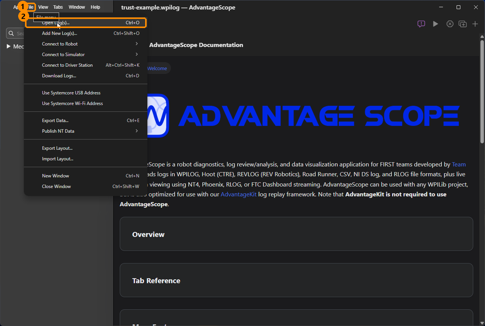
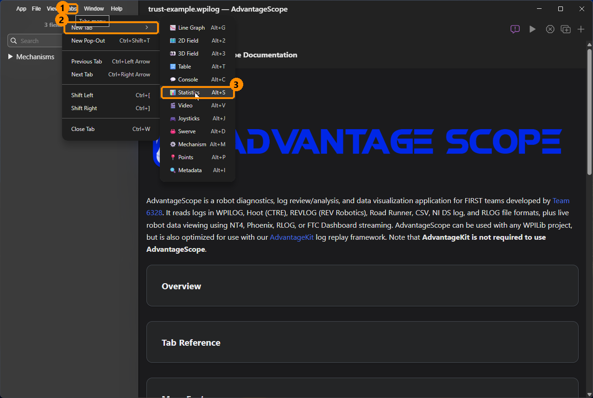
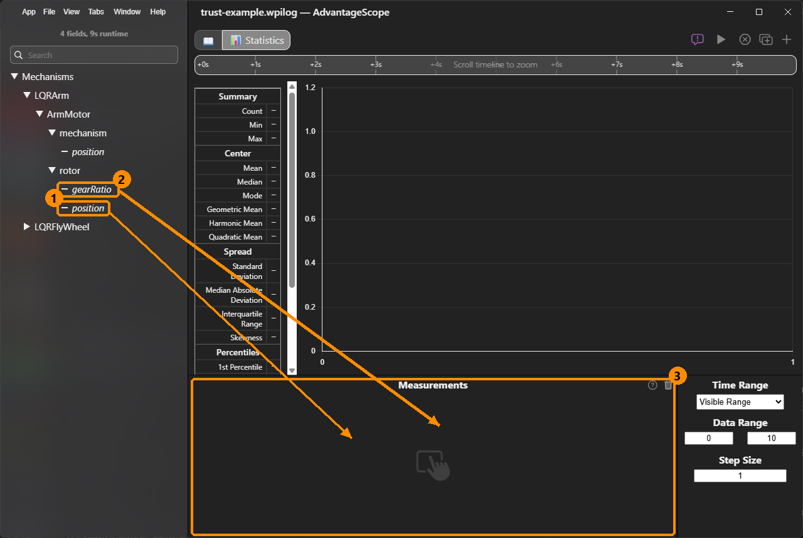
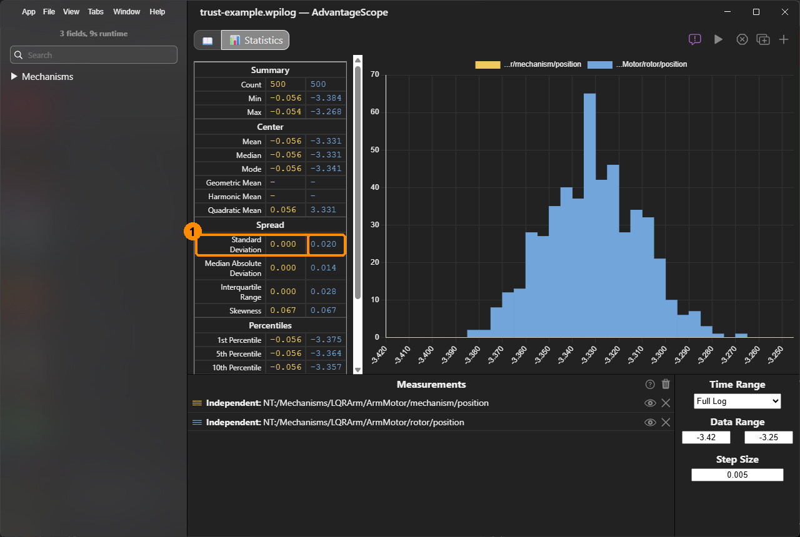
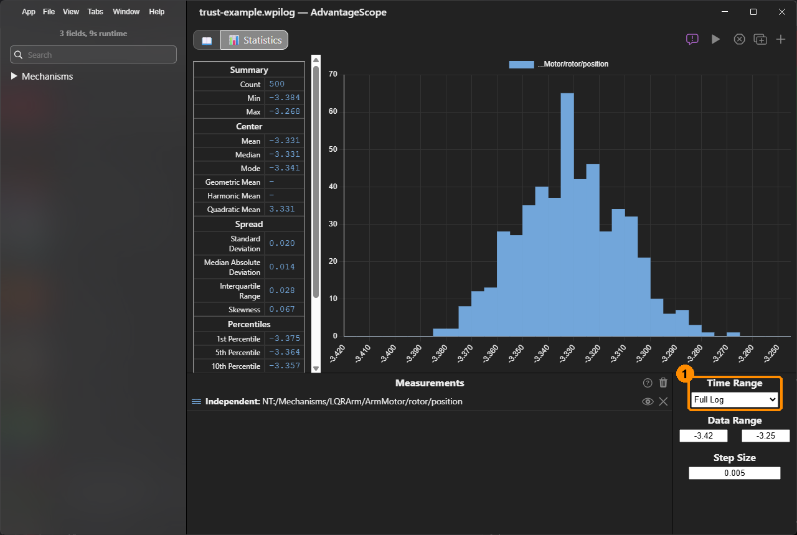
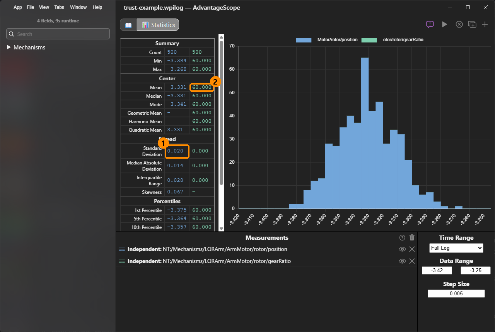
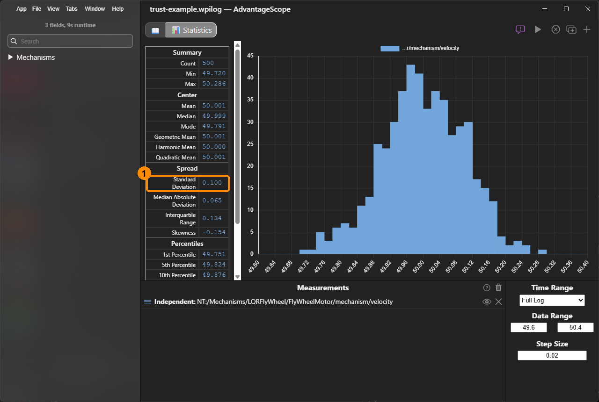

# How do I measure my encoder's noise?

An LQR's **encoder trust** is how noisy the encoder is, as a standard deviation. This page measures it from a log, with AdvantageScope's Statistics view. [Find the encoder and model trust](how-do-i-use-lqr.md#find-the-encoder-and-model-trust) explains what to do with the number.

## Before you start

* A robot whose mechanism has a YAMS motor controller with telemetry on (`LOW` or higher).
* A way to get its log into AdvantageScope, as in [How do I view my DataLog in AdvantageScope?](how-do-i-view-my-datalog-in-advantagescope.md).
* AdvantageScope 2027, from the WPILib installer.

The screenshots below use an example log of an arm resting at -20° on a NEO with a 60:1 reduction, and a flywheel held at 3,000 RPM, each with encoder noise added. Your numbers will differ.

## Measure it



### Log the mechanism holding still

Hold the mechanism still for a few seconds, and log it:

* **An arm, pivot or elevator:** disable the robot with the mechanism resting on a hard stop, so nothing but noise moves the reading.
* **A flywheel:** spin it at a steady voltage instead, with `voltage/enabled` in [live tuning](../details/live-tuning/README.md#drive-a-motor-at-a-voltage), since it has to be turning to read a speed.

**Check it:** you have the log on your computer.



### Open the log

In AdvantageScope, click **File**, then **Open Log(s)...**, and choose the log.

<figure><figcaption>
File, then Open Log(s)...
</figcaption></figure>

**Check it:** the sidebar on the left lists your fields, starting with **Mechanisms**.



### Add a Statistics tab

Click **Tabs**, then **New Tab**, then **Statistics**. The shortcut is Alt+S.

<figure><figcaption>
Tabs, then New Tab, then Statistics.
</figcaption></figure>

**Check it:** a tab named Statistics opens, with an empty table on the left and an empty Measurements list at the bottom.



### Drag the encoder's fields into Measurements

In the sidebar, open **Mechanisms**, then your mechanism, then your motor. Drag these to the **Measurements** list:

* **An arm or pivot:** `rotor/position`, the motor's own encoder, and `rotor/gearRatio`, the gear ratio YAMS uses.
* **An elevator:** the same two, and `measurement/circumference`.
* **A flywheel:** `mechanism/velocity`.

<figure><figcaption>
Drag rotor/position and rotor/gearRatio into the Measurements list.
</figcaption></figure>

**Why the rotor, and not `mechanism/position`?** The Statistics view shows three decimal places, and YAMS logs a mechanism's position in rotations. An arm's noise is a few ten-thousandths of a rotation, which rounds to 0.000. The motor turns gear-ratio times further than the arm, so its noise shows, and `rotor/gearRatio` turns it back into the arm's. An elevator's `measurement/position` in meters rounds away the same way.

<figure><figcaption>
The same noise: 0.000 at the arm, which rounds away, and 0.020 at the motor.
</figcaption></figure>

**Check it:** the fields appear in the Measurements list, and a histogram appears above them.



### Set the time range

Set **Time Range** to **Full Log**, so the statistics cover the whole log.

<figure><figcaption>
Time Range: Full Log.
</figcaption></figure>

If the log also has the mechanism moving, use **Visible Range** instead, and zoom the timeline to just the part where it holds still: motion in the range would count as noise.

**Check it:** Count, at the top of the table, is the number of readings in the log, not 1 or a dash.



### Read the standard deviation

Read the encoder's **Standard Deviation**, under Spread, and the gear ratio: `rotor/gearRatio`'s **Mean**, under Center. An elevator's circumference is `measurement/circumference`'s Mean, in meters.

<figure><figcaption>
The rotor's noise, 0.020 rotations, and the gear ratio, 60.
</figcaption></figure>

Then convert it to the units the LQR's encoder trust takes:

| Mechanism | Encoder trust |
| --- | --- |
| Arm, pivot | `rotor/position`'s standard deviation ÷ `rotor/gearRatio` × 360 = degrees |
| Elevator | `rotor/position`'s standard deviation ÷ `rotor/gearRatio` × `measurement/circumference` = meters |
| Flywheel | `mechanism/velocity`'s standard deviation × 60 = RPM |

For the example arm: 0.020 ÷ 60 × 360 = **0.12°**. For the example flywheel, 0.100 rotations per second × 60 = **6 RPM**:

<figure><figcaption>
A flywheel at 50 rotations per second: a standard deviation of 0.100, or 6 RPM.
</figcaption></figure>

**Check it:** you have one number, in degrees, meters or RPM: your encoder trust.



## If it did not work

* **There is no `rotor/gearRatio` or `measurement/circumference`.** Your YAMS is older than the release that logs them. Work the gear ratio out from your motor config's `withGearing(...)`, or print it with `System.out.println(config.getGearing().getMechanismToRotorRatio())` (C++ `config.GetMotorGearing()->GetMechanismToRotorRatio()`):

  | Your config | Gear ratio |
  | --- | --- |
  | `new MechanismGearing(60)` | 60 |
  | `new MechanismGearing(GearBox.fromReductionStages(3, 4))`, or `fromStages("3:1", "4:1")` | 3 × 4 = 12 |
  | `new MechanismGearing(GearBox.fromTeeth(12, 60))` | 60 ÷ 12 = 5 |
  | `new MechanismGearing(GearBox.fromReductionStages(3, 4), Sprocket.fromStages("12:24"))` | 3 × 4 × 2 = 24 |

  A sprocket written as a number, such as `new Sprocket(2)`, is a 1:2 step-up, which divides the ratio instead: print it to be sure. An elevator's circumference is what you gave `withMechanismCircumference(...)`, or 2 × π × the drum radius.

* **Count is 1, or the table shows dashes.** The time range does not cover the log: set Time Range to Full Log, or zoom the timeline to the part you want with Visible Range.
* **Standard Deviation is 0.000 for `rotor/position` too.** The noise is smaller than one count of the encoder. Use one count divided by 3.5 (√12) instead: a NEO's built-in encoder counts 42 times a motor turn, so on a 60:1 arm one count is 360° ÷ (42 × 60) = 0.14°, and its trust about 0.04°.
* **The mechanism has its own encoder,** such as an absolute encoder on the arm's shaft. Its field, `externalencoder/position`, is in rotations of the mechanism, so it rounds to 0.000 too: use one count of that encoder divided by 3.5. A 4,096-count encoder gives 0.088° ÷ 3.5 = 0.025°.
* **The standard deviation is much larger than you expect.** Something moved: check the mechanism held still for the whole range, and that the robot was disabled or the flywheel's speed was steady.
