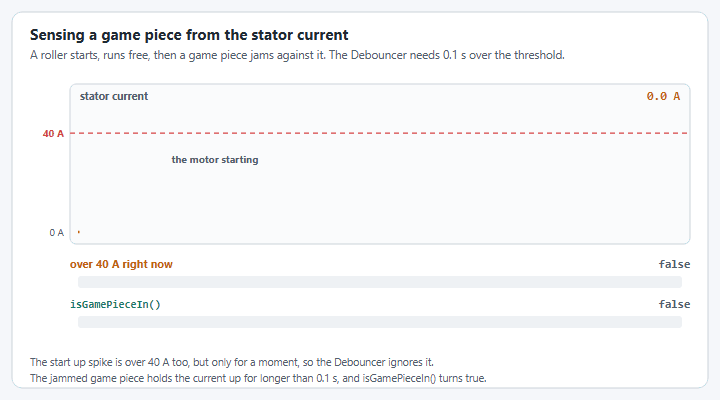

# How do I sense activity from the motor current?

Current sensing lets your robot detect when a mechanism is stalling against a hard stop, for example, an elevator that has fully descended or a claw that has fully closed, without requiring a dedicated limit switch. Because `SmartMotorController` exposes stator current, you can wire a `Trigger` directly to a current threshold, which is useful when a sensor was never installed or when adding one mid-season is not practical.

There are situations where the mechanical team never confirmed with programming on what they would need to plan for and it is too late to redesign the mechanism and add a proper sensor.

In this case you can sense if there is a game piece by the current on the smart motor controller?

<figure><figcaption>
The <code>Debouncer</code> ignores the short spike when the motor starts, and reports the game piece once the current has stayed over the threshold for 0.1 seconds.
</figcaption></figure>



<pre class="language-java"><code class="lang-java">  private SmartMotorControllerConfig smcConfig = new SmartMotorControllerConfig(this)
    .withControlMode(ControlMode.CLOSED_LOOP)
    // Feedback Constants (PID Constants)
    .withClosedLoopController(50, 0, 0)
    .withSimClosedLoopController(50, 0, 0)
    // Feedforward Constants
    .withFeedforward(new ArmFeedforward(0, 0, 0))
    .withSimFeedforward(new ArmFeedforward(0, 0, 0))
    // Telemetry name and verbosity level
    .withTelemetry("ArmMotor", TelemetryVerbosity.HIGH)
    // Gearing from the motor rotor to final shaft.
    // In this example gearbox(3,4) is the same as gearbox("3:1","4:1") which corresponds to the gearbox attached to your motor.
    .withGearing(new MechanismGearing(GearBox.fromReductionStages(3, 4)))
    // Motor properties to prevent over currenting.
    .withMotorInverted(false)
    .withZeroPower(MotorMode.BRAKE)
    .withStatorCurrentLimit(Amps.of(40))
    .withClosedLoopRampRate(Seconds.of(0.25))
    .withOpenLoopRampRate(Seconds.of(0.25));

  // Vendor motor controller object
  private SparkMax spark = new SparkMax(CANPort.CAN_S0, 4, MotorType.kBrushless);

  // Create our SmartMotorController from our Spark and config with the NEO.
<strong>  private SmartMotorController sparkSmartMotorController = new SparkWrapper(spark, DCMotor.getNEO(1), smcConfig);
</strong>
<strong>  private Debouncer statorDebounce = new Debouncer(0.1); // Debouncer to prevent rapid changes in 0.1s
</strong>
<strong>  /**
</strong><strong>   * Game piece is detected if you're using over 40A current for more than 0.1s
</strong><strong>   */
</strong><strong>  public boolean isGamePieceIn() {
</strong><strong>      return statorDebounce.calculate(sparkSmartMotorController.getStatorCurrent().gte(Amps.of(40))); 
</strong><strong>  }
</strong></code></pre>

`Debouncer` is `org.wpilib.math.filter.Debouncer` and `CANPort` is `org.wpilib.hardware.bus.CANPort` in WPILib 2027. To use the check as a `Trigger`, wrap it: `new Trigger(this::isGamePieceIn)`.

