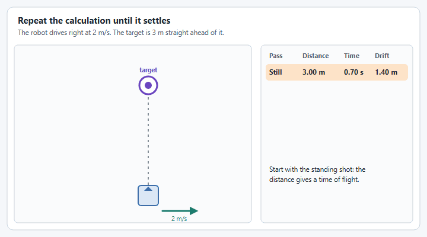

# How do I shoot on the move?

Shooting on the move means scoring while the robot is still driving, instead of stopping to line up first. YAMS does not do the shot math for you, but it gives you every input the math needs and the two outputs it drives: a swerve drive that can face a point while the driver keeps driving, and a flywheel that can follow a changing speed.

This guide builds a small working version on top of the [Swerve Drive](../tutorials/swerve-drive.md) and [Shooter](../tutorials/shooter-flywheels.md) tutorials, and points at the WPILib documentation and the FRC write-ups for each part as it goes. The full reading list is [at the end](#further-reading).


The code is shown for Java with Commands v2 and Commands v3. The C++ `SwerveInputStream` has the same `WithAim`, so the same approach works there. Every snippet on this page compiles against YAMS, but none of it has been run on a robot: the numbers in the tables are placeholders for your own measurements.


## The idea

A game piece keeps the robot's velocity when it leaves the shooter. If the robot is moving sideways, the shot drifts sideways and misses. Almost every team fixes this the same way, and [Shoot on the move from the code perspective](https://www.chiefdelphi.com/t/shoot-on-the-move-from-the-code-perspective/511815) on Chief Delphi explains it well:

1. Work out the shot as if the robot was standing still. The distance to the target gives a flywheel speed and a **time of flight**.
2. Multiply the robot's field relative velocity by that time of flight. That is how far the shot will drift.
3. Move the target the opposite way by that much. This is the **virtual target**.
4. Aim at the virtual target, and work the shot out again for its distance. Repeat two or three times, because the new distance changes the time of flight a little.

WPILib is writing its own explanation of this, with simulations you can play with: [Dynamic Shooting via Time-of-Flight Recursion](https://frc-docs--3242.org.readthedocs.build/en/3242/docs/software/advanced-controls/fire-control/dynamic-shooting.html). It is a preview of a page that is not finished yet.

<figure><figcaption><p>The shot keeps the robot's velocity. Aiming at the virtual target cancels the drift.</p></figcaption></figure>

## What you need first

* A swerve drive that knows where it is. The pose comes from the drive's odometry, and a moving shot is only as good as that pose. WPILib's [Pose Estimators](https://docs.wpilib.org/en/stable/docs/software/advanced-controls/state-space/state-space-pose-estimators.html) page explains how vision corrects it.
* A rotation controller on the drive. `withAim` uses the one you gave [`SwerveDriveConfig`](../details/mechanism-configs/swerve-drive-config.md), which the swerve tutorial already sets.
* A flywheel that reaches its speed quickly and holds it. See [How to shoot with a Shooter?](how-to-shoot-with-a-shooter.md) and WPILib's [Tuning a Flywheel Velocity Controller](https://docs.wpilib.org/en/stable/docs/software/advanced-controls/introduction/tuning-flywheel.html).
* A shooter that points out of the **front** of the robot. `withAim` turns the front of the robot toward the target.

## 1. Measure two tables

With the robot standing still, find the flywheel speed that scores from a few distances, and how long each shot is in the air. A slow motion phone video is enough for the time. [Time of Flight Determination](https://www.chiefdelphi.com/t/time-of-flight-determination/512542) compares the ways teams measure or calculate it, and [Shoot While Move Code (1706)](https://www.chiefdelphi.com/t/shoot-while-move-code-1706/410494) shows a team using exactly this pair of tables.

WPILib's [`InterpolatingDoubleTreeMap`](https://github.wpilib.org/allwpilib/docs/release/java/edu/wpi/first/math/interpolation/InterpolatingDoubleTreeMap.html) fills in the distances between your measurements.

<figure><figcaption><p>Measure a few distances. The table fills in the rest.</p></figcaption></figure>

## 2. Calculate the shot

This class is plain WPILib, so it is the same in Commands v2 and Commands v3. It is the four steps from [The idea](#the-idea) in code. [Translation, Rotation, and Pose](https://docs.wpilib.org/en/stable/docs/software/advanced-controls/geometry/pose.html) covers the geometry classes it uses, and [Introduction to Kinematics and The ChassisSpeeds Class](https://docs.wpilib.org/en/stable/docs/software/kinematics-and-odometry/intro-and-chassis-speeds.html) covers the velocity (`ChassisSpeeds` is called `ChassisVelocities` in WPILib 2027).

<figure><figcaption><p>Each pass uses the distance from the pass before. After three it has settled.</p></figcaption></figure>


```java
package first.robot;

import static org.wpilib.units.Units.RPM;

import org.wpilib.math.geometry.Pose2d;
import org.wpilib.math.geometry.Rotation2d;
import org.wpilib.math.geometry.Translation2d;
import org.wpilib.math.interpolation.InterpolatingDoubleTreeMap;
import org.wpilib.math.kinematics.ChassisVelocities;
import org.wpilib.units.measure.AngularVelocity;

/** Works out where to aim and how fast to spin the flywheel while the robot is moving. */
public final class ShotCalculator {
  /** Where to aim, and the flywheel speed that reaches it. */
  public record Shot(Pose2d target, AngularVelocity flywheelSpeed) {}

  // Where the real target is on the field, in meters.
  private static final Translation2d TARGET = new Translation2d(4.6, 4.0);

  // Distance to the target in meters, to flywheel speed in RPM.
  private static final InterpolatingDoubleTreeMap FLYWHEEL_RPM = new InterpolatingDoubleTreeMap();
  // Distance to the target in meters, to how long the shot is in the air in seconds.
  private static final InterpolatingDoubleTreeMap TIME_OF_FLIGHT = new InterpolatingDoubleTreeMap();

  static {
    // Measure these on your own robot, standing still.
    FLYWHEEL_RPM.put(1.5, 2400.0);
    FLYWHEEL_RPM.put(3.0, 3000.0);
    FLYWHEEL_RPM.put(4.5, 3700.0);

    TIME_OF_FLIGHT.put(1.5, 0.45);
    TIME_OF_FLIGHT.put(3.0, 0.70);
    TIME_OF_FLIGHT.put(4.5, 0.95);
  }

  private ShotCalculator() {}

  /**
   * @param robotPose where the robot is on the field
   * @param fieldVelocity how fast the robot is moving on the field
   */
  public static Shot calculate(Pose2d robotPose, ChassisVelocities fieldVelocity) {
    Translation2d virtualTarget = TARGET;
    // Each pass uses the distance from the pass before, so the answer settles after a few.
    for (int i = 0; i < 3; i++) {
      double distance = robotPose.getTranslation().getDistance(virtualTarget);
      double timeOfFlight = TIME_OF_FLIGHT.get(distance);
      // The shot drifts by the robot's velocity times the time of flight, so aim that far the other way.
      virtualTarget = TARGET.minus(
          new Translation2d(fieldVelocity.vx * timeOfFlight, fieldVelocity.vy * timeOfFlight));
    }
    double distance = robotPose.getTranslation().getDistance(virtualTarget);
    return new Shot(new Pose2d(virtualTarget, new Rotation2d()), RPM.of(FLYWHEEL_RPM.get(distance)));
  }
}
```


**For your robot:** set `TARGET` to your game's target, fill both tables with your own measurements, and flip the target for the red alliance. [Coordinate System](https://docs.wpilib.org/en/stable/docs/software/basic-programming/coordinate-system.html) explains the field coordinates. If your shooter is not at the center of the robot, measure distance from where the shooter is with a transform: see [Transformations](https://docs.wpilib.org/en/stable/docs/software/advanced-controls/geometry/transformations.html).

Want to see how far this can go? [Mechanical Advantage 6328's `LaunchCalculator.java`](https://github.com/Mechanical-Advantage/RobotCode2026Public/blob/main/src/main/java/org/littletonrobotics/frc2026/subsystems/launcher/LaunchCalculator.java) and [Hammerheads 5000's `TurretCalculator.java`](https://github.com/hammerheads5000/2026Rebuilt/blob/main/src/main/java/frc/robot/subsystems/turret/TurretCalculator.java) are complete calculators from 2026 robots, and the Hammerheads' [build thread post](https://www.chiefdelphi.com/t/frc-5000-hammerheads-2026-build-thread-open-alliance/507502/129) walks through theirs. The [Shooting on the fly, part 1](https://blog.eeshwark.com/robotblog/shooting-on-the-fly) and [part 2](https://blog.eeshwark.com/robotblog/shooting-on-the-fly-pt2) blog series and the [Orbit 1690 Online Software Sessions](https://www.chiefdelphi.com/t/orbit-1690-online-software-sessions/467221) cover the math behind them.

## 3. Let the calculator read the drive

The calculator needs two things from the [Swerve Drive](../details/swerve-drive.md): where the robot is, and how fast it is moving on the field. Add these to the drive class from the tutorial.




```java
/** Where the robot is on the field. */
public Pose2d getPose() {
  return drive.getPose();
}

/** How fast the robot is moving on the field. */
public ChassisVelocities getFieldVelocity() {
  return drive.getFieldRelativeSpeed();
}
```





```java
/** Where the robot is on the field. */
public Pose2d getPose() {
  return drive.getPose();
}

/** How fast the robot is moving on the field. */
public ChassisVelocities getFieldVelocity() {
  return drive.getFieldRelativeSpeed();
}
```




## 4. Let the flywheel follow a changing speed

The shot's flywheel speed changes as the robot moves, so the shooter needs a command that takes a supplier. `FlyWheel.run(Supplier)` reads it every loop. Add this to the shooter class from the tutorial, along with an import of `java.util.function.Supplier`.




```java
/** Follow a speed that changes every loop. This command does not end on its own. */
public Command track(Supplier<AngularVelocity> speed) {
  return shooter.run(speed);
}
```





```java
/** Follow a speed that changes every loop. This command does not end on its own. */
public Command track(Supplier<AngularVelocity> speed) {
  return shooter.run(speed);
}
```




## 5. Aim and spin up together

Two things happen while the driver holds the right bumper:

* [`withAim`](../details/swerve-input-stream.md#aim-at-a-target) on the [Swerve Input Stream](../details/swerve-input-stream.md) turns the robot toward the virtual target. It takes a supplier, so it follows the target as it moves every loop. The left stick keeps driving.
* The shooter follows the speed the shot needs.

<figure><figcaption><p><code>withAim</code>: the left stick drives, and the robot keeps facing the target it is given.</p></figcaption></figure>




```java
private final SwerveSubsystem drive = new SwerveSubsystem();
private final ShooterSubsystem shooter = new ShooterSubsystem();

/** The shot for where the robot is, and how it is moving, right now. */
private ShotCalculator.Shot shot() {
  return ShotCalculator.calculate(drive.getPose(), drive.getFieldVelocity());
}

// ...

  drive.setDefaultCommand(drive.drive(
      drive.getChassisSpeedsSupplier(
          () -> -driverController.getLeftY(),
          () -> -driverController.getLeftX(),
          () -> -driverController.getRightX())
          // While the right bumper is held, face the virtual target instead of
          // turning with the right stick. The left stick keeps driving.
          .withAim(() -> shot().target(), driverController.rightBumper())));

  // While the right bumper is held, keep the flywheel at the speed the shot needs.
  driverController.rightBumper().whileTrue(shooter.track(() -> shot().flywheelSpeed()));
```





```java
final SwerveMechanism drive = new SwerveMechanism();
final ShooterMechanism shooter = new ShooterMechanism();

/** The shot for where the robot is, and how it is moving, right now. */
ShotCalculator.Shot shot() {
  return ShotCalculator.calculate(drive.getPose(), drive.getFieldVelocity());
}

// ...

@Override
public void robotPeriodic() {
  drive.periodic();
  shooter.periodic();
  scheduler.run();
  Telemetry.log("Scheduler", scheduler, Scheduler.proto);
}

@Override
public void simulationPeriodic() {
  drive.simulationPeriodic();
  shooter.simulationPeriodic();
}
```



```java
robot.drive.setDefaultCommand(robot.drive.drive(
    robot.drive.getChassisSpeedsSupplier(
        () -> -robot.exampleController.getLeftY(),
        () -> -robot.exampleController.getLeftX(),
        () -> -robot.exampleController.getRightX())
        // While the right bumper is held, face the virtual target instead of
        // turning with the right stick. The left stick keeps driving.
        .withAim(() -> robot.shot().target(), robot.exampleController.rightBumper())));

// While the right bumper is held, keep the flywheel at the speed the shot needs.
robot.exampleController.rightBumper()
    .whileTrue(robot.shooter.track(() -> robot.shot().flywheelSpeed()));
```




## 6. Feed only when the shot is ready

Do not feed a game piece until the flywheel is at the shot's speed and the robot is facing the virtual target. [How to shoot with a Shooter?](how-to-shoot-with-a-shooter.md) shows how to gate a feeder on the flywheel's speed with a debounce. Add a check of the drive's heading against the direction to the virtual target in the same way.

## Tuning it

* Get the standing shot right first. If shots miss while the robot is still, moving will not fix them.
* Then drive slowly sideways past the target. If shots land behind the robot's direction of travel, your times of flight are too short. If they land ahead of it, they are too long.
* Check the aim before the shot. If the robot lags behind the virtual target, raise the rotation controller's gains in [`SwerveDriveConfig`](../details/mechanism-configs/swerve-drive-config.md).
* [part 2](https://blog.eeshwark.com/robotblog/shooting-on-the-fly-pt2) of the shooting on the fly series is about tuning on a real robot.

## Further reading

### WPILib documentation

A **Fire Control** section is being written for the WPILib documentation in [wpilib-docs #3242](https://github.com/wpilibsuite/wpilib-docs/pull/3242). It is a work in progress and has not been merged, so these links go to the pull request's preview and may move:

| Page | What it covers |
| ---- | -------------- |
| [Fire Control](https://frc-docs--3242.org.readthedocs.build/en/3242/docs/software/advanced-controls/fire-control/index.html) | The start of the section, which also has pages on shooting while standing still, a Newton's method solver and drag. |
| [Dynamic Shooting via Time-of-Flight Recursion](https://frc-docs--3242.org.readthedocs.build/en/3242/docs/software/advanced-controls/fire-control/dynamic-shooting.html) | Shooting on the move: the same repeated time of flight calculation as this guide, with an interactive simulation. |

Until that is published, the released WPILib documentation covers every building block. These pages are written for WPILib 2026. The ideas are the same in 2027, though some classes were renamed.

| Page | Why it matters here |
| ---- | ------------------- |
| [Coordinate System](https://docs.wpilib.org/en/stable/docs/software/basic-programming/coordinate-system.html) | Which way X, Y and a positive rotation point. Get this wrong and the virtual target moves the wrong way. |
| [Translation, Rotation, and Pose](https://docs.wpilib.org/en/stable/docs/software/advanced-controls/geometry/pose.html) | The classes that the distance and direction to the target are calculated with. |
| [Transformations](https://docs.wpilib.org/en/stable/docs/software/advanced-controls/geometry/transformations.html) | Getting from the center of the robot to where the shooter really is. |
| [Introduction to Kinematics and The ChassisSpeeds Class](https://docs.wpilib.org/en/stable/docs/software/kinematics-and-odometry/intro-and-chassis-speeds.html) | Robot relative and field relative velocity. |
| [Pose Estimators](https://docs.wpilib.org/en/stable/docs/software/advanced-controls/state-space/state-space-pose-estimators.html) | Combining odometry with vision for a pose you can trust. |
| [Tuning a Flywheel Velocity Controller](https://docs.wpilib.org/en/stable/docs/software/advanced-controls/introduction/tuning-flywheel.html) | Getting the flywheel to its speed quickly. |
| [`InterpolatingDoubleTreeMap`](https://github.wpilib.org/allwpilib/docs/release/java/edu/wpi/first/math/interpolation/InterpolatingDoubleTreeMap.html) (API) | The lookup table used by `ShotCalculator`. |

### FRC write-ups and code

| Resource | What you get from it |
| -------- | -------------------- |
| [Shoot on the move from the code perspective](https://www.chiefdelphi.com/t/shoot-on-the-move-from-the-code-perspective/511815) (Chief Delphi) | The best place to start. It explains the virtual target and links to most of the resources below. |
| [Shooting on the fly, part 1](https://blog.eeshwark.com/robotblog/shooting-on-the-fly) and [part 2](https://blog.eeshwark.com/robotblog/shooting-on-the-fly-pt2) (Eeshwar Krishnan) | A blog series on the technique. Part 2 covers tuning it and using it on a real robot. |
| [Time of Flight Determination](https://www.chiefdelphi.com/t/time-of-flight-determination/512542) (Chief Delphi) | The different ways teams find the time of flight. |
| [Shoot While Move Code (1706)](https://www.chiefdelphi.com/t/shoot-while-move-code-1706/410494) (Chief Delphi) | Team 1706 walks through its 2022 code: a table of time of flight against distance, a virtual goal, and a few repeats of the calculation. |
| [Orbit 1690 Online Software Sessions](https://www.chiefdelphi.com/t/orbit-1690-online-software-sessions/467221) (Chief Delphi) | Recorded sessions from Team 1690 on their swerve and system control software, which other teams point to for the shoot on the move math. |
| [Mechanical Advantage 6328's `LaunchCalculator.java`](https://github.com/Mechanical-Advantage/RobotCode2026Public/blob/main/src/main/java/org/littletonrobotics/frc2026/subsystems/launcher/LaunchCalculator.java) | The launch calculation from their 2026 robot code. |
| [Hammerheads 5000's `TurretCalculator.java`](https://github.com/hammerheads5000/2026Rebuilt/blob/main/src/main/java/frc/robot/subsystems/turret/TurretCalculator.java) | The shot calculation for a turret from their 2026 robot code, with a [build thread post](https://www.chiefdelphi.com/t/frc-5000-hammerheads-2026-build-thread-open-alliance/507502/129) that walks through it. |

None of the team code uses YAMS, so the class and method names differ from yours. Read it for the math, and use the steps above to find the YAMS call that supplies each input.
