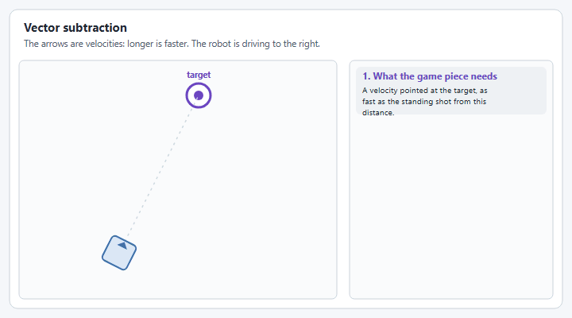
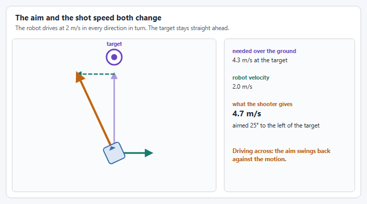

# How do I shoot on the move?

Shooting on the move means scoring while the robot is still driving, instead of stopping to line up first.

We covered this in a YASS Weekly Workshop, **How To Program Target Tracking And Shooting On The Fly for FRC**. Watch it first:



This page does not try to teach it. People in the FRC community have already explained it well, and their work is where you should learn it. What this page adds is the YAMS side: which YAMS call supplies each thing those sources ask for, what the [Swerve Input Stream](../details/swerve-input-stream.md) does for you and what it does not, and a [complete example](#a-complete-example) that goes from an empty project to a robot that shoots on the move.

## Read these first

| Source | Read it for |
| ------ | ----------- |
| [Shooting on the Fly](https://blog.eeshwark.com/robotblog/shooting-on-the-fly) and [Shooting on the Fly, Part 2: The LUT Approach](https://blog.eeshwark.com/robotblog/shooting-on-the-fly-pt2), by Eeshwar | The best place to start. Part 1 explains the idea as plain vector math, then covers what goes wrong on a real robot: latency, a flywheel that slows and slips, spin and drag, lobbed shots, and a shooter that is itself moving. Part 2 is the practical side: building the lookup table, getting the shot's speed from the time of flight, shooters with a hood, and tuning the latency. |
| WPILib's [Fire Control](https://frc-docs--3242.org.readthedocs.build/en/3242/docs/software/advanced-controls/fire-control/index.html) pages: [Static Shooting via Look-Up Table](https://frc-docs--3242.org.readthedocs.build/en/3242/docs/software/advanced-controls/fire-control/static-shooting.html), [Dynamic Shooting via Time-of-Flight Recursion](https://frc-docs--3242.org.readthedocs.build/en/3242/docs/software/advanced-controls/fire-control/dynamic-shooting.html), [Newton's Method for Dynamic Shooting](https://frc-docs--3242.org.readthedocs.build/en/3242/docs/software/advanced-controls/fire-control/newton-shooting.html) and [Linear Drag (First-Order Air Friction)](https://frc-docs--3242.org.readthedocs.build/en/3242/docs/software/advanced-controls/fire-control/linear-drag.html) | Three firing strategies and a drag correction, with interactive simulations that show where each one converges and where it does not. |
| [Shoot on the move from the code perspective](https://www.chiefdelphi.com/t/shoot-on-the-move-from-the-code-perspective/511815) (Chief Delphi) | A short explanation of the virtual target, with links to much of the rest. |
| [Time of Flight Determination](https://www.chiefdelphi.com/t/time-of-flight-determination/512542) (Chief Delphi) | The different ways teams measure or calculate the time of flight. |
| [Shoot While Move Code (1706)](https://www.chiefdelphi.com/t/shoot-while-move-code-1706/410494) (Chief Delphi) | Team 1706 walking through its 2022 code. |
| [Orbit 1690 Online Software Sessions](https://www.chiefdelphi.com/t/orbit-1690-online-software-sessions/467221) (Chief Delphi) | Recorded sessions from Team 1690 on their swerve and system control software. |
| [Mechanical Advantage 6328's `LaunchCalculator.java`](https://github.com/Mechanical-Advantage/RobotCode2026Public/blob/main/src/main/java/org/littletonrobotics/frc2026/subsystems/launcher/LaunchCalculator.java) | A complete launch calculator from a 2026 robot. |
| [Hammerheads 5000's `TurretCalculator.java`](https://github.com/hammerheads5000/2026Rebuilt/blob/main/src/main/java/frc/robot/subsystems/turret/TurretCalculator.java), with a [build thread post](https://www.chiefdelphi.com/t/frc-5000-hammerheads-2026-build-thread-open-alliance/507502/129) that walks through it | A complete shot calculator for a turret from a 2026 robot. |


The WPILib fire control pages are a work in progress in [wpilib-docs #3242](https://github.com/wpilibsuite/wpilib-docs/pull/3242). They have not been merged, so the links go to the pull request's preview and may move.


## The idea in one picture

A game piece keeps the robot's velocity when it leaves the shooter, so a robot that aims straight at the target while driving sideways misses. The sources above all solve the same problem: work out a **lead** that cancels the robot's motion.

<figure><figcaption><p>The shot keeps the robot's velocity, so the aim has to lead it.</p></figcaption></figure>

## A primer: vector subtraction

**Read:** Eeshwar's [Shooting on the Fly](https://blog.eeshwark.com/robotblog/shooting-on-the-fly) and [Shooting on the Fly, Part 2: The LUT Approach](https://blog.eeshwark.com/robotblog/shooting-on-the-fly-pt2).

Before you pick a firing strategy, it helps to see the lead as one subtraction, which is how Eeshwar's posts explain it:

1. The time of flight in your lookup table gives the horizontal speed of the standing shot: the distance divided by the time.
2. Point a velocity of that speed at the target. This is the velocity the game piece needs over the ground.
3. Subtract the robot's velocity. What is left is the velocity the shooter has to give the game piece.
4. The direction of that vector is where to aim, and its length is the speed the shot needs.

<figure><figcaption><p>The orange arrow is what the shooter has to give: the purple arrow minus the green one.</p></figcaption></figure>

Two things follow from this, and every firing strategy below has to deal with both. The **aim** changes when the robot moves, and so does the **speed** of the shot: drive toward the target and the shooter needs less, drive away and it needs more. The strategies below are different ways of working out that same lead from the time of flight in your table.

<figure><figcaption><p>Toward the target the shot needs less speed, away it needs more, and across it the aim swings back.</p></figcaption></figure>

## How the sources' ideas apply to YAMS

Each row is a concept from the sources, where to read about it, and the YAMS piece that does that job.

| Concept | Read about it in | In YAMS |
| ------- | ---------------- | ------- |
| The robot's position and field velocity | Eeshwar's [part 1](https://blog.eeshwark.com/robotblog/shooting-on-the-fly), "Prerequisites" | `drive.getPose()` and `drive.getFieldRelativeSpeed()` on the [Swerve Drive](../details/swerve-drive.md) |
| A lookup table of shots that score, measured standing still | [Static Shooting via Look-Up Table](https://frc-docs--3242.org.readthedocs.build/en/3242/docs/software/advanced-controls/fire-control/static-shooting.html), and Eeshwar's [part 2](https://blog.eeshwark.com/robotblog/shooting-on-the-fly-pt2) | WPILib's [`InterpolatingDoubleTreeMap`](https://github.wpilib.org/allwpilib/docs/release/java/edu/wpi/first/math/interpolation/InterpolatingDoubleTreeMap.html), with the result sent to a [FlyWheel](../details/shooters.md) |
| A flywheel speed that changes every loop | Eeshwar's [part 1](https://blog.eeshwark.com/robotblog/shooting-on-the-fly), "Wait, The Shooter Speed Changed?" | `FlyWheel.run(Supplier)`, which reads the supplier every loop |
| Turning to face a point while the driver keeps driving | Every source | [`withAim`](../details/swerve-input-stream.md#aim-at-a-target), which takes a supplier so the point can move every loop |
| A time of flight lead, as a virtual target | [Dynamic Shooting via Time-of-Flight Recursion](https://frc-docs--3242.org.readthedocs.build/en/3242/docs/software/advanced-controls/fire-control/dynamic-shooting.html), and [Shoot on the move from the code perspective](https://www.chiefdelphi.com/t/shoot-on-the-move-from-the-code-perspective/511815) | You calculate it. Give the result to `withAim` |
| A time of flight lead, as a shot vector with the robot's velocity subtracted | Eeshwar's [part 1](https://blog.eeshwark.com/robotblog/shooting-on-the-fly), "The Math Implementation", and [part 2](https://blog.eeshwark.com/robotblog/shooting-on-the-fly-pt2), "Getting Horizontal Velocity from ToF" | You calculate it. Give its direction to `withAim`, [`withHeading`](../details/swerve-input-stream.md#heading-snap-control) or a turret, and its speed to the flywheel |
| Latency compensation: aim from where the robot will be | Eeshwar's [part 1](https://blog.eeshwark.com/robotblog/shooting-on-the-fly), "Latency Compensation", and [part 2](https://blog.eeshwark.com/robotblog/shooting-on-the-fly-pt2), "The Latency Constant" | [`withAimLookahead`](../details/swerve-input-stream.md#aim-lookahead) |
| A heading that keeps up with a moving aim point | Specific to turning the whole robot. The sources mostly aim a turret | [`withAimFeedforward`](../details/swerve-input-stream.md#aim-feedforward), and the rotation controller in [`SwerveDriveConfig`](../details/mechanism-configs/swerve-drive-config.md) |
| A shooter that does not point out of the front, or a small aim correction for spin | Eeshwar's [part 1](https://blog.eeshwark.com/robotblog/shooting-on-the-fly), "The Magnus Effect and Air Resistance" | [`withAimHeadingOffset`](../details/swerve-input-stream.md#aim-heading-offset) |
| Only shooting when the shot is trustworthy | [Dynamic Shooting via Time-of-Flight Recursion](https://frc-docs--3242.org.readthedocs.build/en/3242/docs/software/advanced-controls/fire-control/dynamic-shooting.html), "Shot Quality in Practice", and Eeshwar's [part 1](https://blog.eeshwark.com/robotblog/shooting-on-the-fly), "Shooter Wheel Dynamics" | [`aimLock`](../details/swerve-input-stream.md#aim-lock) for the heading, and the flywheel's `near` trigger for the speed: see [How to shoot with a Shooter?](how-to-shoot-with-a-shooter.md) |
| A hood, or a turret | Eeshwar's [part 2](https://blog.eeshwark.com/robotblog/shooting-on-the-fly-pt2), the hood variants, and the two team calculators | An [Arm](../details/arms.md) or a [Pivot](../details/turrets-wrists.md), each in its own subsystem |

## What `SwerveInputStream` does, and what it leaves to you

The stream's aim mode uses the simplest method there is, **point at the pose**. [`withAim`](../details/swerve-input-stream.md#aim-at-a-target) takes a target pose, works out the direction from the robot to it, and lets the drive's rotation PID controller turn the front of the robot that way while the left stick keeps translating.

<figure><figcaption><p><code>withAim</code>: the left stick drives, and the robot keeps facing the target it is given.</p></figcaption></figure>

Four options refine it: [`withAimLookahead`](../details/swerve-input-stream.md#aim-lookahead), [`withAimFeedforward`](../details/swerve-input-stream.md#aim-feedforward), [`withAimHeadingOffset`](../details/swerve-input-stream.md#aim-heading-offset) and [`aimLock`](../details/swerve-input-stream.md#aim-lock). The [Swerve Input Stream](../details/swerve-input-stream.md#aim-at-a-target) page explains each one.

<figure><figcaption><p><code>withAimLookahead</code>: the robot turns to the direction it will need a moment from now.</p></figcaption></figure>

Even with all four, the stream on its own does **not** shoot on the move the way you might expect:

* **The lookahead is one fixed time.** Aiming from where the robot will be in 0.3 seconds is the same as leading the target by 0.3 seconds of travel. That is only the right lead when the time of flight is 0.3 seconds, which is true at one distance. Use the lookahead for what the sources call latency: the short, constant delay before the game piece leaves the robot.
* **It only turns the robot.** A lead changes the distance of the shot as well as its direction. The stream knows nothing about your flywheel, your hood or your tables, so it cannot change the shot to match.
* **It assumes a straight line.** The lookahead takes the robot's velocity right now and assumes it stays the same.
* **Without a feedforward, the rotation lags.** The PID controller only reacts to error, so while the robot drives past the target it trails a little behind.

So let the stream do the turning, and give it the right thing to turn to. The lead itself comes from one of the methods in the sources, which is the part you write.

## A complete example

This goes from an empty project to a robot that aims, sets its shooter speed and feeds only when the shot is ready. It repeats the code of the [Swerve Drive](../tutorials/swerve-drive.md) and [Shooter](../tutorials/shooter-flywheels.md) tutorials so that everything is in one place. Read the source named in a step before you copy its code: the code is short because the explanation lives there.


The code is shown for Java with Commands v2 and Commands v3. The C++ `SwerveInputStream` has the same options, so the same approach works there. Every file compiles against YAMS, but none of it has been run on a robot: the numbers in the tables are placeholders for your own measurements.




### Create the project

Make a new WPILib project from the **Command v2 Robot** or **Command v3 Robot** template, and install the matching YAMS vendordep. [Create a project and install YAMS](../tutorials/project-setup.md) walks through it with screenshots.



Use the Java **Command v2 Robot** template, and install **Yet Another Mechanism System (Commands v2)**. Your classes go in the `subsystems` folder.



Use the Java **Command v3 Robot** template, and install **Yet Another Mechanism System (Commands v3)**. Your classes go in the `mechanisms` folder.





### Create the swerve drive

The drive supplies the two things every calculation starts from: where the robot is, and how fast it is moving on the field. This is the drive from the [Swerve Drive](../tutorials/swerve-drive.md) tutorial with `getPose()` and `getFieldVelocity()` added near the end. The tutorial explains every part of it.




```java
package first.robot.subsystems;

import static org.wpilib.units.Units.Amps;
import static org.wpilib.units.Units.DegreesPerSecond;
import static org.wpilib.units.Units.Inches;
import static org.wpilib.units.Units.Meters;
import static org.wpilib.units.Units.MetersPerSecond;

import com.ctre.phoenix6.CANBus;
import com.ctre.phoenix6.hardware.CANcoder;
import com.ctre.phoenix6.hardware.Pigeon2;
import com.revrobotics.spark.SparkLowLevel.MotorType;
import com.revrobotics.spark.SparkMax;
import java.util.function.DoubleSupplier;
import java.util.function.Supplier;
import org.wpilib.command2.Command;
import org.wpilib.command2.SubsystemBase;
import org.wpilib.hardware.bus.CANPort;
import org.wpilib.math.controller.PIDController;
import org.wpilib.math.controller.SimpleMotorFeedforward;
import org.wpilib.math.geometry.Pose2d;
import org.wpilib.math.geometry.Rotation2d;
import org.wpilib.math.geometry.Translation2d;
import org.wpilib.math.kinematics.ChassisVelocities;
import org.wpilib.math.system.DCMotor;
import yams.commands2.config.SmartMotorControllerConfig;
import yams.commands2.config.SwerveDriveConfig;
import yams.commands2.swerve.SwerveDrive;
import yams.commands2.swerve.SwerveInputStream;
import yams.core.gearing.MechanismGearing;
import yams.core.mechanisms.config.SwerveModuleConfig;
import yams.core.mechanisms.swerve.SwerveModule;
import yams.core.motorcontrollers.SmartMotorController;
import yams.core.motorcontrollers.local.SparkWrapper;
import yams.core.telemetry.enums.TelemetryVerbosity;

public class SwerveSubsystem extends SubsystemBase {

  private final SwerveDrive drive;

  // The gyro: a Pigeon2 with CAN ID 14.
  private final Pigeon2 gyro = new Pigeon2(14, new CANBus(CANPort.CAN_S0));

  /** The config of one drive motor. Drive motors are velocity controlled. */
  private SmartMotorControllerConfig buildDriveCfg() {
    return new SmartMotorControllerConfig(this)
        // The wheel diameter turns wheel rotations into distance driven.
        .withWheelDiameter(Inches.of(4))
        // kP trims the velocity error that is left after the feedforward.
        .withClosedLoopController(0.3, 0, 0)
        // Gearing from the motor rotor to the wheel.
        .withGearing(new MechanismGearing(12.75))
        // kV does most of the work of holding a speed.
        .withFeedforward(new SimpleMotorFeedforward(0, 12.0 / (MetersPerSecond.of(1).in(MetersPerSecond) / Inches.of(4).in(Meters)), 0.01))
        .withStatorCurrentLimit(Amps.of(40))
        .withTelemetry("driveMotor", TelemetryVerbosity.HIGH);
  }

  /** The config of one azimuth (steering) motor. Azimuth motors are position controlled. */
  private SmartMotorControllerConfig buildAzimuthCfg() {
    return new SmartMotorControllerConfig(this)
        .withClosedLoopController(1, 0, 0)
        .withFeedforward(new SimpleMotorFeedforward(0, 1))
        // Gearing from the motor rotor to the module's steering axis.
        .withGearing(new MechanismGearing(6.75))
        // The azimuth motor rarely works hard, so it gets a lower limit.
        .withStatorCurrentLimit(Amps.of(20))
        .withTelemetry("angleMotor", TelemetryVerbosity.HIGH);
  }

  /** All four modules share their gearing and gains, so one method builds each of them. */
  private SwerveModule createModule(SparkMax drive, SparkMax azimuth, CANcoder absoluteEncoder,
                                    String moduleName, Translation2d location) {
    SmartMotorController driveMotor = new SparkWrapper(drive, DCMotor.getNEO(1), buildDriveCfg());
    SmartMotorController azimuthMotor = new SparkWrapper(azimuth, DCMotor.getNEO(1), buildAzimuthCfg());

    return new SwerveModule(new SwerveModuleConfig(driveMotor, azimuthMotor)
        // The CANcoder tells the module which way it points when the robot turns on.
        .withAbsoluteEncoder(absoluteEncoder.getAbsolutePosition().asSupplier())
        .withTelemetry(moduleName, TelemetryVerbosity.HIGH)
        // Where the module is on the robot: +X is forward, +Y is left.
        .withLocation(location)
        // Turn the module at most 90 degrees, reversing the wheel instead of turning further.
        .withOptimization(true));
  }

  public SwerveSubsystem() {
    // Each module is 24 inches forward or back and 24 inches left or right of the robot center.
    // CAN IDs are grouped by module: drive, azimuth, CANcoder.
    var frontLeft = createModule(new SparkMax(CANPort.CAN_S0, 1, MotorType.kBrushless),
                                 new SparkMax(CANPort.CAN_S0, 2, MotorType.kBrushless),
                                 new CANcoder(3, new CANBus(CANPort.CAN_S0)), "frontleft",
                                 new Translation2d(Inches.of(24), Inches.of(24)));
    var frontRight = createModule(new SparkMax(CANPort.CAN_S0, 4, MotorType.kBrushless),
                                  new SparkMax(CANPort.CAN_S0, 5, MotorType.kBrushless),
                                  new CANcoder(6, new CANBus(CANPort.CAN_S0)), "frontright",
                                  new Translation2d(Inches.of(24), Inches.of(-24)));
    var backLeft = createModule(new SparkMax(CANPort.CAN_S0, 7, MotorType.kBrushless),
                                new SparkMax(CANPort.CAN_S0, 8, MotorType.kBrushless),
                                new CANcoder(9, new CANBus(CANPort.CAN_S0)), "backleft",
                                new Translation2d(Inches.of(-24), Inches.of(24)));
    var backRight = createModule(new SparkMax(CANPort.CAN_S0, 10, MotorType.kBrushless),
                                 new SparkMax(CANPort.CAN_S0, 11, MotorType.kBrushless),
                                 new CANcoder(12, new CANBus(CANPort.CAN_S0)), "backright",
                                 new Translation2d(Inches.of(-24), Inches.of(-24)));

    SwerveDriveConfig config = new SwerveDriveConfig(this, frontLeft, frontRight, backLeft, backRight)
        // The gyro's attitude. Its yaw is the heading used for field relative driving.
        .withGyro(gyro::getRotation3d)
        .withStartingPose(new Pose2d(0, 0, Rotation2d.fromDegrees(0)))
        // Used by driveToPose(). A kP of 1 is a careful place to start.
        .withTranslationController(new PIDController(1, 0, 0))
        .withRotationController(new PIDController(1, 0, 0));

    drive = new SwerveDrive(config);
  }

  /** Drive with field relative chassis speeds. */
  public Command drive(Supplier<ChassisVelocities> speedsSupplier) {
    return run(() -> drive.setFieldRelativeChassisSpeeds(speedsSupplier.get()))
        .withName("Field Oriented Drive");
  }

  /** Drive to a pose on the field. */
  public Command driveToPose(Pose2d pose) {
    return drive.driveToPose(pose);
  }

  /** Turn the wheels into an X, which resists being pushed. */
  public Command lock() {
    return run(drive::lockPose);
  }

  /** Turn three controller axes into field relative chassis speeds. */
  public SwerveInputStream getChassisSpeedsSupplier(DoubleSupplier translationX, DoubleSupplier translationY,
                                                    DoubleSupplier rotation) {
    return SwerveInputStream.of(drive, translationX, translationY)
        .withControllerRotationAxis(rotation)
        // What a full stick means.
        .withMaximumLinearVelocity(MetersPerSecond.of(1))
        .withMaximumAngularVelocity(DegreesPerSecond.of(360))
        // Ignore a stick that is barely off center.
        .withDeadband(0.01)
        // Cube the sticks, for finer control at low speed.
        .withCubeTranslationControllerAxis()
        .withCubeRotationControllerAxis()
        // Forward on the stick is away from your own alliance wall.
        .withAllianceRelativeControl()
        // Publish the stream's inputs and outputs, and allow live tuning of it.
        .withTelemetry("Driver", TelemetryVerbosity.HIGH);
  }

  /** Where the robot is on the field. */
  public Pose2d getPose() {
    return drive.getPose();
  }

  /** How fast the robot is moving on the field. */
  public ChassisVelocities getFieldVelocity() {
    return drive.getFieldRelativeSpeed();
  }

  @Override
  public void periodic() {
    // Updates the pose estimate, the telemetry and the drive's Field2d.
    drive.updateTelemetry();
  }

  @Override
  public void simulationPeriodic() {
    // Runs the physics simulation of all eight motors.
    drive.simIterate();
    // Keep the simulated Pigeon2 in step with the simulated robot's heading.
    gyro.getSimState().setRawYaw(drive.getSimPose().getRotation().getMeasure());
  }
}
```





```java
package first.robot.mechanisms;

import static org.wpilib.units.Units.Amps;
import static org.wpilib.units.Units.DegreesPerSecond;
import static org.wpilib.units.Units.Inches;
import static org.wpilib.units.Units.Meters;
import static org.wpilib.units.Units.MetersPerSecond;

import com.ctre.phoenix6.CANBus;
import com.ctre.phoenix6.hardware.CANcoder;
import com.ctre.phoenix6.hardware.Pigeon2;
import com.revrobotics.spark.SparkLowLevel.MotorType;
import com.revrobotics.spark.SparkMax;
import java.util.function.DoubleSupplier;
import java.util.function.Supplier;
import org.wpilib.command3.Command;
import org.wpilib.command3.Mechanism;
import org.wpilib.hardware.bus.CANPort;
import org.wpilib.math.controller.PIDController;
import org.wpilib.math.controller.SimpleMotorFeedforward;
import org.wpilib.math.geometry.Pose2d;
import org.wpilib.math.geometry.Rotation2d;
import org.wpilib.math.geometry.Translation2d;
import org.wpilib.math.kinematics.ChassisVelocities;
import org.wpilib.math.system.DCMotor;
import yams.commands3.config.SmartMotorControllerConfig;
import yams.commands3.config.SwerveDriveConfig;
import yams.commands3.swerve.SwerveDrive;
import yams.commands3.swerve.SwerveInputStream;
import yams.core.gearing.MechanismGearing;
import yams.core.mechanisms.config.SwerveModuleConfig;
import yams.core.mechanisms.swerve.SwerveModule;
import yams.core.motorcontrollers.SmartMotorController;
import yams.core.motorcontrollers.local.SparkWrapper;
import yams.core.telemetry.enums.TelemetryVerbosity;

public class SwerveMechanism implements Mechanism {

  private final SwerveDrive drive;

  // The gyro: a Pigeon2 with CAN ID 14.
  private final Pigeon2 gyro = new Pigeon2(14, new CANBus(CANPort.CAN_S0));

  /** The config of one drive motor. Drive motors are velocity controlled. */
  private SmartMotorControllerConfig buildDriveCfg() {
    return new SmartMotorControllerConfig(this)
        // The wheel diameter turns wheel rotations into distance driven.
        .withWheelDiameter(Inches.of(4))
        // kP trims the velocity error that is left after the feedforward.
        .withClosedLoopController(0.3, 0, 0)
        // Gearing from the motor rotor to the wheel.
        .withGearing(new MechanismGearing(12.75))
        // kV does most of the work of holding a speed.
        .withFeedforward(new SimpleMotorFeedforward(0, 12.0 / (MetersPerSecond.of(1).in(MetersPerSecond) / Inches.of(4).in(Meters)), 0.01))
        .withStatorCurrentLimit(Amps.of(40))
        .withTelemetry("driveMotor", TelemetryVerbosity.HIGH);
  }

  /** The config of one azimuth (steering) motor. Azimuth motors are position controlled. */
  private SmartMotorControllerConfig buildAzimuthCfg() {
    return new SmartMotorControllerConfig(this)
        .withClosedLoopController(1, 0, 0)
        .withFeedforward(new SimpleMotorFeedforward(0, 1))
        // Gearing from the motor rotor to the module's steering axis.
        .withGearing(new MechanismGearing(6.75))
        // The azimuth motor rarely works hard, so it gets a lower limit.
        .withStatorCurrentLimit(Amps.of(20))
        .withTelemetry("angleMotor", TelemetryVerbosity.HIGH);
  }

  /** All four modules share their gearing and gains, so one method builds each of them. */
  private SwerveModule createModule(SparkMax drive, SparkMax azimuth, CANcoder absoluteEncoder,
                                    String moduleName, Translation2d location) {
    SmartMotorController driveMotor = new SparkWrapper(drive, DCMotor.getNEO(1), buildDriveCfg());
    SmartMotorController azimuthMotor = new SparkWrapper(azimuth, DCMotor.getNEO(1), buildAzimuthCfg());

    return new SwerveModule(new SwerveModuleConfig(driveMotor, azimuthMotor)
        // The CANcoder tells the module which way it points when the robot turns on.
        .withAbsoluteEncoder(absoluteEncoder.getAbsolutePosition().asSupplier())
        .withTelemetry(moduleName, TelemetryVerbosity.HIGH)
        // Where the module is on the robot: +X is forward, +Y is left.
        .withLocation(location)
        // Turn the module at most 90 degrees, reversing the wheel instead of turning further.
        .withOptimization(true));
  }

  public SwerveMechanism() {
    // Each module is 24 inches forward or back and 24 inches left or right of the robot center.
    // CAN IDs are grouped by module: drive, azimuth, CANcoder.
    var frontLeft = createModule(new SparkMax(CANPort.CAN_S0, 1, MotorType.kBrushless),
                                 new SparkMax(CANPort.CAN_S0, 2, MotorType.kBrushless),
                                 new CANcoder(3, new CANBus(CANPort.CAN_S0)), "frontleft",
                                 new Translation2d(Inches.of(24), Inches.of(24)));
    var frontRight = createModule(new SparkMax(CANPort.CAN_S0, 4, MotorType.kBrushless),
                                  new SparkMax(CANPort.CAN_S0, 5, MotorType.kBrushless),
                                  new CANcoder(6, new CANBus(CANPort.CAN_S0)), "frontright",
                                  new Translation2d(Inches.of(24), Inches.of(-24)));
    var backLeft = createModule(new SparkMax(CANPort.CAN_S0, 7, MotorType.kBrushless),
                                new SparkMax(CANPort.CAN_S0, 8, MotorType.kBrushless),
                                new CANcoder(9, new CANBus(CANPort.CAN_S0)), "backleft",
                                new Translation2d(Inches.of(-24), Inches.of(24)));
    var backRight = createModule(new SparkMax(CANPort.CAN_S0, 10, MotorType.kBrushless),
                                 new SparkMax(CANPort.CAN_S0, 11, MotorType.kBrushless),
                                 new CANcoder(12, new CANBus(CANPort.CAN_S0)), "backright",
                                 new Translation2d(Inches.of(-24), Inches.of(-24)));

    SwerveDriveConfig config = new SwerveDriveConfig(this, frontLeft, frontRight, backLeft, backRight)
        // The gyro's attitude. Its yaw is the heading used for field relative driving.
        .withGyro(gyro::getRotation3d)
        .withStartingPose(new Pose2d(0, 0, Rotation2d.fromDegrees(0)))
        // Used by driveToPose(). A kP of 1 is a careful place to start.
        .withTranslationController(new PIDController(1, 0, 0))
        .withRotationController(new PIDController(1, 0, 0));

    drive = new SwerveDrive(config);
  }

  /** Drive with field relative chassis speeds. */
  public Command drive(Supplier<ChassisVelocities> speedsSupplier) {
    return run(coroutine -> {
      while (true) {
        drive.setFieldRelativeChassisSpeeds(speedsSupplier.get());
        coroutine.yield();
      }
    }).named("Field Oriented Drive");
  }

  /** Drive to a pose on the field. */
  public Command driveToPose(Pose2d pose) {
    return drive.driveToPose(pose);
  }

  /** Turn the wheels into an X, which resists being pushed. */
  public Command lock() {
    return run(coroutine -> {
      while (true) {
        drive.lockPose();
        coroutine.yield();
      }
    }).named("Swerve Lock");
  }

  /** Turn three controller axes into field relative chassis speeds. */
  public SwerveInputStream getChassisSpeedsSupplier(DoubleSupplier translationX, DoubleSupplier translationY,
                                                    DoubleSupplier rotation) {
    return SwerveInputStream.of(drive, translationX, translationY)
        .withControllerRotationAxis(rotation)
        // What a full stick means.
        .withMaximumLinearVelocity(MetersPerSecond.of(1))
        .withMaximumAngularVelocity(DegreesPerSecond.of(360))
        // Ignore a stick that is barely off center.
        .withDeadband(0.01)
        // Cube the sticks, for finer control at low speed.
        .withCubeTranslationControllerAxis()
        .withCubeRotationControllerAxis()
        // Forward on the stick is away from your own alliance wall.
        .withAllianceRelativeControl()
        // Publish the stream's inputs and outputs, and allow live tuning of it.
        .withTelemetry("Driver", TelemetryVerbosity.HIGH);
  }

  /** Where the robot is on the field. */
  public Pose2d getPose() {
    return drive.getPose();
  }

  /** How fast the robot is moving on the field. */
  public ChassisVelocities getFieldVelocity() {
    return drive.getFieldRelativeSpeed();
  }

  /** Call this from Robot.robotPeriodic(), before the scheduler runs. */
  public void periodic() {
    // Updates the pose estimate, the telemetry and the drive's Field2d.
    drive.updateTelemetry();
  }

  /** Robot.simulationInit() runs this in its own Notifier, every robot loop. */
  public void simulationPeriodic() {
    // Runs the physics simulation of all eight motors.
    drive.simIterate();
    // Keep the simulated Pigeon2 in step with the simulated robot's heading.
    gyro.getSimState().setRawYaw(drive.getSimPose().getRotation().getMeasure());
  }
}
```




**For your robot:** change the CAN IDs, the gearing, and where the modules are. Tune the rotation controller in `SwerveDriveConfig`: aiming uses it.



### Create the shooter

The shooter is one flywheel in its own class. It is the one from the [Shooter](../tutorials/shooter-flywheels.md) tutorial, with two additions near the end for a shot whose speed changes every loop:

* **`track(Supplier)`** sets the flywheel's speed from a supplier, which `FlyWheel.run(Supplier)` reads every loop. This is how the shot's speed reaches the flywheel.
* **`atSpeed(Supplier)`** is true while the flywheel is within 50 RPM of that same changing speed. This is how you know the flywheel is ready.




```java
package first.robot.subsystems;

import static org.wpilib.units.Units.Amps;
import static org.wpilib.units.Units.Inches;
import static org.wpilib.units.Units.RPM;

import java.util.function.Supplier;
import com.revrobotics.spark.SparkLowLevel.MotorType;
import com.revrobotics.spark.SparkMax;
import org.wpilib.command2.Command;
import org.wpilib.command2.SubsystemBase;
import org.wpilib.command2.button.Trigger;
import org.wpilib.hardware.bus.CANPort;
import org.wpilib.math.controller.SimpleMotorFeedforward;
import org.wpilib.math.system.DCMotor;
import org.wpilib.units.measure.AngularVelocity;
import yams.commands2.config.SmartMotorControllerConfig;
import yams.commands2.mechanisms.FlyWheel;
import yams.core.gearing.GearBox;
import yams.core.gearing.MechanismGearing;
import yams.core.mechanisms.config.FlyWheelConfig;
import yams.core.motorcontrollers.SmartMotorController;
import yams.core.motorcontrollers.enums.ControlMode;
import yams.core.motorcontrollers.enums.MotorMode;
import yams.core.motorcontrollers.local.SparkWrapper;
import yams.core.telemetry.enums.TelemetryVerbosity;

public class ShooterSubsystem extends SubsystemBase {

  // What the motor controller should do: its control mode, gains and gearing.
  private final SmartMotorControllerConfig smcConfig = new SmartMotorControllerConfig(this)
      .withControlMode(ControlMode.CLOSED_LOOP)
      // Feedback constants (PID), on the real robot and in simulation.
      // A flywheel holds a speed, so it gets no motion profile.
      .withClosedLoopController(1, 0, 0)
      .withSimClosedLoopController(1, 0, 0)
      // Feedforward constants, on the real robot and in simulation.
      .withFeedforward(new SimpleMotorFeedforward(0, 0, 0))
      .withSimFeedforward(new SimpleMotorFeedforward(0, 0, 0))
      // Gearing from the motor rotor to the flywheel: a 3:1 stage and a 4:1 stage, 12:1 in total.
      .withGearing(new MechanismGearing(GearBox.fromReductionStages(3, 4)))
      .withMotorInverted(false)
      // Coast, so that the wheel spins down by itself instead of being braked to a stop.
      .withZeroPower(MotorMode.COAST)
      .withStatorCurrentLimit(Amps.of(40))
      // Telemetry name and how much to publish.
      .withTelemetry("ShooterMotor", TelemetryVerbosity.HIGH);

  // The vendor motor controller object: a SPARK MAX with CAN ID 4.
  private final SparkMax spark = new SparkMax(CANPort.CAN_S0, 4, MotorType.kBrushless);

  // The SmartMotorController applies the config to the SPARK MAX, which drives one NEO.
  private final SmartMotorController motor = new SparkWrapper(spark, DCMotor.getNEO(1), smcConfig);

  private final FlyWheelConfig shooterConfig = new FlyWheelConfig()
      // The diameter of the flywheel, used by the simulation and for surface speeds.
      .withDiameter(Inches.of(4))
      // Telemetry name and how much to publish.
      .withTelemetry("Shooter", TelemetryVerbosity.HIGH);

  // The flywheel mechanism.
  private final FlyWheel shooter = new FlyWheel(shooterConfig, motor);

  /** Spin at a speed and hold it. This command does not end on its own. */
  public Command run(AngularVelocity speed) {
    return shooter.run(speed);
  }

  /** Drive the flywheel with a duty cycle from -1 to 1. The closed loop is not used. */
  public Command set(double dutycycle) {
    return shooter.set(dutycycle);
  }

  /** True while the flywheel is within 50 RPM of a speed. */
  public Trigger atSpeed(AngularVelocity speed) {
    return shooter.near(speed, RPM.of(50));
  }

  /** Follow a speed that changes every loop. This command does not end on its own. */
  public Command track(Supplier<AngularVelocity> speed) {
    return shooter.run(speed);
  }

  /** True while the flywheel is within 50 RPM of a speed that changes every loop. */
  public Trigger atSpeed(Supplier<AngularVelocity> speed) {
    return new Trigger(() -> shooter.isNear(speed.get(), RPM.of(50)));
  }

  @Override
  public void periodic() {
    // Publishes the flywheel's telemetry, and applies anything changed through live tuning.
    shooter.updateTelemetry();
  }

  @Override
  public void simulationPeriodic() {
    // Runs the flywheel's physics simulation.
    shooter.simIterate();
  }
}
```





```java
package first.robot.mechanisms;

import static org.wpilib.units.Units.Amps;
import static org.wpilib.units.Units.Inches;
import static org.wpilib.units.Units.RPM;

import java.util.function.Supplier;
import com.revrobotics.spark.SparkLowLevel.MotorType;
import com.revrobotics.spark.SparkMax;
import org.wpilib.command3.Command;
import org.wpilib.command3.Mechanism;
import org.wpilib.command3.Trigger;
import org.wpilib.hardware.bus.CANPort;
import org.wpilib.math.controller.SimpleMotorFeedforward;
import org.wpilib.math.system.DCMotor;
import org.wpilib.units.measure.AngularVelocity;
import yams.commands3.config.SmartMotorControllerConfig;
import yams.commands3.mechanisms.FlyWheel;
import yams.core.gearing.GearBox;
import yams.core.gearing.MechanismGearing;
import yams.core.mechanisms.config.FlyWheelConfig;
import yams.core.motorcontrollers.SmartMotorController;
import yams.core.motorcontrollers.enums.ControlMode;
import yams.core.motorcontrollers.enums.MotorMode;
import yams.core.motorcontrollers.local.SparkWrapper;
import yams.core.telemetry.enums.TelemetryVerbosity;

public class ShooterMechanism implements Mechanism {

  // What the motor controller should do: its control mode, gains and gearing.
  private final SmartMotorControllerConfig smcConfig = new SmartMotorControllerConfig(this)
      .withControlMode(ControlMode.CLOSED_LOOP)
      // Feedback constants (PID), on the real robot and in simulation.
      // A flywheel holds a speed, so it gets no motion profile.
      .withClosedLoopController(1, 0, 0)
      .withSimClosedLoopController(1, 0, 0)
      // Feedforward constants, on the real robot and in simulation.
      .withFeedforward(new SimpleMotorFeedforward(0, 0, 0))
      .withSimFeedforward(new SimpleMotorFeedforward(0, 0, 0))
      // Gearing from the motor rotor to the flywheel: a 3:1 stage and a 4:1 stage, 12:1 in total.
      .withGearing(new MechanismGearing(GearBox.fromReductionStages(3, 4)))
      .withMotorInverted(false)
      // Coast, so that the wheel spins down by itself instead of being braked to a stop.
      .withZeroPower(MotorMode.COAST)
      .withStatorCurrentLimit(Amps.of(40))
      // Telemetry name and how much to publish.
      .withTelemetry("ShooterMotor", TelemetryVerbosity.HIGH);

  // The vendor motor controller object: a SPARK MAX with CAN ID 4.
  private final SparkMax spark = new SparkMax(CANPort.CAN_S0, 4, MotorType.kBrushless);

  // The SmartMotorController applies the config to the SPARK MAX, which drives one NEO.
  private final SmartMotorController motor = new SparkWrapper(spark, DCMotor.getNEO(1), smcConfig);

  private final FlyWheelConfig shooterConfig = new FlyWheelConfig()
      // The diameter of the flywheel, used by the simulation and for surface speeds.
      .withDiameter(Inches.of(4))
      // Telemetry name and how much to publish.
      .withTelemetry("Shooter", TelemetryVerbosity.HIGH);

  // The flywheel mechanism.
  private final FlyWheel shooter = new FlyWheel(shooterConfig, motor);

  /** Spin at a speed and hold it. This command does not end on its own. */
  public Command setVelocity(AngularVelocity speed) {
    return shooter.run(speed);
  }

  /** Drive the flywheel with a duty cycle from -1 to 1. The closed loop is not used. */
  public Command set(double dutycycle) {
    return shooter.set(dutycycle);
  }

  /** True while the flywheel is within 50 RPM of a speed. */
  public Trigger atSpeed(AngularVelocity speed) {
    return shooter.near(speed, RPM.of(50));
  }

  /** Let the flywheel coast at the lowest priority, so that any other shooter command can interrupt it. */
  public Command idle() {
    return run(coroutine -> coroutine.await(shooter.set(0)))
        .withPriority(Command.LOWEST_PRIORITY)
        .named("Shooter Idle");
  }

  /** Follow a speed that changes every loop. This command does not end on its own. */
  public Command track(Supplier<AngularVelocity> speed) {
    return shooter.run(speed);
  }

  /** True while the flywheel is within 50 RPM of a speed that changes every loop. */
  public Trigger atSpeed(Supplier<AngularVelocity> speed) {
    return new Trigger(() -> shooter.isNear(speed.get(), RPM.of(50)));
  }

  /** Call this from Robot.robotPeriodic(), before the scheduler runs. */
  public void periodic() {
    // Publishes the flywheel's telemetry, and applies anything changed through live tuning.
    shooter.updateTelemetry();
  }

  /** Robot.simulationInit() runs this in its own Notifier, every robot loop. */
  public void simulationPeriodic() {
    // Runs the flywheel's physics simulation.
    shooter.simIterate();
  }
}
```




**For your robot:** change the CAN ID, the gearing and the wheel diameter, then tune the gains until the flywheel reaches a speed quickly and holds it. [How to shoot with a Shooter?](how-to-shoot-with-a-shooter.md) and WPILib's [Tuning a Flywheel Velocity Controller](https://docs.wpilib.org/en/stable/docs/software/advanced-controls/introduction/tuning-flywheel.html) cover that. The 50 RPM tolerance is a place to start.



### Create the feeder

Something has to push the game piece into the flywheel, and it is the one thing you control at the moment of the shot. In YAMS a roller is a `FlyWheel`, and it gets its own class so that it can be commanded on its own.




```java
package first.robot.subsystems;

import static org.wpilib.units.Units.Amps;
import static org.wpilib.units.Units.Inches;

import com.revrobotics.spark.SparkLowLevel.MotorType;
import com.revrobotics.spark.SparkMax;
import org.wpilib.command2.Command;
import org.wpilib.command2.SubsystemBase;
import org.wpilib.hardware.bus.CANPort;
import org.wpilib.math.system.DCMotor;
import yams.commands2.config.SmartMotorControllerConfig;
import yams.commands2.mechanisms.FlyWheel;
import yams.core.gearing.GearBox;
import yams.core.gearing.MechanismGearing;
import yams.core.mechanisms.config.FlyWheelConfig;
import yams.core.motorcontrollers.SmartMotorController;
import yams.core.motorcontrollers.enums.ControlMode;
import yams.core.motorcontrollers.enums.MotorMode;
import yams.core.motorcontrollers.local.SparkWrapper;
import yams.core.telemetry.enums.TelemetryVerbosity;

/** The roller that pushes a game piece into the flywheel. In YAMS a roller is a FlyWheel. */
public class FeederSubsystem extends SubsystemBase {

  private final SmartMotorControllerConfig smcConfig = new SmartMotorControllerConfig(this)
      // The feeder only ever runs at a duty cycle, so it needs no closed loop.
      .withControlMode(ControlMode.OPEN_LOOP)
      .withGearing(new MechanismGearing(GearBox.fromReductionStages(4)))
      // Brake, so that a game piece stops the moment the feeder does.
      .withZeroPower(MotorMode.BRAKE)
      .withStatorCurrentLimit(Amps.of(30))
      .withTelemetry("FeederMotor", TelemetryVerbosity.HIGH);

  // A SPARK MAX with CAN ID 5, driving one NEO.
  private final SparkMax spark = new SparkMax(CANPort.CAN_S0, 5, MotorType.kBrushless);
  private final SmartMotorController motor = new SparkWrapper(spark, DCMotor.getNEO(1), smcConfig);

  private final FlyWheelConfig feederConfig = new FlyWheelConfig()
      .withDiameter(Inches.of(2))
      .withTelemetry("Feeder", TelemetryVerbosity.HIGH);

  private final FlyWheel feeder = new FlyWheel(feederConfig, motor);

  /** Run the feeder with a duty cycle from -1 to 1. */
  public Command set(double dutycycle) {
    return feeder.set(dutycycle);
  }

  @Override
  public void periodic() {
    feeder.updateTelemetry();
  }

  @Override
  public void simulationPeriodic() {
    feeder.simIterate();
  }
}
```





```java
package first.robot.mechanisms;

import static org.wpilib.units.Units.Amps;
import static org.wpilib.units.Units.Inches;

import com.revrobotics.spark.SparkLowLevel.MotorType;
import com.revrobotics.spark.SparkMax;
import org.wpilib.command3.Command;
import org.wpilib.command3.Mechanism;
import org.wpilib.hardware.bus.CANPort;
import org.wpilib.math.system.DCMotor;
import yams.commands3.config.SmartMotorControllerConfig;
import yams.commands3.mechanisms.FlyWheel;
import yams.core.gearing.GearBox;
import yams.core.gearing.MechanismGearing;
import yams.core.mechanisms.config.FlyWheelConfig;
import yams.core.motorcontrollers.SmartMotorController;
import yams.core.motorcontrollers.enums.ControlMode;
import yams.core.motorcontrollers.enums.MotorMode;
import yams.core.motorcontrollers.local.SparkWrapper;
import yams.core.telemetry.enums.TelemetryVerbosity;

/** The roller that pushes a game piece into the flywheel. In YAMS a roller is a FlyWheel. */
public class FeederMechanism implements Mechanism {

  private final SmartMotorControllerConfig smcConfig = new SmartMotorControllerConfig(this)
      // The feeder only ever runs at a duty cycle, so it needs no closed loop.
      .withControlMode(ControlMode.OPEN_LOOP)
      .withGearing(new MechanismGearing(GearBox.fromReductionStages(4)))
      // Brake, so that a game piece stops the moment the feeder does.
      .withZeroPower(MotorMode.BRAKE)
      .withStatorCurrentLimit(Amps.of(30))
      .withTelemetry("FeederMotor", TelemetryVerbosity.HIGH);

  // A SPARK MAX with CAN ID 5, driving one NEO.
  private final SparkMax spark = new SparkMax(CANPort.CAN_S0, 5, MotorType.kBrushless);
  private final SmartMotorController motor = new SparkWrapper(spark, DCMotor.getNEO(1), smcConfig);

  private final FlyWheelConfig feederConfig = new FlyWheelConfig()
      .withDiameter(Inches.of(2))
      .withTelemetry("Feeder", TelemetryVerbosity.HIGH);

  private final FlyWheel feeder = new FlyWheel(feederConfig, motor);

  /** Run the feeder with a duty cycle from -1 to 1. */
  public Command set(double dutycycle) {
    return feeder.set(dutycycle);
  }

  /** Stop at the lowest priority, so that any other feeder command can interrupt it. */
  public Command idle() {
    return run(coroutine -> coroutine.await(feeder.set(0)))
        .withPriority(Command.LOWEST_PRIORITY)
        .named("Feeder Idle");
  }

  /** Call this from Robot.robotPeriodic(), before the scheduler runs. */
  public void periodic() {
    feeder.updateTelemetry();
  }

  /** Robot.simulationInit() runs this in its own Notifier, every robot loop. */
  public void simulationPeriodic() {
    feeder.simIterate();
  }
}
```




**For your robot:** change the CAN ID and the gearing. It brakes when it stops, so that a game piece does not creep into the flywheel.



### Measure the lookup tables

**Read first:** [Static Shooting via Look-Up Table](https://frc-docs--3242.org.readthedocs.build/en/3242/docs/software/advanced-controls/fire-control/static-shooting.html), and Eeshwar's [part 2](https://blog.eeshwark.com/robotblog/shooting-on-the-fly-pt2), which describes how to measure the table with a tape measure and a phone.

The tables hold what you measured standing still: the flywheel speed that scores from each distance, and how long that shot is in the air. WPILib's [`InterpolatingDoubleTreeMap`](https://github.wpilib.org/allwpilib/docs/release/java/edu/wpi/first/math/interpolation/InterpolatingDoubleTreeMap.html) fills in the distances in between. `inRange` says whether the robot is at a distance you measured, which the last step uses.


```java
package first.robot;

import static org.wpilib.units.Units.RPM;

import org.wpilib.math.geometry.Pose2d;
import org.wpilib.math.geometry.Rotation2d;
import org.wpilib.math.geometry.Translation2d;
import org.wpilib.math.interpolation.InterpolatingDoubleTreeMap;
import org.wpilib.math.kinematics.ChassisVelocities;
import org.wpilib.units.measure.AngularVelocity;

/** Works out where to aim and how fast to spin the flywheel. */
public final class ShotCalculator {
  /** Where to aim, and the flywheel speed that reaches it. */
  public record Shot(Pose2d target, AngularVelocity flywheelSpeed) {}

  // Where the real target is on the field, in meters.
  private static final Translation2d TARGET = new Translation2d(4.6, 4.0);

  // Distance to the target in meters, to flywheel speed in RPM.
  private static final InterpolatingDoubleTreeMap FLYWHEEL_RPM = new InterpolatingDoubleTreeMap();
  // Distance to the target in meters, to how long the shot is in the air in seconds.
  private static final InterpolatingDoubleTreeMap TIME_OF_FLIGHT = new InterpolatingDoubleTreeMap();

  static {
    // Measure these on your own robot, standing still.
    FLYWHEEL_RPM.put(1.5, 2400.0);
    FLYWHEEL_RPM.put(3.0, 3000.0);
    FLYWHEEL_RPM.put(4.5, 3700.0);

    TIME_OF_FLIGHT.put(1.5, 0.45);
    TIME_OF_FLIGHT.put(3.0, 0.70);
    TIME_OF_FLIGHT.put(4.5, 0.95);
  }

  private ShotCalculator() {}

  /** Whether the robot is at a distance the tables cover. Outside it they only repeat their last entry. */
  public static boolean inRange(Pose2d robotPose) {
    double distance = robotPose.getTranslation().getDistance(TARGET);
    return distance >= 1.5 && distance <= 4.5;
  }

  /** The shot that reaches a point on the field from where the robot is. */
  private static Shot shotAt(Pose2d robotPose, Translation2d aimPoint) {
    double distance = robotPose.getTranslation().getDistance(aimPoint);
    return new Shot(new Pose2d(aimPoint, new Rotation2d()), RPM.of(FLYWHEEL_RPM.get(distance)));
  }
}
```


**For your robot:** set `TARGET`, fill both tables with your own measurements, change the two distances in `inRange` to match, and flip the target for the red alliance.



### Pick a firing strategy

Each tab is one method to add to `ShotCalculator`. They are the three strategies of the WPILib fire control pages, written against the tables above. The two for a moving robot are **time of flight** methods: they get the lead from the time of flight you measured.



**Read first:** [Static Shooting via Look-Up Table](https://frc-docs--3242.org.readthedocs.build/en/3242/docs/software/advanced-controls/fire-control/static-shooting.html).

Aim at the real target, and read the flywheel speed for the distance. Only right while the robot is not moving.


```java
/** Aim at the real target. Only right while the robot is standing still. */
public static Shot standing(Pose2d robotPose) {
  return shotAt(robotPose, TARGET);
}
```




**Read first:** [Dynamic Shooting via Time-of-Flight Recursion](https://frc-docs--3242.org.readthedocs.build/en/3242/docs/software/advanced-controls/fire-control/dynamic-shooting.html).

A time of flight method. It moves the target against the robot's velocity by the time of flight, which changes the distance and so the time of flight, and repeats until the time stops changing. This is the virtual target that most teams use.


```java
/** Lead the target by the time of flight, and repeat until the time settles. */
public static Shot recursive(Pose2d robotPose, ChassisVelocities fieldVelocity) {
  Translation2d virtualTarget = TARGET;
  // Each pass uses the distance from the pass before, so the answer settles after a few.
  for (int i = 0; i < 3; i++) {
    double distance = robotPose.getTranslation().getDistance(virtualTarget);
    double timeOfFlight = TIME_OF_FLIGHT.get(distance);
    // The shot drifts by the robot's velocity times the time of flight, so aim that far the other way.
    virtualTarget = TARGET.minus(
        new Translation2d(fieldVelocity.vx * timeOfFlight, fieldVelocity.vy * timeOfFlight));
  }
  return shotAt(robotPose, virtualTarget);
}
```




**Read first:** [Newton's Method for Dynamic Shooting](https://frc-docs--3242.org.readthedocs.build/en/3242/docs/software/advanced-controls/fire-control/newton-shooting.html).

A time of flight method. It finds the same time of flight as the recursion in fewer passes, which helps when driving fast toward or away from the target.


```java
/** Find the same time of flight with Newton's method, which needs fewer passes. */
public static Shot newton(Pose2d robotPose, ChassisVelocities fieldVelocity) {
  Translation2d toTarget = TARGET.minus(robotPose.getTranslation());
  double distance = toTarget.getNorm();
  // How fast the game piece covers ground, from the standing shot at this distance.
  double projectileSpeed = distance / TIME_OF_FLIGHT.get(distance);
  // How fast the robot is closing on the target. Negative while it drives away.
  double closingSpeed = (toTarget.getX() * fieldVelocity.vx + toTarget.getY() * fieldVelocity.vy) / distance;

  // A first guess that already allows for the robot's motion toward or away from the target.
  double timeOfFlight = distance / (projectileSpeed + closingSpeed);
  for (int i = 0; i < 3; i++) {
    // The virtual target for this guess.
    double dx = toTarget.getX() - fieldVelocity.vx * timeOfFlight;
    double dy = toTarget.getY() - fieldVelocity.vy * timeOfFlight;
    double virtualDistance = Math.hypot(dx, dy);
    // How far the guess is from what the table says for that distance.
    double error = timeOfFlight - TIME_OF_FLIGHT.get(virtualDistance);
    // How fast that error changes as the guess changes.
    double slope = 1 + (dx * fieldVelocity.vx + dy * fieldVelocity.vy) / (projectileSpeed * virtualDistance);
    timeOfFlight -= error / slope;
  }
  Translation2d virtualTarget = TARGET.minus(
      new Translation2d(fieldVelocity.vx * timeOfFlight, fieldVelocity.vy * timeOfFlight));
  return shotAt(robotPose, virtualTarget);
}
```






### Aim, set the shooter speed, and shoot safely

This is where it comes together. Replace the template's file with this one. `shot()` calls the strategy you picked: it uses the recursion here, and swapping strategies only changes that one line.




```java
package first.robot;

import static org.wpilib.units.Units.Degrees;
import static org.wpilib.units.Units.Seconds;

import first.robot.Constants.OperatorConstants;
import first.robot.subsystems.FeederSubsystem;
import first.robot.subsystems.ShooterSubsystem;
import first.robot.subsystems.SwerveSubsystem;
import org.wpilib.command2.Command;
import org.wpilib.command2.Commands;
import org.wpilib.command2.button.CommandGamepad;
import org.wpilib.command2.button.Trigger;
import yams.commands2.swerve.SwerveInputStream;

public class RobotContainer {
  private final SwerveSubsystem drive = new SwerveSubsystem();
  private final ShooterSubsystem shooter = new ShooterSubsystem();
  private final FeederSubsystem feeder = new FeederSubsystem();

  private final CommandGamepad driverController =
      new CommandGamepad(OperatorConstants.DRIVER_CONTROLLER_PORT);

  /** The shot for where the robot is, and how it is moving, right now. */
  private ShotCalculator.Shot shot() {
    return ShotCalculator.recursive(drive.getPose(), drive.getFieldVelocity());
  }

  public RobotContainer() {
    // The left stick translates and the right stick's X axis rotates.
    // Pushing a stick forward or left reads negative, so negate each axis to match
    // WPILib's convention: +X forward, +Y left, counterclockwise positive.
    SwerveInputStream input = drive.getChassisSpeedsSupplier(
            () -> -driverController.getLeftY(),
            () -> -driverController.getLeftX(),
            () -> -driverController.getRightX())
        // While the right bumper is held, face the shot's target instead of
        // turning with the right stick. The left stick keeps driving.
        .withAim(() -> shot().target(), driverController.rightBumper())
        // Aim from where the robot will be when the game piece leaves it.
        .withAimLookahead(Seconds.of(0.1));
    drive.setDefaultCommand(drive.drive(input));

    // With no button held, the flywheel coasts and the feeder is stopped.
    shooter.setDefaultCommand(shooter.set(0));
    feeder.setDefaultCommand(feeder.set(0));

    // While the right bumper is held, keep the flywheel at the speed the shot needs.
    driverController.rightBumper().whileTrue(shooter.track(() -> shot().flywheelSpeed()));

    // The shot is ready when the robot faces the aim heading, the flywheel is at the shot's
    // speed, and the robot is at a distance the tables cover. All three must hold for a tenth
    // of a second, so that one lucky loop does not fire a shot.
    Trigger ready = input.aimLock(Degrees.of(2))
        .and(shooter.atSpeed(() -> shot().flywheelSpeed()))
        .and(() -> ShotCalculator.inRange(drive.getPose()))
        .debounce(0.1);

    // Feed only while the shot is ready. The moment it is not, the feeder stops.
    ready.whileTrue(feeder.set(0.8));
  }

  public Command getAutonomousCommand() {
    return Commands.none();
  }
}
```





```java
package first.robot;

import first.robot.constants.DriverConstants;
import first.robot.mechanisms.ExampleMechanism;
import first.robot.mechanisms.FeederMechanism;
import first.robot.mechanisms.ShooterMechanism;
import first.robot.mechanisms.SwerveMechanism;
import java.util.ArrayList;
import java.util.List;
import org.wpilib.command3.Scheduler;
import org.wpilib.command3.button.CommandGamepad;
import org.wpilib.framework.OpModeRobot;
import org.wpilib.system.Notifier;
import org.wpilib.telemetry.Telemetry;

public class Robot extends OpModeRobot {
  // The template's ExampleAuto still uses this one.
  final ExampleMechanism exampleMechanism = new ExampleMechanism();
  final SwerveMechanism drive = new SwerveMechanism();
  final ShooterMechanism shooter = new ShooterMechanism();
  final FeederMechanism feeder = new FeederMechanism();
  final CommandGamepad exampleController =
      new CommandGamepad(DriverConstants.DRIVER_CONTROLLER_PORT);

  // The scheduler that runs every command.
  private final Scheduler scheduler = Scheduler.getDefault();
  // Each mechanism's simulation Notifier, kept so that it is not garbage collected.
  private final List<Notifier> simulationNotifiers = new ArrayList<>();

  /** The shot for where the robot is, and how it is moving, right now. */
  ShotCalculator.Shot shot() {
    return ShotCalculator.recursive(drive.getPose(), drive.getFieldVelocity());
  }

  public Robot() {
    // With no button held, the flywheel coasts and the feeder is stopped.
    shooter.setDefaultCommand(shooter.idle());
    feeder.setDefaultCommand(feeder.idle());
  }

  @Override
  public void robotPeriodic() {
    // Runs every loop, on the robot and in simulation.
    // Update every mechanism before the scheduler runs its commands.
    drive.periodic();
    shooter.periodic();
    feeder.periodic();
    scheduler.run();
    // Publish the scheduler, so that a dashboard shows which commands are running.
    Telemetry.log("Scheduler", scheduler, Scheduler.proto);
  }

  @Override
  public void simulationInit() {
    // Runs once, when the simulation starts.
    // Run each mechanism's simulation in its own Notifier, every robot loop.
    startSimulation("Drive", drive::simulationPeriodic);
    startSimulation("Shooter", shooter::simulationPeriodic);
    startSimulation("Feeder", feeder::simulationPeriodic);
  }

  /** Runs a mechanism's simulation in its own Notifier, every robot loop period. */
  private void startSimulation(String name, Runnable simulationPeriodic) {
    Notifier notifier = new Notifier(simulationPeriodic);
    notifier.setName(name + " Simulation");
    notifier.startPeriodic(getPeriod());
    simulationNotifiers.add(notifier);
  }
}
```



```java
package first.robot;

import static org.wpilib.units.Units.Degrees;
import static org.wpilib.units.Units.Seconds;

import org.wpilib.command3.Trigger;
import org.wpilib.opmode.OpMode;
import org.wpilib.opmode.Teleop;
import yams.commands3.swerve.SwerveInputStream;

@Teleop
public class ExampleTeleop implements OpMode {
  public ExampleTeleop(Robot robot) {
    // The left stick translates and the right stick's X axis rotates.
    // Pushing a stick forward or left reads negative, so negate each axis to match
    // WPILib's convention: +X forward, +Y left, counterclockwise positive.
    SwerveInputStream input = robot.drive.getChassisSpeedsSupplier(
            () -> -robot.exampleController.getLeftY(),
            () -> -robot.exampleController.getLeftX(),
            () -> -robot.exampleController.getRightX())
        // While the right bumper is held, face the shot's target instead of
        // turning with the right stick. The left stick keeps driving.
        .withAim(() -> robot.shot().target(), robot.exampleController.rightBumper())
        // Aim from where the robot will be when the game piece leaves it.
        .withAimLookahead(Seconds.of(0.1));
    robot.drive.setDefaultCommand(robot.drive.drive(input));

    // While the right bumper is held, keep the flywheel at the speed the shot needs.
    robot.exampleController.rightBumper()
        .whileTrue(robot.shooter.track(() -> robot.shot().flywheelSpeed()));

    // The shot is ready when the robot faces the aim heading, the flywheel is at the shot's
    // speed, and the robot is at a distance the tables cover. All three must hold for a tenth
    // of a second, so that one lucky loop does not fire a shot.
    Trigger ready = input.aimLock(Degrees.of(2))
        .and(robot.shooter.atSpeed(() -> robot.shot().flywheelSpeed()))
        .and(() -> ShotCalculator.inRange(robot.drive.getPose()))
        .debounce(Seconds.of(0.1));

    // Feed only while the shot is ready. The moment it is not, the feeder stops.
    ready.whileTrue(robot.feeder.set(0.8));
  }
}
```




Holding the right bumper does three things at once:

1. **Aims.** [`withAim`](../details/swerve-input-stream.md#aim-at-a-target) turns the robot to face the shot's target while the left stick keeps driving, and [`withAimLookahead`](../details/swerve-input-stream.md#aim-lookahead) covers the short delay before the game piece leaves.
2. **Sets the shooter speed.** `shooter.track(...)` keeps the flywheel at the speed the shot needs, which changes as the robot moves.
3. **Shoots, but only when it is safe to.** The feeder runs only while `ready` is true.

`ready` is what makes the shot safe. It is true only when all of these hold, and have held for a tenth of a second:

| Check | Why |
| ----- | --- |
| [`aimLock`](../details/swerve-input-stream.md#aim-lock): the robot is aiming and within 2 degrees of the aim heading | A shot fired while the robot is still turning goes wide. It is also false whenever the bumper is not held, so nothing feeds by accident. |
| `shooter.atSpeed(...)`: the flywheel is within 50 RPM of the shot's speed | A flywheel that is still spinning up, or still recovering from the last shot, throws short. |
| `ShotCalculator.inRange(...)`: the robot is at a distance you measured | Outside the tables, the lookup just repeats its last entry and the shot misses. |
| `debounce(0.1)` | One loop where everything happens to line up is not a ready shot. |

Releasing the bumper ends the aim and the flywheel command. `ready` goes false, the feeder stops, and the default commands let the flywheel coast.

**For your robot:** tune the lookahead, the 2 degree and 50 RPM tolerances, and the debounce. Tighter is more accurate and slower to fire. If your shooter does not point out of the front of the robot, add [`withAimHeadingOffset`](../details/swerve-input-stream.md#aim-heading-offset).



### Try it in simulation

Run **WPILib: Simulate Robot Code**, connect a controller, and enable teleop. Hold the right bumper and drive: the robot keeps facing the shot's target, and the flywheel's setpoint follows the shot. Watch the feeder in telemetry to see when `ready` lets it run. The simulation does not model the game piece, so it shows that the logic works, and not whether shots land.



## Tuning the YAMS side

The sources cover how to tune the shot itself. These are the YAMS settings that go with their advice:

| Their advice | The YAMS setting |
| ------------ | ---------------- |
| Get the standing shot consistent before anything else (Eeshwar's [part 1](https://blog.eeshwark.com/robotblog/shooting-on-the-fly), "Prerequisites") | The flywheel's gains: see WPILib's [Tuning a Flywheel Velocity Controller](https://docs.wpilib.org/en/stable/docs/software/advanced-controls/introduction/tuning-flywheel.html) and [How to shoot with a Shooter?](how-to-shoot-with-a-shooter.md) |
| Tune the latency constant by driving straight across the front of the target (Eeshwar's [part 2](https://blog.eeshwark.com/robotblog/shooting-on-the-fly-pt2), "The Latency Constant") | The time you give [`withAimLookahead`](../details/swerve-input-stream.md#aim-lookahead). Start at 0.1 seconds |
| A moving shot is only as good as the pose it starts from | Vision measurements into the drive's pose estimate: see WPILib's [Pose Estimators](https://docs.wpilib.org/en/stable/docs/software/advanced-controls/state-space/state-space-pose-estimators.html) |
| Watch whether the heading keeps up as you drive past | The rotation controller in [`SwerveDriveConfig`](../details/mechanism-configs/swerve-drive-config.md), then [`withAimFeedforward`](../details/swerve-input-stream.md#aim-feedforward) |
| Hold fire when the shot is not trustworthy ([Dynamic Shooting via Time-of-Flight Recursion](https://frc-docs--3242.org.readthedocs.build/en/3242/docs/software/advanced-controls/fire-control/dynamic-shooting.html), "Shot Quality in Practice") | The tolerance you give [`aimLock`](../details/swerve-input-stream.md#aim-lock), and the flywheel's `near` tolerance |

## WPILib building blocks

The released WPILib documentation covers the classes the example uses. These pages are written for WPILib 2026. The ideas are the same in 2027, though some classes were renamed: `ChassisSpeeds`, for example, is `ChassisVelocities`.

| Page | Why it matters here |
| ---- | ------------------- |
| [Coordinate System](https://docs.wpilib.org/en/stable/docs/software/basic-programming/coordinate-system.html) | Which way X, Y and a positive rotation point. |
| [Translation, Rotation, and Pose](https://docs.wpilib.org/en/stable/docs/software/advanced-controls/geometry/pose.html) | The classes that the distance and direction to the target are calculated with. |
| [Transformations](https://docs.wpilib.org/en/stable/docs/software/advanced-controls/geometry/transformations.html) | Getting from the center of the robot to where the shooter really is. |
| [Introduction to Kinematics and The ChassisSpeeds Class](https://docs.wpilib.org/en/stable/docs/software/kinematics-and-odometry/intro-and-chassis-speeds.html) | Robot relative and field relative velocity. |
