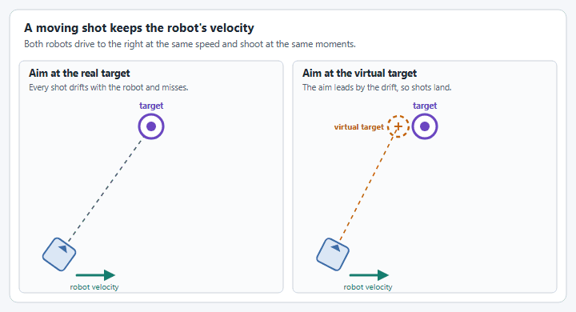
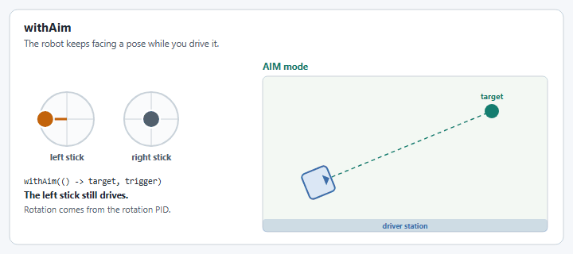
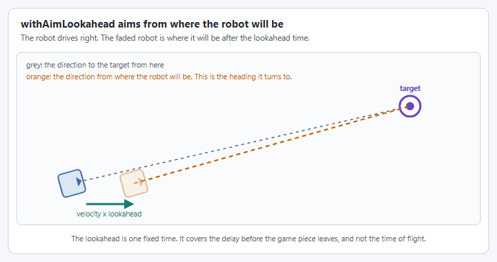

# How do I shoot on the move?

Shooting on the move means scoring while the robot is still driving, instead of stopping to line up first.

We covered this in a YASS Weekly Workshop, **How To Program Target Tracking And Shooting On The Fly for FRC**. Watch it first:



This page does not try to teach it. People in the FRC community have already explained it well, and their work is where you should learn it. What this page adds is the YAMS side: which YAMS call supplies each thing those sources ask for, what the [Swerve Input Stream](../details/swerve-input-stream.md) does for you and what it does not, and a worked example on top of the [Swerve Drive](../tutorials/swerve-drive.md) and [Shooter](../tutorials/shooter-flywheels.md) tutorials.

## Read these first

| Source | Read it for |
| ------ | ----------- |
| [Shooting on the Fly](https://blog.eeshwark.com/robotblog/shooting-on-the-fly) and [Shooting on the Fly, Part 2: The LUT Approach](https://blog.eeshwark.com/robotblog/shooting-on-the-fly-pt2), by Eeshwar | The best place to start. Part 1 explains the idea as plain vector math, then covers what goes wrong on a real robot: latency, a flywheel that slows and slips, spin and drag, lobbed shots, and a shooter that is itself moving. Part 2 is the practical side: building the lookup table, getting the shot's speed from the time of flight, shooters with a hood, and tuning the latency. |
| WPILib's [Fire Control](https://frc-docs--3242.org.readthedocs.build/en/3242/docs/software/advanced-controls/fire-control/index.html) pages: [Static Shooting via Look-Up Table](https://frc-docs--3242.org.readthedocs.build/en/3242/docs/software/advanced-controls/fire-control/static-shooting.html), [Dynamic Shooting via Time-of-Flight Recursion](https://frc-docs--3242.org.readthedocs.build/en/3242/docs/software/advanced-controls/fire-control/dynamic-shooting.html), [Newton's Method for Dynamic Shooting](https://frc-docs--3242.org.readthedocs.build/en/3242/docs/software/advanced-controls/fire-control/newton-shooting.html) and [Linear Drag (First-Order Air Friction)](https://frc-docs--3242.org.readthedocs.build/en/3242/docs/software/advanced-controls/fire-control/linear-drag.html) | Three firing strategies and a drag correction, with interactive simulations that show where each one converges and where it does not. |
| [Shoot on the move from the code perspective](https://www.chiefdelphi.com/t/shoot-on-the-move-from-the-code-perspective/511815) (Chief Delphi) | A short explanation of the virtual target, with links to much of the rest. |
| [Time of Flight Determination](https://www.chiefdelphi.com/t/time-of-flight-determination/512542) (Chief Delphi) | The different ways teams measure or calculate the time of flight. |
| [Shoot While Move Code (1706)](https://www.chiefdelphi.com/t/shoot-while-move-code-1706/410494) (Chief Delphi) | Team 1706 walking through its 2022 code. |
| [Orbit 1690 Online Software Sessions](https://www.chiefdelphi.com/t/orbit-1690-online-software-sessions/467221) (Chief Delphi) | Recorded sessions from Team 1690 on their swerve and system control software. |
| [Mechanical Advantage 6328's `LaunchCalculator.java`](https://github.com/Mechanical-Advantage/RobotCode2026Public/blob/main/src/main/java/org/littletonrobotics/frc2026/subsystems/launcher/LaunchCalculator.java) | A complete launch calculator from a 2026 robot. |
| [Hammerheads 5000's `TurretCalculator.java`](https://github.com/hammerheads5000/2026Rebuilt/blob/main/src/main/java/frc/robot/subsystems/turret/TurretCalculator.java), with a [build thread post](https://www.chiefdelphi.com/t/frc-5000-hammerheads-2026-build-thread-open-alliance/507502/129) that walks through it | A complete shot calculator for a turret from a 2026 robot. |


The WPILib fire control pages are a work in progress in [wpilib-docs #3242](https://github.com/wpilibsuite/wpilib-docs/pull/3242). They have not been merged, so the links go to the pull request's preview and may move.


## The idea in one picture

A game piece keeps the robot's velocity when it leaves the shooter, so a robot that aims straight at the target while driving sideways misses. The sources above all solve the same problem: work out a **lead** that cancels the robot's motion.

<figure><figcaption><p>The shot keeps the robot's velocity, so the aim has to lead it.</p></figcaption></figure>

## How the sources' ideas apply to YAMS

Each row is a concept from the sources, where to read about it, and the YAMS piece that does that job.

| Concept | Read about it in | In YAMS |
| ------- | ---------------- | ------- |
| The robot's position and field velocity | Eeshwar's [part 1](https://blog.eeshwark.com/robotblog/shooting-on-the-fly), "Prerequisites" | `drive.getPose()` and `drive.getFieldRelativeSpeed()` on the [Swerve Drive](../details/swerve-drive.md) |
| A lookup table of shots that score, measured standing still | [Static Shooting via Look-Up Table](https://frc-docs--3242.org.readthedocs.build/en/3242/docs/software/advanced-controls/fire-control/static-shooting.html), and Eeshwar's [part 2](https://blog.eeshwark.com/robotblog/shooting-on-the-fly-pt2) | WPILib's [`InterpolatingDoubleTreeMap`](https://github.wpilib.org/allwpilib/docs/release/java/edu/wpi/first/math/interpolation/InterpolatingDoubleTreeMap.html), with the result sent to a [FlyWheel](../details/shooters.md) |
| A flywheel speed that changes every loop | Eeshwar's [part 1](https://blog.eeshwark.com/robotblog/shooting-on-the-fly), "Wait, The Shooter Speed Changed?" | `FlyWheel.run(Supplier)`, which reads the supplier every loop |
| Turning to face a point while the driver keeps driving | Every source | [`withAim`](../details/swerve-input-stream.md#aim-at-a-target), which takes a supplier so the point can move every loop |
| A time of flight lead, as a virtual target | [Dynamic Shooting via Time-of-Flight Recursion](https://frc-docs--3242.org.readthedocs.build/en/3242/docs/software/advanced-controls/fire-control/dynamic-shooting.html), and [Shoot on the move from the code perspective](https://www.chiefdelphi.com/t/shoot-on-the-move-from-the-code-perspective/511815) | You calculate it. Give the result to `withAim` |
| A time of flight lead, as a shot vector with the robot's velocity subtracted | Eeshwar's [part 1](https://blog.eeshwark.com/robotblog/shooting-on-the-fly), "The Math Implementation", and [part 2](https://blog.eeshwark.com/robotblog/shooting-on-the-fly-pt2), "Getting Horizontal Velocity from ToF" | You calculate it. Give its direction to `withAim`, [`withHeading`](../details/swerve-input-stream.md#heading-snap-control) or a turret, and its speed to the flywheel |
| Latency compensation: aim from where the robot will be | Eeshwar's [part 1](https://blog.eeshwark.com/robotblog/shooting-on-the-fly), "Latency Compensation", and [part 2](https://blog.eeshwark.com/robotblog/shooting-on-the-fly-pt2), "The Latency Constant" | [`withAimLookahead`](../details/swerve-input-stream.md#aim-lookahead) |
| A heading that keeps up with a moving aim point | Specific to turning the whole robot. The sources mostly aim a turret | [`withAimFeedforward`](../details/swerve-input-stream.md#aim-feedforward), and the rotation controller in [`SwerveDriveConfig`](../details/mechanism-configs/swerve-drive-config.md) |
| A shooter that does not point out of the front, or a small aim correction for spin | Eeshwar's [part 1](https://blog.eeshwark.com/robotblog/shooting-on-the-fly), "The Magnus Effect and Air Resistance" | [`withAimHeadingOffset`](../details/swerve-input-stream.md#aim-heading-offset) |
| Only shooting when the shot is trustworthy | [Dynamic Shooting via Time-of-Flight Recursion](https://frc-docs--3242.org.readthedocs.build/en/3242/docs/software/advanced-controls/fire-control/dynamic-shooting.html), "Shot Quality in Practice", and Eeshwar's [part 1](https://blog.eeshwark.com/robotblog/shooting-on-the-fly), "Shooter Wheel Dynamics" | [`aimLock`](../details/swerve-input-stream.md#aim-lock) for the heading, and the flywheel's `near` trigger for the speed: see [How to shoot with a Shooter?](how-to-shoot-with-a-shooter.md) |
| A hood, or a turret | Eeshwar's [part 2](https://blog.eeshwark.com/robotblog/shooting-on-the-fly-pt2), the hood variants, and the two team calculators | An [Arm](../details/arms.md) or a [Pivot](../details/turrets-wrists.md), each in its own subsystem |

## What `SwerveInputStream` does, and what it leaves to you

The stream's aim mode uses the simplest method there is, **point at the pose**. [`withAim`](../details/swerve-input-stream.md#aim-at-a-target) takes a target pose, works out the direction from the robot to it, and lets the drive's rotation PID controller turn the front of the robot that way while the left stick keeps translating.

<figure><figcaption><p><code>withAim</code>: the left stick drives, and the robot keeps facing the target it is given.</p></figcaption></figure>

Four options refine it: [`withAimLookahead`](../details/swerve-input-stream.md#aim-lookahead), [`withAimFeedforward`](../details/swerve-input-stream.md#aim-feedforward), [`withAimHeadingOffset`](../details/swerve-input-stream.md#aim-heading-offset) and [`aimLock`](../details/swerve-input-stream.md#aim-lock). The [Swerve Input Stream](../details/swerve-input-stream.md#aim-at-a-target) page explains each one.

<figure><figcaption><p><code>withAimLookahead</code>: the robot turns to the direction it will need a moment from now.</p></figcaption></figure>

Even with all four, the stream on its own does **not** shoot on the move the way you might expect:

* **The lookahead is one fixed time.** Aiming from where the robot will be in 0.3 seconds is the same as leading the target by 0.3 seconds of travel. That is only the right lead when the time of flight is 0.3 seconds, which is true at one distance. Use the lookahead for what the sources call latency: the short, constant delay before the game piece leaves the robot.
* **It only turns the robot.** A lead changes the distance of the shot as well as its direction. The stream knows nothing about your flywheel, your hood or your tables, so it cannot change the shot to match.
* **It assumes a straight line.** The lookahead takes the robot's velocity right now and assumes it stays the same.
* **Without a feedforward, the rotation lags.** The PID controller only reacts to error, so while the robot drives past the target it trails a little behind.

So let the stream do the turning, and give it the right thing to turn to. The lead itself comes from one of the methods in the sources, which is the part you write.

## A worked example

This applies the sources to the [Swerve Drive](../tutorials/swerve-drive.md) and [Shooter](../tutorials/shooter-flywheels.md) tutorials. Read the source named in each step before you copy its code: the code is short because the explanation lives there.


The code is shown for Java with Commands v2 and Commands v3. The C++ `SwerveInputStream` has the same options, so the same approach works there. Every snippet compiles against YAMS, but none of it has been run on a robot: the numbers in the tables are placeholders for your own measurements.




### Let the calculator read the drive

Add these to the drive class from the swerve tutorial.




```java
/** Where the robot is on the field. */
public Pose2d getPose() {
  return drive.getPose();
}

/** How fast the robot is moving on the field. */
public ChassisVelocities getFieldVelocity() {
  return drive.getFieldRelativeSpeed();
}
```





```java
/** Where the robot is on the field. */
public Pose2d getPose() {
  return drive.getPose();
}

/** How fast the robot is moving on the field. */
public ChassisVelocities getFieldVelocity() {
  return drive.getFieldRelativeSpeed();
}
```






### Let the flywheel follow a changing speed

Add this to the shooter class from the shooter tutorial.




```java
/** Follow a speed that changes every loop. This command does not end on its own. */
public Command track(Supplier<AngularVelocity> speed) {
  return shooter.run(speed);
}
```





```java
/** Follow a speed that changes every loop. This command does not end on its own. */
public Command track(Supplier<AngularVelocity> speed) {
  return shooter.run(speed);
}
```






### The lookup tables

**Read first:** [Static Shooting via Look-Up Table](https://frc-docs--3242.org.readthedocs.build/en/3242/docs/software/advanced-controls/fire-control/static-shooting.html), and Eeshwar's [part 2](https://blog.eeshwark.com/robotblog/shooting-on-the-fly-pt2), which describes how to measure the table with a tape measure and a phone.

The tables hold what you measured standing still: the flywheel speed that scores from each distance, and how long that shot is in the air. WPILib's [`InterpolatingDoubleTreeMap`](https://github.wpilib.org/allwpilib/docs/release/java/edu/wpi/first/math/interpolation/InterpolatingDoubleTreeMap.html) fills in the distances in between.


```java
package first.robot;

import static org.wpilib.units.Units.RPM;

import org.wpilib.math.geometry.Pose2d;
import org.wpilib.math.geometry.Rotation2d;
import org.wpilib.math.geometry.Translation2d;
import org.wpilib.math.interpolation.InterpolatingDoubleTreeMap;
import org.wpilib.math.kinematics.ChassisVelocities;
import org.wpilib.units.measure.AngularVelocity;

/** Works out where to aim and how fast to spin the flywheel. */
public final class ShotCalculator {
  /** Where to aim, and the flywheel speed that reaches it. */
  public record Shot(Pose2d target, AngularVelocity flywheelSpeed) {}

  // Where the real target is on the field, in meters.
  private static final Translation2d TARGET = new Translation2d(4.6, 4.0);

  // Distance to the target in meters, to flywheel speed in RPM.
  private static final InterpolatingDoubleTreeMap FLYWHEEL_RPM = new InterpolatingDoubleTreeMap();
  // Distance to the target in meters, to how long the shot is in the air in seconds.
  private static final InterpolatingDoubleTreeMap TIME_OF_FLIGHT = new InterpolatingDoubleTreeMap();

  static {
    // Measure these on your own robot, standing still.
    FLYWHEEL_RPM.put(1.5, 2400.0);
    FLYWHEEL_RPM.put(3.0, 3000.0);
    FLYWHEEL_RPM.put(4.5, 3700.0);

    TIME_OF_FLIGHT.put(1.5, 0.45);
    TIME_OF_FLIGHT.put(3.0, 0.70);
    TIME_OF_FLIGHT.put(4.5, 0.95);
  }

  private ShotCalculator() {}

  /** The shot that reaches a point on the field from where the robot is. */
  private static Shot shotAt(Pose2d robotPose, Translation2d aimPoint) {
    double distance = robotPose.getTranslation().getDistance(aimPoint);
    return new Shot(new Pose2d(aimPoint, new Rotation2d()), RPM.of(FLYWHEEL_RPM.get(distance)));
  }
}
```


**For your robot:** set `TARGET`, fill both tables with your own measurements, and flip the target for the red alliance.



### Pick a firing strategy

Each tab is one method to add to `ShotCalculator`. The first three are the strategies of the WPILib fire control pages, and the fourth is the one from Eeshwar's blog. All four are written against the tables above, and the three for a moving robot are all **time of flight** methods: they get the lead from the time of flight you measured, and differ in how they use it.



**Read first:** [Static Shooting via Look-Up Table](https://frc-docs--3242.org.readthedocs.build/en/3242/docs/software/advanced-controls/fire-control/static-shooting.html).

Aim at the real target, and read the flywheel speed for the distance. Only right while the robot is not moving.


```java
/** Strategy 1: aim at the real target. Only right while the robot is standing still. */
public static Shot standing(Pose2d robotPose) {
  return shotAt(robotPose, TARGET);
}
```




**Read first:** [Dynamic Shooting via Time-of-Flight Recursion](https://frc-docs--3242.org.readthedocs.build/en/3242/docs/software/advanced-controls/fire-control/dynamic-shooting.html).

A time of flight method. It uses the time of flight to move the target, and repeats until the time stops changing.


```java
/** Strategy 2: lead the target by the time of flight, and repeat until the time settles. */
public static Shot recursive(Pose2d robotPose, ChassisVelocities fieldVelocity) {
  Translation2d virtualTarget = TARGET;
  // Each pass uses the distance from the pass before, so the answer settles after a few.
  for (int i = 0; i < 3; i++) {
    double distance = robotPose.getTranslation().getDistance(virtualTarget);
    double timeOfFlight = TIME_OF_FLIGHT.get(distance);
    // The shot drifts by the robot's velocity times the time of flight, so aim that far the other way.
    virtualTarget = TARGET.minus(
        new Translation2d(fieldVelocity.vx * timeOfFlight, fieldVelocity.vy * timeOfFlight));
  }
  return shotAt(robotPose, virtualTarget);
}
```




**Read first:** [Newton's Method for Dynamic Shooting](https://frc-docs--3242.org.readthedocs.build/en/3242/docs/software/advanced-controls/fire-control/newton-shooting.html).

A time of flight method. It finds the same time of flight as the recursion in fewer passes, which helps when driving fast toward or away from the target.


```java
/** Strategy 3: find the same time of flight with Newton's method, which needs fewer passes. */
public static Shot newton(Pose2d robotPose, ChassisVelocities fieldVelocity) {
  Translation2d toTarget = TARGET.minus(robotPose.getTranslation());
  double distance = toTarget.getNorm();
  // How fast the game piece covers ground, from the standing shot at this distance.
  double projectileSpeed = distance / TIME_OF_FLIGHT.get(distance);
  // How fast the robot is closing on the target. Negative while it drives away.
  double closingSpeed = (toTarget.getX() * fieldVelocity.vx + toTarget.getY() * fieldVelocity.vy) / distance;

  // A first guess that already allows for the robot's motion toward or away from the target.
  double timeOfFlight = distance / (projectileSpeed + closingSpeed);
  for (int i = 0; i < 3; i++) {
    // The virtual target for this guess.
    double dx = toTarget.getX() - fieldVelocity.vx * timeOfFlight;
    double dy = toTarget.getY() - fieldVelocity.vy * timeOfFlight;
    double virtualDistance = Math.hypot(dx, dy);
    // How far the guess is from what the table says for that distance.
    double error = timeOfFlight - TIME_OF_FLIGHT.get(virtualDistance);
    // How fast that error changes as the guess changes.
    double slope = 1 + (dx * fieldVelocity.vx + dy * fieldVelocity.vy) / (projectileSpeed * virtualDistance);
    timeOfFlight -= error / slope;
  }
  Translation2d virtualTarget = TARGET.minus(
      new Translation2d(fieldVelocity.vx * timeOfFlight, fieldVelocity.vy * timeOfFlight));
  return shotAt(robotPose, virtualTarget);
}
```




**Read first:** Eeshwar's [Shooting on the Fly](https://blog.eeshwark.com/robotblog/shooting-on-the-fly) and [Shooting on the Fly, Part 2: The LUT Approach](https://blog.eeshwark.com/robotblog/shooting-on-the-fly-pt2).

A time of flight method. The time of flight in the table gives the horizontal speed of the standing shot: the distance divided by the time. Point a velocity of that speed at the target, and subtract the robot's velocity from it. The direction of what is left is where to aim, and its length is the speed the shot needs.


```java
/** Vector subtraction: take the robot's velocity out of the velocity the shot needs over the ground. */
public static Shot vectorSubtraction(Pose2d robotPose, ChassisVelocities fieldVelocity) {
  Translation2d toTarget = TARGET.minus(robotPose.getTranslation());
  double distance = toTarget.getNorm();
  // The horizontal speed of the standing shot from here.
  double speed = distance / TIME_OF_FLIGHT.get(distance);
  // The velocity the game piece needs over the ground, minus the robot's own velocity.
  Translation2d shotVelocity = toTarget.div(distance).times(speed)
      .minus(new Translation2d(fieldVelocity.vx, fieldVelocity.vy));
  double requiredSpeed = shotVelocity.getNorm();

  // Read the table in reverse: find the distance whose standing shot has that speed.
  // This assumes shots from farther away are faster, and searches between the ends of the table.
  double near = 1.5;
  double far = 4.5;
  for (int i = 0; i < 20; i++) {
    double middle = (near + far) / 2;
    if (middle / TIME_OF_FLIGHT.get(middle) < requiredSpeed) {
      near = middle;
    } else {
      far = middle;
    }
  }
  double effectiveDistance = (near + far) / 2;

  // A point in the direction of the shot, for the drive to face.
  Translation2d aimPoint = robotPose.getTranslation().plus(shotVelocity.div(requiredSpeed).times(distance));
  return new Shot(new Pose2d(aimPoint, new Rotation2d()), RPM.of(FLYWHEEL_RPM.get(effectiveDistance)));
}
```


The blog aims a turret with the angle of the shot. This example turns the whole robot, so it hands `withAim` a point in that direction instead. The speeds here are horizontal: if your shot is lobbed, read the blog's section on lobbed shots before you trust them.






### Aim and spin up together

While the driver holds the right bumper, the stream turns the robot toward the shot's target and the shooter follows the shot's speed. `shot()` calls the strategy you picked, and swapping strategies only changes that one line.




```java
private final SwerveSubsystem drive = new SwerveSubsystem();
private final ShooterSubsystem shooter = new ShooterSubsystem();

/** The shot for where the robot is, and how it is moving, right now. */
private ShotCalculator.Shot shot() {
  return ShotCalculator.recursive(drive.getPose(), drive.getFieldVelocity());
}

// ...

  SwerveInputStream input = drive.getChassisSpeedsSupplier(
          () -> -driverController.getLeftY(),
          () -> -driverController.getLeftX(),
          () -> -driverController.getRightX())
      // While the right bumper is held, face the shot's target instead of
      // turning with the right stick. The left stick keeps driving.
      .withAim(() -> shot().target(), driverController.rightBumper())
      // Aim from where the robot will be when the game piece leaves it.
      .withAimLookahead(Seconds.of(0.1));
  drive.setDefaultCommand(drive.drive(input));

  // While the right bumper is held, keep the flywheel at the speed the shot needs.
  driverController.rightBumper().whileTrue(shooter.track(() -> shot().flywheelSpeed()));

  // True while the robot is aiming and within 2 degrees of the aim heading.
  Trigger aimed = input.aimLock(Degrees.of(2));
```





```java
final SwerveMechanism drive = new SwerveMechanism();
final ShooterMechanism shooter = new ShooterMechanism();

/** The shot for where the robot is, and how it is moving, right now. */
ShotCalculator.Shot shot() {
  return ShotCalculator.recursive(drive.getPose(), drive.getFieldVelocity());
}

// ...

@Override
public void robotPeriodic() {
  drive.periodic();
  shooter.periodic();
  scheduler.run();
  Telemetry.log("Scheduler", scheduler, Scheduler.proto);
}

@Override
public void simulationPeriodic() {
  drive.simulationPeriodic();
  shooter.simulationPeriodic();
}
```



```java
SwerveInputStream input = robot.drive.getChassisSpeedsSupplier(
        () -> -robot.exampleController.getLeftY(),
        () -> -robot.exampleController.getLeftX(),
        () -> -robot.exampleController.getRightX())
    // While the right bumper is held, face the shot's target instead of
    // turning with the right stick. The left stick keeps driving.
    .withAim(() -> robot.shot().target(), robot.exampleController.rightBumper())
    // Aim from where the robot will be when the game piece leaves it.
    .withAimLookahead(Seconds.of(0.1));
robot.drive.setDefaultCommand(robot.drive.drive(input));

// While the right bumper is held, keep the flywheel at the speed the shot needs.
robot.exampleController.rightBumper()
    .whileTrue(robot.shooter.track(() -> robot.shot().flywheelSpeed()));

// True while the robot is aiming and within 2 degrees of the aim heading.
Trigger aimed = input.aimLock(Degrees.of(2));
```







### Feed only when the shot is ready

Do not feed until the robot faces the aim heading and the flywheel is at the shot's speed. `aimed` from the last step is the first half. [How to shoot with a Shooter?](how-to-shoot-with-a-shooter.md) shows how to gate a feeder on the flywheel's speed with a debounce, which is the second half. Combine the two with `aimed.and(...)`.



## Tuning the YAMS side

The sources cover how to tune the shot itself. These are the YAMS settings that go with their advice:

| Their advice | The YAMS setting |
| ------------ | ---------------- |
| Get the standing shot consistent before anything else (Eeshwar's [part 1](https://blog.eeshwark.com/robotblog/shooting-on-the-fly), "Prerequisites") | The flywheel's gains: see WPILib's [Tuning a Flywheel Velocity Controller](https://docs.wpilib.org/en/stable/docs/software/advanced-controls/introduction/tuning-flywheel.html) and [How to shoot with a Shooter?](how-to-shoot-with-a-shooter.md) |
| Tune the latency constant by driving straight across the front of the target (Eeshwar's [part 2](https://blog.eeshwark.com/robotblog/shooting-on-the-fly-pt2), "The Latency Constant") | The time you give [`withAimLookahead`](../details/swerve-input-stream.md#aim-lookahead). Start at 0.1 seconds |
| A moving shot is only as good as the pose it starts from | Vision measurements into the drive's pose estimate: see WPILib's [Pose Estimators](https://docs.wpilib.org/en/stable/docs/software/advanced-controls/state-space/state-space-pose-estimators.html) |
| Watch whether the heading keeps up as you drive past | The rotation controller in [`SwerveDriveConfig`](../details/mechanism-configs/swerve-drive-config.md), then [`withAimFeedforward`](../details/swerve-input-stream.md#aim-feedforward) |
| Hold fire when the shot is not trustworthy ([Dynamic Shooting via Time-of-Flight Recursion](https://frc-docs--3242.org.readthedocs.build/en/3242/docs/software/advanced-controls/fire-control/dynamic-shooting.html), "Shot Quality in Practice") | The tolerance you give [`aimLock`](../details/swerve-input-stream.md#aim-lock), and the flywheel's `near` tolerance |

## WPILib building blocks

The released WPILib documentation covers the classes the example uses. These pages are written for WPILib 2026. The ideas are the same in 2027, though some classes were renamed: `ChassisSpeeds`, for example, is `ChassisVelocities`.

| Page | Why it matters here |
| ---- | ------------------- |
| [Coordinate System](https://docs.wpilib.org/en/stable/docs/software/basic-programming/coordinate-system.html) | Which way X, Y and a positive rotation point. |
| [Translation, Rotation, and Pose](https://docs.wpilib.org/en/stable/docs/software/advanced-controls/geometry/pose.html) | The classes that the distance and direction to the target are calculated with. |
| [Transformations](https://docs.wpilib.org/en/stable/docs/software/advanced-controls/geometry/transformations.html) | Getting from the center of the robot to where the shooter really is. |
| [Introduction to Kinematics and The ChassisSpeeds Class](https://docs.wpilib.org/en/stable/docs/software/kinematics-and-odometry/intro-and-chassis-speeds.html) | Robot relative and field relative velocity. |
