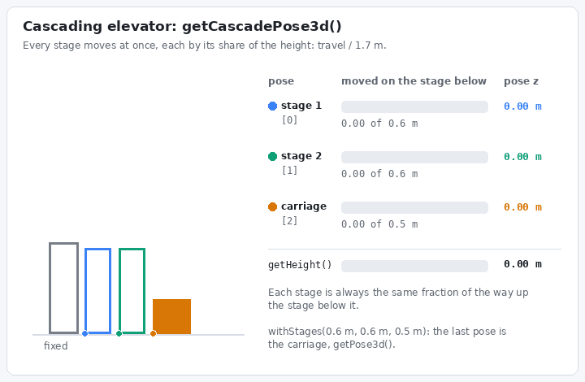
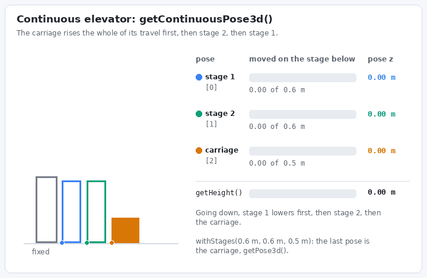
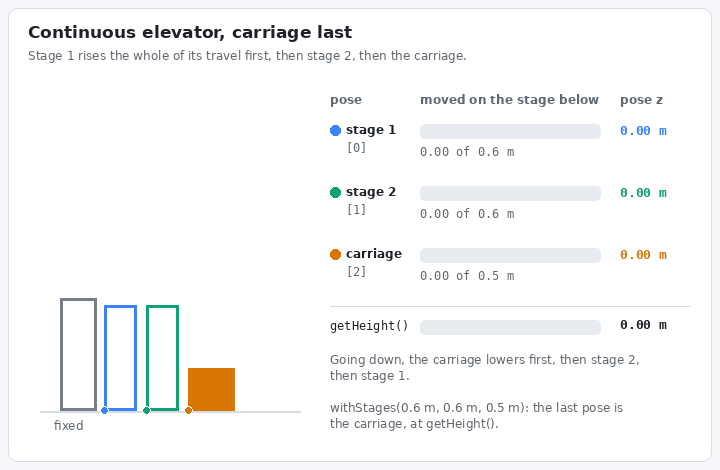

# How do I show an elevator's stages on a 3D robot model?

**Goal:** every stage of your elevator moves on the 3D robot model in AdvantageScope, not just the carriage.

This builds on [How do I show my mechanisms on a 3D robot model?](how-do-i-show-my-mechanisms-on-a-3d-robot-model.md): set that up first, with the elevator's `MechanismPositionConfig`, the model files and the component poses. An elevator with only a carriage needs nothing more than `getPose3d()`.

## Give YAMS the stages

An elevator with moving stages has a component for each stage. Give its `ElevatorConfig` the stages with [`withStages`](../details/mechanism-configs/elevator-config.md#withstages): how far each moving stage travels relative to the stage below it, one height for each stage, the carriage last. The heights must add up to the elevator's maximum height, and without hard limits they set it.

YAMS only knows the carriage's height, `getHeight()`. Where each stage below it sits depends on how the elevator is rigged, so there are two methods. Both return a pose for each moving stage, in order from the stage nearest the fixed stage to the carriage, and the last pose is always the carriage, the same as `getPose3d()`. Each pose is the stage's bottom, moved straight along the elevator's angle from where the elevator is mounted.

## Cascading elevators

In a cascading elevator every stage is rigged to the one below it, so every stage moves at once. Use `getCascadePose3d()`: each stage moves its share of the carriage's height, its travel divided by the total travel, on top of the stage below it. With stages of 0.6 m, 0.6 m and 0.5 m, a carriage at 0.85 m, halfway, puts stage 1 at 0.3 m, stage 2 at 0.6 m and the carriage at 0.85 m.

<figure><figcaption><p>A cascading elevator: every stage is always the same fraction of the way up the stage below it.</p></figcaption></figure>

## Continuous elevators

In a continuous elevator one rope runs through every stage, so the stages move one at a time. Which moves first depends on how it is rigged, and on friction and the weight it carries, so watch your elevator move and tell `getContinuousPose3d(carriageFirst)` which it is. Either way, the carriage is always at the elevator's height.

**Carriage first: `getContinuousPose3d(true)`.** The carriage rises the whole of its travel first, then the stage below it, and so on out to the stage nearest the fixed stage. Going down, the stage nearest the fixed stage lowers first, and the carriage last. With the same stages, a carriage at 0.85 m has risen its whole 0.5 m and stage 2 the other 0.35 m, so stage 1 is at 0 m, stage 2 at 0.35 m and the carriage at 0.85 m.

<figure><figcaption><p>A continuous elevator that moves the carriage first: <code>getContinuousPose3d(true)</code>.</p></figcaption></figure>

**Carriage last: `getContinuousPose3d(false)`.** The stage nearest the fixed stage rises the whole of its travel first, then the next, and the carriage last. Going down, the carriage lowers first, and the stage nearest the fixed stage last. With the same stages, a carriage at 0.85 m has stage 1 at the top of its 0.6 m, and stage 2 has risen the other 0.25 m, so stage 1 is at 0.6 m, and stage 2 and the carriage are both at 0.85 m.

<figure><figcaption><p>A continuous elevator that moves the carriage last: <code>getContinuousPose3d(false)</code>.</p></figcaption></figure>

## Publish the stages

Publish the stage poses in place of the carriage's `getPose3d()`, and put any mechanism mounted on the carriage after them:




```java
import static org.wpilib.units.Units.Meters;

import java.util.ArrayList;
import java.util.List;
import org.wpilib.math.geometry.Pose3d;
import org.wpilib.telemetry.Telemetry;

// In ElevatorSubsystem: two stages that each travel 0.6 m, then a carriage that travels 0.5 m.
new ElevatorConfig()
    // ... the rest of the config
    .withStages(Meters.of(0.6), Meters.of(0.6), Meters.of(0.5));

// Every loop, where the elevator and the arm are both visible (see the 3D robot model page).
// The first stage, the second stage, then the carriage, which is elevator.getPose3d().
// A continuous elevator uses elevator.getContinuousPose3d(true), or (false) if its carriage moves last.
List<Pose3d> components = new ArrayList<>(elevator.getCascadePose3d());
components.add(arm.getPose3d());
Telemetry.log("Robot/Components", components.toArray(Pose3d[]::new), Pose3d.struct);
```


`elevator` and `arm` here are the subsystems, each with a method that returns its mechanism's poses, as on the 3D robot model page.




```cpp
#include <span>
#include <vector>

#include <wpi/telemetry/Telemetry.hpp>

// Two stages that each travel 0.6 m, then a carriage that travels 0.5 m.
m_elevatorConfig.WithStages(0.6_m, 0.6_m, 0.5_m);

// The first stage, the second stage, then the carriage, which is m_elevator->GetPose3d().
// A continuous elevator uses m_elevator->GetContinuousPose3d(true), or (false) if its carriage moves last.
std::vector<wpi::math::Pose3d> components = m_elevator->GetCascadePose3d();
components.push_back(m_arm->GetPose3d());
wpi::telemetry::Log("Robot/Components", std::span<const wpi::math::Pose3d>{components});
```




Both need 2 or more stages, and throw an `ElevatorConfigurationException` without them: an elevator with only a carriage uses `getPose3d()`. In AdvantageScope each stage is a component, zeroed like the carriage: as it sits with the elevator all the way down.

## Line up the stages

Export each stage as its own component, as the robot model page's [Export the model](how-do-i-show-my-mechanisms-on-a-3d-robot-model.md#id-3.-export-the-model) does for any part, in the order you publish the poses. Then zero each one as in [Line each part up with its pose](how-do-i-show-my-mechanisms-on-a-3d-robot-model.md#id-4.-line-each-part-up-with-its-pose): a stage sits as it does with the elevator all the way down, moved by the same offset as the carriage.

## Check it

Start the simulation, open AdvantageScope's 3D Field tab with your robot model, and move the elevator from the bottom to the top. Every stage should move with the carriage the way your real elevator does: all together for a cascading elevator, one at a time for a continuous one. If the stages move in the wrong order, switch between `getCascadePose3d()` and `getContinuousPose3d(...)`, or flip `carriageFirst`.
