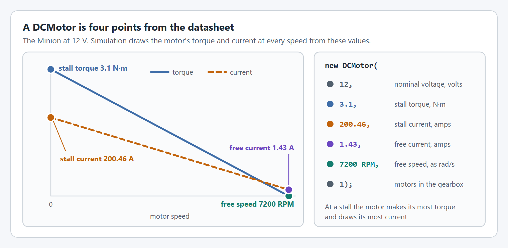

# How do I use a DCMotor that isn't in WPILib?

**Goal:** simulate a motor that WPILib has no `DCMotor` for, by building one from its datasheet and giving it to your `SmartMotorController`.

Every YAMS wrapper (`SparkWrapper`, `TalonFXWrapper`, `TalonFXSWrapper`, `NovaWrapper`) takes a `DCMotor` (`org.wpilib.math.system.DCMotor`). YAMS uses it to simulate the motor, so a wrong `DCMotor` makes the simulation faster or slower and stronger or weaker than the real robot.

First look for a ready-made one:

* **WPILib's factories** cover the motors it knows: `getNEO`, `getNeo550`, `getNeoVortex`, `getFalcon500`, `getKrakenX60`, `getKrakenX44`, `getMinion` and more.
* **`YMotors`** (`yams.core.motorcontrollers.YMotors`, Java) adds the motors WPILib does not have yet: `YMotors.getThriftyPulsar(1)` for a Thrifty Pulsar 775.

Use one of those if your motor is listed, and skip the rest of this page. Each is just a call to the `DCMotor` constructor, which you can make yourself for any other motor.



### Find the datasheet values


You need four numbers, measured at a nominal voltage (usually 12 V): stall torque, stall current, free current and free speed. Get them from the manufacturer's datasheet, or look the motor up on ReCalc:



<figure><figcaption><p>The four datasheet values and where each goes in the constructor.</p></figcaption></figure>

**Check it:** you have all four numbers, and know the voltage they were measured at.



### Build the DCMotor

The constructor takes the values in this order. Torque is in newton meters, current in amps and free speed in radians per second.

```java
public DCMotor(
    double nominalVoltage,  // volts the values were measured at
    double stallTorque,     // newton meters
    double stallCurrent,    // amps
    double freeCurrent,     // amps
    double freeSpeed,       // radians per second
    int numMotors)          // motors in the gearbox
```

For example, before WPILib added `DCMotor.getMinion()`, a [Minion motor](https://store.ctr-electronics.com/products/minion-brushless-motor) could be created with:


```java
import static org.wpilib.units.Units.RPM;
import static org.wpilib.units.Units.RadiansPerSecond;
import org.wpilib.math.system.DCMotor;

// One Minion: 12 V, 3.1 N·m stall torque, 200.46 A stall current,
// 1.43 A free current, 7200 RPM free speed.
private final DCMotor minion =
    new DCMotor(12, 3.1, 200.46, 1.43, RPM.of(7200).in(RadiansPerSecond), 1);
```


**Check it:** the code builds.



### Give it to the wrapper

Pass your `DCMotor` where the examples pass `DCMotor.getNEO(1)`. This fragment goes in the same class, after the `smcConfig` field:


```java
private final SparkMax spark = new SparkMax(CANPort.CAN_S0, 4, MotorType.kBrushless);

// The custom DCMotor replaces DCMotor.getNEO(1).
private final SmartMotorController motor = new SparkWrapper(spark, minion, smcConfig);
```



`TalonFXSWrapper` uses the `DCMotor` to choose the TalonFXS motor arrangement, so it only accepts the motors it knows (Minion, NEO, NEO 550, NEO Vortex and Thrifty Pulsar), compared value for value. Any other `DCMotor` throws an `IllegalArgumentException` ("Unknown motor for TalonFXS"). That includes a Pulsar you build yourself: the comparison is exact, so different datasheet numbers or a different unit conversion fail it. With a TalonFXS, use the factory, such as `DCMotor.getMinion(1)` or `YMotors.getThriftyPulsar(1)`.


**Check it:** the robot code starts in simulation without an exception.



## Check it

1. Start the simulation and run the mechanism at full output (for example a `set(1)` command).
2. Watch the motor's `rotor/velocity` under **NetworkTables > Mechanisms**. With little load it should level off near the motor's free speed: 7200 RPM is 120 rotations per second.

## If it did not work

* **The simulated motor is far too fast or too slow.** A value is in the wrong unit: free speed must be in radians per second (convert RPM with `RPM.of(x).in(RadiansPerSecond)`), and torque in newton meters, not inch pounds.
* **`IllegalArgumentException: Unknown motor for TalonFXS`.** Use a factory: see the warning in [Give it to the wrapper](#give-it-to-the-wrapper).

## Read more

Now that the simulation matches the motor, tune your mechanism as its tutorial does: [Arm](../tutorials/arm/tune.md), [Elevator](../tutorials/elevator/tune.md) or [Shooter](../tutorials/shooter-flywheels/tune.md).
