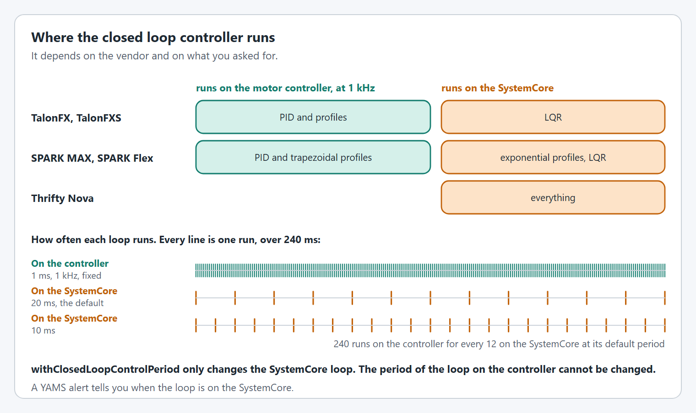

# How do I use a Thrifty Nova?

YAMS supports The Thrifty Bot's Thrifty Nova motor controller through `NovaWrapper`, a `SmartMotorController` just like `SparkWrapper` and `TalonFXWrapper`. Once the Nova is wrapped, every YAMS mechanism (`Arm`, `Elevator`, `Pivot`, `FlyWheel`, swerve modules) works with it, including simulation, telemetry, live tuning and alerts.

## Install ThriftyLib

`NovaWrapper` uses ThriftyLib 2027. Install the ThriftyLib vendordep alongside YAMS:

```
https://software.thethriftybot.com/frcvendor/ThriftyLib-2027.json
```

## Create the `NovaWrapper`

A `Nova` is constructed with its CAN bus number, CAN ID and the type of motor plugged into it. Hand it to `NovaWrapper` with the matching `DCMotor` and your `SmartMotorControllerConfig`.



```java
package first.robot.subsystems;

import static org.wpilib.units.Units.Amps;
import static org.wpilib.units.Units.Degrees;
import static org.wpilib.units.Units.DegreesPerSecond;
import static org.wpilib.units.Units.DegreesPerSecondPerSecond;
import static org.wpilib.units.Units.Feet;
import static org.wpilib.units.Units.Pounds;

import com.thrifty.core.Motor.MotorType;
import com.thrifty.nova.Nova;
import org.wpilib.command2.Command;
import org.wpilib.command2.SubsystemBase;
import org.wpilib.math.controller.ArmFeedforward;
import org.wpilib.math.system.DCMotor;
import org.wpilib.units.measure.Angle;
import yams.commands2.config.SmartMotorControllerConfig;
import yams.commands2.mechanisms.Arm;
import yams.core.gearing.GearBox;
import yams.core.gearing.MechanismGearing;
import yams.core.mechanisms.config.ArmConfig;
import yams.core.motorcontrollers.SmartMotorController;
import yams.core.motorcontrollers.enums.ControlMode;
import yams.core.motorcontrollers.enums.MotorMode;
import yams.core.motorcontrollers.local.NovaWrapper;
import yams.core.telemetry.enums.TelemetryVerbosity;

public class ArmSubsystem extends SubsystemBase {

  private final SmartMotorControllerConfig smcConfig = new SmartMotorControllerConfig(this)
      .withControlMode(ControlMode.CLOSED_LOOP)
      .withClosedLoopController(4, 0, 0)
      .withTrapezoidalProfile(DegreesPerSecond.of(180), DegreesPerSecondPerSecond.of(90))
      .withFeedforward(new ArmFeedforward(0, 0, 0))
      .withGearing(new MechanismGearing(GearBox.fromReductionStages(3, 4)))
      .withSoftLimits(Degrees.of(-20), Degrees.of(100))
      .withStartingPosition(Degrees.of(0))
      .withMomentOfInertia(Feet.of(2), Pounds.of(5))
      .withZeroPower(MotorMode.BRAKE)
      .withStatorCurrentLimit(Amps.of(40))
      .withTelemetry("ArmMotor", TelemetryVerbosity.HIGH);

  // Nova on CAN bus 0, CAN ID 3, driving a NEO.
  private final Nova nova = new Nova(0, 3, MotorType.NEO);

  private final SmartMotorController motor = new NovaWrapper(nova, DCMotor.getNEO(1), smcConfig);

  private final ArmConfig armConfig = new ArmConfig()
      .withLength(Feet.of(2))
      .withHardLimits(Degrees.of(-30), Degrees.of(110))
      .withTelemetry("Arm", TelemetryVerbosity.HIGH);

  private final Arm arm = new Arm(armConfig, motor);

  public Command setAngle(Angle angle) { return arm.setAngle(angle); }

  @Override
  public void periodic() { arm.updateTelemetry(); }

  @Override
  public void simulationPeriodic() { arm.simIterate(); }
}
```

For Commands v3, import `SmartMotorControllerConfig` and `Arm` from `yams.commands3` and implement `org.wpilib.command3.Mechanism` instead. `NovaWrapper` itself is the same class for both.



```cpp
#include <yams/motorcontrollers/local/NovaWrapper.hpp>

using namespace yams::motorcontrollers;
using namespace yams::motorcontrollers::local;

// Declare as subsystem members:
//   thrifty::Nova                 m_nova{0, 3, thrifty::Motor::NEO};
//   SmartMotorControllerConfig    m_cfg;
//   std::optional<NovaWrapper>    m_smc;

m_cfg.WithSubsystem(this)
    .WithFeedback(1.0, 0.0, 0.0)
    .WithStatorCurrentLimit(wpi::units::ampere_t{40})
    .WithMotorInverted(false)
    .WithClosedLoopMode()
    .WithTelemetry("ArmMotor", SmartMotorControllerConfig::TelemetryVerbosity::HIGH);

m_smc.emplace(&m_nova, wpi::math::DCMotor::NEO(1), &m_cfg);
```

The `thrifty::Nova` and the `SmartMotorControllerConfig` must outlive the `NovaWrapper`, so keep all three as members. C++ is only available with the Commands v2 vendordep.



## Where the closed loop runs

The Nova's closed loop controller runs on the SystemCore, and YAMS commands the Nova with voltage. ThriftyLib's simulation ignores the Nova's onboard PID gains, so running the loop on the SystemCore keeps simulation and the real robot behaving the same. YAMS raises a medium level alert saying the closed loop controller is running on the SystemCore, this is expected for a Nova.

<figure><figcaption><p>Where the closed loop runs, and what the control period changes.</p></figcaption></figure>

## External encoders

Pass one of these to `withExternalEncoder(...)`:

| External encoder | What it is |
|---|---|
| `FeedbackSensorType.ABS` | An absolute encoder wired to the Nova's data port. Set its type in the vendor config, such as `NovaConfig.absoluteEncoderType(AbsoluteEncoderType.REV_ENCODER)`. |
| `FeedbackSensorType.QUAD` | A quadrature encoder wired to the Nova's data port. Set its type in the vendor config, such as `NovaConfig.quadratureEncoderType(QuadratureEncoderType.custom(2048))`. |
| `CanEncoder` | A Thrifty CAN Encoder on the same CAN bus. |

`FeedbackSensorType`, `AbsoluteEncoderType` and `QuadratureEncoderType` are nested in `com.thrifty.core.Motor`; `CanEncoder` is `com.thrifty.canEncoder.CanEncoder`.

`withExternalEncoderZeroOffset(...)` and `withExternalEncoderDiscontinuityPoint(...)` only apply to absolute and CAN encoders. A discontinuity point of `Rotations.of(0.5)` reports \[-0.5, 0.5), and `Rotations.of(1)` (the default) reports \[0, 1). A quadrature encoder counts from where it powers on, so it is seeded from `withStartingPosition(...)` instead. See [How do I use absolute encoders on my Arm?](how-do-i-use-absolute-encoders-on-my-arm.md) for a full absolute encoder example.

## Vendor config

Nova specific options go through `withVendorConfig(...)` as a ThriftyLib `NovaConfig.Config`, usually a `NovaConfigBatch`. It is applied before the YAMS config, so anything you also set in `SmartMotorControllerConfig` wins.

```java
.withVendorConfig(new NovaConfigBatch(NovaConfig.tempThrottleEnable(true)))
```

See [How do I use a vendor hardware config?](how-do-i-use-a-vendor-hardware-config.md) for how precedence works.

## Limitations

* The Nova's internal encoder cannot be inverted, so calling `withEncoderInverted(...)` throws an `IllegalArgumentException`. Invert the motor with `withMotorInverted(...)` or the external encoder with `withExternalEncoderInverted(...)` instead.
* Followers given to a Nova must also be `Nova` objects.
