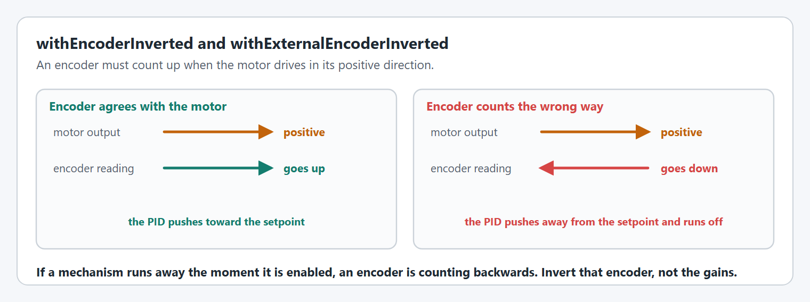
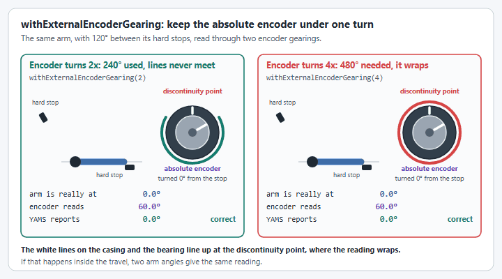

# How do I use absolute encoders on my Arm?

Relative encoders (built into most NEOs and Falcons) lose their zero reference on every power cycle, so an arm must be homed before closed-loop control is accurate. Absolute encoders retain their position across power cycles and eliminate the homing step entirely, which is especially important for arms that park at a non-zero angle. YAMS accepts an absolute encoder offset that maps the encoder's native range to your arm's coordinate system.

Absolute encoders report the physical position of a mechanism within a single rotation and retain that reading across power cycles and reboots. On an Arm (or Pivot) mechanism this means the robot always knows where the arm is the moment it powers on, no homing routine, no encoder drift from brownouts or e-stops.

## Supported encoder types

Each `SmartMotorController` wrapper only accepts the encoders from its own vendor ecosystem. Passing the wrong encoder type will throw an exception at runtime.

| Wrapper | Supported absolute encoders |
|---|---|
| `SparkWrapper` (SparkMax / SparkFlex) | `SparkAbsoluteEncoder` (`armMotor.getAbsoluteEncoder()`), `DetachedEncoder` |
| `TalonFXWrapper` (TalonFX / Kraken) | `CANcoder`, `CANdi` |
| `TalonFXSWrapper` (TalonFXS / Minion) | `CANcoder`, `CANdi` |
| `NovaWrapper` (Thrifty Nova) | `FeedbackSensorType.ABS` (absolute encoder on the Nova's data port), Thrifty `CanEncoder` |

## Check your inversion

Using the vendor hardware client (REV Hardware Client or Phoenix Tuner X), apply positive power to the motor and graph the absolute encoder position. The position should **increase** as the motor turns in the positive direction.

If it decreases, invert the encoder reading:

```java
.withExternalEncoderInverted(true)
```

<figure><figcaption><p>What a backwards encoder does to closed loop control.</p></figcaption></figure>

## Check your gear ratio and mount

The absolute encoder must complete **at most one full rotation** across the entire range of motion of the arm. Confirm this in the hardware client by moving the arm through its full travel and watching the encoder position, it must never wrap from 1 rotation back to 0 more than once.

Use `.withExternalEncoderGearing(1.0)` if the encoder is mounted directly on the mechanism shaft. If the encoder is driven through a reduction, pass the encoder-to-mechanism ratio.


If the gear ratio causes the encoder to exceed 1 rotation during the arm's range of motion, the encoder position will wrap unpredictably and **cannot** be used as the primary PID feedback device. Either remount the encoder closer to the mechanism output shaft or change the reduction so the encoder never exceeds 1 rotation.


<figure><figcaption><p>The same arm and hard stops. Both use a discontinuity point of 1 rotation, at the line on the casing. With a gearing of 2 the white lines never meet. With a gearing of 4 they do, and the reported angle is wrong.</p></figcaption></figure>

## Set the discontinuity point

An absolute encoder wraps at its **discontinuity point**, the angle at which the reading jumps from its maximum value back to zero (or vice versa). There are two supported ranges:

- `Rotations.of(1.0)`, range is **\[0, 1\]**; the encoder wraps at 1 rotation back to 0
- `Rotations.of(0.5)`, range is **\[-0.5, 0.5\]**; the encoder wraps at ±0.5 rotations

```java
.withExternalEncoderDiscontinuityPoint(Rotations.of(1.0))  // [0, 1] range
// or
.withExternalEncoderDiscontinuityPoint(Rotations.of(0.5))  // [-0.5, 0.5] range
```


If you don't set a discontinuity point, `SparkWrapper` and `NovaWrapper` use `Rotations.of(1.0)` (the **\[0, 1\]** range). Setting it explicitly is recommended for clarity on every wrapper. On a `SparkWrapper`, setting both `.withExternalEncoderGearing(...)` and a discontinuity point raises an alert, because the discontinuity point is not scaled by the gearing.



If the arm's physical range of motion crosses the discontinuity point, the position will jump mid-travel and break closed-loop control. If this happens, remove the encoder, rotate the bearing so the discontinuity point falls outside the arm's travel range, and remount.


<figure><figcaption><p>With 1 rotation the discontinuity point is at the line on the casing. With 0.5 rotations it is 180° from it, and the line has not moved.</p></figcaption></figure>

## Find your zero offset

Move the arm to exactly horizontal (0° from horizontal, parallel to the ground). Read the raw encoder position in the hardware client, that value is your zero offset.

```java
.withExternalEncoderZeroOffset(Degrees.of(33.25))  // replace with your measured value
```

Negative offsets are automatically converted to their positive equivalent (1 rotation is added internally).

The offset is applied to the absolute encoder itself (for example the CANcoder's magnet offset or the SPARK's absolute encoder zero offset). `TalonFXWrapper` and `TalonFXSWrapper` no longer set a separate rotor offset on the motor.

To check the result, read the encoder back through the `SmartMotorController`: `getExternalEncoderMechanismPosition()` returns the absolute encoder's position in mechanism units (empty if there is no external encoder), and `getRelativeMechanismPosition()` returns the motor's built-in relative encoder position. With the offset set correctly, both should read about 0° with the arm horizontal.

<figure><figcaption><p>The zero offset moves the zero, and the discontinuity point moves with it. The line on the casing stays where it is.</p></figcaption></figure>

## Configure the simulation starting position

Simulation has no physical encoder, so the absolute encoder reading is unavailable in sim. Use `.withSimStartingPosition()` to tell the simulator where the arm starts. On a real robot this value is ignored, the true encoder reading is always used.

```java
.withSimStartingPosition(Degrees.of(0))  // arm starts horizontal in sim
```

***

## Complete examples

### SparkMax + SparkAbsoluteEncoder

```java
private final SparkMax armMotor = new SparkMax(CANPort.CAN_S0, 1, MotorType.kBrushless);

private final SmartMotorControllerConfig motorConfig = new SmartMotorControllerConfig(this)
    .withControlMode(ControlMode.CLOSED_LOOP)
    .withClosedLoopController(4, 0, 0)
    .withTrapezoidalProfile(DegreesPerSecond.of(180), DegreesPerSecondPerSecond.of(90))
    .withFeedforward(new ArmFeedforward(0, 0, 0, 0))
    .withSoftLimits(Degrees.of(-30), Degrees.of(100))
    .withGearing(new MechanismGearing(GearBox.fromReductionStages(3, 4)))
    .withZeroPower(MotorMode.BRAKE)
    .withTelemetry("ArmMotor", TelemetryVerbosity.HIGH)
    .withStatorCurrentLimit(Amps.of(40))
    .withExternalEncoder(armMotor.getAbsoluteEncoder())
    .withExternalEncoderInverted(false)
    .withExternalEncoderGearing(1.0)
    .withExternalEncoderZeroOffset(Degrees.of(33.25))
    .withExternalEncoderDiscontinuityPoint(Rotations.of(1.0))  // [0, 1] range
    .withUseExternalFeedbackEncoder(true)
    .withSimStartingPosition(Degrees.of(0));

private final SmartMotorController smc = new SparkWrapper(armMotor, DCMotor.getNEO(1), motorConfig);
```

### TalonFX + CANcoder

```java
private final TalonFX armMotor = new TalonFX(1, new CANBus(CANPort.CAN_S0));
private final CANcoder cancoder = new CANcoder(2, new CANBus(CANPort.CAN_S0));

private final SmartMotorControllerConfig motorConfig = new SmartMotorControllerConfig(this)
    .withControlMode(ControlMode.CLOSED_LOOP)
    .withClosedLoopController(4, 0, 0)
    .withTrapezoidalProfile(DegreesPerSecond.of(180), DegreesPerSecondPerSecond.of(90))
    .withFeedforward(new ArmFeedforward(0, 0, 0, 0))
    .withSoftLimits(Degrees.of(-30), Degrees.of(100))
    .withGearing(new MechanismGearing(GearBox.fromReductionStages(3, 4)))
    .withZeroPower(MotorMode.BRAKE)
    .withTelemetry("ArmMotor", TelemetryVerbosity.HIGH)
    .withStatorCurrentLimit(Amps.of(40))
    .withExternalEncoder(cancoder)
    .withExternalEncoderInverted(false)
    .withExternalEncoderGearing(1.0)
    .withExternalEncoderZeroOffset(Degrees.of(33.25))
    .withExternalEncoderDiscontinuityPoint(Rotations.of(0.5))  // [-0.5, 0.5] range
    .withUseExternalFeedbackEncoder(true)
    .withSimStartingPosition(Degrees.of(0));

private final SmartMotorController smc = new TalonFXWrapper(armMotor, DCMotor.getKrakenX60(1), motorConfig);
```

### TalonFXS + CANdi

The `CANdi` connects to the TalonFXS via its PWM port and is treated the same as a CANcoder for configuration purposes.

```java
private final TalonFXS armMotor = new TalonFXS(1, new CANBus(CANPort.CAN_S0));
private final CANdi candi = new CANdi(2, new CANBus(CANPort.CAN_S0));

private final SmartMotorControllerConfig motorConfig = new SmartMotorControllerConfig(this)
    .withControlMode(ControlMode.CLOSED_LOOP)
    .withClosedLoopController(4, 0, 0)
    .withTrapezoidalProfile(DegreesPerSecond.of(180), DegreesPerSecondPerSecond.of(90))
    .withFeedforward(new ArmFeedforward(0, 0, 0, 0))
    .withSoftLimits(Degrees.of(-30), Degrees.of(100))
    .withGearing(new MechanismGearing(GearBox.fromReductionStages(3, 4)))
    .withZeroPower(MotorMode.BRAKE)
    .withTelemetry("ArmMotor", TelemetryVerbosity.HIGH)
    .withStatorCurrentLimit(Amps.of(40))
    .withExternalEncoder(candi)
    .withExternalEncoderInverted(false)
    .withExternalEncoderGearing(1.0)
    .withExternalEncoderZeroOffset(Degrees.of(33.25))
    .withUseExternalFeedbackEncoder(true)
    .withSimStartingPosition(Degrees.of(0));

private final SmartMotorController smc = new TalonFXSWrapper(armMotor, DCMotor.getKrakenX60(1), motorConfig);
```

### Thrifty Nova + absolute encoder on the data port

Pass `FeedbackSensorType.ABS` as the external encoder and tell the Nova which encoder is wired to its data port through the vendor config. A Thrifty `CanEncoder` on the same CAN bus works too: pass the `CanEncoder` object to `.withExternalEncoder(...)` instead.

```java
private final Nova armMotor = new Nova(0, 1, MotorType.NEO);

private final SmartMotorControllerConfig motorConfig = new SmartMotorControllerConfig(this)
    .withControlMode(ControlMode.CLOSED_LOOP)
    .withClosedLoopController(4, 0, 0)
    .withTrapezoidalProfile(DegreesPerSecond.of(180), DegreesPerSecondPerSecond.of(90))
    .withFeedforward(new ArmFeedforward(0, 0, 0, 0))
    .withSoftLimits(Degrees.of(-30), Degrees.of(100))
    .withGearing(new MechanismGearing(GearBox.fromReductionStages(3, 4)))
    .withZeroPower(MotorMode.BRAKE)
    .withTelemetry("ArmMotor", TelemetryVerbosity.HIGH)
    .withStatorCurrentLimit(Amps.of(40))
    .withVendorConfig(NovaConfig.absoluteEncoderType(AbsoluteEncoderType.REV_ENCODER))
    .withExternalEncoder(FeedbackSensorType.ABS)
    .withExternalEncoderInverted(false)
    .withExternalEncoderGearing(1.0)
    .withExternalEncoderZeroOffset(Degrees.of(33.25))
    .withExternalEncoderDiscontinuityPoint(Rotations.of(1.0))  // [0, 1] range
    .withUseExternalFeedbackEncoder(true)
    .withSimStartingPosition(Degrees.of(0));

private final SmartMotorController smc = new NovaWrapper(armMotor, DCMotor.getNEO(1), motorConfig);
```

The Nova types come from ThriftyLib: `com.thrifty.nova.Nova`, `com.thrifty.nova.NovaConfig`, `com.thrifty.core.Motor.MotorType`, `com.thrifty.core.Motor.FeedbackSensorType` and `com.thrifty.core.Motor.AbsoluteEncoderType`. See [How do I use a Thrifty Nova?](how-do-i-use-a-thrifty-nova.md) for the rest of the Nova setup.


Imports for these examples: `SmartMotorControllerConfig` comes from `yams.commands2.config` (or `yams.commands3.config` for Commands v3). `SmartMotorController`, the wrappers (`yams.core.motorcontrollers.local.SparkWrapper`, `yams.core.motorcontrollers.local.NovaWrapper`, `yams.core.motorcontrollers.remote.TalonFXWrapper`, `yams.core.motorcontrollers.remote.TalonFXSWrapper`), `yams.core.motorcontrollers.enums.ControlMode`/`MotorMode`, `yams.core.gearing.*` and `yams.core.telemetry.enums.TelemetryVerbosity` all come from `yams.core`. CTRE devices take a `com.ctre.phoenix6.CANBus`, built here from WPILib's `org.wpilib.hardware.bus.CANPort`.


***

## Using absolute encoders on a Pivot

The exact same external encoder setup described above works identically for `Pivot` mechanisms (turrets, wrists, and any other single-axis rotational mechanism). The configuration API and all five setup steps are unchanged, just substitute your `PivotConfig` and the appropriate wrapper.

## Code Reference

The arm example demonstrates configuring an arm with a CANcoder as its external feedback encoder:


