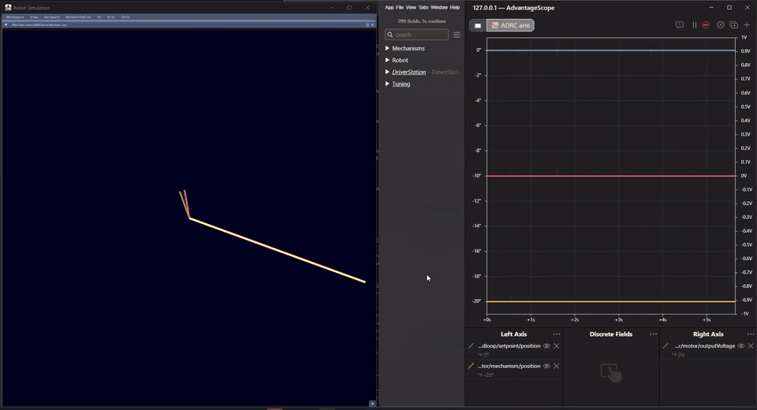
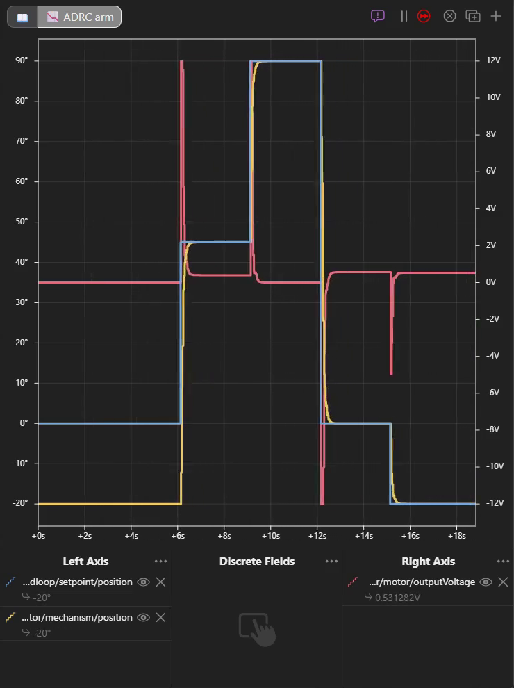
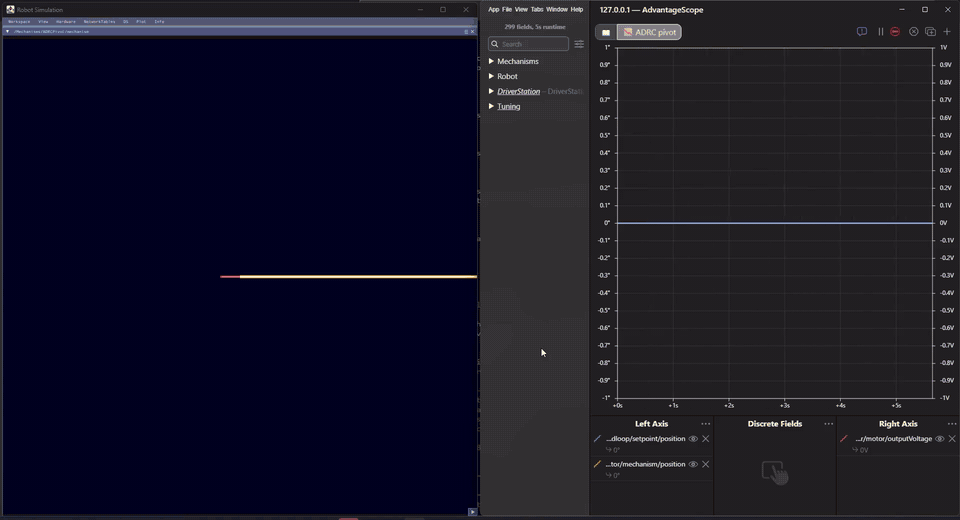
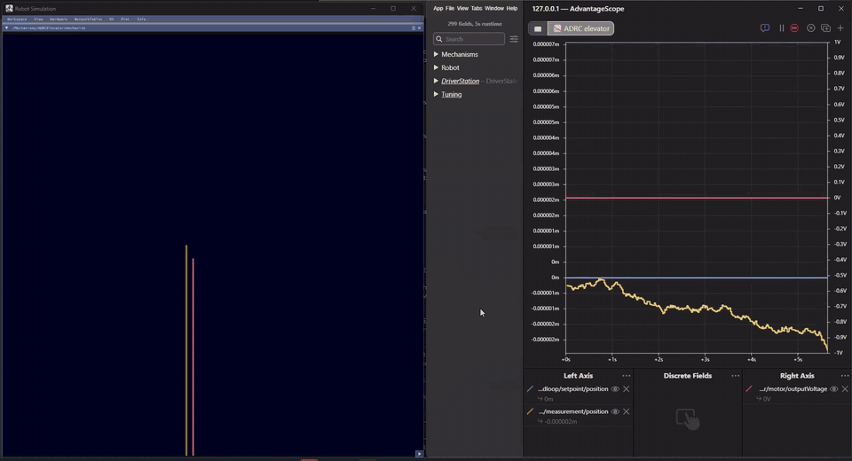
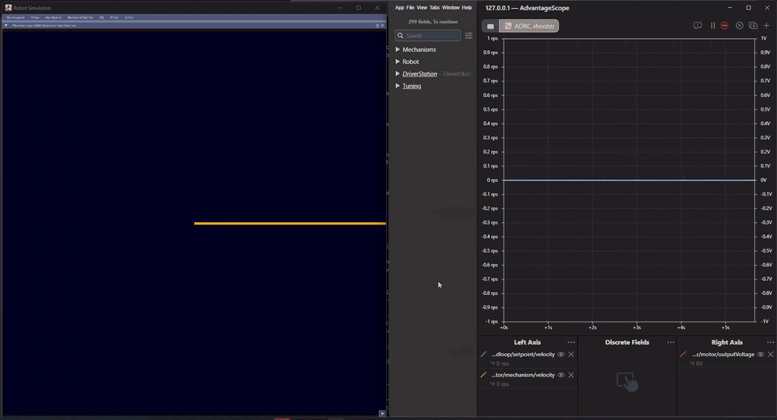

# How do I use ADRC instead of PID?

ADRC (active disturbance rejection control) replaces a PID controller and its feedforward. You tell it what kind of mechanism it drives and how quickly it should reach a setpoint, and it works out the rest: there is no kP, kI, kD, kS, kV or kG to tune. **ADRC in YAMS was written by FRC Team 8331**, who contributed it to YAMS.

This page sets one up and tunes it. [ADRC controllers](../details/editor/adrc-controllers.md) explains how it works.

<figure><figcaption><p>The example ADRC arm in simulation: setpoint in blue, measured angle in yellow, motor voltage in red.</p></figcaption></figure>

## Before you start

* A mechanism already set up with a YAMS motor controller in closed loop mode, as in the [Arm tutorial](../tutorials/arm.md). This page changes its motor controller config.
* Simulation and [AdvantageScope](how-do-i-view-my-datalog-in-advantagescope.md), to see what the ADRC does before you put it on the robot.

## Set it up and tune it



### Replace the gains with an ADRC

On the motor config, swap `withClosedLoopController(kP, kI, kD)` and `withFeedforward(...)` for `withADRCController(...)`. This is the example arm: a NEO on a 60:1 reduction moving a 3 kg, 0.5 m arm.




```java
new SmartMotorControllerConfig(this)
    .withControlMode(ControlMode.CLOSED_LOOP)
    // Takes the place of kP, kI, kD and the feedforward.
    .withADRCController(new ADRCConfig()
        .withSystemOrder(SystemOrder.ARM)   // what kind of mechanism it is
        .withSettlingTime(Seconds.of(0.3))) // how quickly to reach a setpoint
    .withClosedLoopControllerMaximumVoltage(Volts.of(12))
    .withGearing(new MechanismGearing(60))
    // The ADRC works out its model from the motor, the gearing and this inertia.
    .withMomentOfInertia(Meters.of(0.5), Kilograms.of(3))
    .withSoftLimits(Degrees.of(-20), Degrees.of(100))
    .withStartingPosition(Degrees.of(-20))
    .withZeroPower(MotorMode.BRAKE)
    .withStatorCurrentLimit(Amps.of(40))
    .withTelemetry("ArmMotor", TelemetryVerbosity.HIGH);
```





```java
new SmartMotorControllerConfig(this)
    .withControlMode(ControlMode.CLOSED_LOOP)
    // Takes the place of kP, kI, kD and the feedforward.
    .withADRCController(new ADRCConfig()
        .withSystemOrder(SystemOrder.ARM)   // what kind of mechanism it is
        .withSettlingTime(Seconds.of(0.3))) // how quickly to reach a setpoint
    .withClosedLoopControllerMaximumVoltage(Volts.of(12))
    .withGearing(new MechanismGearing(60))
    // The ADRC works out its model from the motor, the gearing and this inertia.
    .withMomentOfInertia(Meters.of(0.5), Kilograms.of(3))
    .withSoftLimits(Degrees.of(-20), Degrees.of(100))
    .withStartingPosition(Degrees.of(-20))
    .withZeroPower(MotorMode.BRAKE)
    .withStatorCurrentLimit(Amps.of(40))
    .withTelemetry("ArmMotor", TelemetryVerbosity.HIGH);
```





```cpp
yams::math::ADRCConfig adrc;
adrc.WithSystemOrder(yams::math::ADRCConfig::SystemOrder::ARM)  // what kind of mechanism it is
    .WithSettlingTime(0.3_s);                                   // how quickly to reach a setpoint

m_motorConfig.WithSubsystem(this)
    .WithClosedLoopMode()
    .WithClosedLoopMaxVoltage(12_V)
    // Takes the place of kP, kI, kD and the feedforward. The motor config keeps its own copy.
    .WithADRCController(adrc)
    .WithMotorGearing(60.0)
    // The ADRC works out its model from the motor, the gearing and this inertia.
    .WithMOI(0.5_m, 3_kg)
    .WithMechanismLimits(-20_deg, 100_deg)
    .WithStartingPosition(-20_deg)
    .WithZeroPower(yams::motorcontrollers::SmartMotorControllerConfig::MotorMode::BRAKE)
    .WithStatorCurrentLimit(40_A)
    .WithTelemetry("ArmMotor", yams::motorcontrollers::SmartMotorControllerConfig::TelemetryVerbosity::HIGH);
```




Nothing else changes: the mechanism's commands, such as the example's `setAngle(...)`, `setHeight(...)` and `spinUp(...)`, work as they do with a PID.

**Check it:** the robot code builds and starts in simulation, with no configuration error.



### Pick the system order

The system order tells the ADRC what kind of mechanism it drives:

| Mechanism | Setpoint | System order |
| --- | --- | --- |
| Shooter, flywheel, roller | Speed | `FLYWHEEL` |
| Arm | Angle | `ARM` |
| Pivot, turret, wrist, hood | Angle | `PIVOT` |
| Elevator | Height | `ELEVATOR` |

For an arm, pivot or elevator, YAMS chooses between two kinds of position control when the robot starts, from the motor, the gearing and the inertia. A heavily geared mechanism and a lightly geared one need different ones, and the wrong one overshoots badly. [ADRC controllers](../details/editor/adrc-controllers.md#two-kinds-of-position-loop) explains why.

An elevator also needs `withLinearClosedLoopController(true)` and its [drum or sprocket size](how-to-find-your-mechanism-circumference.md), so its ADRC works in meters.

**Check it:** in AdvantageScope, `closedloop/adrc/systemOrder` under the motor's `NT:/Mechanisms` entry is 1 or 2.



### Give it the moment of inertia

`withMomentOfInertia(...)` lets YAMS work out the ADRC's model. Use the length and mass form for an arm, a wheel's diameter and mass for a shooter, or a value from CAD. An elevator can do without one.

**Check it:** the robot starts without a "cannot choose the form of its position loop" or "has no b0" error.



### Limit the output

`withClosedLoopControllerMaximumVoltage(...)` caps the voltage the ADRC can ask for, as it does for a PID. `withClosedLoopRampRate(...)` limits how fast the voltage changes; leave it off unless the mechanism needs it, since it slows the response and adds overshoot.

**Check it:** in the graph below, `motor/outputVoltage` never goes past the limit.



### Graph a step

Run the simulation, command a setpoint far from where the mechanism is, then command it back. Graph these keys from the motor's entry:

* `closedloop/setpoint/position` (or `velocity` for a shooter)
* `mechanism/position`, or `measurement/position` for an elevator (`mechanism/velocity` for a shooter)
* `motor/outputVoltage`, on the right axis

<figure><figcaption><p>The example arm graphed in AdvantageScope. Use stepped lines, so a setpoint step draws as a step.</p></figcaption></figure>

**Check it:** the measurement reaches each setpoint in about the settling time and stays there, without overshooting.



### Tune the settling time

The settling time is the main thing to tune. Shorten it while each step gets faster and stays clean, and stop when it no longer helps:

* **The voltage sits at the limit for most of a move.** The mechanism is as fast as it can go.
* **The mechanism overshoots or rings.** Lengthen it again.
* **The voltage chatters.** The ADRC is amplifying sensor noise.

These are the example robots' values, measured in simulation:

| Mechanism | Settling time | Result |
| --- | --- | --- |
| Arm, NEO 60:1 | 0.3 s | No overshoot, settles in 0.34 s (0.60 s at 0.6 s) |
| Elevator, NEO 12:1, 16 lb | 0.3 s | No overshoot. The motor's top speed limits big moves |
| Shooter, NEO direct, 4 in wheel | 0.2 s | 3 RPM overshoot. At 0.15 s, 46 RPM |

Leave a little margin from the fastest clean value: a real mechanism has friction and sensor noise the simulation does not.

**Check it:** each step settles in about the settling time, with no overshoot.



### Tune it live

With `HIGH` telemetry, the [Live Tuning command](../details/live-tuning/) changes `b0`, the settling time and the bandwidth scale while the robot runs, under `NT:/Tuning`. They last until the robot restarts, so copy the values you keep into your code.

**Check it:** typing a new `closedloop/adrc/settlingTime` changes how quickly the next step settles.



## What you should see

The example arm, pivot, elevator and shooter in simulation, each stepping through setpoints.



<figure><figcaption><p>Arm, NEO 60:1, 0.3 s settling time.</p></figcaption></figure>



<figure><figcaption><p>Pivot, NEO 60:1, 0.3 s settling time.</p></figcaption></figure>



<figure><figcaption><p>Elevator, NEO 12:1, 0.3 s settling time. Big moves are limited by the motor's top speed.</p></figcaption></figure>



<figure><figcaption><p>Shooter, NEO direct drive, 0.2 s settling time.</p></figcaption></figure>



## If it did not work

* **"has no system order" at startup.** Add `withSystemOrder(...)` to the `ADRCConfig`.
* **"cannot choose the form of its position loop without a moment of inertia".** Add `withMomentOfInertia(...)` to the motor config, as in [Give it the moment of inertia](#give-it-the-moment-of-inertia).
* **"is an elevator's ADRC, but the closed loop is not linear".** Add `withLinearClosedLoopController(true)` and the mechanism circumference to the motor config.
* **It overshoots or rings whatever the settling time.** Check the moment of inertia: a wrong value can make YAMS choose the wrong kind of position control. If it is right, lower `b0` live: half the derived value often calms it.
* **A step setpoint slams the mechanism.** Add a motion profile to the motor config, or a [tracking differentiator](../details/editor/adrc-controllers.md#smoothing-the-setpoint-the-tracking-differentiator) to the `ADRCConfig`, not both.
* **A shooter crawls up to speed.** Shorten the settling time: the ADRC has to keep up with the motor's back-EMF.

## Code reference

The example robot, with an arm, an elevator and a shooter run by ADRCs, for Commands v2, Commands v3 and C++. Its README has the settings for each.






