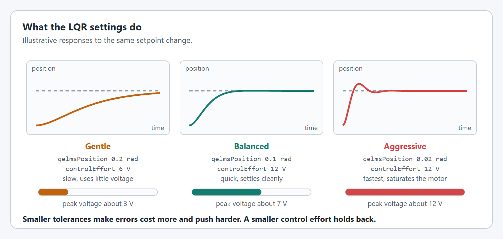
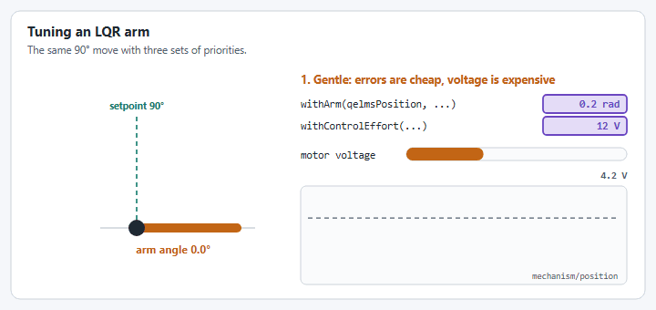

# How do I use LQR instead of PID?

An LQR replaces the PID gains in a motor config: you describe the mechanism and your tolerances, and it works out its own gains. This page sets one up and tunes it. [LQR controllers](../details/editor/lqr-controllers.md) explains how it works, and [LQRConfig](../details/editor/lqr-config.md) lists every option.

## Before you start

* A mechanism already set up with a YAMS motor controller in closed loop mode, as in the [Arm tutorial](../tutorials/arm.md). This page changes its motor controller config.
* The mechanism's model: the motor, the gear ratio, and its moment of inertia (or, for an elevator, the carriage mass and drum radius). LQR is only as good as this model.
* Simulation and [AdvantageScope](how-do-i-view-my-datalog-in-advantagescope.md), to try it before the robot.

## Set it up and tune it



### Describe the mechanism and your tolerances

Make an `LQRConfig` with the mechanism's model, then its type and tolerances. These are the [starting values](../details/editor/lqr-config.md#starting-values); the example robot's values are looser so there is something to tune.




```java
LQRConfig lqrConfig = new LQRConfig(
        DCMotor.getNEO(1),
        new MechanismGearing(60),
        KilogramSquareMeters.of(0.25))     // arm moment of inertia
    .withArm(
        Degrees.of(5),                     // position error you accept
        DegreesPerSecond.of(60),           // velocity error you accept
        Degrees.of(3),                     // how far to trust the model's position
        DegreesPerSecond.of(30),           // and its velocity
        Degrees.of(0.5))                   // how far to trust the encoder
    .withControlEffort(Volts.of(12))
    .withMaxVoltage(Volts.of(12));
LQRController lqr = new LQRController(lqrConfig);
```


In C++, the same values are in radians and radians per second:


```cpp
yams::math::LQRConfig lqrConfig;
lqrConfig.WithArmSystem(wpi::math::DCMotor::NEO(1), 0.25, 60.0)  // motor, kg·m², reduction
    .WithQElems({0.0873, 1.047})        // 5° and 60°/s
    .WithRElems({12.0})
    .WithStateStdDevs({0.0524, 0.524})  // 3° and 30°/s
    .WithMeasurementStdDevs({0.00873})  // 0.5°
    .WithMaxVoltage(12_V);
```





```java
LQRConfig lqrConfig = new LQRConfig(
        DCMotor.getKrakenX60(2),
        new MechanismGearing(GearBox.fromReductionStages(10)),
        KilogramSquareMeters.of(0.01))     // not used by an elevator, but required
    .withElevator(
        Meters.of(0.02),                   // position error you accept
        MetersPerSecond.of(0.5),           // velocity error you accept
        Meters.of(0.005),                  // how far to trust the model's position
        MetersPerSecond.of(0.1),           // and its velocity
        Meters.of(0.001),                  // how far to trust the encoder
        Kilograms.of(5),                   // carriage mass
        Inches.of(1))                      // drum radius
    .withControlEffort(Volts.of(12))
    .withMaxVoltage(Volts.of(12));
LQRController lqr = new LQRController(lqrConfig);
```


In C++, in meters:


```cpp
yams::math::LQRConfig lqrConfig;
lqrConfig.WithElevatorSystem(wpi::math::DCMotor::KrakenX60(2), 5.0, 0.0254, 10.0)  // motors, kg, drum m, reduction
    .WithQElems({0.02, 0.5})
    .WithRElems({12.0})
    .WithStateStdDevs({0.005, 0.1})
    .WithMeasurementStdDevs({0.001})
    .WithMaxVoltage(12_V);
```





```java
LQRConfig lqrConfig = new LQRConfig(
        DCMotor.getNEO(1),
        new MechanismGearing(1),
        KilogramSquareMeters.of(0.000585)) // wheel moment of inertia
    .withFlyWheel(
        RPM.of(100),                       // speed error you accept
        RPM.of(30),                        // how far to trust the model
        RPM.of(1))                         // how far to trust the encoder
    .withControlEffort(Volts.of(12))
    .withMaxVoltage(Volts.of(12));
LQRController lqr = new LQRController(lqrConfig);
```


In C++, in radians per second:


```cpp
yams::math::LQRConfig lqrConfig;
lqrConfig.WithFlywheelSystem(wpi::math::DCMotor::NEO(1), 0.000585, 1.0)  // motor, kg·m², reduction
    .WithQElems({10.47})                 // 100 RPM
    .WithRElems({12.0})
    .WithStateStdDevs({3.14})            // 30 RPM
    .WithMeasurementStdDevs({0.105})     // 1 RPM
    .WithMaxVoltage(12_V);
```




**Check it:** the robot code builds.



### Give it to the motor config, with a feedforward

Replace the PID gains with the `LQRController`. Keep a feedforward: the LQR's model has no gravity, friction or battery sag, so an arm or elevator needs its kG, and a flywheel its kS, as with a PID. [What the model leaves out](../details/editor/lqr-controllers.md#what-the-model-leaves-out-gravity) shows why.


```java
new SmartMotorControllerConfig(this)
    .withControlMode(ControlMode.CLOSED_LOOP)
    .withClosedLoopController(lqr)                      // in place of kP, kI, kD
    .withFeedforward(new ArmFeedforward(0, 0.5, 0, 0))  // kG holds the arm up
    .withGearing(new MechanismGearing(60))
    .withMomentOfInertia(Meters.of(0.5), Kilograms.of(3))
    .withSoftLimits(Degrees.of(-20), Degrees.of(100))
    .withStartingPosition(Degrees.of(-20))
    .withZeroPower(MotorMode.BRAKE)
    .withStatorCurrentLimit(Amps.of(40))
    .withTelemetry("ArmMotor", TelemetryVerbosity.HIGH);
```


The config is the same in a Commands v3 `Mechanism`. In C++, pass the `LQRConfig` itself: `config.WithLQR(lqrConfig)`, with `WithFeedforward(...)` for the kG.

An LQR does not support a closed loop tolerance: `withClosedLoopTolerance` with an `LQRController` throws.

**Check it:** the robot starts in simulation, and the mechanism moves to a setpoint you command.



### Add a motion profile, if you want one

An LQR can follow a [trapezoidal or exponential profile](../details/editor/config/motion-profiles.md), set the usual way. It then tracks the profile's position and velocity instead of jumping straight to the goal. The example arm uses `withTrapezoidalProfile(DegreesPerSecond.of(90), DegreesPerSecondPerSecond.of(180))`.

**Check it:** a big move now starts and stops smoothly.



### Graph a step

Run the simulation, command a setpoint far from where the mechanism is, then command it back. In AdvantageScope, graph `closedloop/setpoint/position` (or `velocity` for a flywheel), `mechanism/position` (or `velocity`), and `motor/outputVoltage` on the right axis.

**Check it:** the mechanism reaches the setpoint and holds it. If it holds short, the kG is too small.



### Tune it live

With `HIGH` telemetry, the LQR's values are tunable under `NT:/Tuning/<Mechanism>/<Motor>/closedloop/lqr/`, in place of kP, kI and kD. Start the [Live Tuning command](../details/live-tuning/), type a value, and the LQR is rebuilt with it on the next loop, starting from its current estimate so the output does not jump. Change one value at a time, in this order:

1. **The feedforward first.** kG, kS, kV and kA are still added to the LQR's output and tuned as in [Tuning order](../details/live-tuning/README.md#tuning-order). With a wrong kG, an arm or elevator ends up short whatever the LQR does.
2. **The response, with the qelms and control effort.**
   * Too slow: lower `qelms/position` (on a flywheel, `qelms/velocity`), or raise `relms` up to 12 V.
   * Overshoots or rings: lower `qelms/velocity` on an arm or elevator, or lower `relms`.
   * `motor/outputVoltage` pinned at the limit: the LQR asks for more than the motor has, so raise the qelms or lower `relms`.
3. **The trust values last, if at all.** If the output is noisy, raise `encoder/position` (on a flywheel, `encoder/velocity`). If the estimate lags the mechanism, raise `model/position` and `model/velocity`.

Every value must be above 0; one the LQR cannot use leaves it as it was, with a warning on the Driver Station. [LQRConfig](../details/editor/lqr-config.md#live-tuning-keys) lists the keys and their units.

<figure><figcaption><p>The two settings you will change most. Illustrative responses.</p></figcaption></figure>

**Check it:** typing a smaller `qelms/position` makes the next move faster.



### Copy the values into your config

Live tuning changes nothing in your code. Write the values down and put them in your `LQRConfig`. In Java the units carry over: `Degrees.of(...)`, `RPM.of(...)`, `Meters.of(...)`, `MetersPerSecond.of(...)` and `Volts.of(...)`. In C++, `WithQElems`, `WithStateStdDevs` and `WithMeasurementStdDevs` take radians, radians per second, meters and meters per second, so convert the degrees and RPM first.

**Check it:** after a restart, the mechanism moves as it did with the tuned values.



## What you should see

<figure><figcaption><p>The same move with three sets of priorities. Illustrative, not a recording.</p></figcaption></figure>

## The complete file

The example arm, for Commands v2. The [`lqr_mechanisms` example](https://github.com/Yet-Another-Software-Suite/YAMS/tree/master/examples/commands2/lqr_mechanisms) also has an LQR flywheel, and a Commands v3 version of both.



## If it did not work

* **It holds short of the setpoint.** The feedforward's kG is too small or missing. Check it first; then lower `qelms/position`, so a small error costs more.
* **It oscillates around the setpoint.** Lower the control effort (`relms`), or lower `qelms/velocity`. Check the mechanism for backlash.
* **It is slow.** Raise the control effort up to 12 V, or lower `qelms/position`. With a motion profile, raise the profile's limits: the LQR follows the profile, so a slow profile gives a slow move.
* **It works in simulation but not on the robot.** The model is wrong: re-measure the mass and moment of inertia, check the gear ratio, and compare the model with the real mechanism's kV and kA, as in [Measuring kV and kA](../details/editor/exponential-profiles.md#measuring-kv-and-ka-optional).
* **"IllegalArgumentException" at startup with `withClosedLoopTolerance`.** An LQR does not support a closed loop tolerance; remove it.
